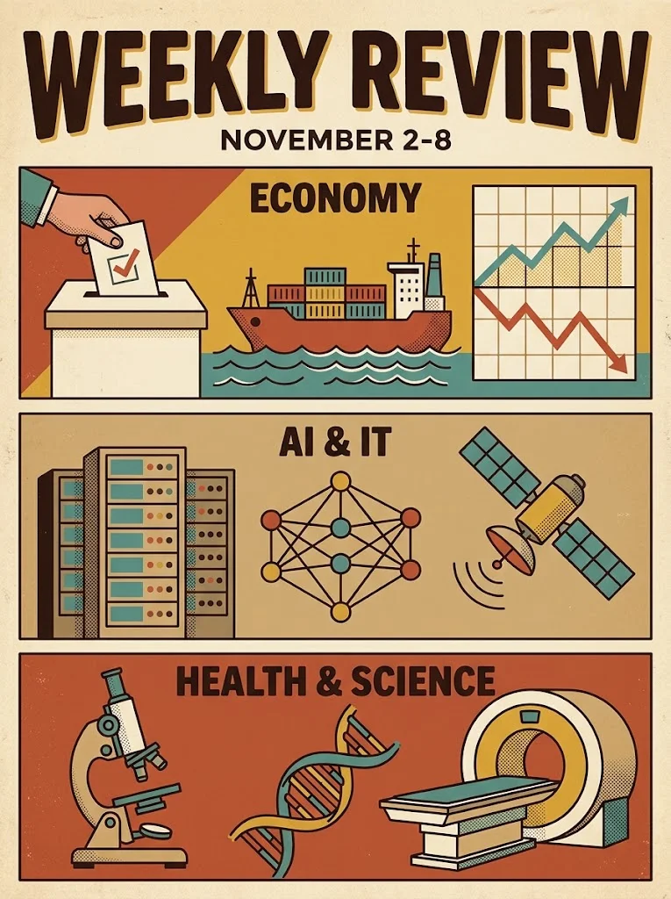

## Iqtisodiyot (Economic)
#### AQSh oraliq saylovlari va moliya bozorlaridagi ehtiyotkorlik

3-noyabr kuni AQShda bo'lib o'tgan oraliq saylovlar dunyo iqtisodiyoti va moliya bozorlarida asosiy e'tibor markazida bo'ldi. Siyosiy maydondagi o'zgarishlar va qabul qilinishi mumkin bo'lgan yangi qonunlar AQSh dollari qiymati hamda xalqaro savdo munosabatlariga o'z ta'sirini ko'rsatishni boshladi.
#### Angliya Bankining muhim qarori
5-noyabr kuni Angliya Banki (Bank of England) o'zining foiz stavkalari bo'yicha uzoq kutilgan qarorini e'lon qildi. Inflyatsiya darajasini nazorat qilish va bozor barqarorligini ta'minlash maqsadida qabul qilingan bu qaror Yevropa moliya bozorlariga, xususan, funt sterling kursiga bevosita ta'sir ko'rsatdi.
#### AQSh va Afrika o'rtasidagi savdo munosabatlarining sovuqlashishi
AQSh hukumati inson huquqlari buzilishi va savdo to'siqlari bilan bog'liq xavotirlar sababli Ruanda va Janubiy Afrikani "Afrikada o'sish va imkoniyatlar to'g'risida"gi qonun (AGOA) doirasidagi bojsiz savdo imtiyozlaridan mahrum qilishini e'lon qildi. Ushbu qaror 2027-yil 1-yanvardan kuchga kiradi va Afrika qit'asidagi yirik eksportyorlar uchun jiddiy iqtisodiy sinov bo'lishi kutilmoqda.

## Sun'iy Intellekt va IT Sektori
#### Kiberxavfsizlikka ixtisoslashgan yangi avlod AI modellari

Sun'iy intellekt sohasida ulkan qadamlar tashlandi, ammo bu safar e'tibor ommaviy foydalanishga emas, to'g'ridan-to'g'ri raqamli xavfsizlikka qaratildi. O'tgan hafta davomida OpenAI o'zining maxsus hujumkor xavfsizlik modeli – GPT-6 Cyber ni ishga tushirganini e'lon qildi. Ushbu model faqatgina ruxsat etilgan xavfsizlik guruhlari uchun mo'ljallangan bo'lib, tizimlardagi zaifliklarni tezkor aniqlashga xizmat qiladi.
Bunga javoban, Google ham kiberxavfsizlik va uzoq muddatli rejalashtirish qobiliyatiga ega bo'lgan o'zining eng kuchli Gemini 4 Carbon modelini ommaga emas, asosan xavfsizlik bo'yicha hamkorlariga taqdim etdi. Bu gigant kompaniyalar endilikda ilg'or modellarni avvalo xavfsizlik tadqiqotlariga yo'naltirayotganidan dalolat beradi.
#### Yevropadagi "Aqlli muzlatkichlar" kiberhujumi
IT xavfsizligi sohasida hafta jiddiy inqiroz bilan yodda qoldi. Yevropaning bir qancha mamlakatlaridagi yirik supermarketlarning aqlli sovutish tizimlari ikkinchi yirik kiberhujum to'lqiniga uchradi. Xakerlar aralashuvi natijasida minglab muzlatkichlar qizib ketdi va katta miqdordagi oziq-ovqat mahsulotlari yaroqsiz holga keldi. Bu hodisa kundalik hayotimizga kirib kelgan Internet of Things (IoT) qurilmalarining xavfsizlik darajasi qanchalik past ekanligini yana bir bor tasdiqladi.

## Sog'liqni Saqlash va Ilm-fan (Health & Science)
#### OIV (HIV) infeksiyasini oldini olishda inqilobiy yechim
Sog'liqni saqlash sohasida haftaning eng quvonchli xabari AQSh Oziq-ovqat va farmatsevtika idorasi (FDA) tomonidan keldi. Idora OIV infeksiyasining oldini olishga qaratilgan lenacapavir preparatining birinchi jenerik (arzonlashtirilgan) versiyasini rasman tasdiqladi. Yiliga atigi ikki marta inyeksiya qilinadigan ushbu preparatning yillik narxi past va o'rta daromadli 120 ta davlat uchun atigi 40 dollar atrofida belgilandi. Bu global miqyosda kasallikning tarqalishini to'xtatish yo'lidagi tarixiy moliyaviy va tibbiy yutuqdir.

#### Taqiladigan texnologiyalar 
(**Wearable Tech**) imkoniyatlarining kengayishi
AQSh Milliy Sog'liqni Saqlash Instituti (NIH) taqiladigan texnologiyalarning inson salomatligidagi o'rni bo'yicha yangi ma'lumotlar bilan o'rtoqlashdi. Unga ko'ra, aqlli soatlar va bilaguzuklar endilikda shunchaki qadam sanaydigan qurilma emas, balki yurak urish tezligi va boshqa biometrik ko'rsatkichlarni tahlil qilish orqali surunkali kasalliklarni barvaqt aniqlash imkonini beruvchi muhim tibbiy profilaktika vositasiga aylanib ulgurgan.
