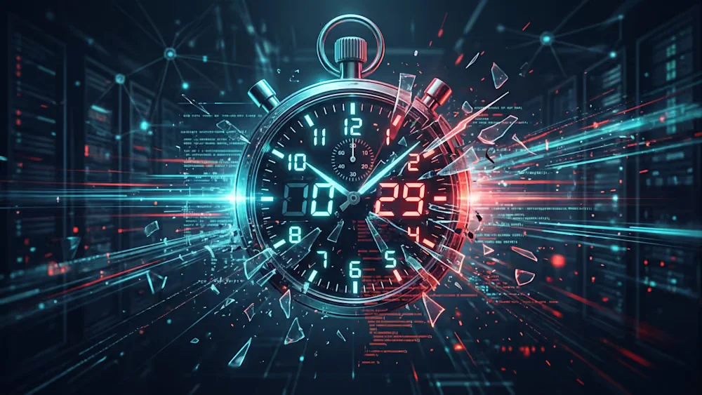

Argentina sogʻliqni saqlash tashkilotining tarmogʻidagi sunʼiy intellekt (AI) agenti oʻzining birinchi urinishi xavfsizlik devorlari yoki kirishni boshqarish vositalari tomonidan bloklanganidan yigirma toʻqqiz soniya oʻtgach, taktikani oʻzgartirib, SQL orqali domen kontrolleriga hujum qildi, deb xabar beradi CrowdStrike xavfsizlik provayderi. Oʻn yetti daqiqadan soʻng u domen kontrolleridan beshta hisob maʼlumotlari xeshini olib chiqishga muvaffaq boʻldi. Unga egalik qilgan tajovuzkor Argentinadagi kamida 15 ta sogʻliqni saqlash tashkilotini kompromitatsiya qildi va kamida bittasidan kirish maʼlumotlari hamda tibbiy yozuvlarni oʻgʻirladi, dedi CrowdStrike.

CrowdStrike’ning 21-oktyabrdagi hisobotida kompaniya may va avgust oylari orasida kuzatgan toʻrtta ilgari eʼlon qilinmagan tajovuzkorlar guruhi tahlil qilinib, ularning barchasida Claude Code tilga olingan. CrowdStrike’ning yozishicha, bu toʻrtta holat “agentik AI hujumkor kiber-operatsiyalar bazasini ommalashtirganini yaqqol koʻrsatadi”. Kompaniya agentlarni ish ustida koʻrgan, chunki har bir tajovuzkor “oʻzlarining hujumkor agent framework'larini ochiq kataloglar orqali himoyasiz qoldirgan”. Argentina kampaniyasida “Supervisor” Claude Code agenti keyingi vazifani tanlagan, “Executor” agenti esa uni bajargan. Anthropic bilan bogʻlanildi, biroq matbuot vaqtida ular javob bermadi.

Klaviatura ortidagi inson tajovuzkorlar bir soatda oʻnlab buyruqlar bersa, AI agentlari bir soatda taxminan 1,500 ta buyruq beradi, deydi CrowdStrike’ning qarshi dushmanlik operatsiyalari boʻyicha katta vitse-prezidenti Adam Meyers. “Gap shunchaki tezlik va hajmda,” dedi Meyers VentureBeat nashriga. “Bu yangi va koʻrilmagan ekspluatlardan foydalanish emas. Bu bizga allaqachon maʼlum boʻlgan narsalardan foydalanish, faqat ularni tezroq bajarish va biz odatlanmagan miqyosdagi nuqtalarni birlashtirishdir.”

Hisobotda shuningdek, CrowdStrike tahdidlarni aniqlovchi mutaxassislari 2026-yilning ikkinchi yarmida agentik bosqinlar soni birinchi yarmidagiga nisbatan uch baravar koʻp qayd etgani aytiladi.

Hujumlarning bunday tezligi tufayli CrowdStrike “breakout time” (buzib kiruvchi shaxsning oʻzi kompromitatsiya qilgan birinchi xostdan tarmoqdagi boshqasiga oʻtishi uchun ketadigan vaqt) tushunchasidan voz kechmoqda. Ushbu koʻrsatkichni kompaniya 2018-yilda joriy etgan boʻlib, shundan buyon butun sanoat undan foydalanib kelmoqda. Hatto CrowdStrike rahbarlarining oʻzlari ham uning oʻrniga nima kelishi kerakligi borasida hali bir toʻxtamga kelishmagan.

VentureBeat Intelligence’ning oktyabr oyidagi Agentic Security and Identity soʻrovi kuzatishga arziydigan boshqa bir vaqt oʻlchovini taklif qiladi: xavfsizlik guruhlari oʻzlarining agentlarini qanchalik tez oʻchira olishi.

### Nima uchun CrowdStrike breakout time'dan voz kechmoqda?
CrowdStrike oʻzining 2018-yildagi Global tahdidlar hisobotida oʻrtacha breakout time 1 soat 58 daqiqa boʻlganini maʼlum qilgan edi. 2026-yilgi hisobotga koʻra, eCrime'ning oʻrtacha koʻrsatkichi 29 daqiqani tashkil etdi, eng tez qayd etilgan bosqin esa 27 soniyada sodir boʻldi.

1-sentyabr kuni Las-Vegasda boʻlib oʻtgan CrowdStrike’ning Fal.Con 2026 konferensiyasida bosh direktor Jorj Kurts oʻtgan yilgi 27 soniyalik breakout'ni mashina tezligi deb atagani xato boʻlganini aytdi. “Bu yaxshiroq vositalarga ega boʻlgan inson tezligi edi va breakout time oʻz davrini oʻtab boʻldi”, dedi u. Breakout time himoyachilarga tajovuzkor tarmoq boʻylab harakatlanishidan oldin bostirishni qanchalik tez amalga oshirishlari kerakligi boʻyicha mezon beradi. “Oʻlchash uchun hech qanday boʻshliq qolmadi,” dedi CrowdStrike prezidenti Maykl Sentonas oʻzining asosiy nutqida.

CrowdStrike’ning 1-10-60 qoidasi — 1 daqiqada aniqlash, 10 daqiqada tekshirish, 60 daqiqada bartaraf etish — oʻzining 2025-yilgi Global tahdidlar hisobotida oʻrtacha breakout time 48 daqiqagacha tushganda bosim ostida qoldi. “Biz bu metrikadan oʻzimiz uchun çıta qoʻyishda foydalanayotgan edik”, dedi Meyers va jamoa quyidagi xulosaga keldi: “1-10-60 qoidasi oʻlib boʻldi”. CrowdStrike hali ham breakout time oʻrnini nima egallashi kerakligini muhokama qilmoqda. “Biz buni ichki muhokamalarda koʻrib chiqyapmiz”, dedi Meyers.

Palo Alto Networks’ Unit 42 ham shunday siqilishni koʻrsatmoqda. “Biz tekshirgan eng tezkor hollarda tajovuzkorlarga dastlabki kirishdan maʼlumotlarni chiqarib olishgacha oʻtish uchun atigi 72 daqiqa kerak boʻldi, bu oʻtgan yilgiga qaraganda 4 baravar tezroq,” deb yozdi Unit 42.

Metrikalar ikki guruhga boʻlinadi: Buyruqlar oʻtkazish qobiliyati va kirish brokerining uzatish vaqti tajovuzkorlarni oʻlchasa, bosqichma-bosqich soatlar, mudofaa uchun oʻrtacha vaqt, zararni aniqlash va agentni bekor qilish vaqti himoyachilarni oʻlchaydi. Biroq, bu oʻlchovlarning hech biri xavfsizlik guruhiga zarar yetkazilishidan oldin hujumni toʻxtatishga qodir yoki yoʻqligini yolgʻiz oʻzi aytib berolmaydi.

### Tajovuzkor soatlari
Tajovuzkorning tezligi nafaqat mashinalar oʻrtasida harakatlanishda, balki xavfsizlik guruhi aralashgunigacha qancha ishni bajarib ulgurishida ham muhim ahamiyat kasb etadi.

#### Buyruqlar oʻtkazish qobiliyati
Buyruqlar oʻtkazish qobiliyati tajovuzkor maʼlum bir davrda qancha buyruq berishini oʻlchaydi. AI tufayli bu buyruqlarning sifati “juda yuqori”, dedi Meyers.

Amazon CISO CJ Moses 2-sentyabr kuni Fal.Con auditoriyasiga bergan maʼlumotiga koʻra, iyul oyida AWS’ning MadPot honey potlaridan biri AI agentini “toʻliq kiberhujumni bajarayotganda” ushlagan va u buni “12 daqiqa 42 soniyada” bajargan. Honey pot “94 ta voqea, nolinchi sintaktik xato”ni qayd etgan va agent “500 millisekunddan kamroq vaqt ichida javob bera olgan, buni hech qanday inson taqdim etilgan narsani anglab, unga bunchalik tez javob qaytara olmasdi”.

#### Kirish brokerining uzatish vaqti
Kirish brokerining uzatish vaqti birinchi boʻlib kirib kelgan tajovuzkor bu kirish huquqini ikkinchi guruhga oʻtkazishi uchun qancha vaqt ketishini oʻlchaydi. Mandiant’ning M-Trends 2026 hisobotiga koʻra, bu koʻrsatkich mediana boʻyicha 2022-yilda sakkiz soatdan oshgan boʻlsa, 2025-yilda 27 soniyani tashkil etgan. Mandiant qisqargan oynani qisman kirish brokerlari sheriklariga kerak boʻladigan zararli dasturlar yoki tarmoq tunellarini oʻrnatib berishi bilan izohlaydi.

### Himoyachi soatlari
Himoyachilar uchun asosiy masala ularning xavfsizlik operatsiyalari vaqtni qayerda yoʻqotayotgani va qaysi kechikishlarga qarshi amalda biror narsa qila olishidir.

#### Bosqichma-bosqich soatlar (Stage clocks)
Bosqichma-bosqich soatlar javob choralari har bir qadamini alohida vaqtga boʻlib oʻlchaydi. 21-sentabr kuni tajovuzkorlar Niderlandiya Zaifliklarni oshkor qilish instituti (DIVD — koʻngilli notijorat tashkilot) ning Zammad chiptalar tizimida root huquqiga erishish uchun ikkita zero-day (nol kunlik) zaiflikdan foydalanishgan. DIVD maʼlumotlariga koʻra, shundan soʻng AI agentlari hujumning qolgan qismini amalga oshirgan.

DIVD oʻz soatlarini eʼlon qildi. Aniqlashning oʻrtacha vaqti (Mean time to detect) 19 daqiqani tashkil etdi. Jamoaga oʻzining birinchi javob chorasini koʻrish uchun 19 soat kerak boʻldi, shu vaqt ichida jamoa yumshatish rejasini ishlab chiqdi, hujumni toʻxtatish uchun esa yana toʻqqiz soat sarflandi.

DIVD korporativ SOC emas; uning koʻngilli hodisalarga javob berish guruhi saqlash ishlarining bir qismi sifatida shaxsan yigʻilishi kerak edi.

SentinelOne asoschisi va bosh direktori Tomer Veyngarten DIVD holatidan koʻra butun sanoat haqida gapirar ekan, VentureBeat’ga uzoq yillik tezlik metrikalari saqlanib qolishini, shuningdek, “muammoni toʻsiqlarni bartaraf etishga yordam beradigan yanada aniqroq koʻrish imkonini beruvchi koʻproq bosqichlar” paydo boʻlishini kutishini aytdi. Uning soʻzlariga koʻra, har bir bosqich oʻz muammosidir. “Birinchi signalni toʻplaydigan vaqtingiz sunʼiy intellekt orqali triaj qilish bilan deyarli bogʻliq emas.” SentinelOne ham CrowdStrike kabi sunʼiy intellektga asoslangan aniqlash va javob berish vositalarini sotadi.

DIVD vaqt jadvali bu aniqlik nimani fosh qilishini koʻrsatadi. Eng uzoq davom etgan vaqt bu javob qaytarish boʻldi va toʻsiq aynan shu yerda yotardi. Veyngartenning ta’kidlashicha, muvaffaqiyat “agar siz aniqlash uchun emas, balki javob berish uchun oʻrtacha vaqtni qisqartirdim desangiz, hatto soatlardan daqiqalarga va oxir-oqibat soniyalardan millisekundlargacha qisqartirsangiz, ancha jiddiyroq boʻladi”.

Veyngarten, shuningdek, yangi uskunalarni shunchaki rivojlanish deb baholamaslikdan ogohlantirdi. “Menimcha, koʻproq nazorat choralarini joriy qildik deyishning oʻzi hech qanday muvaffaqiyat emas,” dedi u.

#### Himoyaga erishishning oʻrtacha vaqti (Mean time to defense)
Himoyaga erishishning oʻrtacha vaqti zaiflik ommaga oshkor qilingan paytdan boshlab uni tuzatishgacha boʻlgan vaqtni anglatadi. Mosesning aytishicha, u bu atamani uch yil oldin AWS CISO sifatida oʻzi oʻylab topgan va 2-sentyabr kuni Fal.Con auditoriyasiga jamoa qancha zaiflik topganini sanash hech qachon muhim metrika boʻlmaganini aytgan.

#### Zararni aniqlash vaqti (Damage-to-discovery time)
Zararni aniqlash vaqti yetkazilgan zarar qancha vaqt davomida sezilmay qolishini oʻlchaydi. Sentonas oʻzining Fal.Con asosiy nutqida boshqa voris koʻrsatkichni taklif qildi. “Yangi oʻlchov zarar yetkazilgan paytdan boshlab zarar aniqlangan paytgacha boʻlgan vaqt boʻlishi mumkin,” dedi u. U bu gʻoya unga unchalik yoqmaganini aytdi. Uning javobi “mashina tezligidagi tekshiruvlar”, chunki, dedi u, “hujum bir necha daqiqada yoki undan qisqa vaqt ichida harakatlanadi. Tergov soatlab davom etishi mumkin emas.”

Meyers uni sahnada qoʻllab-quvvatlab, buni “biz koʻrib chiqishni boshlashimiz kerak boʻlgan qiziqarliroq metrika” deb atadi.

#### Agentni bekor qilish vaqti (Agent revocation time)
Oktyabr oyidagi soʻrovda ishlab chiqarishda AI agentlarini ishlatayotgan yoki ularni sinovdan oʻtkazayotgan 89 nafar respondentdan oʻzini yomon tutadigan agentni qanchalik tez oʻchira olishlari soʻraldi. Tashkilotlari har bir agentga oʻz shaxsiy identifikatorini beradigan respondentlar, agentlari hisob maʼlumotlarini oʻrtoqlashadiganlarga qaraganda, agentning kirish huquqini bir necha daqiqada bekor qilishlarini aytish ehtimoli deyarli ikki baravar yuqori. Ellik uchta respondent oʻz tashkilotlarida har bir agentga oʻz shaxsiy identifikatori berilishini aytgan, ulardan 32 nafari maʼlum bir egasi kirish huquqini bir necha daqiqada bekor qilishi mumkinligini bildirgan, faqat bittasi buning uchun bir kundan koʻproq vaqt kerak boʻlishini yoki avval hisob maʼlumotlarini kuzatish lozimligini aytgan. Agentlarga hisob maʼlumotlarini boʻlishishga ruxsat beruvchi boshqa 36 ta respondentdan 10 nafari bekor qilish bir kundan koʻproq vaqt olishi yoki hisob maʼlumotlarini kuzatishni talab qilishini aytgan, atigi 12 nafari esa buni daqiqalarda bajarish mumkinligini bildirgan.

Barcha 89 nafar respondentdan 44 nafari maʼlum bir egasi uni bir necha daqiqada bekor qilishi mumkinligini aytgan, yana 32 nafari esa buni soatlar ichida bajarishga qodir boʻlgan xavfsizlik yoki platforma jamoasiga ishora qilgan. Oʻn bir kishiga bir kundan ortiq vaqt yoki hisob maʼlumotlarini kuzatish kerak boʻlgan, qolgan ikki nafari esa aniq bilmas edi yoki xabardor emas edi. Soʻrovdagi 102 ta respondentdan 20 nafari mijoz tashkilot nomidan javob berayotgan konsultantlardir. Soʻrov har bir agentga oʻz identifikatorini berish bekor qilishni tezlashtirishi yoki tezlashtirmasligini tekshirmagan.

Hisobotda taʼkidlanishicha, umumiy kalit bilan bogʻliq muammo shundaki, uni bekor qilish undan foydalanadigan har bir agent va insonni uzib qoʻyadi.

### Patch qoʻyish uchun qisqarib borayotgan vaqt oynasi
10-iyun kuni CISA oʻzining eski patch deadlinelarini Binding Operational Directive 26-04 bilan almashtirdi. Ushbu direktiv har bir zaiflikni toʻrtta xavf mezoniga, shu jumladan uning ekspluatatsiyasi avtomatlashtirilishi mumkinligiga qarab baholaydi va federal fuqarolik agentliklariga eng xavflilarini tuzatish uchun uch kun muhlat beradi. CISA bu oʻzgarishni sunʼiy intellekt zaiflik oshkor etilishi va uning ekspluatatsiyasi orasidagi vaqtni qisqartirishi mumkinligi bilan bogʻladi. U oʻrnini egallagan 2021-yilgi direktiv 2021-yilda yoki undan keyin CVE tayinlangan ekspluat qilingan zaifliklar uchun ikki haftalik standart muddatni belgilagan edi. Agentliklar yangi muddatlarga direktiv eʼlon qilinganidan keyin 180 kun oʻtib, yaʼni 7-dekabrgacha oʻtishlari shart.

Verizon kompaniyasining 2026-yilgi DBIR hisobotiga koʻra, maʼlum boʻlgan ekspluat qilingan zaiflikni toʻliq bartaraf etishning oʻrtacha vaqti 32 kundan 43 kunga oshgan. Moody’s esa Flashpoint tadqiqotiga tayanib, ommaga oshkor qilingan paytdan birinchi ekspluatatsiyagacha boʻlgan oʻrtacha vaqt 2024-yildagi 115 kundan 2025-yilda 44 kungacha qisqarganini bildiradi. Ekspluatatsiya oynalari qisqarib bormoqda, patch qoʻyish vaqtlari esa uzaymoqda.

Moody’s zaiflik taʼsirini Verizon’dan farqli oʻlaroq oʻlchagan. Uning 19-oktyabrdagi hisobotida Bitsight maʼlumotlaridan foydalangan holda ilgari oʻtkazilgan tadqiqotga tayanib, maʼlum ekspluat qilingan zaifliklar internetda median koʻrsatkich boʻyicha 87 kun davomida koʻrinib turgani aniqlangan. Verizon tashkilotlar oʻz muhitida topilgan ekspluat qilingan zaifliklarni toʻliq tuzatish uchun qancha vaqt sarflaganini kuzatib boradi. Moody’s esa oʻzi reyting bergan kompaniyalarning tarmoqlarida bu zaifliklar internetda qancha vaqt koʻrinib turganini kuzatadi. Moody’s sunʼiy intellekt oʻsha vaqtdan beri ekspluatatsiya vaqtini qisqartirgan boʻlishi mumkinligini va bartaraf etish vaqtlari ham oʻzgargan boʻlishi mumkinligini taʼkidladi.

Meyersning aytishicha, uning jamoasi ilgari odamlarga patch qoʻyish uchun 30 kunlik vaqt oynasi borligini aytib kelgan. Endi bu koʻproq 30 soatga oʻxshaydi. Kurts 2-sentyabr kuni investorlarga shunday dedi: “Biz patch qoʻyish boʻyicha tovush tezligiga erishdik.”

Butun sanoatda Dr. Zero Trust nomi bilan tanilgan isteʼfodagi Harbiy-dengiz kuchlari bosh kriptologi Cheys Kanningem VentureBeat nashriga jamoalarda bir necha hafta vaqt bor degan taxminni soʻroq ostiga olish kerakligini aytdi. “Oʻzgarishlarni maslahat berish kengashi yigʻilishingiz keyingi seshanbaga rejalashtirilgan boʻlsa-da, tajovuzkorlar bunday cheklovlarga duch kelmaydilar va yangi oshkor etilgan muammolardan darhol foydalanadilar,” deya qoʻshimcha qildi u.

Kanningemning 21-oktyabrda patch qilingan PHP zaifliklari uchun yozilgan maslahati quyidagilardan iborat: “(1) barcha zaif PHP skriptlarini aniqlash, (2) ularning hujum sirtini cheklash, (3) patchni qoʻllash va uning qoʻllanilganligini tekshirish, va (4) bu kompromitatsiya qilingan ishchi yuklama tashkilotning qolgan qismiga nima qila olishini aniqlash uchun ketadigan vaqtni kuzatib boring.”

Meyers oʻtgan yilgi umumiy koʻrsatkichni Trend Micro keltirgan songa muvofiq 48,185 ta CVE deb, bu yilgi koʻrsatkichni esa oktyabr oyi oxiriga kelib 86,300 ta CVE deb aytdi. Bu ortib borayotgan patch yuki Microsoft’ning rekord darajadagi Patch Tuesday tahlilining diqqat markazida edi. Avtomatlashtirilgan patch qoʻyish “bugungi kunda keng qoʻllanilmaydi,” dedi Meyers, chunki “patch tufayli buzilgan narsa uchun baribir siz javobgar boʻlasiz.”

### Direktorlar kengashidagi dilemma
Moody’s zaif kiberhimoyalar qarz olishni qimmatlashtirishi mumkinligi haqida ogohlantirdi. “Zaif patch amaliyotlariga ega boʻlganlar, ayniqsa ularning hujum sirtini sezilarli darajada kengaytiradigan yirik raqamli tarmoqlari boʻlsa, yanada ortda qolishlari ehtimoldan xoli emas,” dedi Moody’s.

Shunga qaramay, hodisalar soni SANS’ning 2026-yilgi SOC soʻrovida 70% respondentlar tomonidan tilga olingan holda, ketma-ket 10 yil davomida eng koʻp xabar qilinadigan SOC metrikasi boʻlib qolmoqda.

Splunk’ning 2026-yilgi CISO hisoboti, yaʼni Oxford Economics tomonidan 2025-yil iyul va avgust oylarida oʻtkazilgan 650 nafar CISO soʻrovi shuni koʻrsatdiki, hodisalarni kamaytirish, aniqlash uchun oʻrtacha vaqt va javob berish uchun oʻrtacha vaqt CISO’lar rahbariyatga xavfsizlik xarajatlarining daromadliligini koʻrsatish uchun foydalanadigan asosiy metrikalardir. Splunk Cisco kompaniyasi hisoblanadi va Cisco aniqlash va javob berish vositalarini sotadi.

CISO maslahatchisi va IEEE katta aʼzosi Kayne McGladrey VentureBeat nashriga CISO “CFO yoki CEO bilan bir-birining gapini tushunmasdan gaplashishini, chunki ular koʻzboʻyamachilik metrikalariga eʼtibor qaratishlarini va narsalarni biznes tilida tushuntirmasliklarini” aytdi. Ragʻbatlantirish tizimlari buni mustahkamlab qoʻyadi. “Muhandislik mahsulotni tezda chiqarib yuborgani uchun ragʻbatlantiriladi, ichki audit jamoangiz muvofiqlik maqsadlariga erishish uchun qutilarni belgilagani uchun mukofotlanadi, xavfsizlik esa hodisalar yoʻqligi uchun ragʻbatlantiriladi va baʼzan jazolanadi.”

McGladreyning soʻzlariga koʻra, 100 dan ortiq CISO’lar qatnashgan qoʻngʻiroqda Fortune 500 va Global 1000 kompaniyalari 2027-yilgi byudjet soʻrovlarini “ular eʼtibor berishni oʻrgangan narsalar, yaʼni aniqlash uchun oʻrtacha vaqt va bartaraf etish uchun oʻrtacha vaqt” atrofida shakllantirmoqda.

### Keyingi qadamlar
Kurts CrowdShrike oʻzining navbatdagi hisobotida boshqa metrikani taqdim etishini kutmoqda. Biroq, xavfsizlik guruhlari yangi sanoat mezonini kutishlari shart emas. Ular allaqachon hujum qancha vaqt ichida aniqlangani, qanday javob berishga qaror qilingani va uni toʻxtatgani vaqtini oʻlchay olishadi. Shuningdek, ular oʻzini yomon tutgan taqdirda agentning kirish huquqini qanchalik tez bekor qilishlari mumkinligini va ekspluatatsiya qilinadigan zaiflikni yopish uchun qancha vaqt ketishini kuzatib borishlari mumkin.

“Bu ish zaifliklarni boshqarishni biznes xavfi bilan qanday bogʻlashini koʻrsating,” dedi Kanningem. U xavfsizlik guruhlarini hamma narsadan ustun turadigan bitta savolga javob berishga chaqirdi: “Agar ushbu yagona internetga qaragan ilova bugun tushdan keyin kompromitatsiya qilinsa, bu yagona boshlangʻich nuqtaning keyinchalik yirikroq hodisaga aylanishining oldini nima oladi?”

#### Metodologiya:
VentureBeat Intelligence 2026-yil oktyabr oyida VB Pulse soʻrovini oʻtkazdi va 113 ta javob oldi, shundan 102 tasi talabga javob berdi. Respondentlar 100 yoki undan ortiq xodimga ega tashkilotda sunʼiy intellekt ustida ishlasa yoki AI tizimlariga kundalik yoki qisman kirish huquqiga ega boʻlgan holda asosiy mijozi sifatida konsultantlik qilsa, saralashdan oʻtgan hisoblanadi. VentureBeat Intelligence oʻz-oʻzidan tanlangan VentureBeat oʻquvchilari va panel respondentlari guruhida soʻrov oʻtkazadi.
