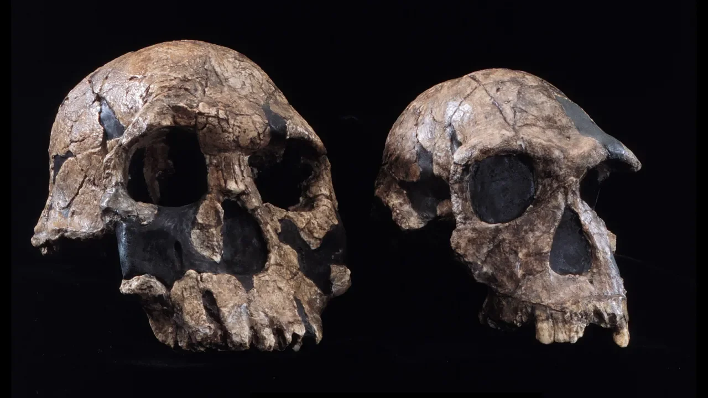

Zamonaviy odamlar taxminan 300 000 yil oldin paydo bo‘lgan bo‘lsa-da, bizning *Homo* urug‘imiz ancha qadimiy. Xo‘sh, fanga ma’lum bo‘lgan eng qadimgi odam turi qaysi?

*Homo rudolfensis* (chapda) va *Homo habilis* (o‘ngda) bosh suyaklari — har ikkisi *Homo* urug‘ining ilk turlariga kiradi. (Rasm: The Natural History Museum / Alamy)

Bugungi kunda yashayotgan barcha odamlar zamonaviy inson — *Homo[ sapiens](https://www.livescience.com/homo-sapiens.html)* (lotincha “aqlli odam”) turiga mansub. Biroq biz yer yuzida yashagan yagona odamlar emasmiz. Topilayotgan qazilmalar *Homo* urug‘iga kiruvchi ilk odamlar haqida tobora ko‘proq ma’lumot bermoqda. Ularning orasida 1,9 million va 110 000 yillar avval Afrika, Osiyo hamda Yevropaning ayrim qismlarida yashagan ajdodimiz — *Homo erectus* (lotincha “tik yuruvchi odam”) ham bor.

Olimlar hozirda *Homo* urug‘iga oid o‘ndan ortiq turni tan olishadi. Xo‘sh, aslida birinchi odam turi qaysi bo‘lgan? Bu savolning javobi unchalik ham aniq emas.

Marokashda topilgan qazilmalar anatomik jihatdan zamonaviy odamlar kamida [300 000 yil oldin](https://www.livescience.com/archaeology/when-did-homo-sapiens-first-appear) paydo bo‘lganini ko‘rsatdi. Ammo olimlar aniq biladigan eng qadimgi odam turi *Homo habilis*, ya’ni “mohir odam” deb ataladi. Ushbu mehnat qurollaridan foydalangan, tik yurgan primat 2,4 million va 1,4 million yillar avval Afrikada yashagan.

Biroq, undan ham qadimiyroq topilmalar *H. habilis*dan oldin yashagan boshqa *Homo* turlari ham bo‘lishi mumkinligiga ishora qilmoqda. Ilk odam qazilmalarining kamyobligi sababli, topilgan g‘ayrioddiy namunalar haqiqatan ham yangi turmi yoki fanga ma’lum turning o‘ziga xos bo‘lmagan vakilimi — buni aniqlash juda qiyin. Buning ustiga, evolyutsiya asta-sekin kechadigan jarayon bo‘lgani uchun, qachon yangi tur paydo bo‘lganini aniq aytish mushkul, ayniqsa, topilmalarda turli turlarga xos belgilar qorishib ketgan bo‘lsa.

> Evolyutsiya jarayoni uzluksiz, ammo o‘zimizga qulay bo‘lishi uchun unga beradigan nomlarimiz harakatsiz, o‘zgarmasdir, — deydi Kaliforniya universitetining (Berkli) paleoantropologi Tim D. Uayt (Tim D. White) Live Science nashriga.

## Eng qadimgi *Homo*

Aksariyat evolyutsion nazariyalarga ko‘ra, *H. habilis* avvalroq yashagan *Australopithecus* nomli primatlar urug‘idan kelib chiqqan. (Bu nom lotincha “janubiy maymun” degan ma’noni anglatadi, chunki uning suyaklari birinchi bo‘lib Janubiy Afrikada topilgan).

Avstralopitekning (*Australopithecus*) turli turlari taxminan 4,4 million yildan 1,4 million yilgacha bo‘lgan oraliqda yashagan. Balki *H. habilis* to‘g‘ridan-to‘g‘ri *Australopithecus afarensis* turidan rivojlangan bo‘lishi ham mumkin. Bu turning eng mashhur vakili 1974-yilda Efiopiyaning Hadar hududidan topilgan “Lyusi” (*Lucy*) hisoblanadi.

Bizning urug‘imizga oid qazilmalar odatda avstralopiteklardan *Homo*ning aniq sezilib turadigan kichik tishlari va nisbatan yirikroq miyasi bilan farq qiladi; aynan mana shu xususiyatlar ko‘proq tosh qurollardan foydalanishga olib kelgan.

Lekin Uaytning ta’kidlashicha, kichik tishlar va yirik miya kabi belgilar dastlabki *Homo*lar kelib chiqqan avstralopiteklar populyatsiyalarida vaqti-vaqti bilan paydo bo‘lgan bo‘lishi kerak.

“Agar avstralopitek urg‘ochisiga qaraydigan bo‘lsak, qaysidir bir aniq tug‘ruq vaqtida u o‘z bolasini ‘Homo’ deb e’lon qilmagan-ku”, — deydi u.

Natijada, *Homo* aynan qaysi vaqtda paydo bo‘lganini ko‘rsatuvchi qat’iy bir sana yo‘q; buning o‘rniga *Homo* urug‘i taxminan 2–3 million yil avvalgi davrda asta-sekin shakllangan, deydi Uayt.

## Afrikadagi evolyutsiya

1970-yillardan boshlab tadqiqotchilar Afrikada boshqa bir qadimiy tur — *Homo rudolfensis*ga tegishli deb hisoblangan qazilmalarni topishdi. Bu esa *H. habilis* eng qadimgi *Homo* bo‘lgan, degan g‘oyani shubha ostiga qo‘yadi.

*H. rudolfensis* *H. habilis*ga qaraganda jismonan ancha yirik bo‘lgan, kattaroq miyaga va tekisroq yuz tuzilishiga ega bo‘lgan ko‘rinadi. Balki shu sababdan u zamonaviy odamga ko‘proq o‘xshagandir.

Uning qazilmalari ham yosh jihatidan *H. habilis* bilan deyarli teng — taxminan 2,4 million yillik. Ammo Smitson milliy tabiiy tarix muzeyiga ko‘ra, “ushbu *Homo rudolfensis*ning faqatgina bitta chindan ham yaxshi saqlangan qazilmasi mavjud”, shuning uchun olimlar *H. rudolfensis* o‘zgacha bir *H. habilis*mi yoki shunchaki odatdagidan kattaroq miyaga ega avstralopitekmi — buni aniq bilishmaydi.

Smitson institutining Insonning kelib chiqishi (Human Origins) dasturi rahbari, paleoantropolog Rik Potts (Rick Potts) Live Science nashriga bergan intervyusida Afrikadan topilgan undan ham qadimiyroq suyaklar *Homo* urug‘iga mansubdek ko‘rinishini va ular har ikki turdan ham oldinroq yashagan bo‘lishi mumkinligini ta’kidladi.

Ushbu qazilmalarning eng qadimgisi taxminan 2,8 million yil oldingi davrga tegishli, ammo ular shunchaki parchalar — bir nechta jag‘ suyaklari va tishlardan iborat xolos. Shunday ekan, bu qoldiqlarning hali fanga noma’lum, boshqa bir *Homo* turiga tegishli yoki tegishli emasligini aniqlash uchun ular yetarli emas, deydi u. 2025-yilda o‘tkazilgan tadqiqotda 2,59 va 2,78 million yil avvalga oid yana qo‘shimcha tishlar ham topilgan bo‘lib, ular ham aynan shu sirli ilk *Homo* turiga tegishli bo‘lishi mumkin.

Demak, ehtimol, birinchi odam turi hali topilmagan bo‘lishi ham mumkin. “*Homo* urug‘ining kelib chiqishi haqida ko‘proq ma’lumotlarni kashf etishga harakat qilar ekanmiz, bu borada hayajonlanarli kashfiyotlar juda ko‘p, ammo noaniqliklar ham talaygina”, — deydi Potts.
