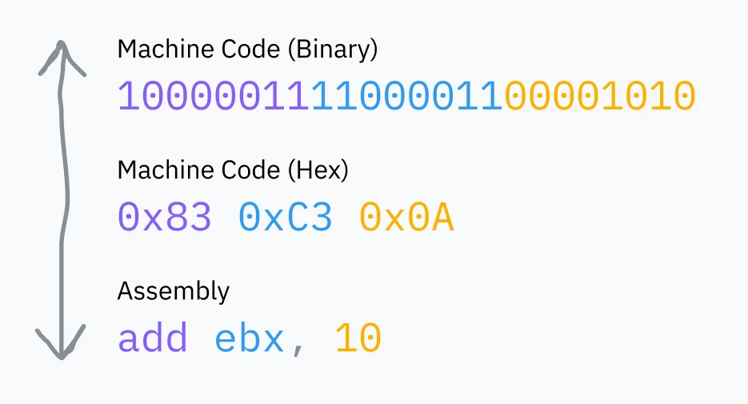
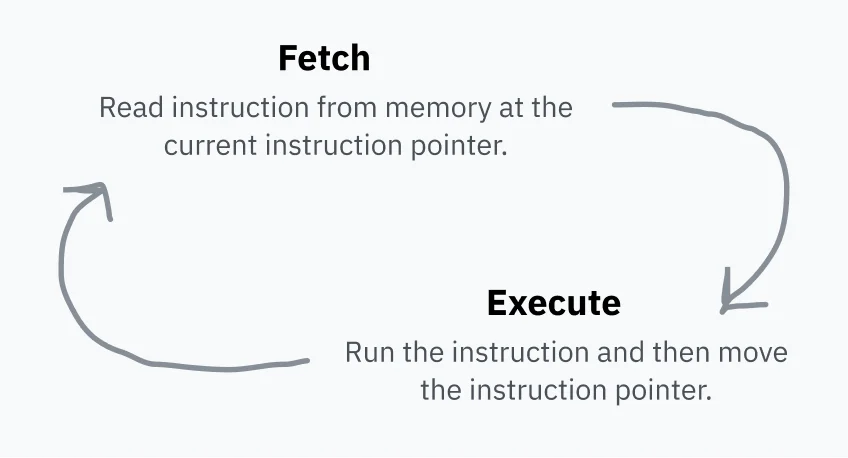
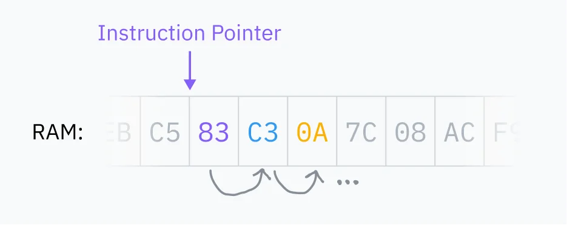
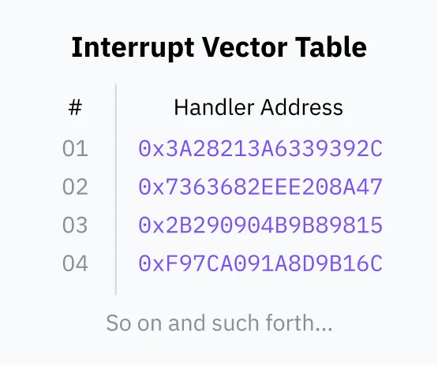
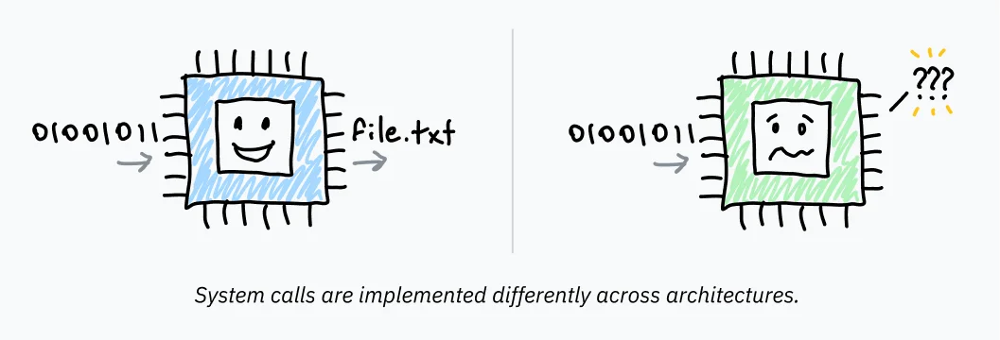
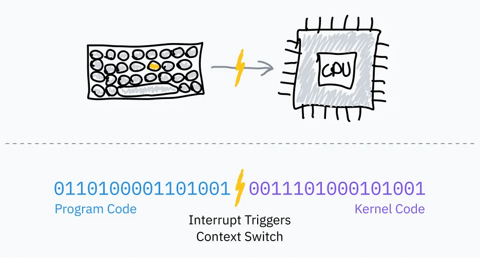
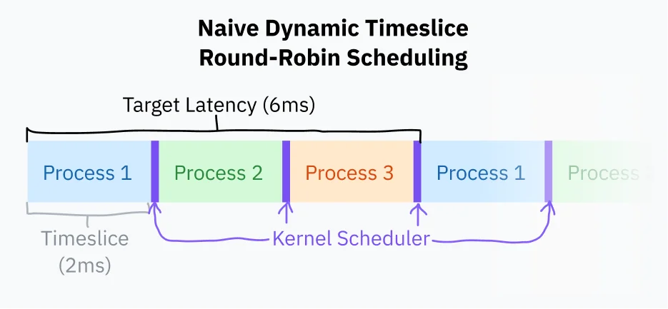
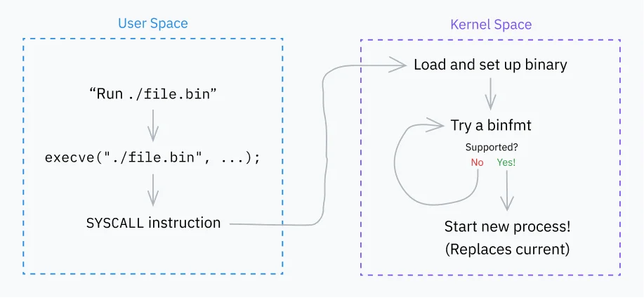
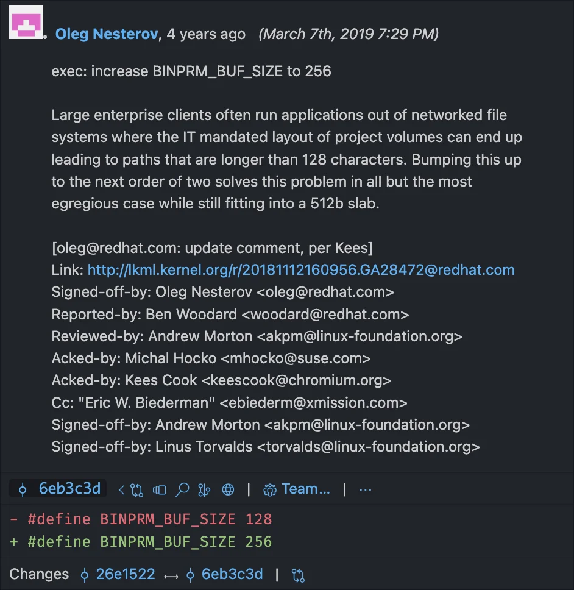
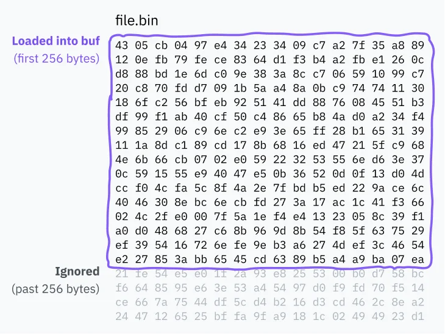

## Eng boshidan boshlasak…

Kompyuterlar bilan [ko‘p ishlarni qilganman](https://github.com/kognise?tab=overview&from=2023-12-01&to=2023-12-31), lekin bilimlarimda doim bir bo‘shliq bor edi: kompyuterda dasturni ishga tushirganingizda aynan nima sodir bo‘ladi? Bu bo‘shliq haqida ko‘p o‘ylardim — menda zarur bo‘lgan quyi darajadagi (low-level) bilimlarning aksariyati bor edi, biroq barcha qismlarni bir-biriga bog‘lab, yaxlit tasavvur hosil qilishga qiynalardim. Dasturlar rostdan ham to‘g‘ridan-to‘g‘ri protsessorda (CPU) bajariladimi yoki boshqa biror jarayon ham kechadimi? Men tizim chaqiruvlaridan (syscall) foydalanganman, lekin ular qanday ishlaydi? Ular aslida nima o‘zi? Bir vaqtning o‘zida bir nechta dastur qanday qilib parallel ishlay oladi?


Oxiri sabrim chidamadi va imkon qadar ko‘proq narsaning tagiga yetishga kirishdim. Agar universitetda o‘qimasangiz, tizimli dasturlash bo‘yicha keng qamrovli manbalar unchalik ko‘p emas; shu sababli sifati turlicha bo‘lgan va ba’zan bir-biriga zid ma’lumotlarni o‘z ichiga olgan juda ko‘p manbalarni elakdan o‘tkazishimga to‘g‘ri keldi. Bir necha haftalik izlanishlar va qariyb 40 sahifalik qaydlar yozganimdan so‘ng, kompyuterlar ishga tushishidan tortib dastur bajarilishigacha bo‘lgan jarayonda qanday ishlashini ancha yaxshiroq tushunib yetdim, deb o‘ylayman. O‘rganganlarimni sodda va aniq tushuntirib beradigan bittagina puxta maqola topish uchun hamma narsaga tayyor edim — shuning uchun o‘zim orzu qilgan o‘sha maqolani yozishga qaror qildim.

Bilasiz-ku, biror narsani boshqa birovga tushuntirib bera olsangizgina, uni chinakamiga tushungan bo‘lasiz, deyishadi.

> Shoshilyapsizmi? Bularning barchasini allaqachon bilaman deb o‘ylaysizmi?
Unda 3-bobni o‘qib ko‘ring — albatta o‘zingiz uchun yangi biror narsa kashf etishingizga kafolat beraman. Agar, albatta, shaxsan Linus Torvaldsning o‘zi bo‘lmasangiz.

## 1-bob: “Asoslar”

> Putting the “You” in CPU turkumidan: kompyuteringiz dasturlarni qanday ishga tushirishi haqidagi chuqur tahlil.

Ushbu maqolani yozish davomida meni qayta-qayta hayratga solgan yagona narsa — kompyuterlarning naqadar sodda ekanligi bo‘ldi. Aslida mavjud bo‘lganidan ko‘ra ko‘proq murakkablik yoki abstraksiya kutib, o‘zimni chalg‘itmaslik hali ham qiyin! Davom etishdan oldin miyangizga muhrlab qo‘yishingiz kerak bo‘lgan bir narsa bor: sodda ko‘ringan hamma narsa haqiqatan ham shunchalik sodda. Bu soddalik juda go‘zal va ba’zan juda-juda g‘alati (cursed).

Keling, kompyuteringizning eng tub mohiyatida qanday ishlashi asoslaridan boshlaylik.

### Kompyuterlar qanday tuzilgan (Arxitektura)

Kompyuterning markaziy protsessori (CPU) barcha hisob-kitoblar uchun javobgardir. U — boshliq. Haqiqiy sehrgar. Kompyuterni yoqishingiz bilanoq u g‘izillab ishga tushadi va buyruq ketidan buyruqni tinimsiz bajara boshlaydi.

Ommaviy ishlab chiqarilgan birinchi CPU — [Intel 4004](http://www.intel4004.com/) bo‘lib, u 60-yillarning oxirida Federiko Fajin (Federico Faggin) ismli italiyalik fizik va muhandis tomonidan loyihalashtirilgan. U bugungi kunda biz foydalanadigan [64-bitli](https://en.wikipedia.org/wiki/64-bit_computing) tizimlar o‘rniga 4-bitli arxitekturaga ega edi va zamonaviy protsessorlarga qaraganda ancha sodda bo‘lgan, biroq o‘sha soddalikning katta qismi hanuzgacha saqlanib qolgan.

Protsessorlar bajaradigan «buyruqlar» (instructions) shunchaki ikkilik (binar) ma’lumotlardir: qaysi buyruq bajarilayotganini bildiruvchi bir yoki ikki bayt (opkod — operatsiya kodi) va uning ortidan buyruqni bajarish uchun zarur bo‘lgan ma’lumotlar keladi. Biz mashina kodi deb ataydigan narsa ketma-ket joylashgan mana shunday ikkilik buyruqlar to‘plamidan boshqa narsa emas. Assembler ([Assembly](https://en.wikipedia.org/wiki/Assembly_language)) esa mashina kodini o‘qish va yozish uchun qulay sintaksis bo‘lib, xom bitlarga qaraganda insonlar o‘qishi va yozishi uchun ancha oson; u har doim protsessoringiz o‘qiy oladigan ikkilik kodga kompilyatsiya qilinadi.



> Mulohaza: Buyruqlar mashina kodida har doim ham yuqoridagi misoldagidek 1:1 nisbatda ifodalanavermaydi. Masalan, `add eax, 512` buyrug‘i `05 00 02 00 00` ko‘rinishiga o‘giriladi.
Birinchi bayt (`05`) aynan EAX registriga 32-bitli sonni qo‘shishni bildiruvchi opkoddir. Qolgan baytlar esa [little-endian](https://en.wikipedia.org/wiki/Endianness) bayt tartibida yozilgan 512 (`0x200`) sonini anglatadi.
Defuse Security assembler va mashina kodi o‘rtasidagi tarjima bilan tajriba o‘tkazib ko‘rish uchun [foydali vosita](https://defuse.ca/online-x86-assembler.htm) yaratgan.

**RAM (operativ xotira)** — kompyuteringizning asosiy xotira banki bo‘lib, kompyuterda ishlayotgan dasturlar foydalanadigan barcha ma’lumotlarni saqlaydigan katta, ko‘p maqsadli makondir. Bunga dastur kodining o‘zi ham, operatsion tizim yadrosidagi kod ham kiradi. CPU mashina kodini har doim to‘g‘ridan-to‘g‘ri RAM’dan o‘qiydi va agar kod RAM’ga yuklanmagan bo‘lsa, uni ishga tushirib bo‘lmaydi.

Protsessor o‘zida buyruqlar ko‘rsatkichini *(instruction pointer)* saqlaydi, u keyingi buyruqni RAM’ning qaysi manzilidan olish kerakligini ko‘rsatib turadi. Har bir buyruqni bajargandan so‘ng, CPU ko‘rsatkichni siljitadi va jarayonni takrorlaydi. Bu olish va bajarish sikli *(fetch-execute cycle)* deb ataladi.



Buyruq bajarilgandan so‘ng, ko‘rsatkich RAM’da xuddi shu buyruqdan darhol keyingi o‘ringa siljiydi va endi keyingi buyruqqa ishora qiladi. Kod aynan shuning uchun ishlaydi! Buyruqlar ko‘rsatkichi shunchaki oldinga qarab intiladi va xotirada qanday tartibda saqlangan bo‘lsa, mashina kodini o‘sha tartibda bajarib boraveradi. Ayrim buyruqlar esa ko‘rsatkichga boshqa joyga «sakrashni» (jump) yoki ma’lum bir shartga qarab turli joylarga sakrashni buyurishi mumkin — bu esa qayta ishlatiladigan kod va shartli mantiqni yaratish imkonini beradi.

Ushbu buyruqlar ko‘rsatkichi registrda saqlanadi. [Registrlar](https://en.wikipedia.org/wiki/Processor_register) — bu protsessor o‘qishi va yozishi uchun o‘ta tezkor bo‘lgan kichik xotira katakchalaridir. Har bir CPU arxitekturasi hisob-kitoblar paytida vaqtinchalik qiymatlarni saqlashdan tortib protsessorni sozlashgacha bo‘lgan barcha vazifalar uchun ishlatiladigan qat’iy registrlar to‘plamiga ega.

Ba’zi registrlarga, masalan, `ebx` registriga mashina kodidan to‘g‘ridan-to‘g‘ri murojaat qilish mumkin. Boshqa registrlar esa faqat protsessorning o‘zi tomonidan ichki tarzda ishlatiladi, lekin ularni ko‘pincha maxsus buyruqlar yordamida yangilash yoki o‘qish mumkin. Bunga misol sifatida buyruqlar ko‘rsatkichini keltirish mumkin: uni to‘g‘ridan-to‘g‘ri o‘qib bo‘lmaydi, ammo masalan, sakrash (jump) buyrug‘i orqali yangilash mumkin.

### Protsessorlar sodda bo‘ladi

Keling, dastlabki savolga qaytaylik: kompyuteringizda bajariluvchi dasturni (executable) ishga tushirganingizda nima sodir bo‘ladi? Avvaliga uni ishga tushirishga tayyorlash uchun bir talay «sehrgarlik» yuz beradi — biz bularning barchasini keyinroq ko‘rib chiqamiz — lekin jarayon oxirida qayerdadir fayl ichida mashina kodi turgan bo‘ladi. Operatsion tizim uni RAM’ga yuklaydi va protsessorga buyruqlar ko‘rsatkichini RAM’dagi o‘sha manzilga sakratishni buyuradi. CPU odatdagidek o‘zining olish-bajarish siklini davom ettiradi va shu tariqa dastur ishlay boshlaydi!

(Bu men uchun o‘zimni hayratga solgan lahzalardan biri edi — jiddiy aytaman, siz ushbu maqolani o‘qiyotgan brauzer dasturi ham xuddi shunday ishlamoqda! Protsessoringiz brauzeringiz buyruqlarini RAM’dan ketma-ket olib, to‘g‘ridan-to‘g‘ri bajarmoqda va ular ushbu maqolani ekranda chizib bermoqda.)



Ma’lum bo‘lishicha, protsessorlar dunyoga o‘ta sodda nazar bilan qaraydi; ular faqat joriy buyruqlar ko‘rsatkichini va biroz ichki holatni ko‘radi xolos. Jarayonlar (processes) esa butunlay operatsion tizim abstraksiyalari bo‘lib, protsessorlar ularni tabiiy ravishda tushunmaydi yoki kuzatib bormaydi.

*qo‘llarini silkitib* jarayonlar — bu ko‘proq kompyuter sotish uchun OT dasturchilari va «katta bayt» korporatsiyalari o‘ylab topgan abstraksiyadir.

Men uchun bu holat javoblardan ko‘ra ko‘proq savollarni keltirib chiqardi:

1. Agar CPU ko‘p jarayonlilik (multiprocessing) haqida bilmasa va buyruqlarni shunchaki ketma-ket bajarsa, nega u o‘zi ishga tushirgan birorta dastur ichida qolib ketmaydi? Qanday qilib bir vaqtning o‘zida bir nechta dastur ishlay oladi?

2. Agar dasturlar to‘g‘ridan-to‘g‘ri CPU’da ishlasa va CPU RAM’ga to‘g‘ridan-to‘g‘ri kira olsa, nega kod boshqa jarayonlarning yoki, xudo ko‘rsatmasin, yadroning (kernel) xotirasiga kira olmaydi?

3. Aytgancha, har bir jarayonning istalgan buyruqni bajarishi va kompyuteringizga xohlagan ishini qilishining oldini oladigan mexanizm nima? VA O‘SHA SYSCALL DEGAN MATOH NIMA O‘ZI?

Xotira haqidagi savol alohida bo‘limga loyiq va 5-bobda yoritilgan — qisqasi (TL;DR) shuki, xotiraga qilinadigan aksariyat murojaatlar aslida butun manzillar makonini qayta xaritalaydigan (remap) chalg‘ituvchi qatlam orqali o‘tadi. Hozircha esa dasturlar barcha RAM’ga to‘g‘ridan-to‘g‘ri kira oladi va kompyuterlar bir vaqtda faqat bitta jarayonni bajara oladi, deb faraz qilib turamiz. Vaqti kelib bu ikkala farazni ham fosh etamiz.

Endi esa tizim chaqiruvlari (syscalls) va xavfsizlik halqalariga to‘la olam sari birinchi chuqurlikka sakrash vaqti keldi.

> Mulohaza: aytgancha, yadro (kernel) nima o‘zi?
Kompyuteringizning macOS, Windows yoki Linux kabi operatsion tizimi — bu kompyuterda ishlaydigan va barcha asosiy narsalarning ishlashini ta’minlaydigan dasturiy ta’minot to‘plamidir. «Asosiy narsalar» juda umumiy tushuncha, «operatsion tizim» ham shunday — kimdan so‘rashingizga qarab, u kompyuteringiz bilan birga keladigan standart ilovalar, shriftlar va piktogrammalarni ham o‘z ichiga olishi mumkin.
Yadro (kernel) esa operatsion tizimning o‘zagidir. Kompyuterni yoqqaningizda, buyruqlar ko‘rsatkichi qayerdadir joylashgan bir dasturdan ish boshlaydi. O‘sha dastur — yadrodir. Yadro kompyuteringiz xotirasi, tashqi qurilmalari (periferiya) va boshqa resurslariga deyarli to‘liq kirish huquqiga ega hamda kompyuteringizga o‘rnatilgan dasturlarni (ular userland — foydalanuvchi makoni dasturlari deb ataladi) ishga tushirish uchun mas’uldir. Yadro bu huquqqa qanday ega ekanligi — va userland dasturlari nega ega emasligi haqida ushbu maqola davomida bilib olamiz.
Linux shunchaki yadro bo‘lib, undan foydalanish uchun qobiqlar (shells) va displey serverlari kabi ko‘plab userland dasturlari kerak bo‘ladi. macOS yadrosi [XNU](https://en.wikipedia.org/wiki/XNU) deb ataladi va Unix-simon tuzilishga ega, zamonaviy Windows yadrosi esa [NT Kernel](https://en.wikipedia.org/wiki/Architecture_of_Windows_NT) deb nomlanadi.

### Barchasini boshqaruvchi ikki halqa

Protsessor qaysi rejimda (ba’zan imtiyoz darajasi yoki halqa — ring deb ham ataladi) turgani unga nimalar qilishga ruxsat berilganini belgilaydi. Zamonaviy arxitekturalarda kamida ikkita variant mavjud: yadro rejimi (kernel/supervisor mode) va foydalanuvchi rejimi (user mode). Arxitektura ikkitadan ko‘p rejimni qo‘llab-quvvatlashi mumkin bo‘lsa-da, bugungi kunda odatda faqat yadro rejimi va foydalanuvchi rejimi ishlatiladi.

Yadro rejimida hamma narsa mumkin: CPU qo‘llab-quvvatlanadigan istalgan buyruqni bajarishi va istalgan xotira manziliga kira oladi. Foydalanuvchi rejimida esa buyruqlarning faqat cheklangan qismiga ruxsat beriladi, kiritish/chiqarish (I/O) va xotiraga kirish cheklanadi, ko‘plab CPU sozlamalari esa qulflangan bo‘ladi. Odatda yadro va drayverlar yadro rejimida, ilovalar esa foydalanuvchi rejimida ishlaydi.

Protsessorlar ishni yadro rejimida boshlaydi. Biror dasturni ishga tushirishdan oldin yadro foydalanuvchi rejimiga o‘tishni boshlaydi.


Protsessor rejimlari haqiqiy arxitekturada qanday namoyon bo‘lishiga bir misol: x86-64 arxitekturasida joriy imtiyoz darajasini (CPL — Current Privilege Level) `cs` (kod segmenti) deb nomlangan registrdan o‘qish mumkin. Aniqrog‘i, CPL `cs` registrining [eng kichik ikkita bitida](https://en.wikipedia.org/wiki/Bit_numbering) joylashgan bo‘ladi. Ushbu ikki bit x86-64’ning to‘rtta mumkin bo‘lgan halqasini saqlay oladi: 0-halqa (ring 0) — yadro rejimi, 3-halqa (ring 3) — foydalanuvchi rejimidir. 1 va 2-halqalar drayverlarni ishga tushirish uchun mo‘ljallangan, biroq ulardan faqat sanoqli eski va tor doiradagi operatsion tizimlargina foydalanadi. Masalan, agar CPL bitlari `11` bo‘lsa, CPU 3-halqada, ya’ni foydalanuvchi rejimida ishlayotgan bo‘ladi.

### Syscall (tizim chaqiruvi) o‘zi nima?

Dasturlar kompyuterga to‘liq kirish huquqi bilan ishonib topshirilishi mumkin emasligi sababli foydalanuvchi rejimida ishlaydi. Foydalanuvchi rejimi o‘z vazifasini bajarib, kompyuterning katta qismiga kirishni to‘sib qo‘yadi — lekin dasturlar qandaydir yo‘l bilan kiritish/chiqarish (I/O) qurilmalaridan foydalanishi, xotira ajratishi va operatsion tizim bilan o‘zaro aloqa qilishi kerak-ku! Buning uchun foydalanuvchi rejimida ishlayotgan dastur operatsion tizim yadrosidan yordam so‘rashi lozim. Shunda OT dasturlarning zararli harakatlar qilishining oldini olish uchun o‘zining xavfsizlik himoyalarini qo‘llay oladi.

Agar qachondir OT bilan o‘zaro aloqa qiladigan kod yozgan bo‘lsangiz, ehtimol `open`, `read`, `fork` va `exit` kabi funksiyalarni taniysiz. Bir nechta abstraksiya qatlamlari ostida bu funksiyalarning barchasi OT’dan yordam so‘rash uchun tizim chaqiruvlaridan (system calls / syscalls) foydalanadi. Tizim chaqiruvi — bu dasturga foydalanuvchi makonidan yadro makoniga o‘tishni boshlash, ya’ni dastur kodidan OT kodiga sakrash imkonini beruvchi maxsus protseduradir.

Foydalanuvchi makonidan yadro makoniga boshqaruvni uzatish dasturiy uzilishlar [software interrupts](https://en.wikipedia.org/wiki/Interrupt#Software_interrupts) deb ataladigan protsessor xususiyati yordamida amalga oshiriladi:

1. Kompyuter yuklanayotganda (boot jarayonida) operatsion tizim RAM’da uzilishlar vektori jadvali (IVT — [Interrupt Vector Table](https://en.wikipedia.org/wiki/Interrupt_vector_table); x86-64 arxitekturasida bu [uzilishlar deskriptori jadvali](https://en.wikipedia.org/wiki/Interrupt_descriptor_table) deb ataladi) deb nomlangan jadvalni saqlaydi va uni CPU’da ro‘yxatdan o‘tkazadi. IVT uzilish raqamlarini ularni qayta ishlovchi kod ko‘rsatkichlari bilan bog‘laydi.



2. Shundan so‘ng, userland dasturlari [INT](https://www.felixcloutier.com/x86/intn:into:int3:int1) kabi buyruqdan foydalanishi mumkin. Bu buyruq protsessorga ko‘rsatilgan uzilish raqamini IVT’dan izlashni, yadro rejimiga o‘tishni va buyruqlar ko‘rsatkichini IVT’da saqlangan xotira manziliga sakratishni buyuradi.

Yadro kodi o‘z ishini tugatgach, CPU’ga yana foydalanuvchi rejimiga qaytishni va buyruqlar ko‘rsatkichini uzilish sodir bo‘lgan paytdagi o‘z joyiga qaytarishni buyurish uchun [IRET](https://www.felixcloutier.com/x86/iret:iretd:iretq) kabi buyruqdan foydalanadi.

(Agar qiziqayotgan bo‘lsangiz, Linux’da tizim chaqiruvlari uchun ishlatiladigan uzilish identifikatori — `0x80`. Linux tizim chaqiruvlari ro‘yxatini [Maykl Kerriskning onlayn manpage](https://man7.org/linux/man-pages/man2/syscalls.2.html) katalogida o‘qishingiz mumkin.)

#### O‘rovchi (Wrapper) APIlar: uzilishlarni abstraksiyalash

Tizim chaqiruvlari haqida hozirgacha bilganlarimiz quyidagilar:

- Foydalanuvchi rejimidagi dasturlar I/O yoki xotiraga to‘g‘ridan-to‘g‘ri kira olmaydi. Tashqi dunyo bilan aloqa qilish uchun ular OT’dan yordam so‘rashlari shart.

- Dasturlar INT va IRET kabi maxsus mashina kodi buyruqlari bilan boshqaruvni OT’ga topshirishi mumkin.

- Dasturlar imtiyoz darajalarini to‘g‘ridan-to‘g‘ri o‘zgartira olmaydi; dasturiy uzilishlar xavfsizdir, chunki protsessor OT kodining aynan qaysi nuqtasiga sakrash kerakligi borasida OT tomonidan oldindan sozlab qo‘yilgan bo‘ladi. Uzilishlar vektori jadvalini esa faqat yadro rejimidan turib sozlash mumkin.

Dasturlar syscall’ni ishga tushirayotganda operatsion tizimga ma’lumotlarni uzatishi kerak; OT aynan qaysi tizim chaqiruvini bajarishni hamda syscall’ning o‘zi uchun zarur bo‘lgan ma’lumotlarni (masalan, qaysi fayl nomini ochish kerakligini) bilishi lozim. Ushbu ma’lumotlarni uzatish mexanizmi operatsion tizim va arxitekturaga qarab farq qiladi, lekin odatda bu uzilishni ishga tushirishdan oldin ma’lumotlarni ma’lum registrlarga yoki stekka (stack) joylashtirish orqali amalga oshiriladi.

Turli qurilmalarda tizim chaqiruvlarini amalga oshirish usullaridagi bunday farqlar dasturchilar uchun har bir dasturda tizim chaqiruvlarini mustaqil ravishda yozib chiqishni mutlaqo amaliyotsiz qilib qo‘ygan bo‘lar edi. Bu, shuningdek, operatsion tizimlar eski tizimga moslab yozilgan barcha dasturlarni buzib qo‘yishdan qo‘rqib, uzilishlarni qayta ishlash mexanizmini o‘zgartira olmasligini ham anglatardi. Va nihoyat, biz endi dasturlarni xom assemblerdan foydalanib yozmaymiz — dasturchilardan har safar fayl o‘qish yoki xotira ajratish kerak bo‘lganda assemblerga tushishni kutib bo‘lmaydi.



Shu bois, operatsion tizimlar ushbu uzilishlar ustida abstraksiya qatlamini taqdim etadi. Zarur assembler buyruqlarini o‘z ichiga olgan, qayta ishlatiladigan yuqori darajadagi kutubxona funksiyalari Unix-simon tizimlarda [libc](https://www.gnu.org/software/libc/) tomonidan, Windows’da esa [ntdll.dll](https://learn.microsoft.com/en-us/windows-hardware/drivers/kernel/libraries-and-headers) deb nomlangan kutubxonaning bir qismi sifatida taqdim etiladi. Ushbu kutubxona funksiyalarini chaqirishning o‘zi yadro rejimiga o‘tishni keltirib chiqarmaydi, ular shunchaki oddiy funksiya chaqiruvlaridir. Kutubxonalarning ichida esa assembler kodi boshqaruvni haqiqatan ham yadroga uzatadi va u o‘rab turuvchi kutubxona funksiyasiga qaraganda platformaga ancha bog‘liq bo‘ladi.

Unix-simon tizimda ishlayotgan C dasturidan `exit(1)` ni chaqirganingizda, ushbu funksiya ichki tomondan tizim chaqiruvining opkodi va argumentlarini kerakli registrlar/stek/va hokazolarga joylashtirgandan so‘ng, uzilishni ishga tushirish uchun mashina kodini bajaradi. Kompyuterlar naqadar ajoyib!

### Tezlikka ehtiyoj / Qani, CISC-lashamiz

x86-64 kabi ko‘plab [CISC](https://en.wikipedia.org/wiki/Complex_instruction_set_computer) arxitekturalari tizim chaqiruvi paradigmasining keng tarqalganligi sababli maxsus tizim chaqiruvlari uchun mo‘ljallangan buyruqlarni o‘z ichiga oladi.

Intel va AMD x86-64 borasida unchalik yaxshi kelisha olishmagan; unda aslida optimallashtirilgan tizim chaqiruvi buyruqlarining ikkita to‘plami mavjud. [SYSCALL](https://www.felixcloutier.com/x86/syscall.html) va [SYSENTER](https://www.felixcloutier.com/x86/sysenter) — bu `INT 0x80` kabi buyruqlarning optimallashtirilgan muqobillaridir. Ularga mos keluvchi qaytish buyruqlari — [SYSRET](https://www.felixcloutier.com/x86/sysret.html) va [SYSEXIT](https://www.felixcloutier.com/x86/sysexit) esa foydalanuvchi makoniga tezda qaytish va dastur kodini davom ettirish uchun mo‘ljallangan.

(AMD va Intel protsessorlari ushbu buyruqlar bilan biroz farqli moslikka ega. `SYSCALL` odatda 64-bitli dasturlar uchun eng yaxshi variant bo‘lsa, `SYSENTER` 32-bitli dasturlar bilan yaxshiroq ishlaydi.)

O‘z uslubiga sodiq qolgan holda, [RISC](https://en.wikipedia.org/wiki/Reduced_instruction_set_computer) arxitekturalarida bunday maxsus buyruqlar bo‘lmaydi. Apple Silicon asoslangan RISC arxitekturasi — AArch64 tizim chaqiruvlari uchun ham, dasturiy uzilishlar uchun ham faqat [bitta uzilish buyrug‘idan](https://support.arm.com/documentation/ddi0596/2021-12/Base-Instructions/SVC--Supervisor-Call-) foydalanadi. Menimcha, Mac foydalanuvchilari bundan hech ham nolishmayapti :)

------

#### Uh, ko‘p narsa bo‘ldi! Keling, qisqacha takrorlab olaylik:

- Protsessorlar buyruqlarni cheksiz olish-bajarish siklida bajaradi va operatsion tizimlar yoki dasturlar haqida hech qanday tushunchaga ega emas. Odatda registrda saqlanadigan protsessor rejimi qaysi buyruqlarni bajarish mumkinligini belgilaydi. Operatsion tizim kodi yadro rejimida ishlaydi va dasturlarni ishga tushirish uchun foydalanuvchi rejimiga o‘tadi.

- Binar faylni ishga tushirish uchun operatsion tizim foydalanuvchi rejimiga o‘tadi va protsessorni RAM’dagi kodning kirish nuqtasiga yo‘naltiradi. Faqat foydalanuvchi rejimi imtiyozlariga ega bo‘lganligi sababli, tashqi dunyo bilan aloqa qilishni istagan dasturlar yordam olish uchun OT kodiga sakrashi kerak. Tizim chaqiruvlari (syscalls) — dasturlarning foydalanuvchi rejimidan yadro rejimiga va OT kodiga o‘tishining standartlashtirilgan usulidir.

- Dasturlar odatda bu syscall’lardan umumiy kutubxona funksiyalarini chaqirish orqali foydalanadi. Bular boshqaruvni OT yadrosiga o‘tkazuvchi va halqalarni almashtiruvchi dasturiy uzilishlar yoki arxitekturaga xos syscall buyruqlarining mashina kodini o‘z ichiga oladi. Yadro o‘z ishini bajaradi, yana foydalanuvchi rejimiga qaytadi va boshqaruvni dastur kodiga qaytaradi.

Keling, boyagi birinchi savolimga qanday javob topishni o‘ylab ko‘raylik:

> Agar CPU bittadan ortiq jarayonni kuzatib bormasa va buyruqlarni shunchaki ketma-ket bajarsa, nega u o‘zi ishga tushirgan dastur ichida qolib ketmaydi? Qanday qilib bir vaqtning o‘zida bir nechta dastur ishlay oladi?

Buning javobi, aziz do‘stim, Coldplay guruhining bunchalik mashhurligi sababi bilan bir xil… soatlar («Clocks»)! (Xo‘sh, texnik jihatdan taymerlar. Shunchaki shu hazilni tiqishtirgim keldi.)

## 2-bob: Vaqtni bo‘laklaymiz

Aytaylik, siz operatsion tizim yaratyapsiz va foydalanuvchilar bir vaqtning o‘zida bir nechta dasturni ishga tushira olishlarini xohlaysiz. Biroq sizda zamonaviy ko‘p yadroli protsessor yo‘q, shuning uchun CPU bir vaqtning o‘zida faqat bitta buyruqni bajara oladi!

Baxtingizga, siz juda aqlli OS dasturchisisiz. Siz jarayonlarga CPU’dan navbatma-navbat foydalanish imkonini berish orqali parallellik illyuziyasini (soxta parallellikni) yaratish mumkinligini tushunib yetasiz. Agar jarayonlar bo‘ylab aylanib chiqsangiz va ularning har biridan bir nechtadan buyruqni bajarsangiz, hech bir jarayon CPU’ni yakka o‘zi egallab olmagan holda ularning barchasi tezkor javob qaytaradigan (responsive) bo‘lib turadi.

Lekin jarayonlarni almashtirish uchun boshqaruvni dastur kodidan qanday qilib qaytarib olasiz? Biroz izlanishdan so‘ng, aksariyat kompyuterlarda taymer chiplari (timer chips) mavjudligini bilib olasiz. Siz taymer chipini ma’lum bir vaqt o‘tgandan so‘ng OS’ning uzilishlarni qayta ishlovchi dasturiga (interrupt handler) o‘tishni ishga tushiradigan qilib dasturlashingiz mumkin.

### Apparat uzilishlari (Hardware Interrupts)

Avvalroq foydalanuvchi dasturidan OS’ga boshqaruvni topshirish uchun dasturiy uzilishlardan qanday foydalanilishini muhokama qilgan edik. Ular “dasturiy” uzilishlar deb ataladi, chunki ular dastur tomonidan ixtiyoriy ravishda ishga tushiriladi — odatiy olish-bajarish siklida protsessor tomonidan bajarilayotgan mashina kodi unga boshqaruvni yadroga o‘tkazishni buyuradi.



OS rejalashtiruvchilari (schedulers) ko‘p vazifalilik (multitasking) uchun apparat uzilishlarini ishga tushirishda [PIT](https://en.wikipedia.org/wiki/Programmable_interval_timer) (dasturlashtiriladigan interval taymerlari) kabi taymer chiplaridan foydalanadi:

1. Dastur kodiga sakrashdan oldin OS taymer chipini ma’lum bir vaqt o‘tgandan so‘ng uzilishni ishga tushiradigan qilib sozlaydi.

2. OS foydalanuvchi rejimiga o‘tadi va dasturning keyingi buyrug‘iga sakraydi.

3. Taymer vaqti tugagach, u yadro rejimiga o‘tish va OS kodiga sakrash uchun apparat uzilishini ishga tushiradi.

4. Endi OS dastur qayerda to‘xtaganini saqlab qo‘yishi, boshqa dasturni yuklashi va jarayonni takrorlashi mumkin.

Bu ustuvor siqib chiqaruvchi ko‘p vazifalilik (preemptive multitasking) deb ataladi; jarayonning majburiy to‘xtatilishi esa siqib chiqarish [preemption](https://en.wikipedia.org/wiki/Preemption_(computing)) deyiladi. Agar siz, masalan, ushbu maqolani brauzerda o‘qiyotgan va ayni shu kompyuterda musiqa tinglayotgan bo‘lsangiz, shaxsiy kompyuteringiz ehtimol soniyasiga minglab marta xuddi shu siklni bajarmoqda.

### Vaqt bo‘lagini (Timeslice) hisoblash

Vaqt bo‘lagi *timeslice* — bu OS rejalashtiruvchisi jarayonni siqib chiqarishdan oldin unga ishlash uchun ruxsat beradigan vaqt davomiyligidir. Vaqt bo‘laklarini tanlashning eng oddiy usuli — har bir jarayonga bir xil vaqt bo‘lagini, masalan, $10\text{ ms}$ atrofida berish va vazifalar bo‘ylab tartib bilan aylanib chiqishdir. Bu qat’iy vaqt bo‘lagiga asoslangan davriy rejalashtirish *fixed timeslice round-robin scheduling* deb ataladi.

> Mulohaza: qiziqarli jargon faktlar!
Vaqt bo‘laklari ko‘pincha «kvantlar» (quantums) deb atalishini bilarmidingiz? Endi bilasiz va barcha texnik do‘stlaringizni hayratda qoldirishingiz mumkin. Ushbu maqolada har ikkinchi gapda “kvant” so‘zini ishlatmaganim uchun katta maqtovga loyiqman deb o‘ylayman.
 Vaqt bo‘laklari jargonidan gap ochilgan ekan, Linux yadrosi dasturchilari qat’iy chastotali taymer tiklarini (timer ticks) sanash uchun jiffy vaqt birligidan foydalanadilar. Boshqa narsalar qatori, [jiffy](https://github.com/torvalds/linux/blob/22b8cc3e78f5448b4c5df00303817a9137cd663f/include/linux/jiffies.h)’lar vaqt bo‘laklarining uzunligini o‘lchash uchun ham ishlatiladi. Linux’ning jiffy chastotasi odatda $1000\text{ Hz}$ ni tashkil qiladi, ammo yadroni kompilyatsiya qilishda uni qayta sozlash mumkin.
 
 Qat’iy vaqt bo‘lagiga asoslangan rejalashtirishni biroz yaxshilash uchun maqsadli kechikish *(target latency)* — jarayonning javob qaytarishi uchun ideal maksimal vaqt tanlanadi. Maqsadli kechikish — bu jarayonlar soni o‘rtacha (maqbul) bo‘lgan sharoitda, siqib chiqarilgan jarayonning yana qayta bajarilishni boshlashi uchun ketadigan vaqtdir. *Buni tasavvur qilish biroz qiyin! Xavotir olmang, tez orada diagramma ham bo‘ladi.*

Vaqt bo‘laklari maqsadli kechikishni vazifalarning umumiy soniga bo‘lish orqali hisoblanadi; bu qat’iy vaqt bo‘lagiga asoslangan rejalashtirishdan yaxshiroq, chunki jarayonlar kam bo‘lganda behuda vazifa almashtirishlarning oldini oladi. Masalan, maqsadli kechikish $15\text{ ms}$ va jarayonlar soni 10 ta bo‘lsa, har bir jarayon ishlash uchun $15/10$ yoki $1.5\text{ ms}$ vaqt oladi. Agar jarayonlar soni atigi 3 ta bo‘lsa, har bir jarayon maqsadli kechikish doirasida qolgan holda uzoqroq — $5\text{ ms}$ lik vaqt bo‘lagiga ega bo‘ladi.

Jarayonlarni almashtirish hisoblash jihatidan qimmatga tushadi, chunki u joriy dasturning butun holatini saqlashni va boshqasini tiklashni talab qiladi. Ma’lum bir chegaradan o‘tgach, haddan tashqari kichik vaqt bo‘lagi jarayonlarning juda tez almashinuvi tufayli unumdorlik muammolariga olib kelishi mumkin. Shu bois vaqt bo‘lagi davomiyligiga quyi chegara (minimal donadorlik — *minimum granularity*) belgilash odatiy holdir. Bu shuni anglatadiki, minimal donadorlik kuchga kirishi uchun jarayonlar yetarlicha ko‘p bo‘lganda, maqsadli kechikish chegarasidan oshib ketiladi.

Ushbu maqola yozilayotgan vaqtda Linux rejalashtiruvchisi $6\text{ ms}$ maqsadli kechikish va $0.75\text{ ms}$ minimal donadorlikdan foydalanadi.



Ushbu oddiy vaqt bo‘lagi hisob-kitobiga asoslangan davriy (round-robin) rejalashtirish bugungi kunda aksariyat kompyuterlar bajaradigan ishga ancha yaqin. Biroq u baribir biroz sodda; aksariyat operatsion tizimlar jarayonlarning ustuvorligi (priorities) va muddatlarini (deadlines) hisobga oladigan murakkabroq rejalashtiruvchilarga ega. 2007-yildan beri Linux [Completely Fair Scheduler](https://docs.kernel.org/scheduler/sched-design-CFS.html) (CFS — Mutlaqo adolatli rejalashtiruvchi) deb nomlangan rejalashtiruvchidan foydalanib kelmoqda. CFS vazifalarga ustuvorlik berish va CPU vaqtini taqsimlash uchun kompyuter fanining bir talay murakkab va chiroyli usullarini qo‘llaydi.

OS har safar biror jarayonni siqib chiqarganda, u yangi dasturning saqlangan bajarilish kontekstini (execution context), shu jumladan uning xotira muhitini yuklashi kerak. Bu CPU’ga “virtual” manzillarni fizik manzillarga bog‘laydigan xarita — boshqa sahifalar jadvalidan (page table) foydalanishni buyurish orqali amalga oshiriladi. Bu, shuningdek, dasturlarning bir-birining xotirasiga kirishiga to‘sqinlik qiladigan tizim hamdir; biz ushbu maqolaning 5 va 6-boblarida aynan shu mavzuning tubiga sho‘ng‘iymiz.

### 1-eslatma: Yadroning uziluvchanligi (Kernel Preemptability)

Hozirgacha biz faqat foydalanuvchi makoni jarayonlarini siqib chiqarish va rejalashtirish haqida gaplashdik. Agar yadro kodi tizim chaqiruvini (syscall) qayta ishlashga yoki drayver kodini bajarishga juda ko‘p vaqt sarflasa, dasturlar qotib ishlayotgandek (laggy) tuyulishi mumkin.

Zamonaviy yadrolar, jumladan Linux ham, uziluvchan yadrolar ([preemptive kernels](https://en.wikipedia.org/wiki/Kernel_preemption)) hisoblanadi. Bu shuni anglatadiki, ular yadro kodining o‘zi ham xuddi foydalanuvchi jarayonlari kabi to‘xtatilishi (uzilishi) va rejalashtirilishi mumkin bo‘lgan tarzda dasturlangan.

Agar siz yadro yoki shunga o‘xshash narsa yozmayotgan bo‘lsangiz, buni bilish unchalik muhim emas, lekin men o‘qigan deyarli har bir maqolada bu haqda eslatib o‘tilgan ekan, men ham aytib o‘tishga qaror qildim! Qo‘shimcha bilim kamdan-kam hollarda zarar qiladi.

### 2-eslatma: Tarix darsi

Qadimgi operatsion tizimlar, jumladan klassik Mac OS va Windows’ning NT’dan ancha oldingi versiyalari, ustuvor siqib chiqaruvchi ko‘p vazifalilikning o‘tmishdoshidan foydalangan. OS dasturlarni qachon siqib chiqarishni hal qilish o‘rniga, dasturlarning o‘zlari OS’ga navbatni bo‘shatib berishni (yield) tanlagan. Ular «hey, endi boshqa dastur ishlashiga ruxsat berishing mumkin» deyish uchun dasturiy uzilishni ishga tushirishgan. OS boshqaruvni qaytarib olishi va navbatdagi rejalashtirilgan jarayonga o‘tishi uchun ushbu ochiq-oydin navbat bo‘shatishlar yagona yo‘l edi.

Bu kooperativ ko‘p vazifalilik ([cooperative multitasking](https://en.wikipedia.org/wiki/Cooperative_multitasking)) deb ataladi. Uning bir nechta jiddiy kamchiliklari bor: zararli yoki shunchaki yomon loyihalashtirilgan dasturlar butun operatsion tizimni osongina qotirib qo‘yishi mumkin, shuningdek, real vaqt rejimidagi yoki vaqtga sezgir vazifalar uchun vaqt izchilligini ta’minlash deyarli imkonsiz. Shu sabablarga ko‘ra, texnologiya olami allaqachon ustuvor siqib chiqaruvchi ko‘p vazifalilikka o‘tgan va ortiga qayrilib ham qaramagan.

## 3-bob: Dasturni qanday ishga tushirish kerak

Hozirgacha biz CPU’lar bajariluvchi fayllardan yuklangan mashina kodini qanday bajarishini, halqalarga asoslangan xavfsizlik nima ekanligini va tizim chaqiruvlari (syscalls) qanday ishlashini ko‘rib chiqdik. Ushbu bo‘limda dasturlar eng avvalo qanday yuklanishi va ishga tushirilishini aniqlash uchun Linux yadrosining ichki tuzilishiga chuqur sho‘ng‘iymiz.

Biz aynan x86-64 arxitekturasidagi Linux’ni ko‘rib chiqamiz. Nega?

- Linux — bu desktop, mobil va serverlar uchun mo‘ljallangan to‘liq funksional ishlab chiqarish (production) operatsion tizimi. Linux ochiq kodli (open source), shuning uchun shunchaki uning manba kodini o‘qish orqali tadqiqot o‘tkazish juda oson. Ushbu maqolada men ba’zi yadro kodlariga to‘g‘ridan-to‘g‘ri havola beraman!

- x86-64 — bu zamonaviy desktop kompyuterlarning aksariyati foydalanadigan arxitektura va ko‘plab kodlarning maqsadli arxitekturasidir. Men tilga oladigan x86-64 ga xos xatti-harakatlarning bir qismi boshqa tizimlarga ham yaxshi umumlashadi.

O‘rganadiganlarimizning aksariyati boshqa operatsion tizimlar va arxitekturalar uchun ham, ular turli o‘ziga xos jihatlari bilan farq qilsa-da, yaxshi umumlashadi.

### Exec tizim chaqiruvlarining asosiy ishlash tartibi



Keling, juda muhim bir tizim chaqiruvidan boshlaylik: execve. U dasturni yuklaydi va agar muvaffaqiyatli bo‘lsa, joriy jarayonni o‘sha dastur bilan almashtiradi. Yana bir nechta tizim chaqiruvlari (execlp, execvpe va boshqalar) mavjud, lekin ularning barchasi turli ko‘rinishlarda execve ustiga qurilgan.


>  Mulohaza: ~ ` execveat`

`execve` aslida dasturni ma’lum konfiguratsiya parametrlari bilan ishga tushiradigan umumiyroq tizim chaqiruvi — `execveat` ustiga qurilgan. Soddalik uchun biz asosan execve haqida gaplashamiz; yagona farq shundaki, u `execveat` ga ba’zi standart (default) qiymatlarni taqdim etadi.
`ve` nimani anglatishiga qiziqyapsizmi? `v` — bir parametr argumentlar vektori (ro‘yxati — `argv`) ekanligini, `e` esa — boshqa parametr muhit o‘zgaruvchilari vektori (`envp`) ekanligini bildiradi. Boshqa turli exec tizim chaqiruvlari turli chaqiruv imzolarini (call signatures) belgilash uchun har xil qo‘shimchalarga ega. `execveat` dagi at esa shunchaki “qayerda” (`at`) ma’nosini beradi, chunki u `execve` ni qaysi joylashuvda ishga tushirishni ko‘rsatadi.

`execve` ning chaqiruv imzosi (call signature) quyidagicha:


```python
int execve(const char *filename, char *const argv[], char *const envp[]);
```

- `filename` argumenti ishga tushiriladigan dasturga olib boruvchi yo‘lni (path) ko‘rsatadi.

- `argv` — bu dasturga beriladigan argumentlarning null bilan tugallanuvchi (null-terminated, ya’ni oxirgi elementi null ko‘rsatkich bo‘lgan) ro‘yxati. C tilidagi main funksiyalariga uzatilishini tez-tez ko‘radigan argc argumenti aslida keyinroq tizim chaqiruvi tomonidan hisoblanadi, null bilan tugallanish ham shuning uchun kerak.

- `envp` argumenti ilova uchun kontekst sifatida ishlatiladigan muhit o‘zgaruvchilarining (environment variables) yana bir null bilan tugallanuvchi ro‘yxatini o‘z ichiga oladi. Ular… odatda `KEY=VALUE` juftliklari ko‘rinishida bo‘ladi. Odatda. Men kompyuterlarni yaxshi ko‘raman.

Qiziqarli fakt! Dasturning birinchi argumenti dastur nomi bo‘lishi haqidagi kelishuvni bilasiz-a? Bu shunchaki bir kelishuv (convention) bo‘lib, aslida `execve` tizim chaqiruvining o‘zi tomonidan o‘rnatilmaydi! Birinchi argument `argv` argumentining birinchi elementi sifatida `execve` ga nima uzatilgan bo‘lsa, o‘sha bo‘ladi — hatto uning dastur nomiga umuman aloqasi bo‘lmasa ham.

Qizig‘i shundaki, `execve` tarkibida `argv[0]` ni dastur nomi deb hisoblaydigan ba’zi kodlar ham bor. Interpretatsiya qilinadigan skript tillari haqida gaplashganimizda bunga batafsilroq to‘xtalamiz.

### 0-qadam: Ta’rif (Definition)

Biz tizim chaqiruvlari qanday ishlashini allaqachon bilamiz, lekin hali haqiqiy hayotiy kod misolini ko‘rmaganmiz! Keling, ichki tomondan `execve` qanday ta’riflanganini ko‘rish uchun Linux yadrosining manba kodiga nazar tashlaylik:


```python
fs/exec.c

SYSCALL_DEFINE3(execve,
		const char __user *, filename,
		const char __user *const __user *, argv,
		const char __user *const __user *, envp)
{
	return do_execve(getname(filename), argv, envp);
}
```


`SYSCALL_DEFINE3` — bu 3 argumentli tizim chaqiruvi kodini ta’riflash uchun mo‘ljallangan makros.

> Nega argumentlar soni ([arity](https://en.wikipedia.org/wiki/Arity)) makros nomiga qat’iy yozib qo‘yilganiga qiziqib qoldim; Google’dan qidirib, bu biror [xavfsizlik zaifligini](https://nvd.nist.gov/vuln/detail/cve-2009-0029) tuzatish uchun aylanma yo‘l (workaround) bo‘lganini bilib oldim.

filename argumenti `getname()` funksiyasiga uzatiladi, u satrni foydalanuvchi makonidan yadro makoniga nusxalaydi va foydalanishni kuzatish bilan bog‘liq ba’zi ishlarni bajaradi. U `include/linux/fs.h` faylida ta’riflangan `filename` strukturasini qaytaradi. Ushbu struktura foydalanuvchi makonidagi asl satrga ko‘rsatkichni ham, yadro makoniga nusxalangan qiymatga yangi ko‘rsatkichni ham saqlaydi:


```python
include/linux/fs.h

struct filename {
	const char		*name;	/* haqiqiy satrga ko'rsatkich */
	const __user char	*uptr;	/* foydalanuvchi makonidagi asl ko'rsatkich */
	int			refcnt;
	struct audit_names	*aname;
	const char		iname[];
};
```

Shundan so‘ng `execve` tizim chaqiruvi `do_execve()` funksiyasini chaqiradi. Bu esa, o‘z navbatida, ba’zi standart qiymatlar bilan `do_execveat_common() `funksiyasini chaqiradi. Yuqorida eslatib o‘tgan `execveat` tizim chaqiruvi ham `do_execveat_common()` ni chaqiradi, lekin u foydalanuvchi tomonidan berilgan ko‘proq parametrlarni o‘tkazadi.

Quyidagi kod parchasida men `do_execve` va `do_execveat` funksiyalarining ikkalasining ham ta’rifini keltirdim:


```python
fs/exec.c

static int do_execve(struct filename *filename,
	const char __user *const __user *__argv,
	const char __user *const __user *__envp)
{
	struct user_arg_ptr argv = { .ptr.native = __argv };
	struct user_arg_ptr envp = { .ptr.native = __envp };
	return do_execveat_common(AT_FDCWD, filename, argv, envp, 0);
}

static int do_execveat(int fd, struct filename *filename,
		const char __user *const __user *__argv,
		const char __user *const __user *__envp,
		int flags)
{
	struct user_arg_ptr argv = { .ptr.native = __argv };
	struct user_arg_ptr envp = { .ptr.native = __envp };
	return do_execveat_common(fd, filename, argv, envp, flags);
}
```

`execveat` da tizim chaqiruviga, so‘ngra `do_execveat_common` ga fayl deskriptori (biror resursga ishora qiluvchi identifikator turi) uzatiladi. Bu dastur qaysi katalogga nisbatan ishga tushirilishini belgilaydi.

`execve` da esa fayl deskriptori argumenti uchun maxsus qiymat — `AT_FDCWD` ishlatiladi. Bu Linux yadrosidagi umumiy konstanta bo‘lib, funksiyalarga fayl yo‘llarini joriy ishchi katalogga (current working directory) nisbatan talqin qilishni buyuradi. Fayl deskriptorlarini qabul qiluvchi funksiyalar odatda `if (fd == AT_FDCWD) { /* special codepath */ }` kabi qo‘lda yozilgan tekshiruvni o‘z ichiga oladi.

### 1-qadam: Tayyorgarlik (Setup)

Biz endi dastur bajarilishini boshqaruvchi asosiy funksiya — do_execveat_common ga yetib keldik. Ushbu funksiya nimalar qilishini kattaroq manzarada ko‘rish uchun kodga tikilishdan biroz chekinamiz.

`do_execveat_common` ning birinchi asosiy vazifasi `linux_binprm` deb nomlangan strukturani sozlashdir. Men butun struktura ta’rifining nusxasini keltirmayman, biroq ko‘rib chiqish kerak bo‘lgan bir nechta muhim maydonlar mavjud:

- Yangi dastur uchun virtual xotira boshqaruvini tayyorlash maqsadida `mm_struct` va `vm_area_struct` kabi ma’lumotlar strukturalari aniqlanadi.

- Dasturga uzatilishi uchun `argc` va `envc` hisoblanadi va saqlanadi.

- `filename` va `interp` mos ravishda dasturning va uning interpretatorining fayl nomlarini saqlaydi. Boshida ular bir-biriga teng bo‘ladi, lekin ba’zi hollarda o‘zgarishi mumkin: bunday holatlardan biri [shebang](https://en.wikipedia.org/wiki/Shebang_(Unix)) ga ega interpretatsiya qilinadigan skriptlarni ishga tushirishdir. Masalan, Python dasturini bajarayotganda filename manba faylga ishora qiladi, interp esa Python interpretatoriga olib boruvchi yo‘l bo‘ladi.

- `buf` — bajarilishi kerak bo‘lgan faylning dastlabki 256 bayti bilan to‘ldiriladigan massiv. U fayl formatini aniqlash va skript shebang’larini yuklash uchun ishlatiladi.

(Bugun bilib oldim: binprm — “binary program”, ya’ni binar dastur degan ma’noni anglatadi.)

Keling, ushbu `buf` buferini yaqinroqdan ko‘rib chiqaylik:


```python
linux_binprm @ include/linux/binfmts.h

	char buf[BINPRM_BUF_SIZE];

```


Ko‘rib turganimizdek, uning uzunligi `BINPRM_BUF_SIZE` konstantasi sifatida belgilangan. Kod bazasidan ushbu satrni qidirish orqali uning ta’rifini `include/uapi/linux/binfmts.h` faylida topishimiz mumkin:


```python
include/uapi/linux/binfmts.h

/* sizeof(linux_binprm->buf) */
#define BINPRM_BUF_SIZE 256

```


Shunday qilib, yadro bajarilayotgan faylning dastlabki 256 baytini ushbu xotira buferiga yuklaydi.

> Mulohaza: UAPI nima o‘zi?

Yuqoridagi kodning yo‘lida `/uapi/` borligini payqagan bo‘lsangiz kerak. Nega uzunlik `linux_binprm` strukturasi joylashgan faylning o‘zida — `include/linux/binfmts.h` da ta’riflanmagan?

UAPI — “userspace API” (foydalanuvchi makoni API’si) degan ma’noni anglatadi. Bu holatda kimdir bufer uzunligi yadroning ommaviy API’si tarkibiga kirishi kerak deb qaror qilgan. Nazariy jihatdan, UAPI’dagi hamma narsa foydalanuvchi makoni (userland) uchun ochiq, UAPI bo‘lmagan hamma narsa esa yadro kodi uchun yopiq (shaxsiy) hisoblanadi.

Yadro va foydalanuvchi makoni kodlari dastlab bitta aralash-quralash to‘plamda birga mavjud bo‘lgan. 2012-yilda texnik xizmat ko‘rsatishni yaxshilash maqsadida UAPI kodi [alohida katalogga ajratib](https://lwn.net/Articles/507794/) chiqarildi.

### 2-qadam: Binfmt’lar (Binar formatlar)

Yadroning keyingi asosiy vazifasi bir qator “binfmt” (binar format) qayta ishlovchilari (handlers) bo‘ylab aylanib chiqishdir. Ushbu qayta ishlovchilar `fs/binfmt_elf.c` va `fs/binfmt_flat.c` kabi fayllarda ta’riflangan. Yadro modullari ham umumiy ro‘yxatga o‘zlarining shaxsiy binfmt qayta ishlovchilarini qo‘shishlari mumkin.

Har bir qayta ishlovchi linux_binprm strukturasini qabul qiladigan va qayta ishlovchi dastur formatini tushunish-tushunmasligini tekshiradigan `load_binary() `funksiyasini taqdim etadi.

Bu ko‘pincha buferdan sehrli raqamlarni ([magic numbers](https://en.wikipedia.org/wiki/Magic_number_(programming)#Format_indicator)) qidirishni, dasturning boshlanishini (shuningdek buferdan) dekodlashga urinishni va/yoki fayl kengaytmasini (extension) tekshirishni o‘z ichiga oladi. Agar qayta ishlovchi haqiqatan ham formatni qo‘llab-quvvatlasa, u dasturni bajarishga tayyorlaydi va muvaffaqiyat kodini qaytaradi. Aks holda, u ishni erta to‘xtatadi va xato kodini qaytaradi. Yadro muvaffaqiyatli yakunlangan birinchi qayta ishlovchiga yetib borgunga qadar har bir binfmt’ning `load_binary()` funksiyasini sinab ko‘radi. Ba’zan ular rekursiv tarzda ishlaydi; masalan, agar skriptda interpretator ko‘rsatilgan bo‘lsa va o‘sha interpretatorning o‘zi ham skript bo‘lsa, ierarxiya quyidagicha ko‘rinish olishi mumkin: `binfmt_script` -> `binfmt_script` -> `binfmt_elf` (bu yerda ELF zanjir oxiridagi bajariluvchi formatdir).

### Format tahlili: Skriptlar

Linux qo‘llab-quvvatlaydigan ko‘plab formatlar orasida men alohida to‘xtalmoqchi bo‘lgan birinchi format bu `binfmt_script` dir.

Siz qachonlardir [shebang](https://en.wikipedia.org/wiki/Shebang_(Unix)) o‘qiganmisiz yoki yozganmisiz? Ba’zi skriptlarning boshida interpretatorga olib boruvchi yo‘lni ko‘rsatadigan o‘sha satr-chi?


```python
#!/bin/bash
```

Men har doim bularni qobiq (shell) qayta ishlaydi deb o‘ylardim, lekin yo‘q! Shebang’lar aslida yadroning xususiyati bo‘lib, skriptlar ham boshqa barcha dasturlar kabi aynan o‘sha tizim chaqiruvlari bilan ishga tushiriladi. Kompyuterlar juda ajoyib.

`fs/binfmt_script.c` fayl shebang bilan boshlanishini qanday tekshirishiga qarang:


```python
load_script @ fs/binfmt_script.c

	/* Agar "#!" bilan boshlanmasa, uni bajarish bizning ishimiz emas. */
	if ((bprm->buf[0] != '#') || (bprm->buf[1] != '!'))
		return -ENOEXEC;
```

Agar fayl haqiqatan ham shebang bilan boshlansa, binfmt qayta ishlovchisi interpretator yo‘lini va yo‘ldan keyin bo‘shliq (probel) bilan ajratilgan har qanday argumentlarni o‘qiydi. U yangi qator belgisiga (newline) yoki bufer oxiriga yetib borganda o‘qishni to‘xtatadi.

Bu yerda ikkita qiziqarli va biroz g‘alati narsa sodir bo‘ladi.

**Birinchidan**, `linux_binprm` ichidagi faylning dastlabki 256 bayti bilan to‘ldirilgan o‘sha bufer esingizdami? U bajariluvchi fayl formatini aniqlash uchun ishlatiladi, biroq `binfmt_script` da shebang’lar ham aynan o‘sha buferdan o‘qib olinadi.

Izlanishlarim davomida bufer uzunligini 128 bayt deb ta’riflagan bir maqolani o‘qib qoldim. O‘sha maqola chop etilganidan keyin qachondir bu uzunlik ikki barobarga oshirilib, 256 bayt qilingan! Sababiga qiziqib, Linux manba kodida `BINPRM_BUF_SIZE` ta’riflangan satr uchun Git blame (kodning ma’lum bir satrini tahrirlagan barcha kishilar jurnali) ni tekshirib ko‘rdim. Qarasam…


KOMPYUTERLAR JUDA AJOYIB!

Shebang’lar yadro tomonidan qayta ishlanganligi va butun faylni yuklash o‘rniga buf dan olinganligi sababli, ular har doim `buf` uzunligigacha qirqiladi (kesiladi). Aftidan, 4 yil oldin kimningdir 128 belgidan uzun yo‘llarini yadro qirqib tashlayotgani asabiga tekkan va uning yechimi bufer hajmini ikki barobar oshirish orqali qirqish nuqtasini ikki barobar uzaytirish bo‘lgan! Bugun ham o‘zingizning Linux mashinangizda, agar 256 belgidan uzun shebang satriga ega bo‘lsangiz, 256 belgidan keyingi hamma narsa *butunlay yo‘qolib ketadi*.



Shu tufayli xatolik (bug) yuzaga kelganini tasavvur qiling. Kodingizni nima buzayotganining tub sababini topishga urinayotganingizni tasavvur qiling. Muammo chuqur Linux yadrosining ichida ekanligini kashf etganingizda o‘zingizni qanday his qilishingizni tasavvur qiling. Katta bir korxonada yo‘lning bir qismi sirli ravishda g‘oyib bo‘lganini kashf etadigan keyingi IT mutaxassisining holiga voy.

**Ikkinchi g‘alati narsa:** `argv[0]` ning dastur nomi bo‘lishi shunchaki kelishuv ekanligi, chaqiruvchi tomon exec tizim chaqiruviga xohlagan `argv` ni uzatishi va u hech qanday tahrirsiz o‘tib ketishi esingizdami?

Ma’lum bo‘lishicha, `binfmt_script `— `argv[0]` ni dastur nomi deb hisoblaydigan joylardan biridir. U har doim `argv[0]` ni olib tashlaydi va so‘ngra argv ning boshiga quyidagilarni qo‘shadi:

- Interpretatorga olib boruvchi yo‘l
- Interpretatorga beriladigan argumentlar
- Skriptning fayl nomi

> Misol: Argumentlarni o‘zgartirish
Keling, `execve` chaqiruvining namunasini ko‘rib chiqaylik:


```python
// Argumentlar: filename, argv, envp
execve("./script", [ "A", "B", "C" ], []);
```
Ushbu faraziy skript faylining birinchi satrida quyidagi shebang mavjud:

```python
script
#!/usr/bin/node --experimental-module
```

Nihoyat Node interpretatoriga uzatiladigan o‘zgartirilgan `argv` quyidagicha bo‘ladi:


```python
[ "/usr/bin/node", "--experimental-module", "./script", "B", "C" ]
```

`argv` ni yangilagandan so‘ng, qayta ishlovchi `linux_binprm.interp` ni interpretator yo‘liga (bu holatda Node binar fayliga) o‘rnatish orqali faylni bajarishga tayyorlashni yakunlaydi. Nihoyat, dasturni bajarishga tayyorlash muvaffaqiyatli o‘tganini bildirish uchun 0 qaytaradi.

### Format tahlili: Turli xil interpretatorlar (binfmt_misc)

Yana bir qiziqarli qayta ishlovchi — bu `binfmt_misc`. U `/proc/sys/fs/binfmt_misc/ `manziliga maxsus fayl tizimini ulash (mount qilish) orqali foydalanuvchi makoni konfiguratsiyasi yordamida ba’zi cheklangan formatlarni qo‘shish imkoniyatini ochadi. Dasturlar o‘zlarining qayta ishlovchilarini qo‘shish uchun ushbu katalogdagi fayllarga maxsus formatlangan ma’lumotlarni yozishlari mumkin. Har bir konfiguratsiya yozuvi quyidagilarni belgilaydi:

- Fayl formatini qanday aniqlash kerakligi. Bu ma’lum bir siljishdagi (offset) sehrli raqamni yoki qidiriladigan fayl kengaytmasini ko‘rsatishi mumkin.

- Interpretator bajariluvchi fayliga olib boruvchi yo‘l. Interpretator argumentlarini ko‘rsatish imkoni yo‘q, shuning uchun agar ular kerak bo‘lsa, o‘rovchi skript (wrapper script) talab qilinadi.

- Ba’zi konfiguratsiya bayroqlari (flags), jumladan `binfmt_misc` `argv` ni qanday yangilashini belgilovchi bayroq.

Ushbu `binfmt_misc` tizimi ko‘pincha Java o‘rnatmalari tomonidan qo‘llaniladi; u .class fayllarini ularning `0xCAFEBABE` sehrli baytlari orqali, .jar fayllarini esa kengaytmasi orqali aniqlashga sozlangan bo‘ladi. Mening shaxsiy tizimimda Python bayt-kodini .pyc kengaytmasi orqali aniqlaydigan va uni tegishli qayta ishlovchiga uzatadigan handler sozlangan.

Bu dastur o‘rnatuvchilariga (installers) yuqori imtiyozli yadro kodini yozishga hojat qoldirmasdan o‘z formatlarini qo‘llab-quvvatlashni qo‘shish imkonini beruvchi juda ajoyib usuldir.

### Yakunda (Linkin Park qo‘shig‘i nazarda tutilmayapti)

exec tizim chaqiruvi har doim ikki yo‘ldan biri bilan yakunlanadi:

U oxir-oqibat o‘zi tushunadigan bajariluvchi binar formatga yetib boradi (balki skript interpretatorlarining bir necha qatlamlaridan o‘tgandan so‘ng) va o‘sha kodni ishga tushiradi. Bu nuqtada eski kod almashtirilgan bo‘ladi.

… yoki u barcha imkoniyatlarini tugatadi va chaqiruvchi dasturga dumini qisgancha xato kodini qaytaradi.

Agar siz qachonlardir Unix’ga o‘xshash tizimdan foydalangan bo‘lsangiz, terminaldan ishga tushirilgan shell skriptlarida shebang satri yoki `.sh` kengaytmasi bo‘lmasa ham ular baribir bajarilishini payqagan bo‘lishingiz mumkin. Agar qo‘lingizda Windows bo‘lmagan terminal bo‘lsa, buni hoziroq sinab ko‘rishingiz mumkin:


```python
$ echo "echo hello" > ./file
$ chmod +x ./file
$ ./file
hello
```

(Bu yerda `chmod +x` OS’ga fayl bajariluvchi ekanligini aytadi. Aks holda uni ishga tushira olmaysiz.)

Xo‘sh, nega shell skripti hech qanday ajratib turuvchi belgisiz ham shell skripti sifatida ishga tushadi? Axir yadroning format qayta ishlovchilarida bunday belgisi yo‘q shell skriptlarini aniqlashning aniq usuli bo‘lmasligi kerak-ku!

Ma’lum bo‘lishicha, bu xatti-harakat yadroning bir qismi emas. Bu aslida sizning qobig‘ingiz (shell) xatolik holatini qayta ishlashining keng tarqalgan usulidir.

Qobiq yordamida faylni ishga tushirganingizda va exec tizim chaqiruvi muvaffaqiyatsiz tugaganda, aksariyat qobiqlar fayl nomini birinchi argument sifatida berib qobiqni ishga tushirish orqali faylni shell skripti sifatida qayta bajarishga harakat qiladi. Bash odatda interpretator sifatida o‘zidan foydalanadi, ZSH esa sh nima bo‘lsa o‘shandan (odatda [Bourne shell](https://en.wikipedia.org/wiki/Bourne_shell)) foydalanadi.

Bu xatti-harakatning bunchalik keng tarqalganiga sabab, u [POSIX](https://en.wikipedia.org/wiki/POSIX) — kodni Unix tizimlari o‘rtasida ko‘chma (portable) qilish uchun yaratilgan eski standartda belgilab qo‘yilgan. Ko‘pgina vositalar yoki operatsion tizimlar POSIX’ga qat’iy amal qilmasa-da, uning ko‘plab kelishuvlari hanuzgacha umumiy hisoblanadi.

> Agar [exec tizim chaqiruvi] `[ENOEXEC]` xatosiga ekvivalent xato tufayli muvaffaqiyatsiz tugasa, qobiq (shell) birinchi operand sifatida buyruq nomi ko‘rsatilgan holda qobiqni chaqirishga va qolgan barcha argumentlarni yangi qobiqqa uzatishga teng bo‘lgan buyruqni bajarishi kerak. Agar bajariluvchi fayl matnli fayl bo‘lmasa, qobiq ushbu buyruqni bajarishni chetlab o‘tishi mumkin. Bunday holda u xato xabarini yozishi va 126 chiqish holatini (exit status) qaytarishi shart.

Manba: [Shell Command Language, POSIX.1-2017](https://pubs.opengroup.org/onlinepubs/9699919799.2018edition/utilities/V3_chap02.html#tag_18_09_01_01)

Kompyuterlar juda ajoyib!
