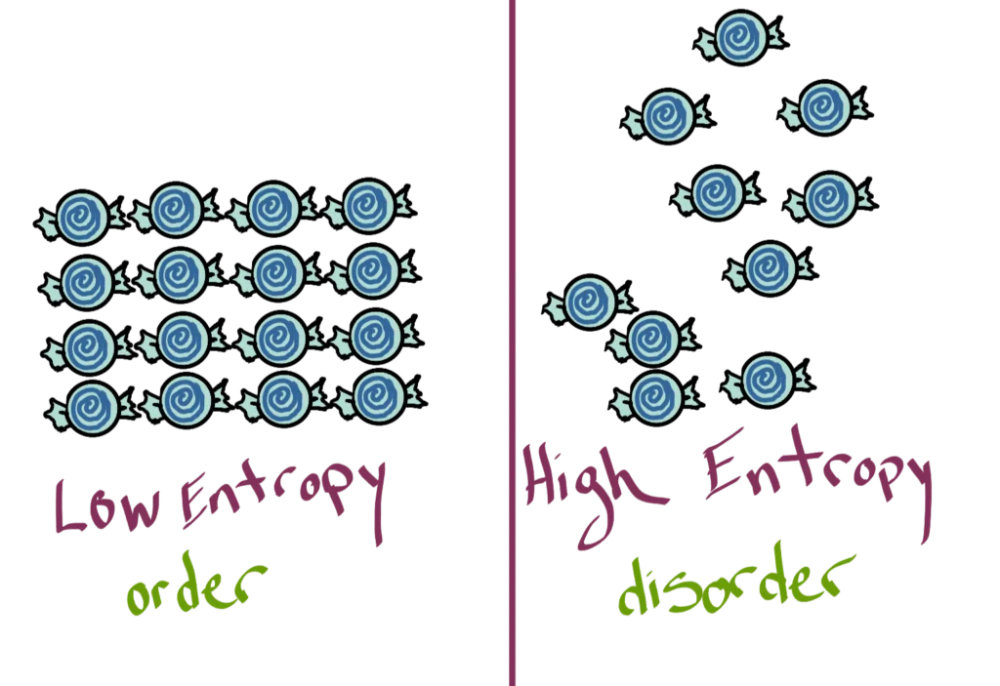

Distributed tizimlarda ishonchlilik, mavjudlik va ishlash unumdorligini oshirish maqsadida ma'lumotlar ko'pincha bir nechta (node'lar) bo'ylab nusxalanadi (replikatsiya qilinadi). Biroq, nusxalash jarayoni o'z navbatida, ayniqsa tarmoq uzilishlari, node lardagi nosozliklar va bir vaqtning o'zida yuz beradigan yangilanishlar holatida ma'lumotlarning o'zaro muvofiqligini saqlash kabi qiyinchiliklarni keltirib chiqaradi. Anti-entropiya – tarqatilgan tizimlarda ma'lumotlar butunligi va muvofiqligini ta'minlashda o'ta muhim ahamiyatga ega tushunchadir. Aslida, **entropiya** tizim node lari o'rtasida ma'lumotlar tafovuti sifatida namoyon bo'ladigan tartibsizlik yoki tasodifiylik darajasini anglatadi. Ushbu maqola anti-entropiyaning entropiyaga qarshi kurashishdagi roli, shuningdek, Distributed tarmoqlar bo'ylab ma'lumotlarning samarali va ishonchli oqimini kafolatlashdagi ahamiyatini yoritib beradi.

### **Anti-entropiya orqali tiklash jarayoni qanday ishlaydi?**

Anti-entropiya yordamida tiklash jarayoni klasterdagi turli node lar bo'ylab nusxalar holatini doimiy ravishda solishtirib boruvchi background jarayoni orqali ishlaydi. Ma'lumotlar nusxalari orasida aniqlangan farqlar sinxronizatsiyani ta'minlash uchun tezda tuzatiladi. Bu jarayon ma'lumotlarning  hash va qiymatlarini ko'p resurs talab qilsa-da, nihoyatda samarali tarzda solishtirish maqsadida Merkle daraxtlaridan (ma'lumotlar bazasi kontekstida xeshlar daraxtidan) foydalanadi.

Keling, buni oddiy misol orqali tushuntirib beramiz. Tasavvur qiling, uchta tugundan iborat tarqatilgan tizim mavjud: 1-tugun, 2-tugun va 3-tugun. Har bir tugunda ma'lumotlarning bittadan nusxasi bor. Qandaydir sababga ko'ra, 2-tugundagi ma'lumotlar eskirib qolgan. Shu o'rinda anti-entropiya jarayoni bu nomuvofiqlikni aniqlaydi va 2-tugundagi ma'lumotlarni qolgan tugunlar bilan sinxronlashtirish uchun tiklash operatsiyasini boshlaydi.


```python
Node 1 -------> Node 2 (Initiates Anti-Entropy Repair) -------> Node 3
Data XYZ         Data LMN                Data XYZ
Data DEF         Data XYZ (Outdated)     Data DEF
Data ABC         Data ABC                Data ABC
```


Kengroq miqyosda qaraydigan bo'lsak, bunday jarayonlar Amazon va Google kabi xizmatlar tomonidan foydalaniladigan minglab node lardagi terabaytlab ma'lumotlar o'rtasidagi nomuvofiqliklarni boshqaradi. U har qanday tarqatilgan saqlash tizimi uchun hal qiluvchi ahamiyatga ega bo'lgan **eventual consistency** — muvofiqlik va mavjudlik o'rtasidagi muvozanatga erishishda katta yordam beradi.

Biroq, shuni ham yodda tutish kerakki, anti-entropiya yordamida tiklash kuchli vosita bo'lsa-da, u har qanday vaziyat uchun doimiy standart yechim bo'lavermaydi. Yuklamalarni taqsimlovchilar (**load balancers**), muvofiqlik talablari, replikatsiya omili, tarmoqning kechikishi hamda ruxsat etilgan nomuvofiqlik darajasi kabi omillar ushbu tiklash jarayonidan foydalanish yoki foydalanmaslikni belgilashda muhim rol o'ynaydi.

Endi "Anti-entropiya" nima ekani va u qanday ishlashi haqida yetarlicha tushunchaga ega bo'lganimizdan so'ng, keyingi maqolalarimizda tarqatilgan tizimlardagi **membership protocol**, ziddiyatlarni hal qilish mexanizmlari hamda muvofiqlik modellari kabi o'zaro uzviy bog'liq bo'lgan boshqa tushunchalarni ham chuqurroq ko'rib chiqamiz.

Distributed tizimlarning eng ajoyib xususiyati shundaki, ular tarmoqdagi tabiiy tartibsizliklar va kutilmagan holatlarga qaramay, yuqori unumdorlik, chidamlilik va barqarorlikka erisha oladi. Anti-entropiya yordamida tiklash kabi konsepsiyalar ana shunday ishonchli – vaziyatga moslasha oladigan, o'zini o'zi tiklaydigan va biz talab qiladigan muvofiqlikni bera oladigan tizimlarni yaratishda poydevor vazifasini o'taydi.

## **Distributed tizimlarda muvofiqlik va mavjudlikni ta'minlashda “Anti-entropiya”ning o'rni**

"Anti-entropiya" distributed tizimlarda muvofiqlik va mavjudlik o'rtasidagi muvozanatni saqlash, ma'lumotlarning har xil versiyalarini boshqarish hamda yuklamaning bir maromda taqsimlanishiga erishishda asosiy vazifani bajaradi.

### **Muvofiqlik va Mavjudlik o'rtasidagi muvozanatni saqlash**

Distributed tizimlarda mavjudlik (availability) va muvofiqlik (consistency) ko'pincha bir-biriga qarama-qarshi kelib qoladi. Yuqori mavjudlik, hatto so'nggi kiritilgan o'zgarishlar hali barcha node larga yetib bormagan bo'lsa ham, so'rovlarga tezkor javob berishni talab qiladi; bu esa o'zaro farq qiluvchi, noaniq javoblarga olib kelishi mumkin. Boshqa tomondan, qat'iy muvofiqlik o'qish jarayoni boshlanishidan oldin barcha o'zgarishlarning barcha node larda saqlanishini talab qiladi, bu esa o'z navbatida mavjudlikka salbiy ta'sir ko'rsatishi tayin. Anti-entropiya jarayonlari "yakuniy muvofiqlik" (eventual consistency) tamoyilini olg'a surgan holda, bu ikki holat o'rtasida maqbul muvozanatni o'rnatadi. Ya'ni, u qisqa muddatli nomuvofiqliklarga ruxsat beradi, biroq yangi yozuvlar kiritilmagan taqdirda, oxir-oqibat barcha o'qish so'rovlari mutlaqo bir xil qiymat qaytarishini kafolatlaydi.

### **Turli versiyalarni boshqarish: Qachon va qancha?**

Distributed tizimlar bir vaqtda amalga oshiriladigan yozish operatsiyalari va tarmoqdagi kechikishlar tufayli ko'pincha ma'lumotlarning turli xil versiyalariga duch keladi. Aynan shunday ssenariylarda "Anti-entropiya" ishga tushadi va ziddiyatlarni hal qilish mexanizmlarini qo'llaydi. Tizim sozlamalariga qarab, "Anti-entropiya" bitta versiyadan tashqari qolgan barchasini o'chirib yuborishi (**based on criteria like timestamp or version number**), yoki bir nechta versiyalarni saqlab qolib, ziddiyatlarni hal qilishni keyinroq dasturiy ilova darajasiga qoldirishi mumkin. Qaysi usulni tanlash ko'p jihatdan ma'lumotlarning tabiati va tarqatilgan tizim talablariga bog'liq.

-----

## **Anti-entropiyani joriy etish mexanizmlari**

Anti-entropiyani tatbiq etishning bir qator mexanizmlari mavjud bo'lib, ularning har biri turli tizimlar va o'ziga xos holatlar uchun moslashgan. Asosiy maqsad — tarqatilgan node lar bo'ylab ma'lumotlar muvofiqligini ta'minlashligicha qoladi. Quyida biz anti-entropiya tamoyillaridan foydalanadigan ba'zi mexanizmlarni ko'rib chiqamiz.

1. **Sinxronizatsiya:** Bu mexanizmning g'oyasi har bir node dan ma'lumotlarni olish va uni mahalliy nusxa bilan solishtirishdan iborat. Agar nomuvofiqlik aniqlansa, tiklash amaliyoti boshlanadi. Bu yondashuvdagi eng muhim masala — tekshiruvlarni o'tkazish tezligi va tizimga tushadigan qo'shimcha yuklama o'rtasidagi oltin oraliqni topishdir.
2. **Merkle Trees:** Anti-entropiya uchun maxsus moslashtirilgan xesh tree larining bir turi bo'lmish Merkle daraxtlari ma'lumotlar bloklarining xeshlarini o'zida saqlaydi. Bu orqali u faqat ma'lum bloklarni tekshirish va tiklashga yo'naltirilgan holda resurslar sarfini kamaytiradi. Tree dagi har bir node o'zidan keyingi (farzand) node larning xeshini ifodalaydi va bunday mantiqiy tuzilma nomuvofiqliklarni tezda topish hamda to'g'rilash imkonini beradi.
3. **Gossip protokoli:** Epidemiologik replikatsiya deb ham ataladigan ushbu protokol, xuddi aholi orasida virus tarqalishiga o'xshab, nodelarning bir-biri bilan tasodifiy ravishda ma'lumot almashishi orqali ishlaydi. Bu usul yirik ma'lumotlar bazalarida yangilanishlarni boshqarishda juda sodda, kengayishga moyil va samaralidir.
4. **Hinted Handoff:** Ushbu usulda biror node ishdan chiqqanda, asli o'sha node ga mo'ljallangan yozuvlar vaqtinchalik boshqa bir tnode da saqlanib turadi (ya'ni "belgilab qo'yiladi" - hinted). Asl node qayta onlayn holatiga qaytgach, ushbu vaqtincha saqlab turgan node yozuvlarni unga qaytarib beradi va ma'lumotlarning butunligini ta'minlaydi.
5. **Read Repair:** Bu jarayon o'qish so'rovi vaqtida yuzaga keladigan nomuvofiqliklarni tuzatadigan ancha faol yondashuvdir. Agar ma'lumotni o'qish jarayonida nusxalar orasida farq borligi aniqlansa, ma'lumotlarni sinxronlashtirish uchun zudlik bilan tiklash jarayoni ishga tushadi.
6. **Faol va Passiv anti-entropiya mexanizmlari:** Ayrim tizimlar faol anti-entropiyadan foydalanadi, bunda nomuvofiqlik topilishi bilan tiklash amaliyoti boshlanadi. Boshqa tizimlar esa o'z navbatida, ma'lumotlar nusxalariga so'rov kelib tushgandagina tiklashni amalga oshiruvchi passiv anti-entropiyani qo'llaydi.

Distributed tizimingizda anti-entropiyani yo'lga qo'yish xuddi sug'urta polisini yaratishga o'xshaydi. U, hatto nosozliklar yuzaga kelgan fors-major holatlarida ham, tizimning uzluksiz ishlashini ta'minlash uchun ichki qatlamda tinimsiz mehnat qiladigan kuchli jarayondir. Mexanizmni tanlash asosan tizimingizning spetsifik talablariga va siz kutayotgan mavjudlik hamda unumdorlik ko'rsatkichlariga bog'liq.

-----

## **Anti-entropiyani ta'minlashda Ma'lumotlar tuzilmasi va Algoritmlarning o'rni**

Distributed tizimlarda anti-entropiyani ta'minlash ma'lum turdagi ma'lumotlar tuzilmasi va algoritmlardan foydalanishga jiddiy tayanadi. Ushbu vositalar tizimdagi anomaliyalarni (xatoliklarni) samarali aniqlash va tuzatish uchun jalb qilinadi. Keling, Merkle Tree, B+ tree lari va Ziddiyatsiz nusxalanuvchi ma'lumotlar turlari (**CRDTs**) bu jarayonga qanday ko'maklashishini ko'rib chiqamiz.

### **Active shards da entropiyani to'g'rilashning asosiy qadamlari qanday?**

Active shards bilan ishlashda Anti-entropiya operatsiyasi birinchi navbatda har qanday nomuvofiq shardni aniqlashdan boshlanadi. U buni xuddi suv idishingizdagi ifloslangan qismlarni aniqlashga o'xshab, Merkle tree lari (ma'lumotlarning turli darajalaridagi nomuvofiqliklarni ko'rsatish uchun ishlatiladigan binar xesh tree lari) yordamida amalga oshiradi.

*Quyida jarayon bosqichlarining oddiy ro'yxati keltirilgan:*

**1. Nomuvofiqliklarni aniqlash**
Nomuvofiqliklarni topish uchun Merkle tree laridan foydalaniladi. Tree dagi har bir node o'z farzand node larining xeshini ifodalaydi, root node esa barcha ma'lumotlarning xeshini jamlaydi. Shardning turli nusxalariga tegishli Merkle tree larining ildiz xeshlarini o'zaro solishtirish orqali farqlarni oson aniqlash mumkin.

```python
# Shards uchun oddiy Merkle daraxti xeshini yaratish
import hashlib

def hash_data(data):
    return hashlib.sha256(data.encode('utf-8')).hexdigest()

def merkle_hash(data_items):
    if len(data_items) == 1:
        return hash_data(data_items[0])
    elif len(data_items) > 1:
        mid = len(data_items) // 2
        left_hash = merkle_hash(data_items[:mid])
        right_hash = merkle_hash(data_items[mid:])
        return hash_data(left_hash + right_hash)

# Sharddagi namunaviy ma'lumotlar
shard_data = ["data1", "data2", "data3", "data4"]
shard_hash = merkle_hash(shard_data)
print(f"Shardning Merkle ildiz xeshi: {shard_hash}")

```

**2. Nomuvofiq shardni belgilab olish**
Merkle tree larini solishtirish davomida tafovut aniqlangandan so'ng, aynan qaysi shardda nomuvofiqlik borligi ajratib olinadi.

```python
# Bizda ikkita shards nusxasi va ularning xeshlari bor deb faraz qilamiz
shard_hash_1 = merkle_hash(shard_data)
shard_hash_2 = merkle_hash(["data1", "data2", "modified_data3", "data4"])  # Sun'iy yaratilgan nomuvofiqlik

if shard_hash_1 != shard_hash_2:
    print("Shards nusxalari o'rtasida nomuvofiqlik aniqlandi.")

```

**3. Nomuvofiq shardsni tiklash**
Nomuvofiqlikni to'g'rilash uchun to'g'ri bo'lgan sharddagi ma'lumotlar nomuvofiq bo'lgan shardga ko'chiriladi. Quyida buyruqlarga asoslangan soddalashtirilgan misol keltirilgan.

```python
# Shardni tiklash uchun soxta (pseudo) buyruq
def repair_shard(source_shard, target_shard):
    # Haqiqiy holatda bu jarayon manbadan maqsadli shardga ma'lumot nusxalashni o'z ichiga oladi
    print(f"{target_shard} shardi {source_shard} ma'lumotlari yordamida tiklanmoqda...")

# Tiklash jarayonini simulyatsiya qilish
consistent_shard = "Shard_1"
inconsistent_shard = "Shard_2"
repair_shard(consistent_shard, inconsistent_shard)

```

**4. Tiklanishni tekshirish**
Tiklash jarayoni tugagach, shard rostdan ham boshqa nusxalari bilan bir xil ekanligini tasdiqlash juda muhim sanaladi.

```python
# Tiklanishni tasdiqlash uchun xeshlarni qayta tekshirish
shard_hash_after_repair = merkle_hash(shard_data)  # Endilikda shard_data muvofiq deb faraz qilamiz

if shard_hash_1 == shard_hash_after_repair:
    print("Shard tiklanganligi tasdiqlandi. Muvofiqlikka erishildi.")
else:
    print("Shard tiklanganligini tasdiqlashda xatolik yuz berdi.")

```

Xulosa qilib aytganda, Anti-entropiya — bu dasturlaringiz yoki o'yinlaringiz maydonini toza va xavfsiz holda saqlab turadigan tozalovchi vositadir. U doimiy ravishda har qanday "chang" (nomuvofiqliklar) bor-yo'qligini kuzatadi va kimdir zarar ko'rishidan oldin uni tozalaydi. U dasturiy ta'minot tizimlaringizning silliq va bexato ishlashiga mas'ul bo'lgan sokin nazoratchidir.

### **Anti-entropiya mexanizmlari: Faol (Active) va Passiv (Passive) yondashuv**

Faol va passiv yondashuvlar anti-entropiya mexanizmlarining ikkita katta toifasidir. Faol anti-entropiya nomuvofiqliklarni aniqlashi bilanoq tiklash jarayonini zudlik bilan boshlaydi. Passiv anti-entropiya esa ta'mirlash operatsiyasini faqatgina ma'lumotlar nusxalariga so'rov kelib tushgandagina amalga oshiradi.

Shuni unutmaslik kerakki, bu usullarning biri ikkinchisidan mutlaq ustun emas va faol yoki passiv anti-entropiyani tanlash faqat va faqat tizim talablari hamda cheklovlariga uzviy bog'liq bo'ladi.

### **Ketma-ket (Sequential) va Parallel tiklash: Eng yaxshi yondashuvni tanlash**

Anti-entropiyani tiklash jarayonlari ketma-ket yoki parallel ravishda ijro etilishi mumkin va ularning o'ziga yarasha yutuq va kamchiliklari bor. Ketma-ket tiklashda ta'mirlash operatsiyasi bir node dan keyingisiga chiziqli usulda o'tib boradi. Bu biroz sekinroq bo'lishi mumkin, ammo u bir vaqtning o'zida faqat bitta operatsiyani bajargani bois tarmoqqa tushadigan bosimni sezilarli darajada kamaytiradi.

Parallel tiklashda esa jarayon bir vaqtning o'zida bir nechta node larda parallel ravishda faollashadi. Bu o'z-o'zidan tezlikni oshiradi, lekin operatsiyalarning bir vaqtda sodir bo'lishi tarmoqni ortiqcha yuklab qo'yish xavfini tug'diradi.

Ketma-ket va parallel usullar o'rtasidagi tanlov asosan tizim ehtiyojlariga qarab belgilanadi. Agar tizim xatolarni juda tez fursatda bartaraf etishi kerak bo'lsa, parallel tiklash ideal yo'l bo'lishi mumkin. Biroq, tarmoqdagi yuklamani yengillashtirishni ko'zlagan tizimlar uchun ketma-ket yondashuv oqilona tanlovdir.

Ma'lumotlar tuzilmasi va algoritmlar anti-entropiyaning asosiy qon tomiri hisoblanib, tarqatilgan tizimlarimizni ishonchli, ishga yaroqli va samarali saqlashga xizmat qiladi. Hech qaysi usul barcha tizimlar uchun universal doridek yechim bo'la olmaydi. Tanlov butkul sizning tarqatilgan tizimingizdagi maxsus talablar va kutilayotgan yuklamalarga qarab amalga oshiriladi.

------

## **Anti-entropiyaning real hayotdagi tatbiqi**

Anti-entropiya prinsiplari osmondan olingan nazariy tushunchalar emas. Haqiqat shundaki, ular bugungi kunda ko'plab yirik distributed tizimlarda faol tarzda ishlatilmoqda. Ular anti-entropiya usullaridan qanday foydalanishini tushunish uchun keling, bir qancha amaliy tatbiqlarni misol keltiramiz.

**Amazon Dynamo**
Elektron tijorat sohasining yirik vakili Amazonning yuqori mavjudlikka ega key-value saqlash ombori — Dynamo nusxalar o'rtasidagi muvofiqlikni ta'minlash uchun Merkle tree lari integratsiya qilingan faol anti-entropiya mexanizmidan foydalanadi. Ushbu tizim yuqori mavjudlik va yakuniy muvofiqlik o'rtasida oltin o'rtalikni ushlab turish maqsadida maxsus ishlab chiqilgan bo'lib, misli ko'rilmagan darajadagi o'qish va yozish operatsiyalarini bajara oladi. Qolaversa, Dynamo'dagi yuklamalarning taqsimlanishi, data partitioning bo'linishi va replikatsiya jarayoni xuddi shu anti-entropiya mexanizmlari ko'magida uning yuqori unumdorligini kafolatlaydi.

**Cassandra va Riak**
Apache Cassandra va Riak dasturlari ham anti-entropiyani amaliyotda qo'llashdagi yana bir ajoyib misollardandir. Xuddi Dynamo kabi, Cassandra ham muvofiqlikni ushlab turishda faol anti-entropiya mexanizmi asosida harakatlanadi. Riak esa, aksincha, faol va passiv anti-entropiya usullarining aralashmasidan foydalanadi hamda uning **strong eventual consistency **modeli bevosita anti-entropiya operatsiyalari tomonidan yuzaga keltiriladigan ziddiyatlarni hal qilish jarayonlariga tayanadi.

**Faol anti-entropiya va Hash Tree almashinuvi**
Faol anti-entropiya qoidalari ma'lumotlardagi nomuvofiqliklarni topishda benuqson usul sanalgan **Hash Tree **almashinuvi  mexanizmida mukammal namoyon bo'ladi. Node lar o'rtasida Merkle daraxtlarining ayrim qismlarini o'zaro almashish orqali ular o'zgarishlarni g'oyatda samarali aniqlashi va ziddiyatni bartaraf etishi mumkin. Bu, xususan, Cassandra kabi halqa (ring) ko'rinishidagi arxitekturalarda juda foydali. Bunday tizimlarda tugunlar ma'lumotlarning alohida qismlarini saqlaydi va nomuvofiqliklarni to'g'rilashda aynan Merkle tree laridan foydalaniladi.

-------

## **Distributed tizimlarda “Anti-entropiya”ni joriy etishdagi qiyinchiliklar**

Distributed tizimlarda "Anti-entropiya" mexanizmlarini qo'llash ulkan foyda keltirishiga qaramasdan, uning o'ziga yarasha to'siqlari ham bor. Keling, ushbu qiyinchiliklarning ba'zilarini ko'rib chiqib, ularni yengib o'tish strategiyalariga e'tibor qaratamiz.

### **Nosozliklarni boshqarish: Nusxalar sinxronizatsiyasi va Hinted Handoff**
Nosozliklar (Failures) – tarqatilgan tizimlarning muqarrar qismidir. Bunday tizimlar tugun ishdan chiqqan vaqtlarda ko'pincha nusxalarni sinxronlashtirish muammolari bilan to'qnash keladi. Misol uchun, vaqtincha faol bo'lmagan node da yozish amaliyoti bajarilganida, tizimdagi boshqa nusxalar bundan bexabar qolib ketadigan holatlar yuzaga kelishi mumkin.

Buning zo'r yechimlaridan biri "hinted handoff" (vaqtinchalik saqlab uzatish) sanaladi. Bunda ishlashda davom etayotgan boshqa bir node ishdan chiqqan nodega ishora qiluvchi "belgi" (hint) bilan yozish amaliyotini o'zida vaqtincha ushlab turadi. Nosoz node yana tarmoqqa ulanganda, vaqtincha saqlab turgan node yozish amaliyotini o'z egasiga uzatadi. Natijada vaqtinchalik nosozliklar sababli hech bir operatsiya yo'qotilmaydi.

### **Tackling Implementation muammolarni hal qilish: " Last-Write-Wins " (LWW) elementlar to'plami**
Distributed tizimlarda qachonki bir vaqtning o'zida yozish amallari sodir bo'lsa, ziddiyatlar kelib chiqishi tayin. Buni kamaytirishning eng keng tarqalgan strategiyasi — tizim vaqti orqali muammoni hal qiluvchi "Last-Write-Wins" (LWW) qoidasidir. Ammo bu yechim node lararo (vaqt) sinxronizatsiyasi to'g'ri bo'lishiga ishonib qoladi, buning o'zi esa oson ish emas.

Bunga optimal yechim sifatida LWW elementlar to'plamini (Conflict-Free Replicated Data Type - CRDT) taqdim etish mumkin. Ushbu ziddiyatsiz ma'lumotlar turi qo'shish va o'chirish amallarini ularning vaqt tamg'alari bilan birgalikda alohida-alohida to'plamlarda saqlaydi. U ana shu vaqt tamg'alarini (timestamps) solishtirib yakuniy xulosani chiqaradi, bu esa soatni markazlashgan holda sinxronlashtirishga bo'lgan ehtiyojni chetlab o'tadi.

```java
public class LWWElementSet<T> {
   private Map<T, Long> addSet;
   private Map<T, Long> removeSet;
}
```

### **Saqlash node larini qo'shish va olib tashlash: Tizimdagi o'zgarishlarni boshqarish**
Distributed tizimlar oldidagi navbatdagi sinov bu — tizimdagi o'zgarishlarni, ayniqsa **storage nodes** qo'shish yoki olib tashlash jarayonlarini mukammal boshqarishdir. Har safar shunday o'zgarishlar yuz berganda, tizim ma'lumotlarning mutanosib taqsimlanishi va tezda foydalanish mumkinligini ta'minlagan holda, ularni o'zaro muvofiqlashtirishi hamda qayta taqsimlashi talab etiladi.

Bu borada `consistent hashing` hamda` virtual nodes `boshqarish kabi uslublar ayni muddaodir. Izchil xeshlash ishlaganida ma'lumotlar joylashuvi maxsus "xesh halqasi"ga biriktiriladi. Va har qanday tizim o'zgarishi paytida halqaning tegishli qismini yangi node larga ko'chirib o'tkazish orqali muammo osonlik bilan hal qilinadi hamda barqaror taqsimot kafolatlanadi.

Barcha to'siqlarga qaramay, "anti-entropiya" mexanizmlarini joriy etish orqali erishiladigan afzalliklar g'oyatda ulkandir. To'g'ri strategiya tanlansa, mavjud to'siqlarni oson aylanib o'tish imkoni tug'iladi va bu distributed tizimlarni maksimal unumdorlikda, yuksak muvofiqlik bilan ishlashiga mustahkam zamin yaratadi.

## **Asosiy xulosalar**

1. "**Anti-entropiya**" – bu distributed tizimlardagi hamma tugunlar bo'ylab ma'lumotlar muvofiqligini qat'iy saqlab turadigan funksional tushunchadir. Sinxronizatsiya, Merkle trees va Gossip protokoli kabi xilma-xil mexanizmlar orqali u ma'lumotlardagi turlichalikni ko'radi va darhol ularni to'g'rilaydi.
2. "Anti-entropiya" tizimda muvofiqlik va mavjudlik o'rtasida tarozini teng ushlab turishda bebaho ahamiyatga ega. U ma'lumotlarning ko'plab versiyalarini boshqara olishi qatorida, yuklamalarni mutanosib taqsimlashga ham xizmat qiladi.
3. Merkle trees, B+ trees va CRDTs kabi tuzilmalar, qolaversa, faol va passiv anti-entropiya amaliyotini qo'llovchi maxsus algoritmlar mazkur jarayonlarni joriy qilishda juda asqotadi.
4. Anti-entropiya operatsiyalari Amazon Dynamo, Apache Cassandra va Riak kabi jonli tizimlarga faol integratsiya qilingan. Ular bugungi kunda mazkur tizimlarda ishonchlilik va misli ko'rilmagan unumdorlikni ta'minlashda eng asosiy tayanch bo'lib turibdi.
5. Garchand "Anti-entropiya"ni tatbiq etish nusxalarni sinxronlashtirish, bir vaqtdagi yozish amallarini hal qilish va tizim o'zgarishlarini nazorat qilish sababli murakkablashsa-da, aniq strategiya hamda ma'lumotlar tuzilmasidan foydalangan holda bu to'siqlarga doimo yechim topsa bo'ladi.

Distributed tizimlarda "Anti-entropiya"ni professional tarzda o'zlashtirish, avvalo, uning ishlash mexanikasi, foydali tomonlari, ishlatilish o'rinlari va qiyinchiliklarini chuqur anglashdan boshlanadi. Bu ko'nikmalar orqali dasturchilar mazkur kuchli vositadan yuqori unumdorlikka ega, muntazam ishlaydigan va ziddiyatsiz distributed tizimlarni yaratishda ustalik bilan foydalanishlari mumkin.

-----

## **Distributed tizimlarda “Anti-entropiya” haqida ko'p beriladigan savollar (FAQ)**

**Byzantine Faults bilan kurashishda "Anti-entropiya"ning o'rni qanday?**
Vizantiya xatoliklari — tizim komponentlarining mutlaqo kutilmagan, noma'lum va tushunarsiz tarzda ishdan chiqishi holatidir. Bu jarayon nodes bo'ylab bir-biriga butunlay zid xabarlarning tarqalishiga va oqibatda tizim muvofiqligiga darz ketishiga olib keladi. Aslida "Anti-entropiya" bevosita Byzantine Faults boshqarish uchun yaratilmagan; uning bosh vazifasi har qanday holatda ham faqat ma'lumotlar muvofiqligini ushlab turishdir. Shunga qaramay, bu xatoliklarni tushunish va bartaraf eta olish ishonchli tarqatilgan tizimlarni yaratishdagi ajralmas bo'lak hisoblanadi. Byzantine Generals' Problem kabi algoritmlar esa aynan shunday chalkashliklarni yechishga ixtisoslashgan.

**"Anti-entropiya" distributed tizimlarni loyihalashtirish mezonlariga qanday ta'sir o'tkazadi?**
"Anti-entropiya" tamoyillari distributed tizimlarning arxitekturasiga salmoqli ta'sir o'tkazadi. U arxitekturadan ma'lumotlarni nusxalash va ta'mirlash mexanizmlari, ziddiyatlarni yechish strategiyalari hamda yuklamalarni samarali taqsimlash kabi ilg'or texnologiyalarni o'z ichiga qamrab olishini talab etadi. Shu boisdan, tizimni barpo etishda nafaqat ma'lumotlarni saqlash hamda qayta ishlash tezligi, balki tarmoqdagi izchil aloqa, replikatsiya omili hamda ushbu anti-entropiya jarayonlarini yuritishga yordam beradigan eng to'g'ri ma'lumotlar tuzilmasi va algoritmlarni kiritish qat'iy nazarda tutilishi zarur.
