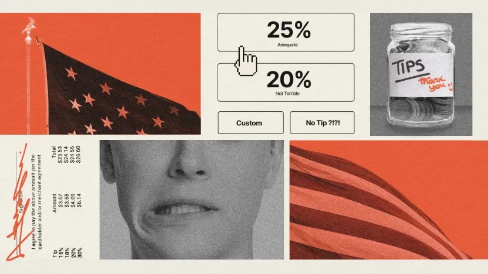

> Asl maqola: [Everyday Philosophy: I didn’t tip for a $5 cup of coffee. Was I wrong?](https://bigthink.com/thinking/everyday-philosophy-i-didnt-tip-for-a-5-cup-of-coffee-was-i-wrong/) 

### Asosiy xulosalar
- "Kundalik falsafa" rukniga xush kelibsiz. Bu yerda men zamonaviy hayotning kundalik dilemmalarini (*ikki o‘t orasida qolish holatlarini*) hal qilishda sizga yordam berish uchun falsafa tarixidagi tushunchalardan foydalanaman.
- Bu hafta Stiv 5 dollarlik qahva uchun choychaqa bermagani sababli o‘zini aybdor his qilyapti. Choychaqa berish tizimi nazoratdan chiqib ketyaptimi?

> Yaqinda hayotimda birinchi marta shunday qildim: mahalliy qahvaxonadagi iPad to‘lov tizimi mendan 5 dollarlik qahva uchun 20 foiz choychaqa qo‘shishni so‘raganida, "Choychaqasiz" (No tip) tugmasini bosdim. Garchand restoranlarda doim yaxshi choychaqa tashlab ketsam-da, so‘nggi bir necha yil ichida AQShda choychaqa berish madaniyati (**tipping culture**) nazoratdan chiqib ketgandek tuyuladi. Iqtisodiy ahvol yomonligini bilaman. Ammo bu mijozning gardaniga yuklanishi kerakmi? Do‘kon egasi noqulay, insonni aybdor his qildiruvchi vaziyatni yuzaga keltirgandan ko‘ra, o‘zi yaxshiroq maosh to‘lashi kerak emasmi? Yoki choychaqa berish kabi ijtimoiy normani buzish o‘rniga, agar ularning choychaqa borasidagi falsafasiga qo‘shilmasam, shunchaki bu qahvaxonalarga borishni to‘xtatishim kerakmi?
– Stiv, Sent-Luis

Bu siz menga uzatgan o‘ziga xos zaharlangan qadahdir, Stiv. Bir tomondan, bu "Kundalik falsafa" uchun deyarli mukammal savol — kundalik, tanish mashg‘ulotning chuqurroq qirralarini ochib berish imkoniyati. Boshqa tomondan, men britaniyalikman. Bu yerda nimaiki yozsam, shaxsimga qaratilgan (ad hominem) "*siz buning nimaligini tushunmaysiz*" degan e'tirozlar yomg‘iri ostida qolishi tayin. Garchi bu mantiqiy xato bo‘lsa-da, unda haqiqat uchquni bor. Men buning nimaligini tushunmayman. Choychaqa berish — Amerika madaniyatining xuddi rodeolar, MakMansionlar (katta uylar) va qahvadagi "krimer" (qaymoq) kabi ajralmas qismidir. Men ko‘zlarimni qisib, uni tushunishga harakat qilaman, biroq u men uchun yot narsaligicha qolmoqda. Lekin doim tavakkal qilishga odatlangan inson sifatida, men bu borada o‘z fikrimni aytib ko‘raman.

Menimcha, Stiv mening ishimni ancha osonlashtirgan, chunki bahs nega biz choychaqa beramiz degan masaladagi bir-biriga zid bo‘lgan ikki xil qarashga borib taqaladi. **Birinchisi**, biz choychaqani yaxshi xizmat sharti bilan beramiz degan fikr — biz yaxshi xizmatni rag‘batlantiramiz va yaxshi xizmat ko‘rsatish madaniyatini rivojlantirish uchun choychaqa qoldiramiz. **Ikkinchisi** — choychaqa shunchaki ijtimoiy norma ekanligi. Bu amerikaliklarning ish tutish tarzi. Agar yaxshi amerikalik bo‘lsangiz, choychaqa berasiz. Agar choychaqa bermasangiz, pasportingizni topshirib qo‘ya qolganingiz ma’qul.

Shunday qilib, Stivga javob berish uchun, biz uning dilemmasini har ikkala qarash prizmasidan o‘tkazamiz va uning ezilgan, yara bo‘lgan vijdonini tinchlantirish uchun qandaydir xulosaga kelishga harakat qilamiz.

## Shartli choychaqa

Qiziqarli ma’lumot sifatida shuni aytish joizki, biz "tip" so‘zining "*qo‘shimcha pul hadya qilish*" ma’nosidagi etimologiyasini (kelib chiqishini) to‘liq bilmaymiz. Bizga ma’lumki, 18-asr ingliz jargoni bo‘yicha u "berish" ma’nosini anglatuvchi umumiy so‘z sifatida ishlatilgan (shu sababli, masalan, kimgadir yaxshi garov haqida "maslahat (tip) berishingiz" mumkin), biroq uning bu ma’noga qanday kelib qolganini bilmaymiz. "Tip" so‘zi "tezlikni ta’minlash uchun" (to ensure promptness) degan iboraning qisqartmasi degan gap juda ajoyib qiziqarli hikoya, lekin afsuski, bu hech qanday dalilga ega bo‘lmagan shunchaki cho‘pchakdir.

Choychaqa berishning axloqiy asosi shundan iboratki, u yaxshi xizmat madaniyatini rag‘batlantiradi, xodimning o‘z ishida qolishiga imkon beradi, biznesga narxlarni past darajada saqlab turishiga yordam beradi va oxir-oqibat iqtisodiyotning umumiy salomatligini yaxshilaydi. Shuning uchun, Stiv "*Do‘kon egasi yaxshiroq maosh to‘lashi kerak emasmi?*" deb so‘raganida u haq. Lekin AQShda choychaqa tizimi bunday ishlamaydi. Choychaqa xizmat ko‘rsatish xodimlarining maoshi yukini xizmatdan foydalanuvchiga, ya'ni Stivga yuklash orqali narxlarni ataylab past ushlab turish uchun mo‘ljallangan.

Ushbu mantiqning asosiy maqsadi yaxshi xizmatni rag‘batlantirishdir. Agar xizmat ko‘rsatish xodimlari buni qilgani uchun katta miqdorda ustama puli (bonus) olishlarini bilsalar, ular qattiqroq, tezroq va xursandroq ishlaydilar. Shu ma'noda, bu ish beruvchi va xodim o‘rtasidagi o‘ziga xos yozilmagan shartnoma (ba'zan, haqiqiy shartnoma) hisoblanadi. Boshliq shunday deydi: "*Men senga soatiga 10 dollar to‘layman, lekin agar qattiq ishlasang, qo‘shimcha 20 dollar olishing mumkin.*" Shunday ekan, agar xodim qattiq ishlamasa, buning tabiiy oqibati sifatida, u choychaqa olishga haqli bo‘lmaydi.

Lekin Stivning muammosi ijtimoiy shartnomaning o‘zgarishiga qaratilganga o‘xshaydi. U "*choychaqa so‘rashning ko‘payib borayotganidan*" (tipping creep) shikoyat qilyapti: ilgari choychaqaga muhtoj bo‘lmagan yoki uni so‘ramagan odamlar — qahva quyib berayotgan barista, odatda, ofitsiant kabi keng ko‘lamli xizmat ko‘rsatmaydi deb bahslashish o‘rinli — to‘satdan sizga choychaqa so‘rashga tayyor iPad-larni uzatib, o‘zlarining eng yoqimli tabassumlarini hadya qilgan holda, sizni 15%, 20%, 25% yoki hechnima degan variantlardan birini tanlashga majbur qilishmoqda. Va bularning hammasi ortingizda xaridorlar navbati turganda hamda ular ehtimol sizning qanday qaror qabul qilishingizni kuzatib turgan paytda sodir bo‘lmoqda. Bu, o‘z stolingizning xilvatligida chekka imzo chekishdan biroz farq qiladi.

Shuning uchun men Stivning savoli zamiridagi fikrni o‘qishga majburman va shuni taxmin qilamanki, u, ehtimol, qahva tayyorlash jarayonini unchalik qiyin vazifa deb hisoblamagan va shuning uchun bu AQSh restoranlarida norma hisoblangan xuddi o‘sha 20 foizlik choychaqa an'anasiga loyiq emas, deb o‘ylagan. Bunga bir finjon qahvaning shundoq ham nisbatan qimmat ekanligini ham qo‘shing. Uning tasavvurida choychaqa faqatgina xizmatga emas, balki tovarning narxiga hamda xizmat ko‘rsatish xodimi ishini qanchalik sifatli bajarganidan qat'i nazar, vazifaning qiyinlik darajasiga bog‘liq shartli narsa hisoblanadi.

## Ko‘z-ko‘z qilinadigan (Performative) choychaqa

"Shartli choychaqa" bu rasional tushuncha. Agar choychaqa berish madaniyatining sabablari va turtkilariga chuqurroq nazar tashlasak, Stivning choychaqa bermaslik qarori mantiqqa to‘g‘ri keladi. Bu holatda "noqulay aybdorlik hissi" yuzaga keladi. Barista choychaqa miqdorini aniq payqagan. Stivning ortidagi navbatda turgan odamlar esa, ehtimol, norozi bo‘lib "ch-ch-ch" degandirlar. Ba'zilar uni hatto ablah deb ham atashgan bo‘lishi mumkin. Uyga qaytib, otasiga choychaqa bermaganini aytganda, otasi uyatdan xonadan chiqib ketishi ham hech gap emas. U choychaqa bermaydigan odamni tarbiyalamagan-da axir.

Choychaqa berish shunchaki aniq qoidalarga ega tizim emas, balki madaniyatdir. Bu holat, kimgadir choychaqa berish va kimgadir bermaslikning mutlaqo tasodifiy ro‘yxatida juda yaqqol namoyon bo‘ladi. Odamlar ofitsiantlar, taksi haydovchilari, barmenlar va yuk tashuvchilarga choychaqa berishadi, lekin bort kuzatuvchilari, do‘kon sotuvchilari yoki yoqilg‘i quyish shoxobchasi xodimlariga bermaydilar. Nima uchun? Buni qanday mantiq belgilaydi? Bahslashish mumkinki, bort kuzatuvchisi barmen bilan bir xil, do‘kondagi sotuvchi esa ofitsiant bilan bir xil vaqtini sizga sarflaydi. Faylasuf Mark Maller ta'kidlaganidek, "Men bu xodimlar choychaqa olmasligi kerak demayapman, lekin butun an'ana axloqiy majburiyat, burch yoki huquqqa emas, balki sof va faqat an'anaga (jumladan, kutilgan umidlarga) asoslangan". Boshqacha aytganda, choychaqa berish jarayonining shunchaki an'anadan boshqa hech qanday izchilligi yoki mantig‘i yo‘q. Ammo bu uning ahamiyatsiz ekanligini bildirmaydi.

Shunday ekan, Stiv, masala endi axloqiy emas, balki shaxsiy masalaga aylanmoqda. Ijtimoiy norma yoki ommaviy kelishuv biror narsani o‘z-o‘zidan to‘g‘ri yoki noto‘g‘ri qilib qo‘ymaydi — natsistlar Germaniyasini tilga olmasdan kamida bitta maqola yozishga harakat qilaman — lekin ushbu norma ma'lum bir rag‘batlantiruvchi kuchga ega. Ko‘pchilik odamlar jamiyatdan ajralib qolishni xohlamaydilar. Hech kim mazax qilinishni va tartibbuzar sifatida chetlatilishni istamaydi. Va agar Stiv o‘zining ijtimoiy obro‘sini qadrlasa, u holda o‘zining shaxsiy e'tirozlaridan qat'i nazar, choychaqa berishni o‘ylab ko‘rishi mumkin.

## Tarozining pallasini bosish

Shunday qilib, savol o‘ziga xos taroziga qisqaradi. Bir tomonda choychaqa berish tizimining qoidalari turadi — ular qanchalik g‘alati bo‘lmasin — ikkinchi tomonda esa sizdan o‘z burchingizni bajarishni kutayotgan madaniyatning sinchkov, hukm chiqaruvchi ko‘zlari.

Shuni inobatga olib, keling, Stivning aynan o‘z holatiga bir oz diqqat bilan qaraylik. iPad ekranini bosish — bu kichik harakat va uni ko‘zdan yashirish mumkin, qahvaxona esa, taxmin qilishimizcha, notanish odamlar bilan to‘la. Ijtimoiy bosim va tarozi pallasidagi yuk ham kichik. Ammo, ikkinchi tomondan, uning choychaqa bermasligi o‘ziga xos xabar qoldirishi mumkin. Bu qandaydir kichik ma'noda, haddan osha boshlagan choychaqa berish tizimining g‘alati va asossiz talablariga qarshi norozilik uyg‘otishi mumkin. Shunday qilib, ushbu farazlarga asoslanib, bu holatda Stiv choychaqa bermaslikda haq deb aytishga moyilman.

Lekin keyin, men britaniyalikman, shuning uchun ehtimol yanglishgan bo‘lishim ham mumkin.
