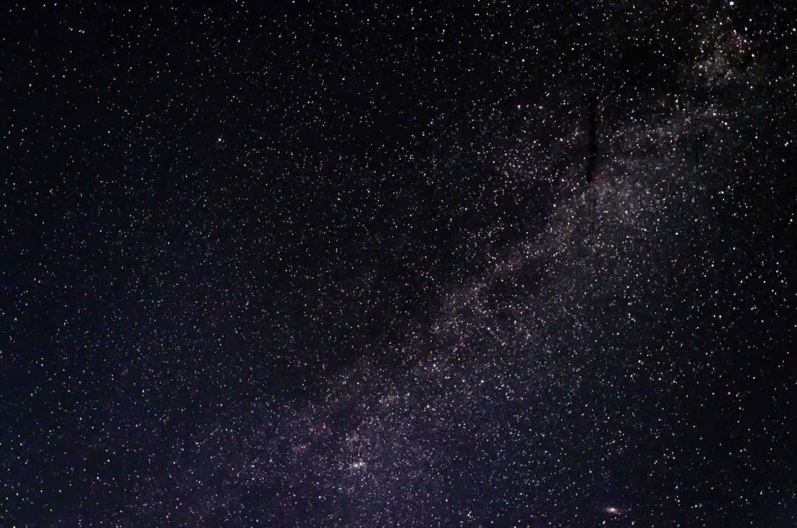
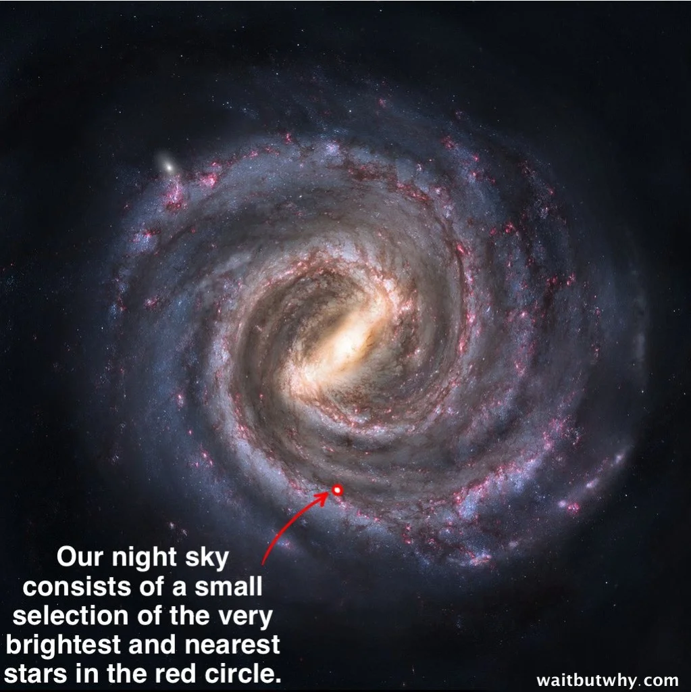
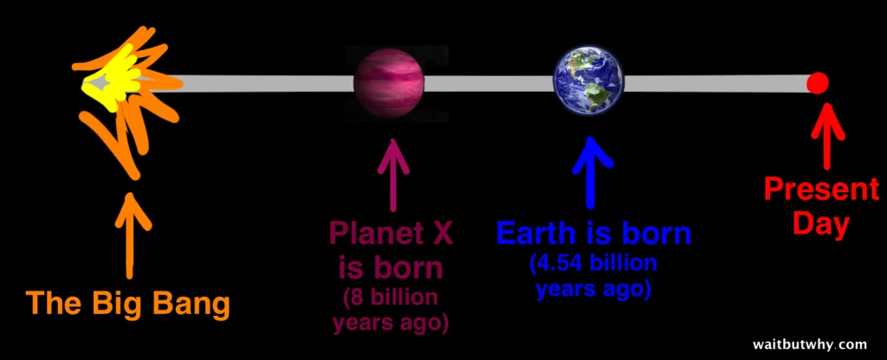
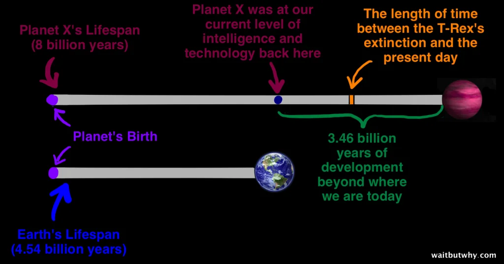
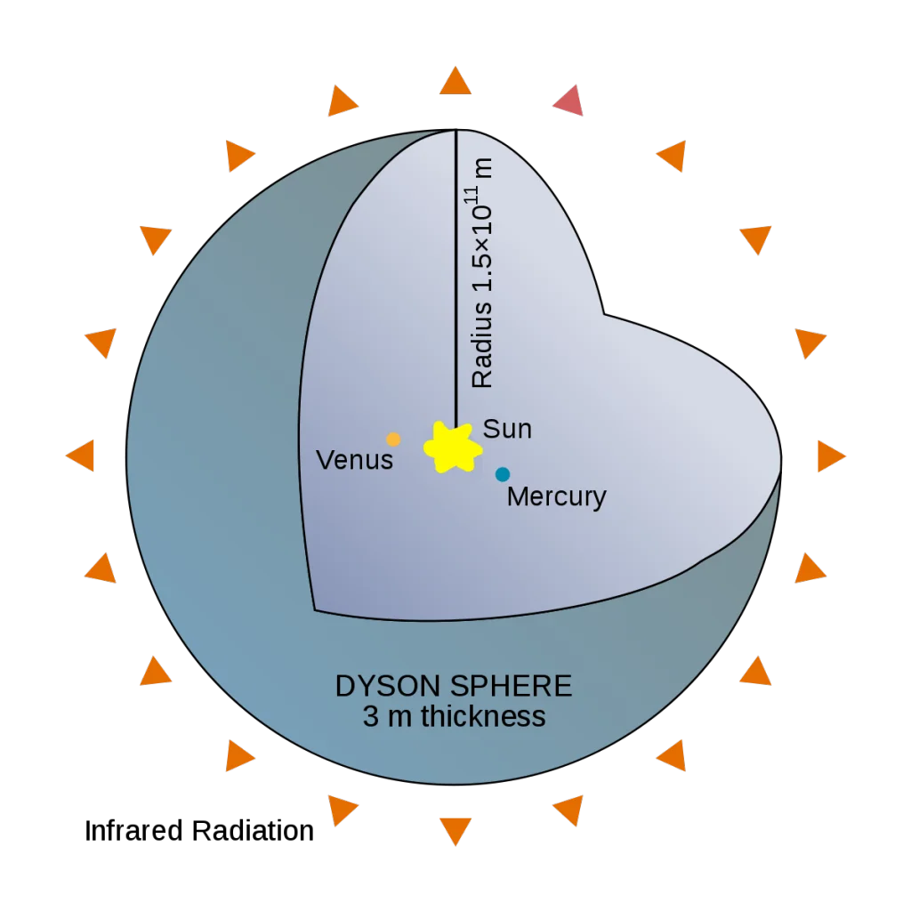
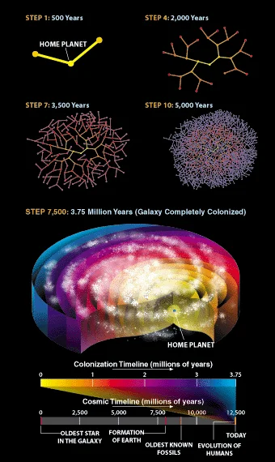
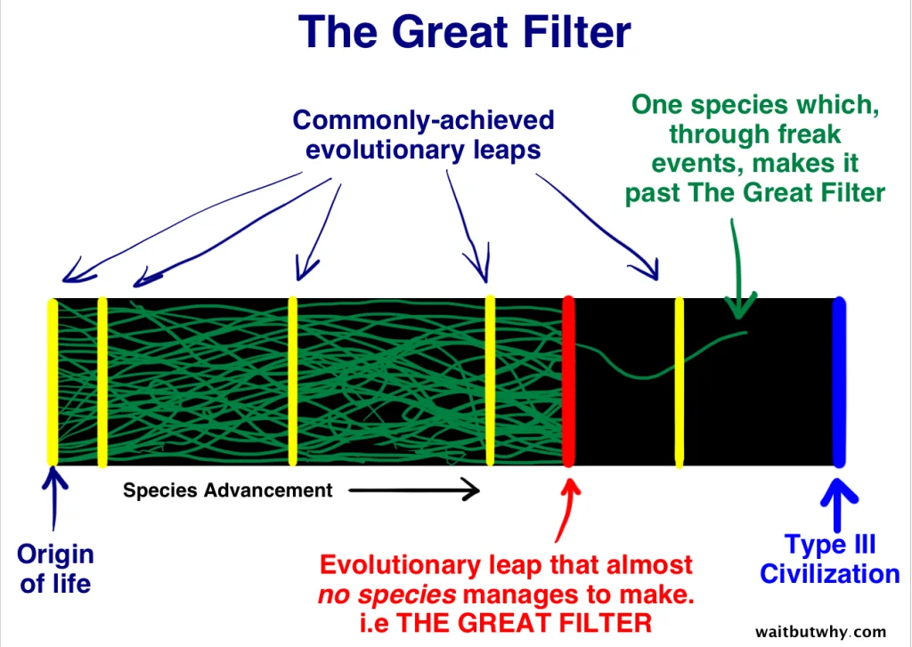
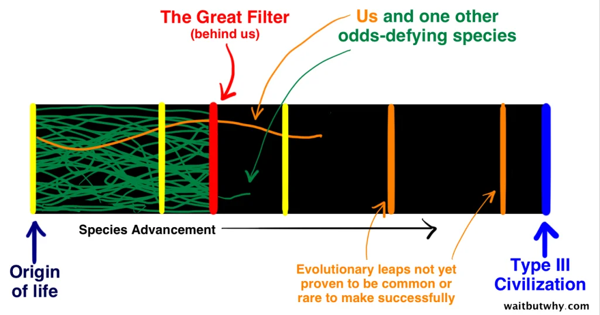
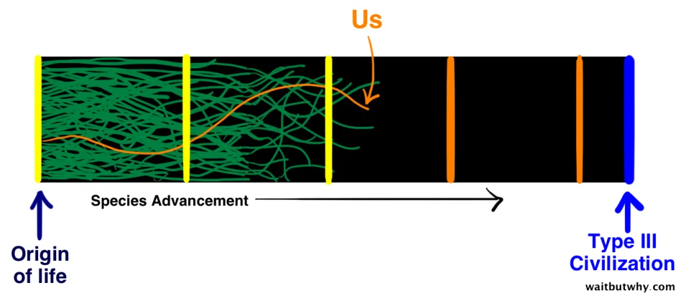
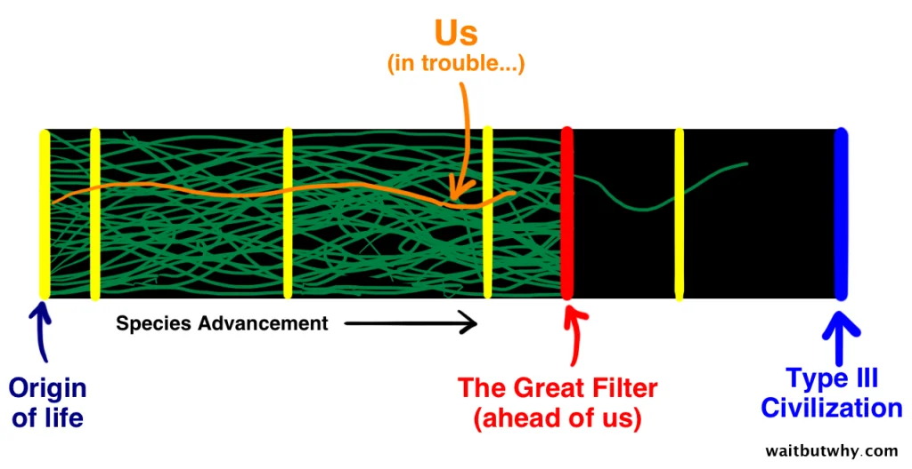

**2014-yil 21-may · Tim Urban**

---

Yulduzlar juda ko‘p ko‘rinadigan joyda, yulduzli tunning ayni muddaosi bo‘lgan bir paytda osmonga qarab, mana buni ko‘rganingizda, har bir odam nimanidir his qiladi:

Ba’zilar odatdagidek, ulkan go‘zallikdan hayratga tushadi yoki koinotning aql bovar qilmas ko‘lamidan lol qoladi. Shaxsan men esa eski odatimga ko‘ra, avval «borliq oldida ekzistensial inqirozga» tushaman, keyin keyingi yarim soat davomida o‘zimni g‘alati tutaman. Ammo har kim nimanidir his qiladi.

Fizik Enriko Fermi ham nimanidir his qilgan edi: «*Xo‘sh, hamma qayerda?*»

---

Haqiqatan ham yulduzlar ko‘p ko‘rinadigan osmon behad kengdek tuyuladi, ammo biz ko‘rayotgan narsamiz aslida juda yaqin atrofimizdagi mahallamiz, xolos. Eng tiniq tunlarda taxminan 2 500 tagacha yulduzni ko‘rishimiz mumkin (bu galaktikamizdagi yulduzlarning qariyb yuz milliondan bir qismi). Ularning deyarli barchasi bizdan 1 000 yorug‘lik yilidan ham yaqin masofada joylashgan (ya’ni Somon Yo‘li diametrining atigi 1 foizi doirasida). Demak, aslida biz ko‘rayotgan manzara mana shu:

Yulduzlar va galaktikalar haqida o‘ylaganimizda, ko‘pchilikni qiziqtiradigan savol shunday: «U yerda, koinotning boshqa joylarida ham aqlli hayot bormi?» Keling, bunga oid raqamlarni ko‘rib chiqaylik.

Galaktikamizda qancha yulduz bo‘lsa (100–400 milliard), kuzatiladigan koinotda ham taxminan shuncha galaktika bor. Demak, ulkan Somon Yo‘lidagi har bir yulduzga qarshi u yerda butun boshli bir galaktika mavjud. Barchasini jamlasak, odatda keltiriladigan hisob-kitobga ko‘ra, jami yulduzlar soni 10²² bilan 10²⁴ oralig‘ida bo‘ladi. Bu Yer yuzidagi har bir sohilning har bir qum donasiga koinotda 10 000 ta yulduz to‘g‘ri keladi, degani.

Bu yulduzlarning necha foizi «Quyoshga o‘xshash» — ya’ni hajmi, harorati va yorqinligi jihatidan Quyoshga yaqin — ekani borasida ilmiy hamjamiyatda yakdil fikr yo‘q. Taxminlar odatda 5 foizdan 20 foizgacha. Eng ehtiyotkor ko‘rsatkichni — 5 foizni — va jami yulduzlar sonining eng quyi chegarasini — 10²² ni — olsak, 500 kvintillion, boshqacha aytganda, 500 milliard milliardta Quyoshga o‘xshash yulduz chiqadi.

Quyoshga o‘xshash yulduzlarning necha foizini Yerga o‘xshash sayyora aylanib yurishi mumkinligi haqida ham bahs bor. Bunday sayyorada harorat sharoiti o‘xshash bo‘lib, suyuq suv mavjud bo‘lishi va Yerga o‘xshash hayotni qo‘llab-quvvatlashi mumkin. Ba’zilar bu ko‘rsatkich 50 foizgacha yetadi deydi, ammo yaqinda PNAS jurnalida e’lon qilingan tadqiqotda olingan ancha ehtiyotkor 22 foizni olaylik. Bu koinotdagi jami yulduzlarning kamida 1 foizi atrofida hayot uchun potensial jihatdan yaroqli, Yerga o‘xshash sayyora aylanishi mumkinligini anglatadi. Bunday sayyoralar soni jami 100 milliard milliardta bo‘ladi.

Demak, dunyodagi har bir qum donasiga 100 ta Yerga o‘xshash sayyora to‘g‘ri keladi. Keyingi safar sohilda bo‘lganingizda shu haqda o‘ylab ko‘ring.

Endi oldinga yurarkanmiz, mutlaqo taxminlarga suyanishdan boshqa ilojimiz yo‘q. Keling, koinot mavjud bo‘lgan milliardlab yillar mobaynida Yerga o‘xshash sayyoralarning 1 foizida hayot paydo bo‘lgan, deb tasavvur qilaylik (agar shunday bo‘lsa, har bir qum donasi hayot mavjud bo‘lgan bitta sayyorani ifodalar edi). Shuningdek, o‘sha sayyoralarning 1 foizida hayot xuddi Yerdagidek aqlli darajagacha rivojlangan, deb faraz qilaylik. Bu kuzatiladigan koinotda 10 kvadrillion, ya’ni 10 million milliardta aqlli sivilizatsiya borligini anglatadi.

Faqat o‘z galaktikamizga qaytib, Somon Yo‘lidagi yulduzlar sonining eng quyi bahosi — 100 milliard — asosida xuddi shu hisobni bajarsak, galaktikamizda 1 milliardta Yerga o‘xshash sayyora va 100 000 ta aqlli sivilizatsiya bor, degan xulosaga kelamiz.¹

SETI (Yerdan tashqaridagi aqlli hayotni izlash) — boshqa aqlli mavjudotlardan kelayotgan signallarni tinglashga bag‘ishlangan tashkilot. Agar galaktikamizda 100 000 yoki undan ortiq aqlli sivilizatsiya bor, degan taxminimiz to‘g‘ri bo‘lsa va ularning hech bo‘lmaganda bir qismi radio to‘lqinlari, lazer nurlari yoki boshqalar bilan aloqa o‘rnatishning boshqa usullaridan foydalanib signal yuborayotgan bo‘lsa, SETI’ning parabolik antennalari turli-tuman signallarni tutib olishi kerak emasmi?

Ammo bunday bo‘lgani yo‘q. Hech bittasini. Hech qachon.

Hamma qayerda?

Vaziyat yanada g‘alati tus oladi. Bizning Quyoshimiz koinot umriga nisbatan ancha yosh. Undan ancha qadimiy yulduzlar va ularning atrofida ancha qadimiy, Yerga o‘xshash sayyoralar bor. Nazariy jihatdan, bu sayyoralarda biznikidan ancha ilg‘or sivilizatsiyalar bo‘lishi kerakligini anglatadi. Masalan, yoshi 4,54 milliard yil bo‘lgan Yerimizni faraziy, yoshi 8 milliard yil bo‘lgan X sayyora bilan solishtiraylik.

Agar X sayyorasining tarixi Yer tarixiga o‘xshash bo‘lsa, u yerdagi sivilizatsiya bugun qaysi bosqichda bo‘lishini ko‘raylik. Yashil vaqt oralig‘i naqadar ulkan ekanini ko‘rsatish uchun to‘q sariq vaqt oralig‘idan mezon sifatida foydalaning:

Bizdan atigi 1 000 yil oldinda bo‘lgan sivilizatsiyaning texnologiyasi va bilimlari bizga o‘rta asr odami uchun bugungi dunyomiz qanchalik hayratlanarli bo‘lsa, shunchalik hayratlanarli tuyulishi mumkin. Bizdan 1 million yil oldinda bo‘lgan sivilizatsiya esa biz uchun insoniyat madaniyati shimpanzelar uchun qanchalik tushunarsiz bo‘lsa, shunchalik tushunarsiz bo‘lishi mumkin. X sayyora esa bizdan 3,4 milliard yil oldinda…

Kardashyov shkalasi degan tushuncha bor. U aqlli sivilizatsiyalarni foydalanadigan energiya miqdoriga qarab uchta keng toifaga ajratishga yordam beradi:

**I turdagi sivilizatsiya** o‘z sayyorasidagi barcha energiyadan foydalanish qobiliyatiga ega. Biz hali I turdagi sivilizatsiya emasmiz, ammo unga yaqinmiz (Karl Sagan ushbu shkala uchun formula yaratgan va unga ko‘ra, biz 0,7 turdagi sivilizatsiyamiz).

**II turdagi sivilizatsiya** o‘z yulduzining butun energiyasini o‘zlashtira oladi. Bizning ojiz I turdagi miyamiz buni qanday amalga oshirish mumkinligini zo‘rg‘a tasavvur qiladi, ammo Dyson sferasi kabi g‘oyalarni o‘ylab, qo‘limizdan kelgancha tasavvur qilishga uringan edik.

**III turdagi sivilizatsiya** qolgan ikki turdan ancha ustun bo‘lib, butun Somon Yo‘li galaktikasining quvvatiga teng energiyadan foydalana oladi.

Bunday taraqqiyot darajasiga ishonish qiyin tuyulsa, yuqoridagi X sayyorani va uning bizdan 3,4 milliard yil ko‘proq rivojlanish imkoniyatiga ega bo‘lganini eslang. Agar X sayyorasidagi sivilizatsiya biznikiga o‘xshash bo‘lsa va III tur darajasigacha yashab qolgan bo‘lsa, tabiiyki, ular yulduzlararo sayohatni allaqachon mukammal o‘zlashtirgan, balki butun galaktikani mustamlaka qilib ham bo‘lgan, deb o‘ylash mumkin.

Galaktikani mustamlaka qilish qanday yuz berishi mumkinligi haqidagi farazlardan biri shuki, boshqa sayyoralarga ucha oladigan mashinalar yaratiladi. Ular yangi sayyoraga yetib borgach, o‘sha joydagi xomashyodan foydalanib, taxminan 500 yil davomida o‘z nusxalarini ko‘paytiradi, so‘ng ikki nusxasini xuddi shu ishni bajarish uchun boshqa joyga yuboradi. Yorug‘lik tezligiga yaqin tezlikda uchishmasa ham, bu jarayon butun galaktikani 3,75 million yil ichida mustamlaka qilishga yetadi. Milliardlab yillar miqyosida bu ko‘z ochib yumguncha o‘tadigan muddat, xolos:

Taxmin qilishda davom etaylik: agar aqlli hayotning 1 foizi galaktikani mustamlaka qilishi mumkin bo‘lgan III turdagi sivilizatsiyaga aylanguncha yashab qolsa, yuqoridagi hisob-kitoblarimizning o‘ziyoq galaktikamizda kamida 1 000 ta III turdagi sivilizatsiya bo‘lishi kerakligini ko‘rsatadi. Bunday sivilizatsiyaning qudratini hisobga olsak, ularning borligi ko‘zga yaqqol tashlanishi kerak edi. Ammo biz hech narsani ko‘rmayapmiz, hech narsa eshitmayapmiz va hech kim bizni ziyorat qilmayapti.

Xo‘sh, hamma qayerda?

---

# Fermi paradoksiga xush kelibsiz

Fermi paradoksiga javobimiz yo‘q. Qo‘limizdan keladigani — «*ehtimoliy izohlar*»ni taklif qilish, xolos. Agar o‘nta turli olimdan qaysi izoh to‘g‘ri bo‘lishi mumkinligi haqidagi taxminini so‘rasangiz, o‘nta turli javob olasiz. O‘tmishdagi odamlar Yer dumaloqmi yoki Quyosh Yer atrofida aylanadimi, yoxud chaqmoq Zevs sababli yuz beradimi, deb bahslashganini eshitganingizda, ular naqadar sodda va bilimsiz bo‘lgan, deb o‘ylaysiz-ku? Bu mavzuda biz ham taxminan o‘sha holatdamiz.

Fermi paradoksiga doir eng ko‘p muhokama qilinadigan ehtimoliy izohlarni ko‘rib chiqishda ularni ikki keng toifaga ajrataylik: birinchi toifadagilar II va III turdagi sivilizatsiyalar belgisi yo‘qligini, chunki bunday sivilizatsiyalar umuman mavjud emasligi bilan izohlaydi; ikkinchi toifadagilar esa ular bor, ammo boshqa sabablar tufayli biz ularni ko‘rmayapmiz yoki eshitmayapmiz, deb hisoblaydi.

## 1-izohlar guruhi: Yuqori darajadagi (II va III turdagi) sivilizatsiyalar belgilari yo‘q, chunki bunday sivilizatsiyalarning o‘zi mavjud emas

Birinchi guruh izohlarini qo‘llab-quvvatlaydiganlar «istisnosizlik muammosi» deb ataladigan masalaga ishora qiladi. Bu muammo: «Yuqori darajadagi sivilizatsiyalar bor, ammo ularning hech biri biz bilan hech qanday aloqa o‘rnatmagan, chunki ularning barchasi _____», deydigan har qanday nazariyaga qarshi dalil bo‘ladi. Birinchi guruh vakillari minglab (yoki millionlab) yuqori darajadagi sivilizatsiyalar bo‘lishi kerakligini ko‘rsatadigan matematik hisob-kitoblarga qaraydi. Ularning fikricha, hech bo‘lmaganda bittasi umumiy qoidadan chetga chiqishi kerak edi. Hatto biror nazariya yuqori darajadagi sivilizatsiyalarning 99,99 foiziga mos kelsa ham, qolgan 0,01 foizi boshqacha yo‘l tutardi va biz ularning mavjudligidan xabar topardik.

Shu sababli, birinchi guruh izohlariga ko‘ra, nihoyatda rivojlangan sivilizatsiyalar umuman yo‘q bo‘lishi kerak. Ammo matematik hisob-kitoblar faqat o‘z galaktikamizning o‘zida ularning minglab bo‘lishi kerakligini ko‘rsatmoqda. Demak, boshqa bir narsa yuz berayotgan bo‘lishi kerak.

Bu boshqa narsa **Buyuk Filtr** deb ataladi.

Buyuk Filtr nazariyasiga ko‘ra, hayot paydo bo‘lishidan tortib III turdagi aql-idrok darajasigacha bo‘lgan yo‘lning qaysidir nuqtasida barcha yoki deyarli barcha hayot shakllari duch keladigan devor bor. Uzoq evolyutsion jarayonning qaysidir bosqichidan o‘tish nihoyatda ehtimoldan yiroq yoki imkonsiz. Ana shu bosqich Buyuk Filtrdir.

Agar bu nazariya to‘g‘ri bo‘lsa, eng muhim savol shunday: Buyuk Filtr vaqt jadvalining qaysi nuqtasida joylashgan?

Ma’lum bo‘lishicha, insoniyat taqdiri haqida gap ketganda, bu savol nihoyatda muhim. Buyuk Filtr qayerda joylashganiga qarab, oldimizda uchta ehtimoliy holat qoladi: biz noyobmiz, biz birinchimiz yoki bizning ishimiz chatoq.

### 1. Biz noyobmiz (Buyuk Filtr ortda qolgan)

Umidlarimizdan biri — Buyuk Filtr ortda qolgan bo‘lishi. Ya’ni biz undan o‘tishga muvaffaq bo‘lganmiz, demak, hayotning biz erishgan aql-idrok darajasigacha yetib kelishi nihoyatda kam uchraydi. Quyidagi diagrammada Filtrdan faqat ikki tur o‘ta olgani va ulardan biri biz ekani ko‘rsatilgan.

Bu ssenariy III turdagi sivilizatsiyalar nega yo‘qligini tushuntirishi mumkin. Ammo bu, shu qadar uzoqqa yetib kelganimizdan so‘ng, biz ham oz sonli istisnolardan biri bo‘lishimiz mumkinligini anglatadi. Demak, umid bor. Tashqi tomondan qaraganda, bu 500 yil avval Yer koinotning markazida turadi, deb taxmin qilgan odamlarga biroz o‘xshaydi — ya’ni biz o‘zimizni alohida deb hisoblaymiz. Biroq olimlar «kuzatuv tanlanishi effekti» deb ataydigan hodisa shuni ko‘rsatadiki, o‘zining naqadar noyobligi haqida o‘ylayotgan har qanday mavjudot aqlli hayotning «muvaffaqiyat hikoyasi»ga mansub bo‘ladi. U haqiqatan ham noyobmi yoki juda keng tarqalganmi, baribir o‘ylaydigan fikrlari va chiqaradigan xulosalari bir xil bo‘ladi. Bu esa alohida ekanimiz hech bo‘lmaganda ehtimollardan biri ekanini tan olishga majbur qiladi.

Agar biz haqiqatan ham alohida bo‘lsak, aynan qachon alohida bo‘lib qoldik? Boshqalar tiqilib qoladigan qaysi bosqichdan biz o‘ta oldik?

Bir ehtimol shuki, Buyuk Filtr eng boshida joylashgan bo‘lishi mumkin: hayotning umuman paydo bo‘lishi nihoyatda noyob hodisadir. Bu taxminni qo‘llab-quvvatlaydigan jihatlar bor: Yer mavjud bo‘lganidan keyin hayot paydo bo‘lishi uchun qariyb bir milliard yil kerak bo‘lgan va biz laboratoriyalarda bu hodisani qayta yaratishga ko‘p bor uringan bo‘lsak-da, uddalay olmadik. Agar Buyuk Filtr haqiqatan ham shu bo‘lsa, bu koinotda nafaqat aqlli hayot, balki boshqa hech qanday hayot ham bo‘lmasligi mumkinligini anglatadi.

Yana bir ehtimol: Buyuk Filtr oddiy prokariot hujayradan murakkab eukariot hujayraga o‘tish bosqichi bo‘lishi mumkin. Prokariotlar paydo bo‘lganidan so‘ng, ular qariyb ikki milliard yil davomida o‘sha holicha qolgan, keyin esa yadroga ega murakkab hujayralarga aylanish uchun evolyutsion sakrashni amalga oshirgan. Agar Buyuk Filtr shu bo‘lsa, koinot oddiy prokariot hujayralar bilan to‘lib-toshgan, ammo ulardan murakkabroq hayot deyarli yo‘q, degani bo‘ladi.

Boshqa ko‘plab ehtimollar ham bor. Hatto ayrimlar hozirgi aql-idrokimiz darajasiga olib kelgan eng so‘nggi sakrashni Buyuk Filtr bo‘lishi mumkin, deb hisoblaydi. Yarim aqlli hayotdan (shimpanzelar) aqlli hayotga (insonlar) o‘tish dastlab mo‘jizaviy bosqichdek tuyulmasligi mumkin. Biroq Stiven Pinker evolyutsiya albatta «yuqoriga ko‘tarilib boradi» degan fikrni rad etadi: «Evolyutsiya biror maqsad sari intilmaydi, shunchaki sodir bo‘ladi. U muayyan ekologik muhit uchun eng foydali moslashuvni tanlaydi. Yerda bu jarayon hozirgacha texnologik aql-idrokka faqat bir marta olib kelgani tabiiy tanlanishning bunday natijasi noyob ekanini va hayot daraxti evolyutsiyasida bu rivojlanish hech qachon muqarrar bo‘lmaganini ko‘rsatishi mumkin».

Aksariyat evolyutsion sakrashlar Buyuk Filtr nomzodi bo‘la olmaydi. Har qanday ehtimoliy Buyuk Filtr milliarddan bir darajasida noyob hodisa bo‘lishi, bir yoki bir nechta favqulodda tasodiflar yuz berishini talab qilishi kerak. Shu sababli, masalan, bir hujayrali hayotdan ko‘p hujayrali hayotga o‘tish bunga nomzod bo‘la olmaydi: bu hodisa Yerning o‘zida alohida-alohida kamida 46 marta sodir bo‘lgan. Xuddi shu sababga ko‘ra, agar Marsda toshga aylangan eukariot hujayra topilsa, yuqorida aytilgan «*oddiy hujayradan murakkab hujayraga o‘tish*» bosqichini (shuningdek, evolyutsion zanjirning undan oldingi barcha bosqichlarini) ehtimoliy Buyuk Filtr sifatida chiqarib tashlashga to‘g‘ri keladi. Chunki bu hodisa Yerda ham, Marsda ham yuz bergan bo‘lsa, u milliarddan bir uchraydigan favqulodda tasodif bo‘lishi deyarli mumkin emas.

Agar biz haqiqatan ham noyob bo‘lsak, bunga g‘ayrioddiy biologik hodisa sabab bo‘lishi mumkin. Ammo bunga «*Noyob Yer gipotezasi*» ham sabab bo‘lishi ehtimol. Bu gipotezaga ko‘ra, Yerga o‘xshash sayyoralar ko‘p bo‘lishi mumkin, lekin Yerdagi muayyan sharoitlar — Quyosh tizimining o‘ziga xos xususiyatlari, uning Oy bilan munosabati (bunday kichik sayyora uchun Oydek katta yo‘ldoshning bo‘lishi noodatiy va u bizning ob-havo hamda okean sharoitlarimizga ta’sir qiladi) yoki sayyoraning o‘ziga xos jihatlari — hayot uchun favqulodda qulaydir.

### 2. Biz birinchimiz

Birinchi guruh tarafdorlari uchun, agar Buyuk Filtr ortda qolmagan bo‘lsa, yagona umid shuki, koinotdagi sharoitlar Katta portlashdan keyin faqat yaqindagina — ilk bor — aqlli hayot rivojlanishiga imkon beradigan holatga yetgan bo‘lishi mumkin. Bunday holda biz va boshqa ko‘plab turlar superintellekt sari yo‘l olayotgan bo‘lishimiz, ammo bu hali ro‘y bermagan bo‘lishi mumkin. Biz tasodifan superaqlli sivilizatsiyalardan birinchilari bo‘lish uchun ayni kerakli davrda yashayapmiz.

Buni haqiqatga yaqinlashtirishi mumkin bo‘lgan hodisalardan biri — gamma-nurlarining portlashlari keng tarqalganidir. Bular biz uzoq galaktikalarda kuzatgan nihoyatda ulkan portlashlardir. Ilk Yerda asteroidlar va vulqonlar faolligi pasayib, hayot paydo bo‘lishi mumkin bo‘lishidan oldin bir necha yuz million yil o‘tganidek, koinot mavjudligining dastlabki davri ham gamma-nurlari portlashlari singari halokatli hodisalarga to‘la bo‘lgan bo‘lishi mumkin. Ular vaqti-vaqti bilan yaqin atrofdagi hamma narsani yo‘q qilib, hayotning ma’lum bosqichdan nariga o‘tishiga to‘sqinlik qilgan bo‘lishi mumkin. Ehtimol, hozir biz astrobiologik faza almashinuvi davrining ichidamiz va aynan hozir hayot ilk bor shuncha uzoq vaqt uzluksiz rivojlana oladigan sharoitga ega bo‘ldi.

### 3. Bizning ishimiz chatoq (Buyuk Filtr oldinda)

Agar biz na noyob, na ilk bo‘lsak, birinchi guruh tarafdorlari Buyuk Filtr kelajakda bo‘lishi kerak, degan xulosaga keladi. Bu hayot muntazam ravishda biz erishgan bosqichgacha rivojlanishini, ammo deyarli barcha holatlarda nimadir uning bundan ancha uzoqqa borib, yuqori darajadagi aql-idrokka erishishiga to‘sqinlik qilishini anglatadi. Biz ham bundan mustasno bo‘lishimiz ehtimoli kam.

Kelajakdagi Buyuk Filtr nomzodlaridan biri — yuqorida aytilgan gamma-nurlari portlashlari kabi muntazam sodir bo‘ladigan ulkan tabiiy falokat bo‘lishi mumkin. Afsuski, ular hali tugamagan va Yer yuzidagi barcha hayot ulardan biri tufayli birdaniga yo‘q bo‘lib ketishi faqat vaqt masalasi, xolos. Yana bir ehtimol — deyarli barcha aqlli sivilizatsiyalar muayyan texnologik darajaga yetgach, oxir-oqibat o‘zini o‘zi yo‘q qilishi muqarrarligidir.

Shu sababli Oksford universiteti faylasufi Nik Bostrom «Yomon xabar yo‘qligi — yaxshi xabar», deydi. Marsda hatto oddiy hayot topilishi ham halokatli xabar bo‘lar edi, chunki bu ortda qolgan bo‘lishi mumkin bo‘lgan bir qator Buyuk Filtr nomzodlarini chiqarib tashlardi. Agar Marsda toshga aylangan murakkab hayot topilsa, Bostromning aytishicha, «bu gazeta muqovasida bosilgan eng yomon xabar bo‘lardi». Chunki bunday topilma Buyuk Filtr deyarli aniq oldimizda ekanini, natijada turimiz halokatga mahkum bo‘lishi mumkinligini anglatardi. Bostrom Fermi paradoksi haqida gapirar ekan, «tungi osmonning sukuti — oltindir», deb hisoblaydi.

## 2-izohlar guruhi: II va III turdagi aqlli sivilizatsiyalar mavjud, ammo biz ularni eshitmayotganimizning mantiqiy sabablari bor

Ikkinchi guruh izohlari biz noyob, alohida yoki biror narsada birinchi ekanimiz haqidagi qarashlarni rad etadi. Aksincha, ular «O‘rtamiyonalik tamoyili»ga ishonadi. Bu tamoyilga ko‘ra, dalillar aksini ko‘rsatmaguncha, galaktikamiz, Quyosh tizimimiz, sayyoramiz yoki aql-idrok darajamizda noodatiy yoxud noyob hech narsa yo‘q, deb hisoblash kerak. Ular, shuningdek, yuqori darajadagi aqlli mavjudotlar haqida dalil yo‘qligini ularning mavjud emasligiga dalil deb qabul qilishga shoshilmaydi. Signallarni qidirishimiz atigi bizdan 100 yorug‘lik yili masofagacha (galaktikaning 0,1 foizi bo‘ylab) yetganini ta’kidlab, bir nechta ehtimoliy izohlarni taklif qiladi. Mana ulardan 10 tasi:

### 1-ehtimol: Superaqlli hayot Yerga allaqachon kelgan bo‘lishi mumkin, ammo bu biz paydo bo‘lishimizdan oldin yuz bergan

Umumiy manzarada ongli insonlar atigi 50 000 yildan beri mavjud — bu vaqtning juda kichik bir lahzasi. Aloqa bundan oldin sodir bo‘lgan bo‘lsa, u faqat bir nechta o‘rdaklarni vahimaga solib, suvga qochishiga sabab bo‘lgan bo‘lishi mumkin, xolos. Bundan tashqari, yozma tariximiz atigi 5 500 yil oldinga boradi. Qadimda yashagan ovchi-yig‘uvchi qabilalardan biri o‘zga sayyoraliklar bilan bog‘liq qandaydir g‘alati hodisani boshdan kechirgan bo‘lishi mumkin, ammo kelajak avlodlarga bu haqda xabar berishning yaxshi usuli bo‘lmagan.

### 2-ehtimol: Galaktika mustamlaka qilingan, ammo biz uning kimsasiz, chekka qishloq hududida yashaymiz

Amerika qit’asini yevropaliklar mustamlaka qilgan bo‘lishi mumkin, ammo uzoq shimoliy Kanadadagi kichik inuit qabilasi bundan xabar topgunicha ancha vaqt o‘tgan bo‘lishi mumkin. Yuqori darajadagi turlarning yulduzlararo yashash hududlarida ham shaharlashuvga o‘xshash holat bo‘lishi mumkin: ma’lum hududdagi barcha qo‘shni Quyosh tizimlari mustamlaka qilingan va o‘zaro aloqa qilib turadi. Biz yashayotgan spiral galaktikaning tasodifiy bir chekka qismigacha borish esa ular uchun amaliy jihatdan ham, maqsad nuqtayi nazaridan ham befoyda bo‘lishi mumkin.

### 3-ehtimol: Jismoniy mustamlaka qilish g‘oyasining o‘zi ancha rivojlangan tur uchun kulgili darajada qoloq tushunchadir

Yuqorida yulduzi atrofida sfera bo‘lgan II turdagi sivilizatsiya tasvirini eslang. Shuncha energiya bilan ular barcha ehtiyojlarini qondiradigan mukammal muhit yaratgan bo‘lishi mumkin. Ehtimol, resurslarga bo‘lgan ehtiyojini kamaytirishning nihoyatda ilg‘or usullarini topishgandir va o‘zlarining baxtli utopiyasini tashlab, sovuq, bo‘sh va rivojlanmagan koinotni kezishga zarracha qiziqishlari yo‘qdir.

Bundan ham rivojlangan sivilizatsiya butun jismoniy olamni nihoyatda ibtidoiy joy deb bilishi mumkin. Ular allaqachon o‘z biologiyasini yengib, miyalarini virtual reallikdagi abadiy hayot jannatiga yuklagan bo‘lishi mumkin. Biologiya, o‘lim, istak va ehtiyojlar hukmron bo‘lgan jismoniy dunyoda yashash ular uchun bizning muzdek va qorong‘i dengizlarda yashaydigan ibtidoiy okean jonzotlariga qarashimizdek tuyulishi mumkin. Ma’lumot uchun: boshqa bir hayot shakli o‘limni yenggan bo‘lishi mumkinligi haqida o‘ylash meni nihoyatda hasadgo‘y va xafa qiladi.

### 4-ehtimol: U yerda dahshatli yirtqich sivilizatsiyalar bor, shu sababli aksariyat aqlli hayot vakillari joylashuvini oshkor qiladigan signallarni yubormaslik kerakligini yaxshi biladi

Bu yoqimsiz tushuncha SETI sun’iy yo‘ldosh antennalari nega hech qanday signal qabul qilmayotganini tushuntirishga yordam beradi. Bu, shuningdek, tashqariga signal yuborish orqali nihoyatda sodda, ahmoqona va tavakkal ish qilayotgan yangilar biz bo‘lishimiz mumkinligini anglatadi. Hozir METI (Yerdan tashqaridagi aqlli mavjudotlarga xabar yuborish — SETI’ning teskarisi) bilan shug‘ullanish kerakmi-yo‘qmi, degan bahs ketmoqda va ko‘pchilik bunday qilmasligimiz kerak, deb hisoblaydi. Stiven Hoking shunday ogohlantiradi: «*Agar o‘zga sayyoraliklar bizga tashrif buyursa, oqibatlar Xristofor Kolumb Amerikaga kelganidagi holatga o‘xshashi mumkin. Bu mahalliy amerikaliklar uchun yaxshi yakunlanmagan*». Hatto yulduzlararo sayohat qilishga yetarlicha rivojlangan har qanday sivilizatsiya dushman emas, balki xayrixoh bo‘ladi, deb hisoblagan Karl Sagan ham METI amaliyotini «nihoyatda aqlsizlik va yetilmaganlik» deb atagan. U shunday tavsiya qilgan: «*G‘alati va noaniq koinotdagi eng yangi bolalar biz tushunmaydigan noma’lum o‘rmonga baqirishdan oldin uzoq vaqt jim tinglashlari, koinotni sabr bilan o‘rganishlari va o‘zaro ma’lumot almashishlari kerak*». Qo‘rqinchli.¹

### 5-ehtimol: Yuqori darajadagi aqlli hayotning faqat bitta namunasi — «*superyirtqich*» sivilizatsiya (xuddi Yerda insonlar kabi) mavjud. U boshqalardan ancha rivojlangan va ma’lum darajaga yetgan har qanday aqlli sivilizatsiyani yo‘q qilib, shu ustunligini saqlab keladi

Bu juda yomon bo‘lardi. Bu quyidagicha ishlashi mumkin: yangi paydo bo‘layotgan barcha aqlli hayot shakllarini yo‘q qilish resurslardan samarasiz foydalanish bo‘lishi mumkin, chunki ularning aksariyati baribir o‘z-o‘zidan yo‘q bo‘lib ketadi. Ammo ma’lum bir nuqtadan keyin supermavjudotlar harakatga tushadi. Chunki ular uchun o‘sib, tarqala boshlayotgan aqlli tur virusga o‘xshab qoladi. Bu nazariya galaktikada birinchi bo‘lib aql-idrokka erishgan kimsa g‘alaba qozonganini va endi boshqa hech kimda imkoniyat yo‘qligini anglatadi. Bunday holat koinotning boshqa joylarida faollik yo‘qligini tushuntirishi mumkin, chunki superaqlli sivilizatsiyalar soni faqat bittaligicha qoladi.

### 6-ehtimol: U yerda faollik va shovqin juda ko‘p, ammo bizning texnologiyamiz juda ibtidoiy va biz noto‘g‘ri narsalarni tinglayapmiz

Bu xuddi zamonaviy ofis binosiga kirib, ratsiyani yoqib, hech qanday faollik eshitmaganingiz uchun bino bo‘sh ekan, degan xulosaga kelishga o‘xshaydi. Vaholanki, hech narsa eshitmasligingiz tabiiy: u yerdagilar ratsiyadan foydalanmaydi, balki SMS yozishadi. Yoki Karl Sagan ta’kidlaganidek, bizning ongimiz u yerdagi boshqa bir aql shakliga qaraganda millionlab marta tezroq yoki sekinroq ishlashi mumkin. Masalan, ular «Salom» deyish uchun 12 yil sarflasa, biz bu aloqani eshitganimizda, u bizga oddiy oq shovqindek tuyulishi mumkin.

### 7-ehtimol: Biz boshqa aqlli hayot shakllaridan aloqa signallarini qabul qilyapmiz, ammo hukumat buni yashiryapti

Bu mavzuni qanchalik ko‘p o‘rgansam, bu nazariya menga shunchalik ahmoqona tuyulmoqda. Lekin u juda ko‘p muhokama qilingani uchun uni ham keltirishim kerak edi.

### 8-ehtimol: Yuqori darajadagi sivilizatsiyalar bizdan xabardor va bizni kuzatib turibdi (ya’ni «*Hayvonot bog‘i gipotezasi*»)

Biz bilganimizcha, superaqlli sivilizatsiyalar qat’iy tartibga solingan galaktikada yashaydi. Bizning Yerimiz esa ulkan va himoyalangan milliy bog‘ning bir qismi sifatida ko‘riladi; biznikiga o‘xshash sayyoralar uchun «Qara, ammo tegma» qoidasi qat’iy amal qiladi. Biz ularni payqamaymiz, chunki ancha aqlli tur bizni kuzatishni istasa, buni biz sezmaydigan tarzda osonlik bilan amalga oshira oladi. Balki Star Trek’dagi «Bosh ko‘rsatma»ga o‘xshash qoida mavjuddir: u superaqlli mavjudotlarga biz kabi kamroq rivojlangan turlar bilan ochiq aloqa o‘rnatishni yoki o‘zini har qanday tarzda oshkor qilishni, toki ular ma’lum aql-idrok darajasiga yetmagunicha, taqiqlaydi.

### 9-ehtimol: Yuqori darajadagi sivilizatsiyalar shu yerda, atrofimizda. Ammo biz ularni anglash uchun juda ibtidoiymiz

Michio Kaku buni quyidagicha tushuntiradi:

> «Tasavvur qiling, o‘rmon o‘rtasida chumolilar uyasi bor. Uning yonida esa ular o‘n qatorli supermagistral qurishyapti. Savol shunday: *“Chumolilar o‘n qatorli supermagistral nima ekanini tushuna olarmidi? Ular yonlarida magistral qurayotgan mavjudotlarning texnologiyasi va niyatlarini anglay olarmidi?”*»

Demak, gap X sayyorasidan kelayotgan signallarni texnologiyamiz yordamida tutib ololmasligimizda emas. Gap shundaki, X sayyorasidagi mavjudotlar kimligini yoki ular nima qilmoqchi ekanini hatto tasavvur ham qila olmaymiz. Bu bizdan shu qadar ustunki, ular bizni ma’rifatli qilishni chin dildan istagan taqdirda ham, bu chumolilarga internet haqida tushuntirishga urinish bilan barobar bo‘lardi.

Shu fikrga bog‘liq yana bir savolga javob ham shunda bo‘lishi mumkin: «*Agar III turdagi shuncha ajoyib sivilizatsiya mavjud bo‘lsa, nega ular hali biz bilan bog‘lanmadi?*» Bunga javob berish uchun o‘zimizdan so‘raylik: Pisarro Peruga kelganida, chumolilar uyasi yonida to‘xtab, ular bilan aloqa o‘rnatishga uringanmi? U chumolilarga yordam berishga intilib, saxovat ko‘rsatganmi? Chumolilar uyasini ezib tashlash uchun asl missiyasini sekinlashtirib, ularga dushmanlik qilganmi? Yoki chumolilar uyasi Pisarro uchun mutlaqo, butunlay va abadiy ahamiyatsiz bo‘lganmi? Bizning holatimiz ham shunday bo‘lishi mumkin.

### 10-ehtimol: Biz borliq haqidagi tasavvurimizda butunlay adashganmiz

Biz o‘ylayotgan hamma narsada mutlaqo xato bo‘lishimiz mumkin bo‘lgan ko‘plab yo‘llar bor. Koinot bir ko‘rinishda namoyon bo‘lib, aslida butunlay boshqa narsa — masalan, gologramma — bo‘lishi mumkin. Yoki, ehtimol, o‘zimiz o‘zga sayyoralikmiz va tajriba o‘tkazish yoki o‘g‘it sifatida foydalanish uchun bu yerga joylashtirilgandirmiz. Hatto barchamiz boshqa dunyodagi bir tadqiqotchi yaratgan kompyuter simulyatsiyasining ichida yashayotgan bo‘lishimiz, boshqa hayot shakllari esa simulyatsiyaga umuman dasturlanmagan bo‘lishi ham mumkin.

---

Yerdan tashqaridagi aql-idrokni topish uchun, ehtimol, behuda bo‘lishi mumkin bo‘lgan izlanishimizni davom ettirar ekanmiz, o‘zim aslida nimani xohlayotganimga ishonchim komil emas. Ochig‘ini aytsam, koinotda mutlaqo yolg‘iz ekanimizni rasman bilish ham, biz bilan boshqalar ham borligini rasman bilish ham qo‘rqinchli tuyulardi. Yuqorida sanab o‘tilgan barcha g‘ayrioddiy ssenariylarda ham aynan shu jihat bor: haqiqat qanday bo‘lishidan qat’i nazar, u aqlni lol qoldiradi.

Fermi paradoksi ilmiy fantastikaga xos hayratlanarli jihatlaridan tashqari, meni chuqur kamtarlikka ham undaydi. Bu shunchaki koinot har doim uyg‘otadigan «Ha, men mikroskopik darajada kichkinaman va mavjudligim uch soniyaga teng» degan odatiy kamtarlik emas. Fermi paradoksi yanada o‘tkir, shaxsiyroq kamtarlikni yuzaga chiqaradi. Bunday tuyg‘u faqat soatlab izlanish olib borib, o‘z turimizning eng mashhur olimlari aql bovar qilmas nazariyalarni ilgari surishini, fikrini qayta-qayta o‘zgartirishini va bir-biriga keskin zid qarashlarini eshitgandan keyin paydo bo‘lishi mumkin. Bular bizga kelajak avlodlar ham bizga xuddi osmondagi yulduzlar samoviy gumbazning ostki tomoni ekaniga ishongan qadimgi odamlar kabi qarashini eslatadi. Ular: «*Voy, ular aslida nimalar bo‘layotganini umuman tushunmagan ekan-ku*», deb o‘ylashadi.

Bularning barchasiga II va III turdagi sivilizatsiyalar haqidagi gaplar insoniyatning o‘ziga bo‘lgan hururiga yetkazadigan zarba ham qo‘shiladi. Yerda biz o‘z kichik qal’amizning qirolimiz, sayyoramizni biz bilan baham ko‘rayotgan ulkan ahmoqlar to‘dasining faxrli hukmdorimiz. Raqobat yo‘q va bizni baholaydigan hech kim yo‘q bu pufak ichida o‘zimizdan ancha past turadigan boshqa bir tur mavjudligi haqidagi fikrga kamdan-kam duch kelamiz. Ammo o‘tgan hafta II va III turdagi sivilizatsiyalar bilan ko‘p vaqt o‘tkazganimdan so‘ng, qudratimiz va g‘ururimiz biroz Devid Brentga xos tus olayotgandek ko‘rinmoqda.

Shunday bo‘lsa-da, odatda insoniyatni kimsasiz koinot o‘rtasidagi mitti qoyada yolg‘iz qolgan yetim deb tasavvur qilishimni hisobga olsak, ehtimol biz o‘zimiz o‘ylaganchalik aqlli emasligimiz va ishonchimiz komil bo‘lgan ko‘p narsalar noto‘g‘ri bo‘lishi mumkinligi haqidagi kamtarona haqiqat menga ajoyib tuyuladi. Bu voqeaning biz anglaganimizdan ko‘ra kattaroq davomi bo‘lishi mumkin degan umidga, juda kichik bo‘lsa-da, eshik ochadi.

