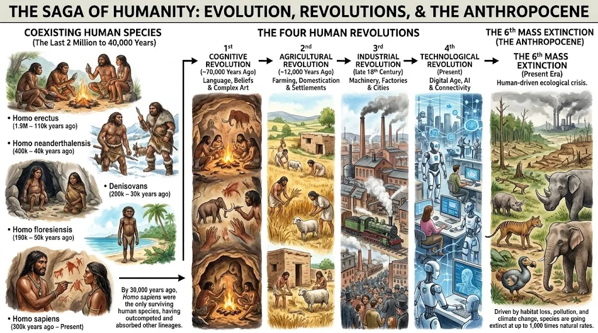

Biz ko'pincha o'zimizni tabiatning toji, Yerdagi yagona aql-idrok egalari deb hisoblaymiz. Ammo doim ham bunday bo'lmagan. Tasavvur qiling, bundan atigi 100 ming yil oldin Yer yuzida odamning faqat bitta emas, balki kamida oltita turli xil turi bir vaqtning o'zida yashagan! Ular xuddi sher, qoplon va gepardlar kabi bir oilaga mansub, ammo turli xil jonzotlar edi.

Xo'sh, nega bugun faqat biz — Homo sapiens (Aqlli odam) qoldik? Qolgan "aka-ukalarimiz" qayoqqa g'oyib bo'ldi? Keling, shu savollarga ilmiy nuqtai nazardan javob izlaymiz.

## 1. Boshqa "Odam"lar va Ularning Taqdiri
Insonlarning ilk ajdodlari bundan 2.5 million yil oldin Sharqiy Afrikada paydo bo'lgan. Vaqt o'tishi bilan ular dunyoning turli burchaklariga tarqalib, u yerdagi iqlimga moslashgan holda turli xil "Homo" (Odam) turlariga evolyutsiya qildi. Biz bilan bir davrda yashagan eng mashhur turlar quyidagilar:
#### Homo neanderthalensis (Neandertallar):
 Yevropa va G'arbiy Osiyoning sovuq iqlimiga moslashgan, bizdan ko'ra muskulli, baquvvat va hatto miya hajmi biznikidan biroz kattaroq bo'lgan odamlar.

####  Denisovaliklar: 
Osiyoning g'orlarida (ayniqsa Sibir va Tibetda) yashagan sirli odam turi.

#### Homo erectus (Tik yuruvchi odam): 
Asosan Sharqiy Osiyoda yashagan.
Homo floresiensis (Xobbitlar): Indoneziyaning Flores orolida yashagan, bo'yi atigi 1 metr atrofida bo'lgan mitti odamlar.

#### Nega ular qirilib ketdi?
Olimlar o'rtasida ikkita asosiy nazariya bor: Chatishish nazariyasi va O'rnini egallash (Siqib chiqarish) nazariyasi. Bugungi kunda DNK tahlillari ikkalasi ham to'g'ri ekanligini ko'rsatmoqda.
Homo sapiens Afrikadan chiqib, Yevropa va Osiyoga kirib borgach, Neandertallar va Denisovaliklar bilan resurslar (ovqat, yashash joyi) uchun raqobatga kirishdi. Bizning turimiz ijtimoiy jihatdan jipslashgan, qurollarimiz mukammalroq edi. Raqobatda biz yutib chiqdik va ularni chekkaroq, ozuqa kam hududlarga siqib chiqardik. Shu bilan birga, biz ular bilan qisman chatishdik ham (bugungi kunda afrikaliklardan tashqari barcha insonlarning DNKsida 1.5-2% Neandertal geni bor).

#### Kim ko'proq yashadi? (Solishtirish)
Biz o'zimizni juda uzoq yashayotgandek his qilamiz, ammo tarixiy masshtabda Homo sapiens hali juda yosh tur.
Homo erectus: Taxminan 1.9 million yil davomida yashagan. Bu insoniyat tarixidagi mutlaq rekord!
Neandertallar: Taxminan 350 000 - 400 000 yil yashagan va bundan 40 ming yil oldin qirilib ketgan.

**Homo sapiens (Biz)**: Bundan atigi 300 000 yil oldin paydo bo'lganmiz.
Biz Homo erectusning rekordini yangilashimiz uchun yana 1.6 million yil omon qolishimiz kerak. Ammo bugungi texnologik va ekologik xatarlarni hisobga olsak, bunga kafolat yo'q.

## 2. Insoniyatni G'olib Qilgan To'rt Inqilob
Nega aynan Homo sapiens barcha raqobatchilarini yengib, butun sayyora xo'jayiniga aylandi? Isroillik tarixchi Yuval Nuh Xarari va boshqa antropologlarning ta'kidlashicha, buning sababi bizning miyamiz va jamiyat tuzilishimizda yuz bergan inqiloblardir.

#### I. Aqliy inqilob (**Cognitive Revolution**) — ~70,000 yil oldin
Bu davrda bizning miyamizdagi genetik mutatsiya tufayli biz mutlaqo yangicha fikrlash va gapirish qobiliyatiga ega bo'ldik. Eng muhimi — biz mavjud bo'lmagan narsalar (miflar, dinlar, qonunlar, millatlar) haqida ishonch bilan gapirishni o'rgandik.
Neandertallar faqat o'zi ko'rgan narsasi (masalan, "Daryo bo'yida sher bor") haqida gapira olsa, Sapiens "Bu sher bizning qabilamizning muqaddas ruhi" deb ayta oldi. Bu qobiliyat minglab notanish odamlarga bitta g'oya atrofida birlashish va ulkan jamoa bo'lib hamkorlik qilish imkonini berdi.

#### II. Agrar inqilob (**Agricultural Revolution**) — ~12,000 yil oldin
Ovchilik va termachilikdan voz kechib, bug'doy eqish va hayvonlarni xonakilashtirishga o'tdik. Insonlar bir joyda muqim yashay boshladi, qishloqlar va shaharlar qurildi. Aholi soni keskin o'sdi. Ammo agrar inqilobning qorong'i tarafi ham bor edi: oziq-ovqat turi kamaydi, odamlar og'ir mehnatga mahkum bo'ldi va hayvonlardan o'tuvchi yuqumli kasalliklar (vabo, chechak) paydo bo'ldi.

#### III. Sanoat inqilobi (**Industrial Revolution**) — 250 yil oldin
Bug' dvigatelining kashf etilishi va qazilma yoqilg'ilar (ko'mir, neft) dan foydalanish insoniyatga mislsiz energiya berdi. Fabrikalar, poyezdlar, tibbiyotdagi kashfiyotlar (antibiotiklar) tufayli o'lim darajasi keskin tushib ketdi. Atigi ikki asr ichida Yer aholisi 1 milliarddan 8 milliardga sakradi.

#### IV. To'rtinchi texnologik inqilob (**Fourth Industrial Revolution**) — 
Hozirgi davr
Biz hozir aynan shu inqilobning ichida yashayapmiz. Sun'iy intellekt, gen injeneriyasi (CRISPR), biotexnologiyalar va koinotni zabt etish davri. Endi biz nafaqat atrof-muhitni, balki hayotning o'zini (genlarni) ham qayta dasturlash darajasiga yetdik. Inson o'z evolyutsiyasini o'zi boshqaradigan "Xudo" darajasiga yaqinlashmoqda.

## 3. Oltinchi Ommaviy Qirilish (Golotsen Qirilishi)
Sayyoramiz tarixida oldin 5 ta ulkan ommaviy qirilish yuz bergan (ular haqida oldingi qismda yozgan edik). Ularning barchasi tabiat hodisalari — asteroid tushishi yoki vulqonlar otilishi sababli ro'y bergan. Ammo hozir boshlangan Oltinchi ommaviy qirilish tarixda yagona bo'lib, u bitta turning — insonlarning faoliyati tufayli sodir bo'lmoqda.
BMTning Biologik xilma-xillik bo'yicha hisobotiga (IPBES) ko'ra:
Hozirgi kunda o'simlik va hayvon turlarining yo'qolib ketish sur'ati tabiiy holatdan 100 dan 1000 baravargacha tezlashgan.
Taxminan 1 millionga yaqin hayvon va o'simlik turi yaqin o'n yilliklarda butunlay qirilib ketish arafasida.
Bunga asosiy sabablar: o'rmonlarni kesish (yashash joylarini yo'q qilish), atrof-muhitning plastik va kimyoviy ifloslanishi, global iqlim isishi va brakonyerlikdir.
Biz o'zimizning yashash joyimiz bo'lgan Yerni kesib tashlayapmiz. Agar ekotizim (oziq-ovqat zanjiri) qulasa, bu zanjirning eng tepasida turgan Homo sapiens ham omon qololmaydi.

## Xulosa
Bizning turimiz tabiatning oddiy bir qismi bo'lib yaraldi, ammo bugun biz tabiatning taqdirini hal qiluvchi kuchga aylandik. Aqliy inqilob bizga hamkorlik qilishni, agrar va sanoat inqiloblari bizga qudratni berdi. Hozirgi to'rtinchi inqilob esa bizdan eng muhim narsani — mas'uliyatni talab qilmoqda. O'tmishdagi qardoshlarimiz (Neandertallar va Erectuslar) tabiat qonunlariga dosh berolmay yo'qolib ketishdi. Biz esa o'zimiz yaratgan qonuniyatlar qurboniga aylanmasligimiz kerak.
