Bu — men anchadan beri yozmoqchi bo‘lib yurgan mavzu: karyera haqida post. Jamiyat bizga karyerada nimani xohlashimiz kerakligi va qanday imkoniyatlar borligi haqida ko‘p narsa aytadi. Bu g‘alati, chunki men jamiyat bu masalalarda deyarli hech narsa bilmasligiga ishonaman. Karyera masalasida jamiyat — bayram kunlari sizni qisib olib, o‘n besh daqiqa davomida deyarli tushunarsiz, so‘ralmagan nasihatlarini to‘kib soladigan keksa amakiga o‘xshaydi. Siz uning gapiga deyarli quloq solmaysiz, chunki u nima haqida gapirayotganini o‘zi ham bilmasligi, aytganlarining hammasi qirq besh yil eskirib qolgani ayon. Jamiyat — o‘sha keksa amaki, ommabop qarashlar (conventional wisdom) esa — uning ming‘irlashi. Faqat bu safar biz quloqni berkitib o‘tirmaymiz, aksincha, har bir so‘ziga ixlos bilan quloq solamiz-da, keyin uning gaplariga qarab hayotimizdagi eng muhim qarorlarni qabul qilamiz. Bu — ancha g‘alati ish.
 
Bu post aslida karyera bo‘yicha maslahat emas — bu sizning kimligingizni, nimani xohlayotganingizni va bugungi tez o‘zgaruvchan karyera manzarasini aks ettiradigan karyera qarorlarini qabul qilishda yordam beradigan fikrlash tizimi. Siz bu borada mutaxassis emassiz, lekin o‘zingizga nima yaxshiligini aniqlashga hammamizning o‘zini bilmaydigan keksa amakimizdan ancha ko‘proq vakolatlisiz. Karyerasini hali boshlamagan va hayotda nima qilishni bilmaydiganlarga ham, karyerasining o‘rtasida turib, to‘g‘ri yo‘ldamanmi, deb ikkilanayotganlarga ham bu post fikrlash jarayonini “qayta yuklash” va biroz oydinlik topishga yordam bersa, deb umid qilaman.
 
---
 
## Hayot yo‘lingiz hozirgacha
 
Ko‘pchiligimiz uchun bolalik daryoga, biz esa shu daryodagi itbaliqlarga o‘xshaymiz.

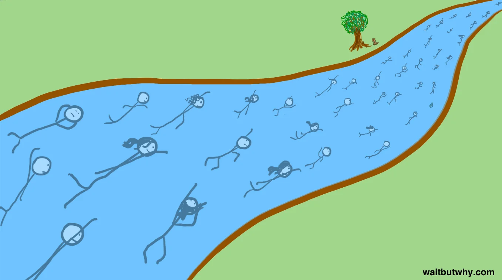
 
Daryoni biz tanlamaganmiz. Biz xuddi to‘satdan uyg‘onib ketgandek, ota-onamiz, jamiyat va sharoit biz uchun belgilab qo‘ygan yo‘lda ekanimizni ko‘ramiz. Bizga daryoning qoidalari, qanday suzish kerakligi va maqsadlarimiz nima bo‘lishi lozimligi aytib qo‘yiladi. Vazifamiz — yo‘limiz haqida bosh qotirish emas, balki muvaffaqiyat deganda bizga o‘rgatilgan narsaga qarab, qo‘yib yuborilgan yo‘limizda yutuqqa erishishdir.
 
Ko‘pchiligimizda — va menimcha, Wait But Why o‘quvchilarining katta qismida ham — bolalik daryosi keyin kollej deb ataladigan ko‘lchaga quyiladi. Aynan qaysi ko‘lchaga tushishimizda bizning ham ozgina ovozimiz bo‘lishi mumkin, ammo oxir-oqibat, kollej ko‘lchalarining ko‘pi bir-biridan unchalik farq qilmaydi.

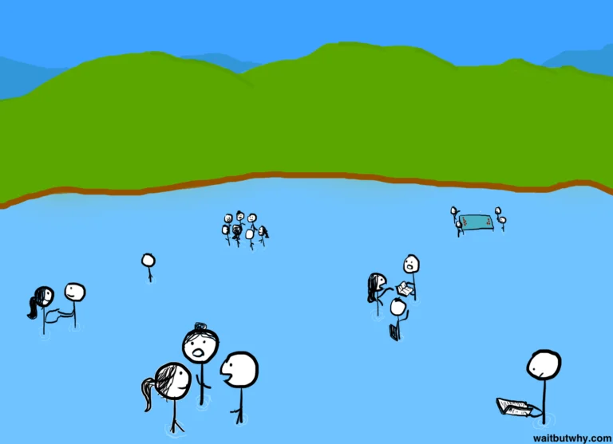
 
Ko‘lchada biz biroz erkinroq nafas olamiz va aniqroq qiziqishlar sari yo‘l ochish uchun ozgina imkon topamiz. Ko‘lcha qirg‘oqlariga — haqiqiy dunyo boshlanadigan va umrimizning qolgan qismini o‘tkazadigan joyga — qarab, o‘yga tola boshlaymiz. Bu odatda aralash tuyg‘ularni uyg‘otadi.
 

Va nihoyat, shiddatli daryoda uyg‘onganimizdan 22 yil o‘tib, bizni ko‘lchadan quvib chiqarishadi va dunyo “borib, hayotingdan biror narsa yasa” deydi.
 

Bu yerda bir nechta muammo bor. Birinchisi: o‘sha lahzada siz xuddi ko‘nikmasiz, bilimsiz va yana ko‘p narsasiz qolgandek bo‘lasiz:
 

Ammo o‘zingizning umumiy yaroqsizligingiz bilan shug‘ullanib ulgurmasdanoq, undan ham kattaroq muammo chiqadi: oldindan belgilab qo‘yilgan yo‘lingiz tugadi. Maktabdagi bolalar xuddi bosh direktori boshqa odam bo‘lgan kompaniyaning xodimlariga o‘xshaydi. Haqiqiy hayotda esa na hayotingizning, na karyera yo‘lingizning direktori bor — faqat o‘zingizdan boshqa. Siz esa butun umringizni o‘quvchilik kasbining mohir ustasi bo‘lishga sarflab, hech narsaning direktori bo‘lish tajribasiga ega bo‘lmay qolgansiz. Shu paytgacha siz faqat mayda, “mikro” qarorlarga javob berib keldingiz — “Talaba sifatidagi ishimda qanday qilib yaxshi natija ko‘rsataman?” — endi esa to‘satdan “makro” kabinaning kalitlari ham qo‘lingizda, va siz “Men kimman?”, “Hayotda nima muhim?”, “Qanday yo‘llar bor, qaysi birini tanlayman, umuman, yo‘lni qanday yaratadi odam?” kabi bosimli makro savollarga javob berishingiz kerak. Maktabni oxirgi marta tark etganimizda, o‘rganib qolgan makro yo‘l-yo‘riq birdan yo‘qoladi, biz esa nima qilishni bilmay, qo‘limizni qayerga qo‘yishni bilmay serrayib qolamiz.
 
Keyin vaqt o‘tadi. Biz qandaydir yo‘lga tushib qolamiz. Va o‘sha yo‘l hayotimiz hikoyasiga aylanadi.
 
Umrimiz oxirida ortga nazar tashlab, ishlar qanday kechganini ko‘rganimizda, hayot yo‘limizni qushlar uchadigan balandlikdan — butun-butunligicha ko‘ramiz.
 
Olimlar o‘lim to‘shagidagi odamlarni va ularning o‘z hayotiga munosabatini o‘rganganida, ko‘pchiligi jiddiy pushaymonlik his qilishini aniqlaydi. Menimcha, bu pushaymonliklarning ko‘pi shundan kelib chiqadi: bolaligimizda bizga yo‘l yaratishni deyarli o‘rgatishmaydi, kattalar sifatida ham bu borada unchalik ilgarilab ketmaymiz. Natijada ko‘plar o‘zi kim ekanini va yashagan dunyosini hisobga olganda, unchalik mantiqqa to‘g‘ri kelmaydigan hayot yo‘liga qarab qoladi.
 
Demak, bu post — yo‘l yaratish haqida. Keling, o‘lim to‘shagiga yetib bormasimizdan oldin o‘ttiz daqiqa to‘xtab, hozir yurib ketayotgan yo‘limizga, shu yo‘l bizni qayoqqa olib borayotganiga nazar tashlaylik va uning mantiqqa to‘g‘ri kelishiga ishonch hosil qilaylik.
 
## Oshpaz va shef — qayta ko‘rib chiqamiz
 
Ilgari men “birlamchi tamoyillardan kelib chiqib fikrlash” bilan “o‘xshashlik bo‘yicha fikrlash” o‘rtasidagi muhim farq haqida yozgan edim — buni “shef” (chef) bo‘lish va “oshpaz” (cook) bo‘lish deb atagandim. O‘sha postni yozganimdan beri bu farqni hamma joyda ko‘raman va o‘z hayotimda u haqida taxminan 2 million marta o‘ylab ko‘rganman.
 
G‘oya shundan iboratki, birlamchi tamoyillardan kelib chiqib fikrlash — olimdek fikrlash demak. Siz asosiy faktlar va kuzatuvlarni olib, ulardan xulosani xuddi jumboqni terganday yig‘asiz — xomashyo bilan tajriba qilib, undan biror yaxshi taom chiqarmoqchi bo‘lgan shefga o‘xshab. Shu tariqa bosh qotira-qotira, shef oxir-oqibat yangi retsept yozadi. Fikrlashning ikkinchi turi — o‘xshashlik bo‘yicha fikrlash — ishlar allaqachon qanday qilinayotganiga qarab, uni asosan ko‘chirib olishingizda yuz beradi, u yer-bu yerga ozgina o‘z qo‘shimchangizni qo‘shasiz, xolos — xuddi tayyor retsept bo‘yicha pishiradigan oshpazga o‘xshab.
 
Retseptni so‘zma-so‘z ko‘chiradigan sof oshpaz bilan mustaqil ijod qiladigan sof shef — albatta, bir spektrning ikki chekkasi. Lekin hayotingizning fikrlash va qaror qabul qilishni talab qiladigan har bir sohasida, spektrning qayerida bo‘lishingizdan qat’i nazar, fikrlash tarzingizni asosan shefcha yoki asosan oshpazcha deb atash mumkin. Yaratish yoki ko‘chirish. O‘zgacha bo‘lish yoki hammaga o‘xshash bo‘lish.
 
Shef bo‘lish juda ko‘p vaqt va kuch talab qiladi — bu tabiiy, chunki siz g‘ildirakni qaytadan kashf qilmayapsiz, uni birinchi marta ixtiro qilyapsiz. Xulosaga bosh qotirib yetib borish ko‘zingiz bog‘langan holda sirli o‘rmonda yo‘l izlashga o‘xshaydi va doim sinab ko‘rish va xato qilish ko‘rinishidagi ko‘plab muvaffaqiyatsizliklarni o‘z ichiga oladi. Oshpaz bo‘lish ancha oson, oddiy va yoqimsizligi kamroq. Ko‘p hollarda shef bo‘lish — vaqtning katta isrofi va boy berilgan imkoniyat narxi ham baland, chunki Yer yuzidagi vaqt nihoyatda cheklangan. Hozir men J. Crew jinsisi, oddiy futbolka, kapyushonli kofta va Allbirds poyabzalini kiyib yuribman, chunki hammaga moslashishga harakat qilaman. Butun umr o‘zimga o‘xshab ko‘rinadigan odamlarga qarab, ular kiyadigan kiyimlarga o‘xshash kiyimlar sotib olib keldim. Bu mantiqli — chunki kiyim men uchun muhim emas va men o‘zimning betakrorligimni u orqali ifodalashni tanlamaganman. Demak, men uchun moda — fikrlashda yo‘l qisqartirib, oshpaz bo‘lish uchun juda mos sohadir.
 
Biroq hayotning shunday sohalari ham borki, ular juda-juda muhim: qayerda yashashni tanlash, qanday do‘stlar orttirish, turmush qurish-qurmaslik va kim bilan qurish, farzand ko‘rish-ko‘rmaslik va ularni qanday tarbiyalash, turmush tarzi ustuvorliklarini qanday belgilash.
 
Karyera yo‘lini yaratish — shubhasiz, shunday juda-juda muhim ishlardan biri. Buning ravshan sabablarini sanab chiqaylik:
 
**Vaqt.** Ko‘pchiligimiz uchun karyera (unga aloqador qo‘shimcha vaqt — ishga qatnash va ish haqida o‘ylashga ketadigan vaqt — bilan birga) 50 000 dan 150 000 soatgacha vaqtimizni yeb qo‘yadi. Hozir uzoq umr taxminan 750 000 soatni tashkil etadi. Bundan bolalikni (~175 000 soat), shuningdek, kattalik davrida uxlash, ovqatlanish, mashq qilish va umuman, o‘zingiz yashab turgan “inson uy hayvoni”ga qarash bilan birga yumushlar va kundalik turmush tashvishlariga ketadigan vaqtni (~325 000 soat) ayirsangiz, 250 000 “mazmunli kattalik soati” qoladi. Demak, oddiy karyera mazmunli kattalik vaqtingizning 20 foizidan 60 foizigacha qismini egallaydi — oshpaz bo‘lib turib qaraydigan masala emas.

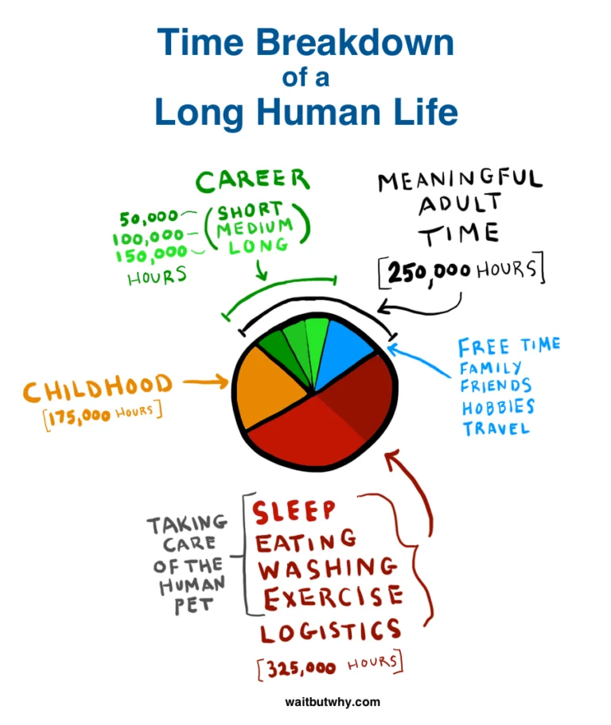
 
**Hayot sifati.** Karyera karyeradan tashqari barcha soatlaringizga ham katta ta’sir qiladi. Oldingi daromadlar, nikoh yoki meros orqali allaqachon boy bo‘lmaganlarimiz uchun karyera ayni paytda kun ko‘rish manbai ham hisoblanadi. Karyerangizning o‘ziga xos jihatlari ko‘pincha qayerda yashashingizni, hayotingiz qanchalik moslashuvchan bo‘lishini, bo‘sh vaqtingizda nimalar qila olishingizni, hatto ba’zan kim bilan turmush qurishingizni ham belgilab beradi.
 
**Ta’sir.** Karyera vaqtingizning katta qismini o‘tkazadigan ish va qolgan vaqtingizning kun ko‘rish manbai bo‘lishidan tashqari, yana ta’sir o‘tkazishning asosiy usulingiz hamdir. Har bir inson hayoti minglab boshqa hayotlarga minglab turli yo‘llar bilan tegadi, siz o‘zgartirgan o‘sha hayotlar esa o‘z navbatida yana minglab hayotlarga ta’sir qiladi. Buni sinab ko‘ra olmaymiz, lekin ishonchim komilki, bugun tirik har qanday 80 yoshli odamni tanlab, vaqtda 80 yil orqaga qaytsangiz, uni chaqaloq holida topib, axlatga tashlab, so‘ng hozirgi kunga qaytsangiz, son-sanoqsiz narsa o‘zgarib ketganini ko‘rasiz. Har bir hayot dunyoga va kelajakka katta ta’sir qiladi, ammo qanday ta’sir qoldirishingiz asosan sizning qo‘lingizda — qanday qadriyatlar bilan yashashingizga va kuchingizni qayerga yo‘naltirishingizga bog‘liq. Karyera yo‘lingiz qanday shaklga kirmasin, dunyo u tufayli o‘zgaradi.
 
**O‘zlik.** Bolaligimizda karyera rejalarimiz haqida “katta bo‘lsang, kim bo‘lasan?” deb so‘rashadi. Katta bo‘lgach, karyeramiz haqida kim ekanimizni aytib gapiramiz. Biz “Men yuridik sohada ishlayman” demaymiz, “Men yuristman” deymiz. Karyeraga bunday qarash, ehtimol, sog‘lom emas, ammo hozirgi ko‘p jamiyatlarda inson karyerasi uning asosiy o‘zligiga ham aylanib qoladi. Bu esa ancha katta gap.
 
Xullas, karyera yo‘lingiz mening mana bu bachkana kapyushonli koftamga o‘xshamaydi. U juda-juda muhim, ya’ni “Albatta, mutlaqo shef bo‘ling” toifasiga to‘g‘ridan-to‘g‘ri tushadi.
 
## Karyera xaritangiz
 
Endi o‘zingizga kelsak. Sizning ahvolingiz aniq qanaqaligini bilmayman. Lekin ko‘k hududlardan birida bo‘lishingiz ehtimoldan yiroq emas —

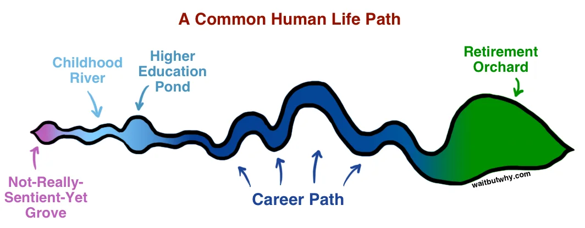
 
— demak, karyera yo‘lingiz hali tugallanmagan.
 
Karyerangizni endi boshlaydigan bo‘lsangiz ham, ancha ilgarilab ketgan bo‘lsangiz ham, ongingizning qayeridadir (balki juda oldingi qismida) “Karyera rejalari” xaritasi turibdi.
 
Xarita egalarini uch katta toifaga bo‘lish mumkin — ularning har biri daryoda ham, ko‘lchada ham, qirg‘oqda turganlar orasida ham, kattalik hayotining har bir bosqichida ham yetarlicha uchraydi.
 
Bir guruh odamlar xaritaga qarab, katta, bezovta qiluvchi so‘roq belgisini ko‘radi.

 
Bular karyera yo‘lida qarorsiz odamlar. Ularga “ishtiyoqingdan ketaver” deyishgan, lekin ular hech narsaga alohida ishtiyoq sezmaydi. Ularga “kuchli tomonlaring yo‘l ko‘rsatsin” deyishgan, lekin ular nimada eng yaxshi ekanini bilishmaydi. Ilgari javoblar bor deb his qilgan bo‘lishlari mumkin, ammo ular o‘zgargan va endi kim ekanlariga ham, qayoqqa ketayotganlariga ham ishonchlari yo‘q.
 
Boshqalar xaritada o‘zlari to‘g‘ri deb ishonadigan yo‘nalishni ko‘rsatuvchi aniq, ravshan strelkani ko‘radi — ammo oyoqlari boshqa tomonga qadam tashlayotganini payqaydi. Bular insoniy qayg‘uning eng keng tarqalgan manbalaridan biri bilan yashaydi: ular yuraklarida noto‘g‘ri ekanini biladigan karyera yo‘lida yurishadi.

 
Omadlilari esa qayoqqa borishni xohlashini biladi va shu tomonga qarab ketayotganiga ishonadi.

 
Lekin ular ham to‘xtab, o‘zidan so‘rashi kerak: “Bu strelkani aslida kim chizgan? Rostdan men chizganmanmi?” Javob chalkash bo‘lib chiqishi mumkin.
 
Bu odamlarning hammasiga karyera yo‘li haqida bir lahza o‘ylab ko‘rish foyda keltirishiga ishonchim komil.
 
### Mayli-ku, lekin siz nega karyera haqida o‘ylashimga yordam bera olaman deb hisoblaysiz, axir kun ko‘rishingiz stikmen chizish-ku? — Ko‘k quti
 
Juda o‘rinli savol. Yozish uchun mavzu tanlayotganimda o‘zimdan doim so‘raydigan narsa: “Bu haqda yozishga layoqatlimanmi?” Bu mavzuni qo‘lga olishga qaror qilishimning sabablari:
 
1) Oxirgi 20 yilning ko‘p qismini o‘z karyera yo‘limni tinimsiz tahlil qilish bilan o‘tkazdim.
2) Yo‘lim ko‘p burilishlar qildi: 7 yoshimda kino yulduzi bo‘lishni, 17 yoshimda prezident bo‘lishni, 22 yoshimda filmlarga musiqa yozishni, 24 yoshimda tadbirkor bo‘lishni, 29 yoshimda myuziklar yozishni xohladim, eng oxirida esa yozuvchiga o‘xshagan bir yigit bo‘lmoqchi bo‘ldim.
3) Umrimning ko‘p qismida karyera yo‘lim borasida ancha adashib yurgach, hozir ishimni haqiqatan yaxshi ko‘raman. Bu har doim o‘zgarishi mumkin, ammo meni chalkash yoki bezdiruvchi joylarga olib kelgan qaror qabul qilish jarayonlarini ko‘proq qoniqish keltirgan joyga olib kelgan qarorlar bilan yonma-yon ko‘ra olishim odamlar odatda qayerda xato qilishi haqida ma’lum bir donolik berdi.
4) O‘z hikoyamdan tashqari, eng yaqin o‘n ikkitacha do‘stimning hikoyalarini ham eng oldingi qatordan kuzatganman. Do‘stlarimda ham menga o‘xshab karyera yo‘lidan alahsish bor shekilli, shuning uchun ularning yo‘llarini kuzatib, yo‘l davomida ular haqida qayta-qayta suhbatlashib, bu mavzudagi qarashlarimni kengaytirdim; bu esa faqat mening hayotimga xos saboqlarni umumiyroq saboqlardan ajratishga yordam beradi.
5) Nihoyat, bu post qaysi karyera boshqalardan yaxshiroq yoki yomonroq ekani, qaysi karyera qadriyatlari ko‘proq yoki kamroq mazmunli ekani haqida emas — bu borada yaxshi ma’lumotlarga ega ijtimoiy fan olimlari va o‘z-o‘ziga yordam kitoblari mualliflari ko‘p, men ulardan emasman. Aksincha, bu karyera yo‘li haqida o‘ylayotgan odamga o‘z vaziyatini va unga haqiqatan nima muhimligini aniqroq, halol ko‘rishga yordam beradigan fikrlash tizimi. Bu tizim menga juda yaxshi ishlagan, shuning uchun boshqalarga ham foydali bo‘lishi mumkin deb o‘ylayman.
Karyera rejalari xaritangizga va uning ustida bor-yo‘q strelkaga yangicha nazar tashlab bo‘lgach, uni qo‘yib, ko‘zdan olib tashlang. Postning oxirida unga qaytamiz. Endi chuqur sho‘ng‘ish vaqti — keling, bu masalani noldan boshlab o‘ylaymiz. Birlamchi tamoyillardan.
 
---
 
Oshpaz-shef haqidagi postda men shefning katta karyera tanlovlarini qanday qilishi uchun oddiy fikrlash tizimi ishlab chiqqan edim. Uning markazida oddiy Venn diagrammasi turadi.
 
Diagrammaning birinchi qismi — **Xohlash qutisi**, unda siz orzu qiladigan barcha karyeralar turadi.

 
Ikkinchi qismi — **Voqelik qutisi**. Voqelik qutisi erishish ehtimoli real bo‘lgan barcha karyeralar to‘plami uchun — har bir holda sohadagi salohiyat darajangiz bilan o‘sha sohada muvaffaqiyatga erishishning umumiy qiyinligi solishtirilib aniqlanadi.

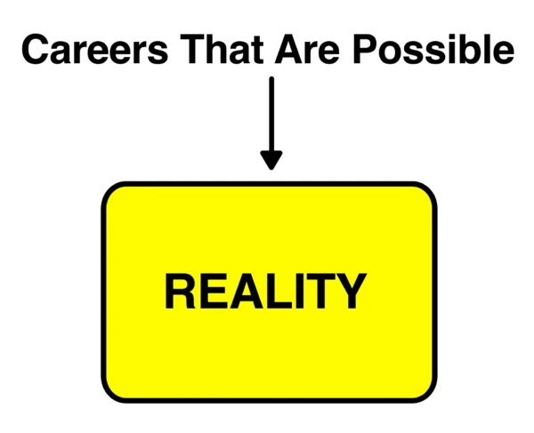
 
Kesishgan joyda eng maqbul karyera yo‘li tanlovlaringiz bor — Karyera xaritangizga chizishni o‘ylab ko‘rishingiz kerak bo‘lgan strelkalar to‘plami. Uni **Variantlar hovuzi** deb atashimiz mumkin.

 
Bu yetarlicha oddiy. Lekin bu qutilarni aniq to‘ldirish ko‘ringanidan ancha qiyin. Diagramma ishlashi uchun u haqiqatga iloji boricha yaqin bo‘lishi kerak, buning uchun esa ongostimizning qopqog‘ini ochib, pastga tushishimiz lozim. Xohlash qutisidan boshlaymiz.
 
---
 
## Chuqur tahlil, 1-qism: Xohlash qutingiz
 
Xohlash qutisining qiyin tomoni shundaki, siz bir qancha turli narsalarni xohlaysiz — to‘g‘rirog‘i, sizda bir qancha turli tomonlar bor va ularning har biri o‘ziga xos narsani xohlaydi va o‘ziga xos narsadan qo‘rqadi. Ba’zi turtkilarning manfaatlari boshqalarinikiga zid bo‘lgani uchun, ta’rifiga ko‘ra, xohlaganingizning hammasiga ega bo‘la olmaysiz. Xohlagan narsalaringizdan birining ketidan tushish, ta’rifiga ko‘ra, boshqalarining ketidan tushmaslik demak, ba’zan esa aynan boshqalarga qarshi borish ham. Xohlash qutisi — murosa o‘yini.
 
### Intilishlar sakkizoyog‘i
 
Xohlash qutisini to‘g‘ri tekshirish uchun karyerada nimaga intilayotganingizni o‘ylab, so‘ng uni sinchiklab, hech narsani qoldirmay yoyib chiqishingiz kerak. Baxtimizga, bu yerda bizga yordam beradigan kimsa bor. Intilishlar sakkizoyog‘i.

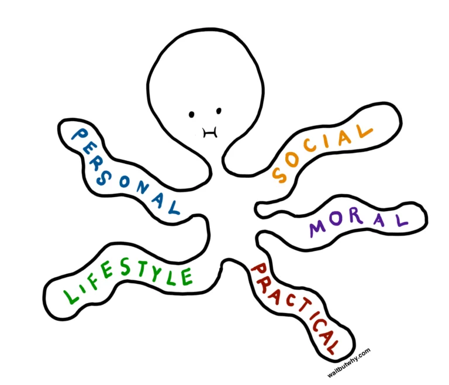
 
Har birimizning boshimizda o‘zimizning Intilishlar sakkizoyog‘imiz bor. Har kimning sakkizoyog‘i o‘ziga xos bo‘ladi, ammo odamlar bir-biridan unchalik ham farq qilmaydi va ko‘pchiligimiz juda o‘xshash intilish va qo‘rquvlarni his qilishimizga ishonaman (ayniqsa, Wait But Why o‘quvchilarining o‘zaro ko‘p umumiyligi borligini ko‘rib turganimda).
 
Avvalo shuni o‘ylab ko‘ring: butunlay alohida intilish olamlari bor — har biri bitta oyoqda yashaydi. Bu oyoqlar ko‘pincha bir-biri bilan chiqisha olmaydi.

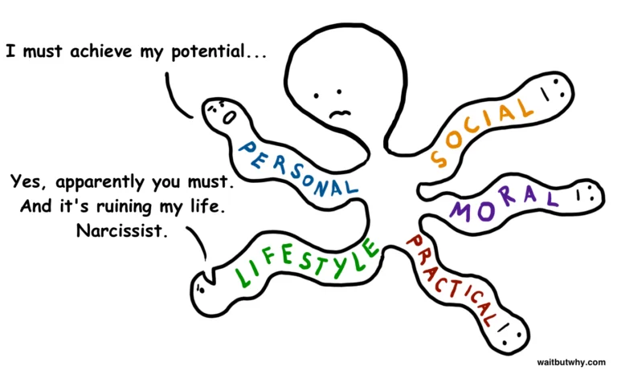
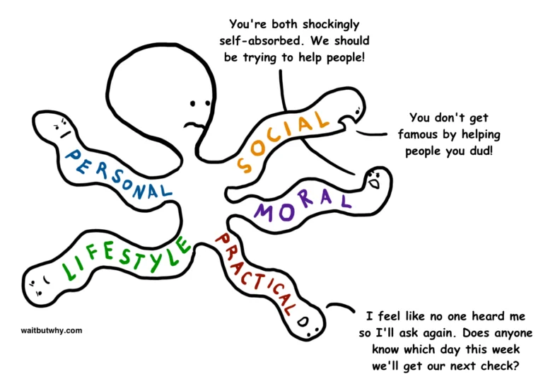

Bu bilan gap tugamaydi. Har bir oyoq bir qancha alohida intilishlardan va ularga hamroh qo‘rquvlardan iborat — ular ham ko‘pincha bir-biri bilan qattiq to‘qnashadi.

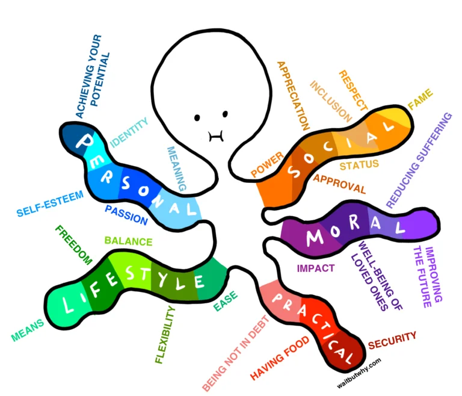
 
Nima bo‘layotganini tushunish uchun har bir oyoqqa yaqinroq nazar tashlaylik.

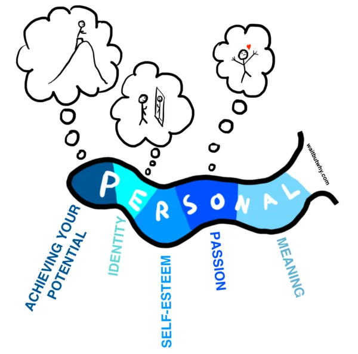

**Shaxsiy intilishlar** oyog‘ini umumlashtirish, ehtimol, eng qiyin — u har birimizga juda xos. U bizning o‘ziga xos shaxsiyatimiz va qadriyatlarimizning aksi bo‘lib, insonning, ehtimol, eng murakkab va eng og‘ir ehtiyoji — hayotdan to‘la qoniqish topish — yukini ko‘taradi. U faqat hozirgi o‘zimiz bilan emas, o‘tmishdagi bir qancha o‘zimiz bilan ham ovora. 7 yoshli sizning orzulari, 12 yoshli sizning ideallashtirilgan qiyofasi, 17 yoshli sizning yashirin umidlari va hozirgi o‘zingizning o‘zgarib borayotgan ishtiyoqlari — hammasi shaxsiy oyoqning qayeridadir, har biri istagiga erishish uchun o‘z jahlini chiqarib turibdi va agar uni xafa qilsangiz, hafsalasi pir bo‘lgani va jirkanishi bilan o‘zingizni dahshatli his qildirishga tayyor. Buning ustiga, ba’zan shaxsiy oyoqda o‘limdan qo‘rquv ham bosh ko‘taradi — u iz qoldirishingizni, ulug‘likka erishishingizni va shunga o‘xshash narsalarni talab qilib yopishib oladi. Shaxsiy oyoq tufayli milliarderlarning ko‘pi umrining qolgan qismini sohilda kokteyl ho‘plab o‘tkazishga qanoat qilmaydi — bu juda talabchan oyoq.
 
Shunga qaramay, shaxsiy oyoq ko‘pincha biroz e’tibordan chetda qoladi. Chunki ko‘p hollarda bu intilishlar to‘plamining ketidan chindan ham tushish eng noqulay; chunki bu oyoqning qo‘rquvlari darrov qo‘rqitmaydi — ular vaqt o‘tib, orqa fondan sezdirmay kirib keladi; va chunki shaxsiy oyoqni karyera boshidayoq boshqa oyoqlarning kuchli hayvoniy tuyg‘ulari ezib yuborishi hech gap emas. Bu e’tiborsizlik chang bosilgach, kishini keyinchalik katta pushaymonlik bilan qoldirishi mumkin. Masalan, juda muvaffaqiyatli, lekin juda baxtsiz odamning sababi ko‘pincha shaxsiy intilishlar oyog‘ining to‘yinmay qolganidir — u noto‘g‘ri sohada muvaffaqiyatga erishdim deb o‘ylashi mumkin.

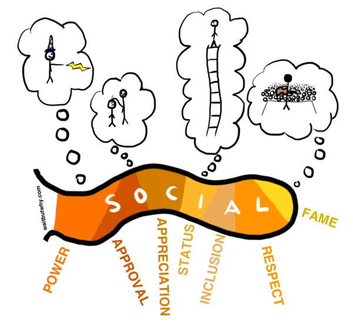
 
**Ijtimoiy intilishlar** oyog‘i — ehtimol, bizning eng ibtidoiy, hayvoniy tomonimiz; uning asosiy turtkisi evolyutsiyamizning qabilaviy o‘tmishiga borib taqaladi. Bu oyoqda bir nechta g‘alati maxluq yashaydi.
 
Bu blogda ilgari muhokama qilganimizdek, har birimizning boshimizda Ijtimoiy omon qolish mamonti yashaydi, u boshqalar biz haqimizda nima deb o‘ylashi haqidagi tashvishdan yer yorilguday darajada o‘zini yo‘qotgan. Demak, u qabul qilinish, jamoaga qo‘shilish va yoqtirilishga tashna, shu bilan birga, sharmandalik, salbiy baho va ma’qullamaslikdan dahshatda. U “o‘zimizniki”lar qatorida bo‘lishni juda-juda-juda xohlaydi va “begonalar” qatorida qolishni juda-juda-juda xohlamaydi. Ammo o‘zi ancha shirin.
 
Keyin sizning egongiz bor — u ham shunga o‘xshash, ammo yana ham talabchan. Egongiz shunchaki qabul qilinishni emas, balki hayratga tushirilishni, orzu qilinishni va oldida egilib-bukilishni xohlaydi — ideal holda, ommaviy miqyosda. Uni yoqtirilmaslikdan ko‘ra ko‘proq xafa qiladigan narsa — e’tiborga olinmaslik. U dolzarb, muhim va keng tanilgan bo‘lishni istaydi.
 
Atrofda yana boshqa personajlar ham aylanib yuribdi. Ijtimoiy oyoqning boshqa bir joyida kichkina bolg‘ali kichkina sudya bor — u odamlar sizni adolatli baholamayotgan, ya’ni sizni munosib qadrlamayotgan deb o‘ylasa, juda qattiq ranjiydi. Sudya uchun odamlar siz o‘zingizni qanchalik aqlli va qobiliyatli deb hisoblashingizni aynan bilib turishi juda muhim. Sudya yana ko‘ngliga tugib qo‘yishga ham usta — shuning uchun ko‘pchilikni hammadan ko‘ra o‘ziga hech qachon ishonmagan odamga yoki odamlarga o‘z kuchini ko‘rsatish istagi harakatga keltiradi.
 
Nihoyat, ayrimlarimiz ijtimoiy oyoqda mehribon bir kuchukchani topishi mumkin — u dunyodagi hamma narsadan ko‘ra egasini xursand qilishni istaydi va uni xafa qilish haqida o‘ylashga ham chidolmaydi. Bu yoqimtoy maxluqning bitta muammosi bor: uning egasi siz emassiz. Bu — sizning ustingizdan shunchalik katta ruhiy kuchga ega odamki, ehtiyot bo‘lmasangiz, butun karyerangizni uni xursand qilish va u bilan faxrlanishiga erishishga bag‘ishlab yuborishingiz mumkin. (Bu, ehtimol, ota-onangizdan biri.)

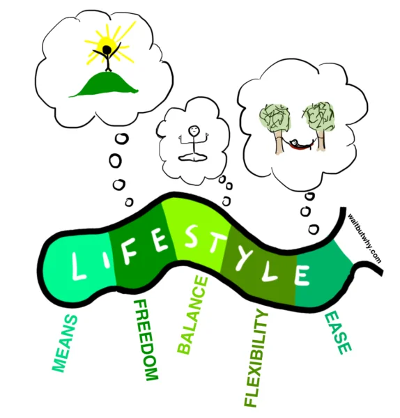
 
**Turmush tarzi intilishlari** oyog‘i asosan seshanba kuni yaxshi kun bo‘lishini xohlaydi. Lekin, aytaylik, chindan ham yoqimli, zavqli kun — ko‘p bo‘sh vaqt, o‘zini parvarish qilish, dam olish va hashamat bilan.
 
U yana hayotingiz katta rasmda iloji boricha a’lo bo‘lishi haqida qayg‘uradi — turmush tarzi oyog‘ining fikricha, siz hayotda nimani xohlasangiz, o‘shani, qachon va qanday xohlasangiz, shunday, eng yoqtirgan odamlaringiz bilan qila olishingiz kerak. Hayot qiziqarli onlar va boy tajribalarga to‘la bo‘lishi lozim, ammo u bir tekis, juda ko‘p mehnat qilmasdan, yo‘ldagi chuqurliklar imkon qadar kam bo‘lib o‘tishi ham kerak.
 
Muammo shundaki, turmush tarzi intilishlariga katta ustuvorlik bersangiz ham, butun oyoqni bir vaqtning o‘zida mamnun qilish ancha qiyin. Oyoqning shunchaki o‘tirib dam olishni istaydigan qismi sizni uzoq muddatli moslashuvchanlik beradigan karyera va hayotni hashamatli, farovon, o‘yinchoqlarga to‘la qila oladigan boylik qurish uchun ter to‘kishdan to‘xtatib turadi. Kelajak oldindan ma’lum bo‘lgandagina o‘zini qulay his qiladigan qismi esa oyoqning boshqa bir qismi orzu qiladigan uzoq muddatli erkinlikni keltirib chiqarishi mumkin bo‘lgan yo‘llarning aynan o‘shalarini rad etadi. Stresssiz hayot istaydigan tomoningiz Richard Branson kabi Namibiyadagi qoyadan deltaplanda uchishga chanqoq tomoningiz bilan unchalik inoq emas.

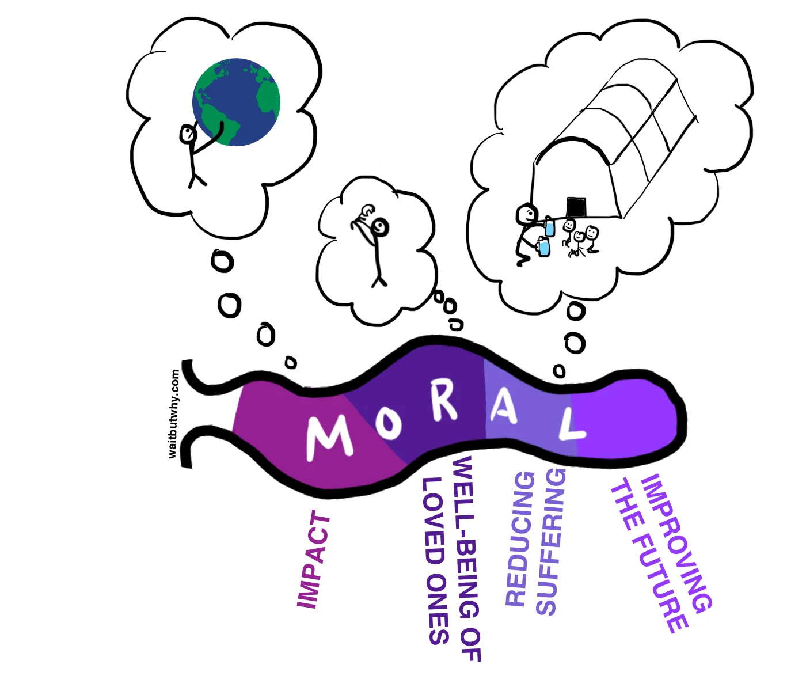
 
**Axloqiy intilishlar** oyog‘i Intilishlar sakkizoyog‘ining qolgan oyoqlarini chin ma’nodagi bir to‘da la’nati deb hisoblaydi — har biri keyingisidan ham o‘ziga berilib ketgan va o‘zini ortiqcha erkalatgan. Axloqiy oyoqqa tegishli qismlaringiz atrofga qarab, tuzatilishi kerak bo‘lgan juda ko‘p narsasi bor katta dunyoni ko‘radi; ular yaxshi hayotga siz bilan teng munosib, ammo shunchaki yomonroq sharoitda tug‘ilib qolgan milliardlab odamni ko‘radi; ular Yerdagi hayot uchun utopiya va distopiya o‘rtasida muallaq turgan noaniq kelajakni ko‘radi — agar boshqa oyoqlarimizni yo‘limizdan olib tashlay olsak, uni haqiqatan ham to‘g‘ri tomonga surib qo‘yishimiz mumkin. Boshqa oyoqlar bankda bir milliard dollaringiz bo‘lsa, hayotingiz bilan nima qilishingiz haqida xayol suradi, axloqiy oyoq esa joylashtirish uchun bir milliard dollaringiz bo‘lsa, qanday ta’sir qila olishingiz haqida xayol suradi.
 
Aytish shart emas, Intilishlar sakkizoyog‘ingizning boshqa oyoqlari axloqiy oyoqni chidab bo‘lmas deb biladi. Ular xayriyani xayriya uchun qilishni ham aslo tushunolmaydi — ular “Boshqalar men emas, nega vaqtim va kuchimni ularga yordam berishga sarflashim kerak?” deb o‘ylaydi — lekin xayriyani o‘z maqsadlari uchun qilishni tushunadi. Axloqiy va turmush tarzi oyoqlari odatda bevosita to‘qnashsa-da, boshqalari ba’zan umumiy til topadi: ijtimoiy oyoq xayriya ishi sizga yuqori obro‘li ijtimoiy guruhning hurmati va hayratini keltirsa, unga qattiq berilib ketishi mumkin, ba’zi odamlarning shaxsiy oyog‘i esa o‘zi shunchalik tashna bo‘lgan ma’no yoki o‘zini qadrlash tuyg‘usini xayriya ishida topishi mumkin.
 
Shuning uchun ham xayriya ishi bilan — yoki umuman har qanday fidokorona ish bilan — shug‘ullansangiz, boshingizda bir nechta alohida jarayon kechadi. Qilgan ishingiz uchun munosib ommaviy e’tirof olishga qat’iy bel bog‘lagan qismingiz ijtimoiy oyoqda yashaydi; “Ey Xudo, men qanday yaxshi odamman” deb o‘ylaydigan qismingiz shaxsiy oyoqda; yordam bergan odamingiz yoki guruhingiz ahvoli yaxshilanganini ko‘rishni chin dildan yaxshi ko‘radigan qismingiz esa axloqiy oyoqda yashaydi. Xuddi shuningdek, boshqalar uchun hech narsa qilmaslik sizga bir necha oyoq orqali zarar yetkazishi mumkin — axloqiy oyoq uchun u aybdorlik va g‘amginlik, ijtimoiy oyoq uchun u boshqalar sizni xudbin yoki ochko‘z deb baholashiga sabab bo‘lishi, shaxsiy oyoq uchun esa o‘zini hurmat qilishingizni pasaytirishi mumkin.

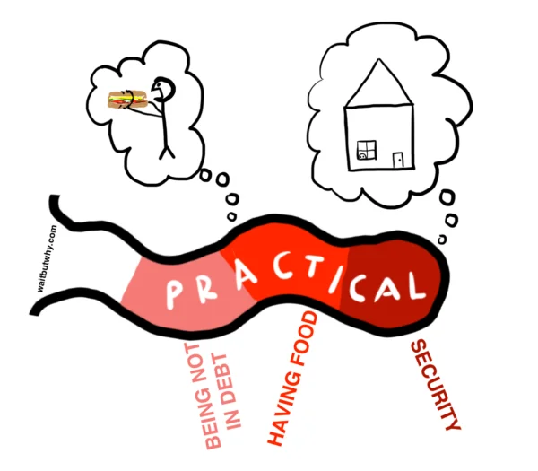
 
**Amaliy intilishlar** oyog‘i bularning hammasini zo‘r va yaxshi deb biladi — lekin u hozir 31-mart ekanini va ijara haqi ertaga to‘lanishini eslatib qo‘ymoqchi; gap shundaki, u bank hisobingizga kirib, undagi pul uy egasi sizdan kelgusi 34 soat ichida talab qiladigan puldan aslida kam ekanini ko‘rdi. Va ha, u chekni payshanba kuni topshirganingizni va u ertaga ertalab o‘tishi kerakligini biladi, lekin amaliy oyoq baribir qasam ichib ayta oladi: o‘tgan oyning o‘zida barcha oyoqlar bank hisobida hech bo‘lmasa ozgina zaxira to‘plash uchun biroz o‘zini cheklashga va’da bergan edi, toki ijara haqini to‘lashning o‘zi har oy la’nati darajada stress bo‘lmasin. Amaliy oyoq yana shunga e’tibor bermay qolmaydi: ijtimoiy oyoq o‘tgan shanba kuni barga birga borgan to‘qqiz kishining hammasiga ichimlik buyurishni taklif qildi, toki ular sizni ziyoli, saxiy odam deb bilsin; turmush tarzi oyog‘i esa hozir ish haqidan ish haqigacha yashayotgan odam uchun juda ham chiroyli ko‘rinadigan kvartirani ijaraga olishni tanladi; axloqiy oyoq olti oy oldin do‘stingiz ochgan bagel yetkazib berish xizmatini oyoqqa turg‘azish uchun 2 500 dollar qo‘shgan edi, endi o‘sha do‘stingizdan yangiliklar tinib qoldi; va yana, shu orada shaxsiy oyoq hammani bir vaqtning o‘zida ikkita komediya yozish stajirovkasida tinmay ter to‘kishga majbur qilmoqda, ular birgalikda ham kollejning ikkinchi kursida Jekyll & Hyde’da misrlik jodugar bo‘lib kiyinib, ofitsiantlik qilib topgan pulingizdan kam pul keltiradi.
 
Eng oddiy darajada amaliy oyoq sizning ovqat yeyishingiz, kiyinishingiz, kerakli dorilarni sotib olishingiz va ko‘chada yashamasligingizni ta’minlashni xohlaydi. Bularning qanday bo‘lishi uni unchalik qiziqtirmaydi — u shunchaki bo‘lsa bo‘ldi deydi. Lekin sakkizoyoqning qolganlari ishlarni qo‘pol chalkashtirib, amaliy oyoqning hayotini juda og‘irlashtiradi. Daromadingiz har oshganida turmush tarzi oyog‘i o‘z istak va kutganlarining mezonini ko‘tarishga qaror qiladi, amaliy oyoq esa kredit karta qarzingiz oshib ketmasligi uchun hammasini yopishga urinib, doim tang ahvolda qoladi. Shaxsiy oyoqning juda ko‘p vaqt oladigan va ko‘pincha katta pul keltirmaydigan g‘alati ehtiyojlari bor. Amaliy oyoq esa boy amakisidan shunchaki yordam so‘rashga mutlaqo tayyor bo‘lsa-da, ijtimoiy oyoq “bu chiroyli ko‘rinmaydi” deb boshqalardan pul so‘rashni taqiqlab qo‘ygan, shaxsiy oyoq esa “ha, biz bundan yuqoriroqmiz” deb qo‘shilgan.
 
Vaziyat shunday. Boshingizda besh oyoqli (yoki sizniki nechta bo‘lsa, shuncha oyoqli) Intilishlar sakkizoyog‘i bor, har birining o‘z rejasi va ular ko‘pincha bir-biriga zid. Keyin har bir oyoqdagi alohida intilishlar bor, ular ham ko‘pincha o‘zaro to‘qnashadi. Bu yetmaganidek, ba’zan bitta intilishning ichida ham shiddatli ichki nizo bo‘ladi. Masalan, ishtiyoqingiz ketidan borish istagi o‘zi nimaga eng ko‘p ishtiyoq sezishini aniqlay olmay qolganda.
 

Yoki hurmat qilinishni juda xohlaganingizda, jamiyatning bir qismining so‘nmas hurmatini qozonadigan karyera boshqa qismlarda doim yelka qisish bilan, yana boshqalarida esa hatto nafratomuz ko‘z aylantirish bilan kutib olinishini eslaganingizda.
 
Yoki boshqalarga yordam berish istagingizni qondirishga qaror qilib, hayotini insoniyatning eng katta mavjudlik xatarlarini kamaytirishga bag‘ishlamoqchi bo‘lgan qismingiz o‘z mahalliy jamoangizga aniq, sezilarli yaxshilik qilishni afzal ko‘radigan qismingizni sezilarli darajada nazar-pisand qilmasligini payqaganingizda — bugungi millionlab odam toza suvga ega emasligi haqidagi fikrga chiday olmaydigan qismingiz esa ana o‘sha ikkala intilishni ham ancha sovuq va berahm deb bilishini ko‘rganingizda.
 
Xullas, Intilishlar sakkizoyog‘ingiz murakkab. Tarixda hech bir inson o‘z sakkizoyog‘ini to‘liq qondira olmagan — shuning uchun uning to‘la tabassum qilganini hech qachon ko‘rmaysiz. Insoniy intilish — tanlovlar, qurbonliklar va murosa o‘yini.
 
### Sakkizoyoqni yorib ko‘ramiz
 
Shuni yodda tutib, Xohlash qutingizga qaytaylik. Karyera maqsadlarimiz, qo‘rquvlarimiz, umidlarimiz va orzularimiz haqida o‘ylaganimizda, ongimiz Intilishlar sakkizoyog‘ining faqat yakuniy natijasiga yetib boradi — u odatda eng baland ovozlardan tashkil topadi. Aslida nima bo‘layotganini faqat ongostimizni kovlab ko‘rgandagina ko‘ra olamiz.
 
Zo‘r tomoni shundaki, buni qilishga hammamizning qo‘limizdan keladi. Ongostingizdagi narsalar uyning yerto‘lasidagi narsalarga o‘xshaydi. Ular biz uchun taqiqlangan emas — shunchaki yerto‘lada turibdi. Istagan paytda borib ko‘rishimiz mumkin — faqat A) uyning yerto‘lasi borligini unutmasligimiz va B) pastga tushish yoqmasa ham, haqiqatan vaqt va kuch sarflab tushishimiz kerak.
 
Keling, sakkizoyoqni izlab, ongingizning yerto‘lasiga tushamiz. Agar siz ongostingizni tahlil qilishda chindan mashq qilgan odamlardan bo‘lmasangiz, yerto‘la qorong‘i bo‘lishi va sakkizoyog‘ingizni ko‘rish qiyin bo‘lishi mumkin. Chiroqni yoqishni boshlashning yo‘li — ongingiz hozir intilish va qo‘rquvlaringiz haqida nimani bilishini aniqlash va keyin uni yoyib chiqish.
 
Masalan, sizga ajoyib tuyuladigan biror karyera yo‘li bo‘lsa, uni yoyib chiqing. Aynan qaysi oyoqlar o‘sha karyeraga intilyapti — va bu oyoqlarning qaysi aniq qismlari?
 
Agar hozir o‘zingiz intiladigandek tuyulgan o‘sha karyera sari ishlamayotgan bo‘lsangiz, nega ekanini tushunishga urinib ko‘ring. Agar muvaffaqiyatsizlikdan qo‘rqqaningiz uchun deb o‘ylasangiz, buni yoyib chiqing. Muvaffaqiyatsizlik qo‘rquvi har qanday oyoqdan paydo bo‘lishi mumkin, shuning uchun bu yetarlicha aniq tahlil emas. Qo‘rquvning aniq manbasini topish kerak. Bu ijtimoiy oyoqning sharmanda bo‘lish qo‘rquvimi yoki boshqalar sizni unchalik aqlli emas deb baholashidan, yoki sevgi qiziqishlaringiz oldida unchalik muvaffaqiyatli ko‘rinmay qolishdan qo‘rquvimi? Bu shaxsiy oyoqning o‘z obrazingizga zarar yetkazish — o‘zingiz haqingizdagi sizni bezovta qilib yuradigan shubhani tasdiqlab qo‘yish — qo‘rquvimi? Bu turmush tarzi oyog‘ining yashash sharoitingizni pasaytirishga majbur bo‘lish yoki hozir oldindan bashorat qilsa bo‘ladigan hayotga stress va beqarorlik olib kelish qo‘rquvimi? Yoki yashash sharoitini pasaytirish qo‘rquvi aslida turmush tarzi oyog‘idan emas, ko‘proq ijtimoiy oyoqdan kelayotgandir — boshqacha aytganda, kvartira almashishining o‘ziga befarq bo‘lib, ammo turmush tarzining pasayishi do‘stlaringiz va oila a’zolaringizga qanday xabar yetkazishidan juda tashvishlanayotgan bo‘lishingiz mumkinmi? Yoki hozir orqaga chiqib bo‘lmaydigan moliyaviy majburiyatlar bor-u, karyera almashinuvi kutilganidan uzoqroq cho‘zilsa yoki umuman natija bermasa, qanday qilib kun ko‘rishingiz haqida amaliy oyoq haqiqiy vahimada qolgandir? Yoki shulardan bir nechtasi birlashib, sakrash qo‘rquvini yaratayotgandir?
 
Balki sizni to‘xtatib turgan narsa muvaffaqiyatsizlik qo‘rquvi emas, boshqa narsadir. Ehtimol, bu shunday karyera o‘zgarishi muqarrar ravishda olib keladigan o‘zlik o‘zgarishidan — ichki ham, tashqi ham — qo‘rqishdir. Ehtimol, bu inersiyaning og‘ir yukidir — o‘zgarishga qattiq qarshilik, u o‘z-o‘zicha mavjud bo‘lib, boshqa barcha intilishlaringizni bosib ketadigandek. Har ikki holda ham his-tuyg‘uni yoyib chiqib, aynan qaysi oyoqlar o‘zlik o‘zgarishiga shunchalik qarshi yoki inersiyaga shunchalik berilganini o‘zingizdan so‘rashingiz kerak.
 
Ehtimol, siz boy bo‘lishga zor bo‘lib yurgandirsiz. Yiliga 1,2 million dollar topadigan hayot haqida xayol surasiz va buni ro‘yobga chiqarish uchun juda kuchli turtki his qilasiz. Besh oyoqning barchasi ma’lum sharoitda boylikka intilish his qilishi mumkin, har biri o‘z sababi bilan. Buni yoyib chiqing.
 
Pul topishga bo‘lgan ichki turtkini yoyib chiqarkansiz, balki uning mohiyatida ulkan boylikdan ko‘ra ko‘proq xavfsizlik hissi yotganini topasiz. Buni ham yoyib chiqish mumkin. Xavfsizlikka intilish eng oddiy ko‘rinishida shunchaki amaliy oyoq o‘zi qiladigan ishni qilishidir. Lekin, ehtimol, siz oddiy xavfsizlikni emas, turmush tarzi yoki ijtimoiy oyoq talab qiladigan ma’lum darajadagi dabdabali hayotning kafolatini xohlayotgandirsiz. Yoki chindan ham xohlagan narsangiz shunchalik haddan ziyod xavfsizlik darajasiki, uni endi xavfsizlikka intilish deb ham bo‘lmaydi — aksincha, bu turmush tarzi oyog‘ining ruhiy osoyishtalik qismining, haqiqiy moliyaviy ahvolingizdan deyarli qat’i nazar, umr bo‘yi his qilishga o‘rgatilgan majburiy moliyaviy stressni yengillashtirishga bo‘lgan turtkisi bo‘lishi mumkin.
 
Bu savollarning barchasiga javoblar Intilishlar sakkizoyog‘ingizning oyoqlarining qayeridadir yotibdi. Shunday savollar berib, turli intilishlaringizning chin ildizlarini aniqlash uchun yetarlicha chuqur kovlaganingizda, yerto‘la chirog‘ini yoqa boshlaysiz va sakkizoyog‘ingiz bilan uning butun murakkabligi bilan tanisha boshlaysiz.
 
Shuningdek, ichki intilishlaringizdan qaysilari ongingizda eng baland gapirishini va qaror qabul qilish jarayonlaringizda eng ko‘p ta’sir kuchiga ega ekanini tushunib olasiz. Tez orada intilishlar ierarxiyasi o‘zini ko‘rsata boshlaydi. Siz baland ovozda gapirib, o‘z aytganini qildiradigan intilishlarni; butun kuchi bilan qichqirsa ham, sakkizoyoqning ustuvorroq qismlari doim chetga itarib tashlaydigan intilishlarni; ierarxiyadagi past mavqeiga ko‘nikib qolganga o‘xshaydigan intilishlarni aniqlaysiz.
 
### Soxtakorlarni qidirib
 
Yaxshi ilgarilayapmiz — lekin hali endigina boshladik. Intilishlar sakkizoyog‘ingiz haqida ancha aniq tasavvurga ega bo‘lganingizdan so‘ng, asl ishni boshlash mumkin — bu ish ongostingizning yana bir qavat pastida, yerto‘laning yerto‘lasida bo‘ladi. Bu yerda kichkina so‘roq xonasi tuzib, har bir intilishni birma-bir shu yerga tushirib, so‘roq qilishingiz mumkin.
 
Har bir intilishdan so‘rashdan boshlaysiz: sen bu yerga qanday kelib qolding va nega aynan shundaysan? Istaklar, e’tiqodlar, qadriyatlar va qo‘rquvlar bo‘shliqdan paydo bo‘lmaydi. Ular yo kuzatuvlar va hayot tajribasi oqib kelgani sari ichki ongimiz vaqt o‘tib shakllantiradigan narsalar, yo boshqa birov bizga tashqaridan joylab qo‘ygan narsalardir. Boshqacha aytganda, ular yo shef bo‘lgan sizning, yo oshpaz bo‘lgan sizning mahsulingiz.
 
Demak, sizning bu dahshatli so‘roq xonangizdagi maqsad — har bir intilishning yuzini tortib ko‘rib, u haqiqatan sizmi yoki sizning qiyofangizga kirib olgan boshqa birovmi, aniqlash.
 
Intilishning yuzini “Nega?” o‘yini orqali tortib ko‘rishingiz mumkin. Birinchi “Nega?”ni so‘raysiz — Nega men buni xohlayman? — va qandaydir “Chunki”ga yetib kelasiz. Keyin davom etasiz. Nega aynan shu “Chunki” sizni hozir xohlayotgan narsangizni xohlashga olib keldi? Va aynan shu “Chunki” qachon sizda shunchalik katta og‘irlikka ega bo‘ldi? “Chunki”ning ortidagi chuqurroq “Chunki”ga yetasiz. Davom ettirsangiz, odatda uch narsadan birini kashf qilasiz:
 
1) “Nega?”ni boshlanishigacha kuzatib borib, chuqur mustaqil fikrlash orqali shakllangan haqiqiy evolyutsiyaning uzun zanjirini ochasiz. Yuzini tortib, terisi chinakam ekanini tasdiqlaysiz.
2) “Nega?”ni kuzatib, boshqa birov sizga o‘rnatib qo‘ygan dastlabki “Chunki”ga yetasiz — “Menimcha, bu qadriyat menda faqat onam uni ma’lum darajada majburlagani uchun bor” — va bu qadriyatga haqiqatan mustaqil ravishda qo‘shilish-qo‘shilmasligingiz haqida hech o‘ylab ko‘rmaganingizni anglaysiz. O‘zingiz yig‘gan donolik o‘sha asosiy e’tiqodga nisbatan his qilayotgan ishonch darajangizni chindan oqlaydimi, deb o‘zingizdan hech so‘rab ko‘rmagansiz. Bunday holda intilish sizning haqiqiy intilishingizdek ko‘rinayotgan soxtakor ekani oshkor bo‘ladi. Siz uning yuzini tortasiz — niqob yechilib, ostidan intilishning asl o‘rnatuvchisi chiqib qoladi.
3) “Nega?”ni orqaga va yana orqaga kuzatib borib, “Shunchaki bilaman, chunki bu rost-da!” degan tumanda adashib qolasiz. Bu haqiqiy o‘zingizga xos narsa bo‘lishi mumkin, yoki bu tuyg‘u sizga qachon o‘rnatilganini eslay olmaydigan holatdagi 2-variantning yana bir ko‘rinishi bo‘lishi mumkin. Qayeringizdadir chuqurda qaysi biri ekani haqida ichki sezgi bo‘ladi.
1-holatda o‘zingizning shu qismingizni shefdek shakllantirganingiz bilan faxrlanishingiz mumkin. Bu — haqiqiy va mashaqqat bilan topilgan tuyg‘u yoki qadriyat.
 
2-holatda yoki, ehtimol, 3-holatda siz aldanganingizni kashf qilasiz. Siz bexabar qolgan paytingizda boshqa birov Intilishlar sakkizoyog‘ingizga yashirincha kirib olishiga yo‘l qo‘ygansiz. O‘sha e’tiqodingizga kelsak, siz boshqa birovning retsepti bo‘yicha pishirayotgan oshpazsiz — boshqa birovning miyasidan olingan istak va qo‘rquvlarni takrorlab turgan itoatkor robot.
 
Ehtimol, siz g‘ayrioddiy dono odamsiz va tekshiruvingiz sakkizoyog‘ingizni asosan o‘zingiz shakllantirganini va uni doim yangilab turganingizni ko‘rsatadi. Ko‘proq esa siz men va do‘stlarimning ko‘pchiligiga o‘xshaysiz — so‘roq xonangiz aniq soxtakorlarni yoki hech bo‘lmasa ko‘plab noaniqliklarni fosh qiladi. Masalan, bir niqob ostidan onangizni topasiz.

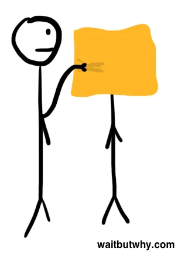
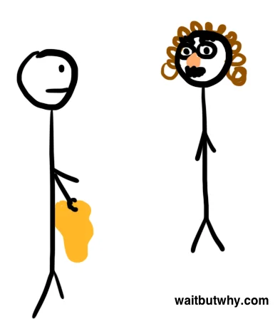
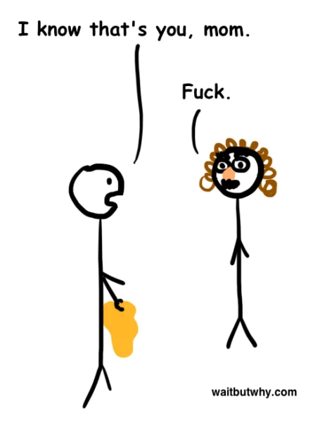
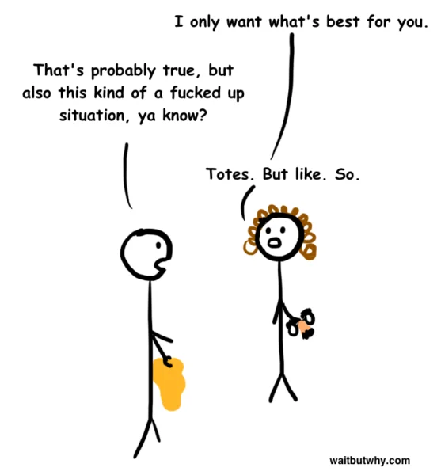

 
Boshqalarini yechib, kengroq ommabop qarashlarning qadriyatlari va hukmlarini, yoki yaqinroq jamoangizning qarashlarini, yoki avlodingizdagi hukmron madaniyat yoki eng yaqin do‘stlaringiz davrasidagi madaniyat nimani zo‘r deb hisoblashini topasiz.

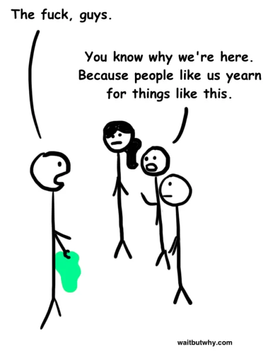
 
Ba’zan “Nega-Chunki” yo‘lining oxiriga yetib, mashhur romandagi falsafani yoki sevimli mashhur qahramoningiz bir intervyuda aytgan gapni yoki professorlaringizdan biri doim takrorlab yurgan qat’iy fikrni topasiz.
 
Hatto ba’zi intilish va qo‘rquvlaringizni o‘zingiz yozgan bo‘lib chiqishi mumkin… yetti yoshingizda. Masalan, chin dildan halol bo‘lganingizda, aslida shuni xohlayman deb ishonadigan narsa sifatida ongingiz tubiga o‘yib qo‘yilgan bolalik orzusi.
 
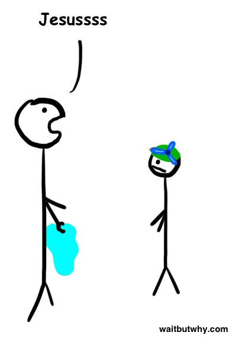
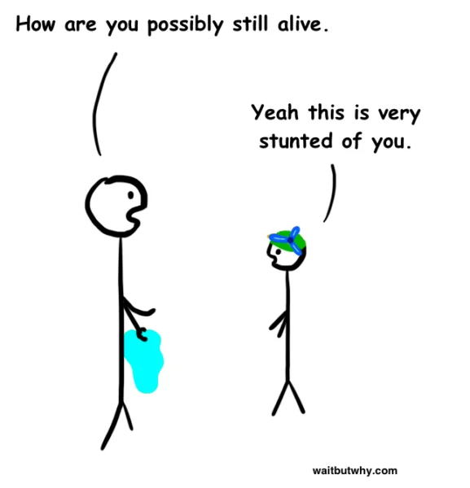

So‘roq xonasi, ehtimol, unchalik yoqimli vaqt bo‘lmaydi. Lekin bu vaqt behuda ketmaydi — chunki siz 7 yoshli o‘zingiz emassiz, xuddi ota-onangiz, do‘stlaringiz, avlodingiz, jamiyatingiz, qahramonlaringiz, o‘tmishdagi qarorlaringiz yoki yaqindagi sharoitingiz emasligingiz kabi. Siz — Hozirgi Yoshdagi Sizsiz — siz xohlagan va xohlamagan narsalarni xohlash va xohlamaslikka haqiqatan layoqatli yagona inson va o‘zingizning yagona versiyasi.
 
Aniqlik uchun: bu dono ota-onaning, mashhur faylasufning, hurmat qiladigan do‘stlaringizning so‘zlari bo‘yicha yoki yoshroq o‘zingizning e’tiqodlari bo‘yicha yashash noto‘g‘ri degani emas. Kamtar odamlar ta’rifiga ko‘ra ta’sirga ochiq bo‘ladi — ta’sirlar har birimiz kimligimizning muhim va muqarrar qismi. Asosiy farq mana shunda:
 
Tashqi ta’sirlarning so‘zlariga haqiqiy ichki siz ushlab turib, o‘ylab ko‘rgan va ehtiyotkorlik bilan qabul qilishga qaror qilgan ma’lumot sifatida qaraysizmi? Yoki ta’sirlarning o‘zi aslida miyangizda o‘tirib, ichki siz bo‘lib o‘zini ko‘rsatyaptimi?
 
Tanishingiz xohlagan narsani siz ham xohlaysizmi — chunki uning bu haqda gapirganini eshitib, o‘z hayot tajribangiz bilan yonma-yon o‘ylab ko‘rdingiz-da, oxir-oqibat hozircha rozi ekaningizga qaror qildingizmi? Yoki birovning nimani xohlashi yoki nimadan qo‘rqishi haqida gapirganini eshitib, “Men hech narsani bilmayman, u esa biladi, shuning uchun u X rost desa, aniq to‘g‘ridir” deb o‘yladingiz — va o‘sha g‘oyalarni ongingizga o‘yib qo‘yib, ularni qayta so‘roqqa tutish kerakligini hech his qilmadingizmi?
 
Birinchisi — sheflar qiladigan ish. Ikkinchisi — itoatkor robot bo‘lganingizda qiladigan ishingiz. Robotga esa qachondir miyangizga boshqa birov siz bo‘lishga o‘zingizdan ko‘ra layoqatliroq degan g‘oya kirib qolganida aylanasiz.
 
Yaxshi xabar shuki, bu xatoni barcha odamlar qiladi — va siz uni tuzata olasiz. Ongostingiz ko‘rib chiqmoqchi bo‘lsangiz, xuddi shu yerda turganidek, uni o‘zgartirish, yangilash va qayta yozish uchun ham shu yerda. Bu sizning boshingiz — u bilan xohlaganingizni qilishga haqqingiz bor.
 
Demak, ba’zilarni haydab chiqarish vaqti keldi. Niqobli soxtakorlar ketishi kerak. Hatto ona va ota ham.
 
Bularning oxirida sakkizoyog‘ingiz biroz huvillab qolgandek ko‘rinishi, o‘zingizni endi kim ekaningizni umuman bilmaydigandek his qilishingiz mumkin. Buni odatda yomon tuyg‘u, hatto ekzistensial inqiroz deb bilamiz, lekin aslida bu siz ko‘pchilikdan yaxshiroq yo‘ldaligingizni anglatadi.

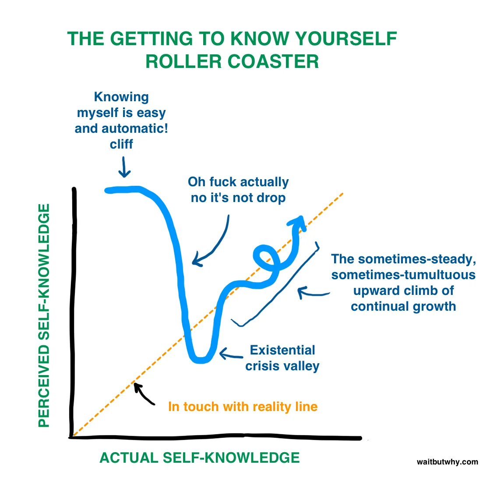
 
Sodda, ortiqcha ishonchdan dono, realistik kamtarlikka tushish hech qachon yoqimli emas, lekin amerika tog‘lari (roller coaster) hali birinchi jarlikda turganida uni to‘xtatib, og‘riqdan qochish — ko‘pchilikning yo‘li shu bo‘lib chiqadi — yaxshi strategiya emas. Donolik bilim bilan bog‘liq emas, u voqelik bilan aloqada bo‘lish bilan bog‘liq — grafikda qanchalik o‘ngda ekaningiz emas, to‘q sariq chiziqqa qanchalik yaqinligingiz muhim. Donolik avvaliga og‘ritadi, lekin haqiqiy o‘sish faqat shu yerda sodir bo‘ladi. Ajablanarlisi shuki, dunyodagi jarlikda to‘xtab qolganlar vodiy aholisi yoki tinimsiz tepaga ko‘tarilayotganlarni — ulardan donoroq va jasurroq odamlarni — o‘zlarini yomon his qilishga majbur qilishni yaxshi ko‘radi, chunki ular o‘zini bilish qanday ishlashini tubdan tushunmaydi. Ular hali bu bosqichga yetmagan.
 
O‘zingizning haqiqiy o‘zingizni tanish juda qiyin va hech qachon tugamaydi. Lekin jarlikdan quladingizmi, siz muhim o‘tish marosimidan o‘tgansiz va endi ilgarilash mumkin. To‘q sariq chiziq bo‘ylab ko‘tarilar ekansiz, sekin, lekin ishonchli tarzda Intilishlar sakkizoyog‘ingizni yana haqiqiy o‘zingiz bilan to‘ldira boshlaysiz.
 
Hozircha sizning o‘sha yetishmayotgan intilishlaringiz aniq nima ekani ehtimol ravshan bo‘lmaydi — chunki ular ongostingizning yanada chuqurroq qavatida. Ular yerto‘laning yerto‘lasining yerto‘lasida — Inkor qamoqxonasi deb ataladigan joyda.
 
### Inkor qamoqxonasi
 
Miyamizning Inkor qamoqxonasi ko‘pchiligimiz borligini ham bilmaydigan joy — biz o‘zimizning bostirib, inkor qiladigan qismlarimizni shu yerga solib qo‘yamiz.
 
Biz bilan aloqada bo‘lgan haqiqiy intilishlarimiz — ya’ni so‘roq paytida haqiqiy ekani isbotlanganlari — haqiqiy o‘zimizning ongostimizdan topish oson bo‘lgan qismlari edi, ular ongimiz yuzasining aynan ostida, ko‘z oldida yotardi. Hatto ongimiz ham bu intilishlarni yaxshi biladi, chunki ular tez-tez yuqoriga, fikrlarimizga chiqib turadi. Bular o‘zimizning sog‘lom munosabatda bo‘lgan qismlarimiz.
 
Lekin sizning shunday qismlaringiz ham borki, ular sakkizoyog‘ingizda bo‘lishi kerak bo‘lgan joyda yashamagan — buning o‘rniga ularning o‘rnida soxtakorni topdingiz. Sizning bu yo‘qolgan qismlaringizga yetib borish ko‘pincha nihoyatda qiyin, chunki ular ongostingizning chuqurida, deyarli mavjud bo‘lmagandek past qavatda yashagan. Deyarli.
 
Ba’zi qismlarimiz uchinchi yerto‘lada surgun qilingan, chunki ularni tan olish yoki ular haqida o‘ylash biz uchun g‘oyat og‘riqli. Ba’zan yangi qismlarimiz tug‘ilishi bilanoq o‘z evolyutsiyamizni inkor etishning bir ko‘rinishi sifatida — ya’ni o‘jarlikdan — qamoqqa solinadi. Ammo ba’zan qismimiz Inkor qamoqxonasida shuning uchun yotadiki, uni u yerga boshqa birov qamab qo‘ygan. Intilishlaringizga kelsak, ularning ba’zilarini ularning o‘rnini egallab turgan niqobli bosqinchi u yerga tiqqan bo‘ladi. Agar dadangiz sizni nufuzli karyeraga juda qattiq ahamiyat berishingizga muvaffaqiyatli ishontirgan bo‘lsa, ehtimol, u sizni chuqur ichingizda duradgor bo‘lishni chindan xohlaydigan qismingiz aslida siz emasligiga va siz chindan xohlagan narsa emasligiga ham ishontirgan bo‘ladi. Bolaligingizning qaysidir paytida u duradgorlikka bo‘lgan ishtiyoqingizni Inkor qamoqxonasining qorong‘i, nam kamerasiga tashlab yuborgan.
 
Keling, jasoratni yig‘ib, ongingizning yerto‘lasining yerto‘lasining yerto‘lasiga tushamiz va nima topishimizni ko‘ramiz.

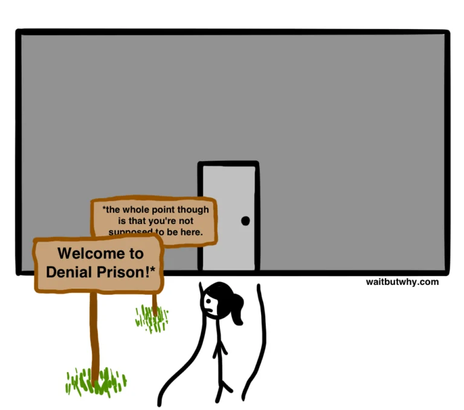
 
Yo‘lda bir nechta yoqimsiz personajlar yonidan o‘tishingiz mumkin.

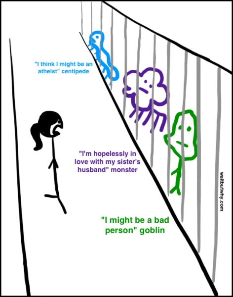
 
Ularni boshqa safarga qoldiring — hozir qamab qo‘yilgan, karyeraga oid intilishlarni qidiring. Ehtimol, o‘qituvchilikka bostirilgan ishtiyoqni topasiz. Yoki o‘z qabilangiz sizni sharmanda qilib undan voz kechtirgan mashhur bo‘lish istagini. Yoki ehtirosliroq, ochko‘zroq o‘smir o‘zingiz alanga olgan shuhratparastlik yo‘lida zinadan pastga tepib yuborgan uzun, erkin, bo‘sh dam olish vaqtlariga chuqur muhabbatni.
 
Inkor qamoqxonasida haqiqiy o‘zingizning ba’zi qismlarini topa olmasligingiz mumkin — u yerda ancha qorong‘i. Lekin sabr qiling — endi tekshiruvni o‘tkazib, sakkizoyog‘ingizda ular uchun joy bo‘shatganingiz uchun, ular paydo bo‘la boshlashi mumkin.
 
### Ustuvorliklar tartibi
 
Intilishlar sakkizoyog‘i tekshiruvining ikkinchi qismi intilishlaringiz ierarxiyasiga qaratiladi. Intilishlarning o‘zi qanchalik muhim bo‘lsa, ularga berilgan ustuvorlik ham deyarli shunchalik muhim. Ierarxiyani ko‘rish oson, chunki u harakatlaringizda ochiladi. Siz jasorat bilan biror ish qilish istagi ierarxiyangizning yuqorisida deb o‘ylashni yoqtirishingiz mumkin, ammo hozir jasoratli biror ish ustida ishlamayotgan bo‘lsangiz, bu jasorat siz uchun qanchalik muhim bo‘lmasin, hozircha undan ham ustunroq qo‘yilgan boshqa narsa — ichingizdagi qandaydir qo‘rquv yoki inersiya manbai — borligini ko‘rsatadi.
 
Shuni esda tutish muhim: intilishlar reytingi — qo‘rquvlar reytingi hamdir. Sakkizoyoqda sizni ma’lum karyeraga intilishga yoki intilmaslikka undashi mumkin bo‘lgan hamma narsa bor, har bir intilishning teskari tomoni esa uning qarama-qarshisidan qo‘rquvi. Hayratga tushirilish istagingizning teskari tomoni — sharmandalikdan qo‘rquv. O‘zini ro‘yobga chiqarish istagingizni ag‘darib qarasangiz, kam erishishdan qo‘rquvni ko‘rasiz. O‘zini hurmat qilishga tashnaligingizning ikkinchi yarmi — uyat his qilishdan qo‘rquv. Agar harakatlaringiz intilishlaringizning ichki ierarxiyasi deb o‘ylagan narsangizga mos kelmasa, odatda qo‘rquvlaringiz qanday rol o‘ynayotganini o‘ylashni unutganingiz sabab bo‘ladi. Masalan, muvaffaqiyatga qat’iy intilish bo‘lib ko‘ringan narsa aslida salbiy o‘z obrazidan qochayotgan yoki hasad yoki qadrlanmaslik kabi tuyg‘ulardan qutulishga urinayotgan odam bo‘lishi mumkin. Agar harakatlaringiz sizga unchalik ham muhim bo‘lmagan intilishlarga bo‘ysunayotgandek ko‘rinsa, ehtimol, qo‘rquvlaringizga yetarlicha sinchiklab qaramayapsiz.
 
Intilishlar va qo‘rquvlarni birga yodda tutib, ichki ierarxiyangiz qanday ko‘rinishda bo‘lishi mumkinligini o‘ylang va o‘sha muhim savolga qayting: “Bu tartibni kim o‘rnatgan? Rostdan men o‘rnatganmanmi?”
 
Masalan, bizga tez-tez “ishtiyoqingdan ketaver” deyishadi — bu jamiyatning “ishtiyoq intilishlaringni ierarxiyangning eng tepasiga qo‘y” deyishi. Bu juda aniq ko‘rsatma. Ehtimol, bu siz uchun to‘g‘ri, lekin to‘g‘ri bo‘lmasligi ham mumkin. Buni mustaqil baholash kerak.
 
Buni to‘g‘ri qilish uchun yangi reyting tuzib ko‘raylik — birlamchi tamoyillardan, haqiqatan kimligimizga, vaqt o‘tib qanday o‘zgarganimizga va hozir biz uchun eng muhimi nima ekaniga tayanib.
 
Gap qaysi intilish yoki qo‘rquvning ovozi balandligi yoki qaysi qo‘rquv eng seziluvchanligi haqida emas — agar shunday bo‘lsa, siz hayotingiz rulini turtkilaringizga topshirgan bo‘lasiz. Reytingni tuzuvchi odam — siz, ya’ni shu postni o‘qiyotgan, sakkizoyog‘ingizni kuzatib, unga xolis qarashi mumkin bo‘lgan ongning kichik markazi. Bu yana bir turdagi murosani talab qiladi. Bir tomondan, hayot davomida yig‘gan butun donoligingizdan foydalanib, qadriyatlar haqida — chindan nima muhim deb ishonishingiz haqida — faol qarorlar qabul qilishga urinasiz. Ikkinchi tomondan, gap o‘zini qabul qilish va o‘ziga rahm-shafqat haqida. Ba’zan sizda ko‘p faxrlanmaydigan, lekin inkor qilib bo‘lmaydigan kuchli intilishlar bo‘ladi — xohlaysizmi, yo‘qmi, ular sizning bir qismingiz va ularni e’tiborsiz qoldirsangiz, doimiy sassiq hid taratib, sizni baxtsiz qilishi mumkin. Intilishlar ierarxiyasini tuzish — nima muhim va nima siz ekani o‘rtasidagi berish-olish. Yuqoriroq ustuvorlikni asilroq xislatlaringizga berish, ehtimol, yaxshi maqsad, lekin chegarani qayerdan o‘tkazishingizga qarab, unchalik asil bo‘lmagan tomonlaringizdan ba’zilariga ham ozgina ulush berib qo‘yish durust. Unchalik asil bo‘lmagan tomoningizni qachon qabul qilish va qachon butunlay rad etishni bilishda donolik bor.
 
Bularning hammasini tartibga solish uchun yaxshi tizim kerak. O‘zingizga mos keladiganini sinab ko‘rishingiz mumkin — menga tokcha g‘oyasi yoqadi:

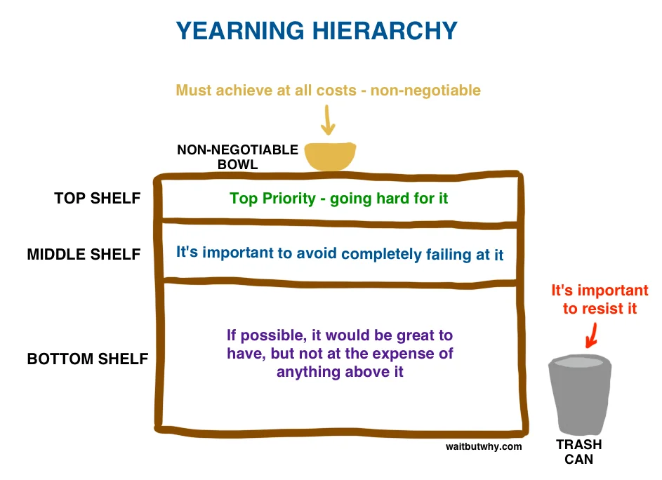
 
Bu narsalarni besh toifaga ajratadi. Mutlaq eng yuqori ustuvorlikdagi ichki turtkilar o‘ta maxsus, “kelishib bo‘lmaydigan” (KB) kosaga tushadi. KB kosasi — siz uchun shunchalik muhim intilishlar uchunki, ularning amalga oshishini, zarur bo‘lsa, boshqa barcha intilishlar hisobidan, deyarli kafolatlamoqchisiz. Shuning uchun ham tarixning ko‘plab afsonaviy shaxslari yakkayu yagona maqsad bilan yashagani bilan mashhur — ularning KB kosasida juda kuchli bir intilish bor edi va u ularni dunyo shuhratiga olib bordi, ko‘pincha munosabatlar, muvozanat va sog‘liq hisobiga. Kosa kichkina, chunki undan juda kam foydalanish kerak — agar umuman kerak bo‘lsa. Masalan, uni faqat bitta narsa oladi. Yoki ikki-uch narsa. KB kosasidagi narsa haddan ko‘p bo‘lsa, uning kuchi yo‘qoladi — bu kosada hech narsa bo‘lmagani bilan baravar.
 
Yuqori tokchadagi intilishlar guruhi karyera tanlovlaringizni asosan shu harakatga keltiradi — ammo yuqori tokchaga joylashtirish ham tejab-tergab berilishi kerak (shuning uchun u unchalik katta tokcha emas). Tokchaga joylashtirish ustuvorlik berish bilan birga ustuvorlikni kamaytirish haqidadir. Siz nafaqat o‘zingizning qaysi qismlaringiz sizni baxtli qilish uchun eng muhimligini tanlaysiz, balki qaysi qismlaringizni ataylab to‘yintirmasdan yoki hatto to‘g‘ridan-to‘g‘ri qarshi turib qoldirishni ham tanlaysiz. Ierarxiyangiz qanday ko‘rinishda bo‘lmasin, ba’zi intilishlar o‘zini juda baxtsiz his qiladi, ba’zi qo‘rquvlar esa tinimsiz hujumga uchrayotgandek bo‘ladi. Bu muqarrar.
 
Shuning uchun ko‘pchilik intilishlar o‘rta tokchada, pastki tokchada yoki axlat chelagida bo‘lishi kerak. O‘rta tokcha — o‘zingizdagi qabul qilishga qaror qilgan unchalik asil bo‘lmagan xislatlar uchun yaxshi joy. Ular e’tiboringizning bir qismiga loyiq. Va ular ko‘pincha buni talab qiladi — sizning asosiy qismlaringiz ustuvorlikdan chetlatilishga indamay ko‘nmaydi, ularni e’tiborsiz qoldirsangiz, ba’zan hayotingizni chindan buzib yuborishi mumkin.
 
Qolganlarining ko‘pi pastki tokchada qoladi. O‘zingizning bir qismingizni pastki tokchaga qo‘yish unga shunday deyish demak: “Bilaman, sen bularni xohlaysan, lekin hozircha boshqa narsalar muhimroq deb qaror qildim. Bir oz keyinroq, ko‘proq ma’lumot to‘plagach, senga qaytishga va’da beraman, fikrimni o‘zgartirsam, shunda tokchang yuqoriga ko‘tariladi.” Pastki tokchani shunday tasavvur qilgan ma’qul: pastki tokchadagi o‘ringa rozi bo‘lishga ko‘ndira oladigan intilishlaringiz qancha ko‘p bo‘lsa, yuqori tokcha va KB kosasidagi intilishlarning o‘zi xohlagan narsaga erishish imkoni shuncha yaxshi bo‘ladi. Xuddi shuningdek, yuqori tokchaga qancha kam intilish qo‘ysangiz, tokchadagilarning gullab-yashnashi shuncha ehtimolli bo‘ladi. Vaqtingiz va kuchingiz juda cheklangan, shuning uchun bu — yig‘indisi nolga teng murosa. Havaskorlarning xatosi — KB kosasi va yuqori tokchaga haddan ortiq saxiy, katta pastki tokchaga esa haddan ortiq xasis bo‘lish.
 
Nihoyat, axlat chelagi bor — butunlay rad etadigan turtki va qo‘rquvlaringiz uchun, ya’ni eng dono o‘zingiz bo‘lishni xohlagan insonga tubdan zid keladigan qismlaringiz uchun. Ichki nizoning ancha qismi odamlarning axlat chelagidan chiqadi, axlat chelagini nazorat qilish esa sobit prinsipiallik va ichki kuchning muhim tarkibiy qismi. Ammo ierarxiyaga oid boshqa qarorlar kabi, nimaning axlat hisoblanishi mezonlari ham o‘zingizning chuqur mulohazangizdan kelib chiqishi kerak, boshqalar nima axlat va nima axlat emasligini aytgani asosida emas.
 
Bu mashaqqatli ustuvorlik belgilash jarayonidan o‘tarkansiz — ba’zan, muqarrar ravishda, ustuvorligi pasaytirilgan, baxtsiz intilishlarning baqiroq noroziliklariga qarshi — xonadagi yagona dono siz ekaningizni eslang. Intilish va qo‘rquvlar sabrsiz va katta rasmni ko‘rishda ojiz. Hatto axloqiy oyoqdagilar kabi ko‘rinishda oliyjanob intilish ham to‘liq rasmni siz kabi tushuna olmaydi. Dunyoni yaxshilash uchun mo‘jizalar ko‘rsatgan ko‘plab odamlar bu yo‘lga boylik yoki shaxsiy qoniqish kabi xudbin niyatlar bilan chiqqan — ularning axloqiy oyog‘i avvaliga ehtimol bu niyatlardan nafratlangan bo‘lgan. Sakkizoyoq xonadagi dono katta odam bo‘lmaydi — bu sizning vazifangiz.

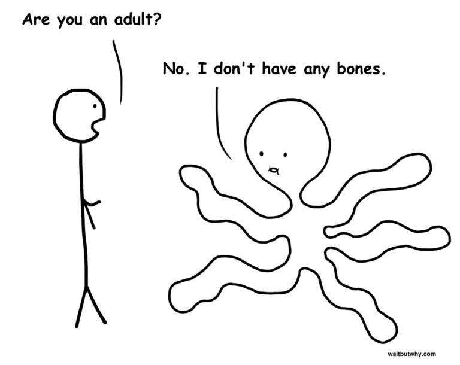
 
Va nihoyat, keyinroq yana gaplashamiz, bu doimiy qaror emas. Aksincha — bu yengil qalamda yozilgan qoralama. Bu — sinab ko‘rib, so‘ng bu ierarxiya bilan amalda yashash qanday his qilinishiga qarab qayta ko‘rib chiqishingiz mumkin bo‘lgan farazdir.
 
Xohlash qutingiz tayyor. Endi Voqelik qutingizga o‘tamiz.
 
---
 
## Chuqur tahlil, 2-qism: Voqelik qutingiz
 
Xohlash qutisi siz nimani istalgan deb bilishingiz bilan shug‘ullanadi. Voqelik qutisi esa nima mumkinligi bilan.
 
Ammo Xohlash qutisini ko‘rib chiqqanimizda ayon bo‘ldiki, u albatta siz haqiqatan nimani xohlashingizga asoslanmagan — u nimani xohlayman deb o‘ylashingizga, nimani xohlashga o‘rganib qolganingizga asoslangan.
 
Voqelik qutisi ham xuddi shunday. U sizga voqelikni emas, voqelik qanday bo‘lishi mumkinligi haqidagi eng yaxshi taxminingizni — voqelikni qanday idrok etishingizni ko‘rsatadi.
 
O‘z-o‘zini tahlil qilishning maqsadi — bu ikkala qutini ham iloji boricha aniqlikka yaqinlashtirish. Biz idrok etilgan intilishlarimiz haqiqiy ichki o‘zimizning chin aksi bo‘lishini va nima mumkinligi haqidagi e’tiqodlarimiz aslida nima mumkinligini aks ettirishga yaqin bo‘lishini xohlaymiz. Xohlash qutisi tekshiruvi uchun biz uning qopqog‘ini ochib, sozlamalarini — intilish va qo‘rquvlaringizni — topdik. Voqelik qutingizning qopqog‘ini ochsak, bir guruh e’tiqodlarni ko‘ramiz.
 
Karyera imkoniyatlaringizga kelsak, sizda ikki guruh e’tiqod bor: dunyo haqidagi e’tiqodlar va o‘z salohiyatingiz haqidagi e’tiqodlar. Karyera varianti Voqelik qutingizga kirishi uchun o‘sha sohadagi salohiyatingiz o‘sha sohada muvaffaqiyatga erishishning ob’ektiv qiyinligiga yetishi kerak.
 
Biz o‘zimiz bo‘lganimiz uchun, ehtimol, bu taqqoslashning ikkala tomonini ham aniq baholashda ancha ojizmiz.
 
Karyera yo‘lining qiyinligi haqida qanday o‘ylashingizni bilmayman, lekin tajribamga ko‘ra, odamlar ko‘pincha unga shunday qaraydi:
 
An’anaviy karyeralar bor — tibbiyot, huquq, o‘qituvchilik yoki korporativ zinapoya va shu kabilar — va bu karyeralarning oldindan bashorat qilsa bo‘ladigan, belgilangan yo‘llari bor. Agar siz yetarlicha aqlli bo‘lib, qattiq ishlasangiz, muvaffaqiyatli va barqaror holatga yetasiz.
 
Keyin kamroq an’anaviy karyeralar bor — san’at, tadbirkorlik, notijorat ishlar, siyosat va shu kabilar — ular esa oldindan aytib bo‘lmaydigan joker kartalar. Muvaffaqiyat va barqarorlik kafolatlanmagan, katta cho‘qqilarga chiqish esa yo lotereya chiptasi o‘yinidagi omad, yo tug‘ma iste’dodning genetik lotereyasi, yo bularning birikmasi.
 
Bu to‘liq o‘rinli taxminlar — agar siz 1952-yilda yashasangiz. Karyera olami haqidagi va muvaffaqiyatga nima kerakligi haqidagi e’tiqodlaringiz ham intilishlaringiz kabi puxta niqobsizlantirilishi kerak — va gumonimcha, ularning ko‘pi ortidan katta, semiz ommabop qarashlarni topasiz. Avvaliga e’tiqodlaringizdan birining niqobini yechib, ota-onangiz yoki do‘stlaringiz yoki kollejdagi karyera maslahatchingizni topishingiz mumkin — lekin davom etib, ularning yuzini tortsangiz, odatda bu ham niqob ekanini, ortida ommabop qarashlar yashiringanini ko‘rasiz. Umumiy tasavvur, keng tarqalgan fikr, tez-tez keltiriladigan statistika — ularning birortasini o‘zingiz tekshirib ko‘rmagansiz, jamiyat esa hammasini so‘zsiz haqiqat deb biladi.
 
Bugungi dunyo har o‘n yillikda keskin o‘zgarishlarni boshdan kechiradi, bu esa ommabop qarashlarni odatda butunlay eskirtirib qo‘yadi. Ammo biz deyarli hech narsa o‘zgarmaydigan qadimiyroq dunyo uchun “sozlangan”miz, shuning uchun hammamiz oshpazdek fikrlaymiz va ommabop qarashlarni haqiqat bilan tenglashtiramiz.
 
Bu muammolar keyin o‘z salohiyatimizga qanday qarashimizga ham o‘tadi. Tug‘ma iste’dodning odamlarning karyerasidagi yutuqlariga ta’sirini ortiqcha baholasangiz — va iste’dod bilan ko‘nikma darajasini ham aralashtirsangiz — bu ko‘p yo‘llardagi imkoniyatlaringiz haqida sizni yaxshi his qildirmaydi. An’anaviy karyeralarning yo‘nalishini yaxshiroq tushunganimiz uchun, ularda bunga kamroq berilamiz. Birinchi kurs tibbiyot talabasi tajribali jarrohning ishini ko‘rib: “Men ham bir kun u yerga yetaman — faqat taxminan 20 yil mehnat qilish kerak” deb o‘ylaydi. Ammo yosh rassom, tadbirkor yoki dasturchi o‘z sohasidagi tajribali jarrohga teng keladigan odamga qaraganda, ko‘proq “Voy, bular qanchalik iste’dodli — men u darajaga yaqin ham emasman” deb o‘ylaydi va umidsizlikka tushadi. Yana boshqa keng tarqalgan tasavvur ham bor: noan’anaviy karyeralarda gullab-yashnagan odamlarning qachondir qandaydir “katta omadi” kelgan, xuddi qirib ochiladigan lotereya chiptasidan jekpot yutgandek — va men karyerasini qirib ochiladigan chiptalarga tikmoqchi bo‘lgan odamlarni ko‘p bilmayman.
 
Bu — buyuk karyeralar qanday yuzaga kelishi haqida bizda odatda bo‘ladigan ko‘plab xayol va yanglish tasavvurlardan bir nechtasi, xolos. Keling, aslida bu qanday ishlashi mumkinligi haqida fikr yuritib ko‘ramiz:
 
### Karyera manzarasi
 
Asosan, hech qanday tasavvurim yo‘q. Va menimcha, ko‘pchilikda ham yo‘q. Narsalar shunchaki juda tez o‘zgaryapti.
 
Lekin gap aynan shunda. Agar tashqaridagi haqiqiy karyera manzarasining ancha aniq tasvirini qanday olishni topa olsangiz, ko‘pchiligi ommabop qarashlarni qo‘llanma qilib olgan boshqa hammadan juda katta ustunlikka ega bo‘lasiz.
 
Avvalo, keng manzara bor — bugungi jamiyatda odam ega bo‘lishi mumkin bo‘lgan barcha ishlar to‘plami. Mening hozirgi lavozim ta’rifim: “Turli xil mavzularda 8000 dan 40 000 so‘zgacha bo‘lgan maqolalar yozuvchi, so‘kinishlar va stikmenlar bilan, juda tartibsiz jadvalda.” Sizningcha, ommabop qarashlarda shu ta’rifga mos menga biror bo‘sh ish o‘rni bormi? Bugungi manzara minglab variantdan iborat — ba’zilari 40 yillik, ba’zilari esa atigi uch oy oldin biror yangi texnologiya paydo bo‘lgani tufayli mumkin bo‘lgan — va hozirgi tartibda, agar siz xohlagan variant hali yo‘q bo‘lsa, uni o‘zingiz yaratishingiz mumkin. Ancha stressli, lekin ayni paytda ajoyib hayajonli.
 
Keyin har bir aniq karyera yo‘li bor. Karyera yo‘li — o‘yin taxtasiga o‘xshaydi. Ommabop qarashlar kitob javonida bugungi mavjud o‘yin taxtalarining faqat kichik bir qismi uchun qo‘llanmalar turadi — va ular odatda o‘sha o‘yin o‘tmishda qanday o‘ynalganini aytadi, holbuki hozirgi o‘yin taxtasi sezilarli darajada o‘zgarib, yangi turdagi imkoniyatlar, boshqa qoidalar va qoidalardagi yangi bo‘shliqlarga ega bo‘lib ketgan. Bugun karyera yo‘lini ko‘rib chiqayotganingizda, yo‘l qanday ko‘rinishini va u qanday kuchli-zaif tomonlar profilini ma’qul ko‘rishini aniq baholash uchun o‘sha karyeraning hozirgi o‘yin taxtasi qanday ekanini tushunishingiz kerak. Aks holda bu — professional basketbolchi bo‘lish imkoniyatingizni bo‘yingiz va kuchingizga qarab baholashga urinib, basketbol o‘zgarib ketganini, masalan, endi 10 ta har xil, 7 futlik halqasi bo‘lgan katta o‘lchamli maydonlarda o‘ynalishini va hozirgi o‘yin bo‘y va kuchdan ko‘ra tezlikka ustunlik berishini payqamaslikka o‘xshaydi.
 
Bu umidli xabar. Ehtimol, sizning tabiiy kuchli tomonlaringizga ajoyib mos keladigan o‘nlab ajoyib karyera yo‘llari bor va o‘sha yo‘llarda muvaffaqiyatga intilayotgan boshqalarning ko‘pchiligi eskirgan qoidalar kitobi va strategiya qo‘llanmasi bilan o‘ynayotgan bo‘lsa kerak. Agar siz o‘yin taxtasi aslida qanday ko‘rinishini tushunib, zamonaviy qoidalar bo‘yicha o‘ynasangiz, sizda katta ustunlik bo‘ladi.
 
### Sizning salohiyatingiz
 
Bu bizni sizga va sizning o‘ziga xos kuchli tomonlaringizga olib keladi. Biz kuchli tomonlarimizni noto‘g‘ri o‘yin taxtalariga qarab baholashimiz bilan cheklanmaymiz (basketbol misolidagidek) — hatto to‘g‘ri o‘yin taxtasini ko‘z oldimizga keltirsak ham, o‘sha o‘yin talab qiladigan haqiqiy kuchli tomonlarni aniqlashda ko‘pincha ojizmiz.
 
Muayyan karyera yo‘lida imkoniyatlaringizni baholayotganda asosiy savol:
 
Yetarli vaqt bilan bu o‘yinda o‘sha karyerada muvaffaqiyat deb nimani hisoblasangiz, shunga erishish ehtimoli bo‘ladigan darajada yaxshi bo‘la olarmidingiz?
 
Men “muvaffaqiyatga erishadigan darajada yaxshi o‘yinchi bo‘lish” sari bu safarga masofa sifatida qarashni yoqtiraman. Masofa hozir turgan joyingiz — A nuqtasidan — boshlanib, muvaffaqiyat ta’rifingizga yetishingiz bilan tugaydi, buni yulduz bilan chizishimiz mumkin.

 
Masofa uzunligi A nuqtasi qayerdaligiga (hozirgi paytda qanchalik ilgarilab ketganingizga) va yulduz qayerdaligiga (muvaffaqiyat ta’rifingiz qanchalik baland ekaniga) bog‘liq.
 
Demak, agar siz kompyuter fanlari bo‘yicha kollejni tugatgan bo‘lsangiz va karyera maqsadingiz Google’da zinapoyaning o‘rtasidagi muhandis bo‘lish bo‘lsa, masofangiz mana bunday ko‘rinishi mumkin:

 
Ammo agar siz ilgari hech qachon kompyuter fanlari bilan shug‘ullanmagan bo‘lsangiz-u, karyera maqsadingiz Google’dagi eng yaxshi muhandis bo‘lish bo‘lsa, oldingizda ancha uzunroq yo‘l bor:

 
Agar maqsadingiz yangi Google’ni yaratish bo‘lsa, yo‘l yana ancha-ancha uzayadi.

Shu yerda ommabop qarashlar boshingizda ovoz bo‘lib paydo bo‘lib, muayyan ko‘nikmada shunchaki yetarlicha yaxshi bo‘lish muvaffaqiyatni aslida kafolatlamasligini — karyera yo‘lidagi yulduzga yetib ham, hali “erishmaganingizni” aniqlashingiz mumkinligini aytishi mumkin.
 
Bu asosan noto‘g‘ri, chunki u yulduzni tushunmaslikdir. Yulduz muayyan ko‘nikma darajasi — masalan, dasturlash qobiliyati, aktyorlik mahorati yoki biznes zukkoligi — haqida emas, balki butun o‘yin haqida. An’anaviy karyeralarda o‘yinlar tekisroq bo‘ladi — mashhur jarroh bo‘lmoqchi bo‘lsangiz va jarrohlikda g‘oyat yaxshi bo‘lib olsangiz, ehtimol yulduzingizga yetgansiz va karyerangiz bo‘ladi. Ammo kamroq an’anaviy karyeralardagi o‘yin taxtalarida omillar ancha ko‘p bo‘ladi. “Mashhur aktyor bo‘lmoqchiman” yulduziga yetish shunchaki Morgan Friman kabi yaxshi aktyorlik qilishni emas, balki ko‘pchilik kino yulduzlari yorib chiqqan paytiga kelib erishadigan butun aktyorlik o‘yinida shunchalik yaxshi bo‘lishni bildiradi. Aktyorlik qobiliyati bu jumboqning faqat bir bo‘lagi — yana o‘zingizni hokimiyat egalari oldiga olib chiqish ko‘nikmasi, shaxsiy brend yaratishdagi ziyraklik, benihoya optimizm, aql bovar qilmas darajadagi shijoat va sabot va hokazo kerak. Agar siz shu butun o‘yinda — uning har bir tarkibiy qismida — yetarlicha yaxshi bo‘lsangiz, birinchi darajali (A-list) kino yulduzi bo‘lish imkoniyatingiz aslida ancha yuqori. Yulduzga yetish deganda shuni nazarda tutaman.
 
Ammo ommabop qarashlar noan’anaviy karyeralar qanday ishlashini tushunmaydi — u muvaffaqiyatning faqat tor jihati: iste’dod va qattiq mehnat nuqtai nazaridan o‘ylaydi. Karyera yo‘llarining o‘yin taxtalarida ancha ko‘p narsa bo‘lganda, ommabop qarashlar shunchaki qo‘l siltab, buni “omad” deb ataydi. Ommabop qarashlarga ko‘ra, kino yulduzi bo‘lish biroz iste’dod talab qiladi, lekin asosan kam uchraydigan qirib ochiladigan chiptadan jekpot yutishdir.
 
Xo‘sh, har qanday yulduzga yetish imkoniyatlaringizni qanday aniqlaysiz? Hammasi oddiy formulaga bog‘liq:
 

$$
Masofa = Tezlik × Vaqt.
$$

 
Bizning holatda aniqroq ifoda quyidagicha bo‘lishi mumkin:
 

$$
Olg‘a siljish = Sur’at × Sabot.

$$
 
Har qanday karyera izlanishidagi istiqbolingiz A) o‘sha karyeraning “o‘yini”ni o‘ynashda yaxshilanib borish sur’atingizga va B) o‘sha yulduz ortidan qancha vaqt sabot bilan yugurishga tayyorligingizga bog‘liq. Ikkalasi haqida gaplashaylik:
 
### Sur’at
 
Nima odamni karyera o‘yinida yaxshilanishda sekinroq yoki tezroq qiladi? Menimcha, bu uch omilga borib taqaladi:
 
**Sheflik darajangiz.** Yuqorida muhokama qilganimizdek, sheflar dunyoga yangi ko‘z bilan qarab, kuzatgan va boshdan kechirgan narsalariga asoslanib xulosa chiqaradi. Oshpazlar xulosaga boshqa birovning retsepti bo‘yicha boradi — karyera holatida retsept odatda ommabop qarashlardir. Karyeralar deyarli hamma yomon boshlaydigan murakkab o‘yinlar — keyin sheflar uzluksiz sikl orqali tez yaxshilanadi…

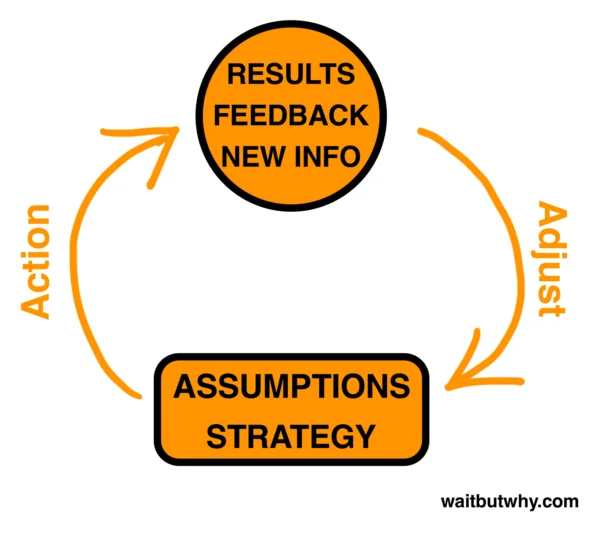
 
…oshpazlar esa salyangoz tezligida yaxshilanadi, chunki ularning strategiyasi retseptga ergashishdan iborat, retseptning o‘zi esa deyarli o‘zgarmaydi. Bundan tashqari, karyera o‘yinlari doimiy o‘zgarib, shakl almashayotgan dunyoda shefning taktikasi real vaqtda o‘zgarib, ulgurib borishi mumkin. Oshpazning retsepti esa shunchaki tobora eskirib boradi — bu muammodan u bexabar qoladi. Shuning uchun men hech bo‘lmaganda kamroq an’anaviy karyeralarda sheflik darajangiz yaxshilanish sur’atingizni belgilovchi yagona eng muhim omil ekaniga ancha ishonaman.
 
**Mehnatga munosabatingiz.** Bu ravshan. Karyerasi ustida haftasiga 60 soat, yiliga 50 hafta ishlaydigan odam, haftasiga 20 soat, yiliga 40 hafta ishlaydigan odamga qaraganda yo‘lda deyarli to‘rt barobar tezroq yuradi. Muvozanatli turmush tarzini tanlagan odam yakkayu yagona maqsadli ishqibozdan sekinroq ilgarilaydi. Dangasalik yoki ishni keyinga qoldirishga moyil odam izchil ish kunlarini o‘tkazishga usta odamga ko‘p yutqazadi. Xayol surish yoki telefonni qo‘liga olish uchun tez-tez ishdan uzilib turadigan odam har ish soatida chuqur diqqatni mashq qiladigan odamga qaraganda kamroq ish bitiradi.
 
**Tabiiy qobiliyatlaringiz.** Iste’dod muhim, albatta. Aqlliroq, iste’dodliroq odamlar tabiatan kamroq qobiliyatli odamlarga qaraganda o‘yinda tezroq yaxshilanadi. Lekin aql va iste’dod bu yerda ishga tushadigan tabiiy qobiliyatning faqat ikki turi. Epchillik va zukkolik ham muhim, bu xislatlar esa doim sof aql bilan mos kelavermaydi. Karyera turiga qarab, ijtimoiy ko‘nikmalar ham hal qiluvchi ahamiyatga ega bo‘lishi mumkin. Ko‘p karyeralarda odamlarga yoqadigan (yoki nozik manipulyator) odamlar kamroq yoqimli odamlarga qaraganda katta ustunlikka ega — va muloqotdan zavq oladiganlar vaqt o‘tib odamlar bilan ko‘proq soat o‘tkazadi va odamovi odamlarga qaraganda chuqurroq munosabatlar quradi.
 
Boshqa narsalar — mavjud aloqalar, mavjud resurslar va mavjud ko‘nikmalar — albatta, muhim, lekin ular sur’atning tarkibiy qismi emas — ular A nuqtasi joylashuvining bir qismi.
 
### Sabot
 
Sabot deganda men uzoq muddatli sabotni nazarda tutaman (kundalik mehnat odatidan farqli o‘laroq). Sabot sur’atdan oddiyroq. Yulduz ortidan quvishga qancha yil bag‘ishlashga tayyor bo‘lsangiz, yulduz sari yo‘lda shuncha uzoqqa borasiz. Soatiga 30 mil tezlikda yurib, 15 daqiqadan keyin to‘xtaydigan mashina soatiga 10 mil tezlikda ikki soat yuradigan mashinaga qaraganda ancha kam yo‘l bosadi.
 
Sabot shuning uchun ham juda muhim. Orzu karyerasiga faqat uch yil urinib ko‘rib, keyin zaxira rejaga o‘tishga qaror qilgan odam, aslida, o‘zini orzulariga erishish imkonidan mahrum qilgan. Qanchalik ajoyib bo‘lishingizning ahamiyati yo‘q — agar yorib chiqolmay ikki-uch yil o‘tib taslim bo‘lsangiz, muvaffaqiyatga erishishingiz dargumon. Sur’atingiz qanchalik ta’sirli bo‘lmasin, bir necha yil eng ajoyib muvaffaqiyat yulduzlariga yetish uchun odatda talab qilinadigan uzun masofalarni bosib o‘tishga shunchaki yetmaydi.
 
### Haqiqiy kuchli va zaif tomonlaringiz
 
Sur’at × sabot tenglamasini yodda tutib, kuchli va zaif tomonlar tushunchasiga qaytaylik. “Kuchli va zaif tomonlar” yomon tushuncha emas — biz u haqida butunlay noto‘g‘ri o‘ylaymiz. Kuchli tomonlarimizni sanaganimizda, hammadan ko‘ra mavjud ko‘nikma sohalarimizni sanaymiz. Aslida esa kuchli tomonlar sur’at va sabot xislatlari haqida bo‘lishi kerak. Originallik yoki uning yo‘qligi muhokamaning hal qiluvchi qismi bo‘lishi, chaqqonlik va kamtarlik kabi xislatlar (sheflarga xos belgilar) muhim kuchli tomonlar, o‘jarlik yoki aqliy dangasalik kabi xislatlar (oshpazlarning klassik belgilari) esa muhim zaif tomonlar bo‘lishi kerak. Mehnat odatining nozikliklari — chuqur diqqat ko‘nikmasi yoki ishni keyinga qoldirishga moyillik kabi — ham, iste’doddan tashqari tabiiy qobiliyatlar — zukkolik va yoqimlilik kabi — ham muhokamaning asosiy qismi bo‘lishi lozim. Sabotga oid xislatlar — chidamlilik, qat’iyat va sabr — istiqbolli kuchli tomonlar deb qaralishi kerak, imkon qadar tezroq muvaffaqiyatli ko‘rinishga shoshayotgan ijtimoiy oyoq esa yorqin qizil bayroq deb baholanishi kerak.
 
Eng muhimi, bu xislatlar hozir qayerdaligining lahzalik surati sifatida emas, balki ularning har birida yaxshilanish salohiyatingiz nuqtai nazaridan muhokama qilinishi kerak. Agar 25 yoshli Maykl Jordanga basketbol to‘pini birinchi marta berib qo‘ysangiz, u yomon o‘ynardi. Lekin basketbolni uning “zaif tomoni” deb atash juda katta xato bo‘lardi. Buning o‘rniga, keyingi olti hafta davomida uning mashq qilishini kuzatib, yaxshilanish qiyaligini baholagan bo‘lardingiz. Bu saboq muayyan ko‘nikmalarga tegishli — lekin umumiy sur’at va sabot xislatlarining ko‘pini ham, agar e’tibor qaratsangiz, ustida ishlab yaxshilash mumkin.
 
### Voqelik qutisini to‘ldirish
 
Haqiqiy Voqelik qutingizga so‘zma-so‘z shunday barcha karyera yo‘llari kirgan bo‘lardi: o‘zingizning keskin yaxshilangan versiyangiz butun umr mehnat qilib, muvaffaqiyat deb ataganingizdan qoniqadigan eng kichik yulduzga yetishi mumkin deb hisoblagan yo‘llar. Bu cheksiz katta ro‘yxat bo‘lardi, undan faqat yo‘lda mumkin bo‘lgan eng yuqori sur’atingizda ham bosib o‘tishingiz uchun aniq haddan ziyod uzun yo‘llargina chiqarib tashlanadi (masalan, men uchun figurali konkida uchish bo‘yicha olimpiya sportchisi bo‘lish karyerasini quvish kabi). Ammo baribir bir daqiqa to‘xtab, to‘liq Voqelik qutingizning ulkan kengligi haqida o‘ylab ko‘rish foydali — sizga haqiqatan qancha variant ochiqligini shunchaki tan olish sizni to‘g‘ri kayfiyatga solishi mumkin.
 
Shunday qilib, birozgina samaraliroq bo‘lish uchun, Voqelik qutisining haqiqatan Variantlar hovuzingizga (Xohlash va Voqelik qutilari kesishadigan Venn diagrammasining o‘rtasiga) tushishi mumkin bo‘lgan qismlari haqida qayg‘uraylik. Voqelik qutisi tekshiruvini shu shart bilan yakunlash uchun biz quyidagilarni baholashimiz kerak:
 
1) **Umumiy manzara.** Dunyodagi hozirgi karyera manzarasini — mavjud (yoki yaratish mumkin bo‘lgan) variantlarning to‘liq doirasini — baholashga qo‘limizdan kelganicha urinib ko‘rish.
 
2) **Aniq o‘yin taxtalari.** Qiziq tuyulgan har qanday karyera uchun o‘sha karyeraning hozirgi o‘yin taxtasida nimalar borligi haqida o‘ylang — ishtirokchilar, boshqalar yaqinda qanday qilib muvaffaqiyatga erishayotgani, o‘yinning eng so‘nggi qoidalari, ishlatilayotgan eng yangi bo‘shliqlar va hokazo.
3) **Boshlang‘ich nuqta.** O‘sha yo‘llar uchun o‘sha sohaga aloqador hozirgi ko‘nikmalaringiz, resurslaringiz va aloqalaringizga asoslanib, boshlang‘ich nuqtangizni baholang.
4) **Muvaffaqiyat nuqtasi.** Yakuniy nuqtalar va yulduzingiz har bir chiziqning qayeriga qo‘yilishi kerakligi haqida o‘ylang. O‘zingizdan so‘rang: o‘sha karyera yo‘lini tanlaganingizdan xursand bo‘lish uchun erishishingiz kerak bo‘lgan muvaffaqiyatning eng past darajasi qanday?
5) **Sur’atingiz.** Sur’atga oid hozirgi kuchli tomonlaringiz va ularning har birida qanchalik yaxshilana olishingizga (boshqacha aytganda, tezligingiz qanchalik oshishi mumkinligiga) asoslanib, bu turli o‘yin taxtalarida yaxshilanish sur’atingiz qanday bo‘lishi mumkinligini dastlabki baholang.
6) **Sabot darajangiz.** Bu yo‘llarning har biriga qancha vaqt sarflashga tayyor bo‘lishingizni baholang.
Endi bu shunchaki matematika. O‘yin taxtangizni chiziqqa aylantirasiz, boshlang‘ich nuqtalar va muvaffaqiyat yulduzlarini qo‘yasiz, ular birgalikda oldingizdagi turli masofalarni hosil qiladi va har biri uchun sur’atingizni sabot darajangizga ko‘paytirasiz. Agar muayyan karyera yo‘li uchun sur’at va sabotingiz ko‘paytmasi yo‘lning umumiy uzunligiga yetishi mumkindek tuyulsa, o‘sha karyera Voqelik qutingizga tushadi. Albatta, yuqoridagi omillarning birortasi uchun ham aniq qiymat olishning iloji yo‘q, lekin hech bo‘lmaganda qanday tenglama bilan ishlayotganingizni bilish yaxshi.
 
Birlamchi tamoyillardan kelib chiqqan Voqelik qutisi tekshiruvi haddan ziyod optimistik ba’zi odamlarni yerga tushirishi mumkin, lekin gumonimcha, ko‘pchilikda bu tekshiruv ularda o‘zi anglagandan ancha ko‘proq variant borligi tuyg‘usini qoldiradi va ularga nigohini jasurroq yo‘nalishga qaratish uchun kuch beradi.
 
Yaxshi Voqelik qutisi mulohazasi yana bir Xohlash qutisi mulohazasini talab qiladi. Bir qancha karyera yo‘llarini ongingizda yangicha ko‘rib chiqish ularning ba’zilariga intilish darajangizga ta’sir qiladi. Bir karyera u minglab soatlik tanish-bilish orttirish (networking) yoki muvaffaqiyatgacha bo‘lgan bir necha o‘n yillik kurashni o‘z ichiga olishini eslatganingizdan keyin kamroq jozibador tuyulishi mumkin. Boshqasi qancha omad ishtirok etishi haqidagi fikringizni o‘zgartirganingizdan keyin kamroq qo‘rqinchli tuyulishi mumkin. Yana boshqa karyera yo‘llarini xohlashni o‘ylamagan bo‘lasiz, chunki ularni real variant deb hisoblamagan edingiz, ammo chuqur mulohaza ongingizni ularga ochib qo‘ygan.
 
Bu bizni uzoq, ikki qismli chuqur sho‘ng‘ishimizning oxiriga olib keladi. Ancha charchatuvchi qutilarni tekshirish jarayonidan so‘ng Venn diagrammamizga qaytishimiz mumkin.
 
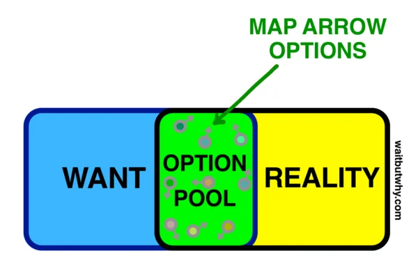

Ba’zi narsalar o‘zgargan deb faraz qilsak, sizda ko‘rib chiqish uchun yangi Variantlar hovuzi bor — stol ustidagi yangi variantlar ro‘yxati, ular ham yuqori ustuvorlikdagi reytinglaringizga muvofiq istalgan, ham erishish mumkin ko‘rinadi. Endi tahlilni boshlashimizdan oldingi joyga — hozirgi lahzaga — qaytishga tayyormiz. Bu variantlar oldimizda turganda, tahlildan boshimizni ko‘tarib, kelajakka qarashga tayyormiz.
 
---
 
## Nuqtalarni kelajakka tutashtirish
 
Postning boshida qo‘yib qo‘yishga majbur qilgan Karyera rejalari xaritangizni — strelkali yoki so‘roq belgili xaritani — qaytarish vaqti keldi. Agar tekshiruvdan oldin xaritangizda aniq strelka bo‘lgan bo‘lsa, yangi Variantlar hovuzingizga qarang. Hamma o‘ylab ko‘rganlaringizni hisobga olganda, hozirgi karyera rejangiz hamon u yerda bo‘lishga loyiqmi? Agar shunday bo‘lsa, tabriklayman — siz ko‘pchiligimizdan oldindasiz.
 
Agar yo‘q bo‘lsa, bu — yomon xabar, ammo ayni paytda yaxshi xabar ham. Esingizda tursin, soxta strelkadan so‘roq belgisiga o‘tish hayotda har doim katta ilgarilashdir.

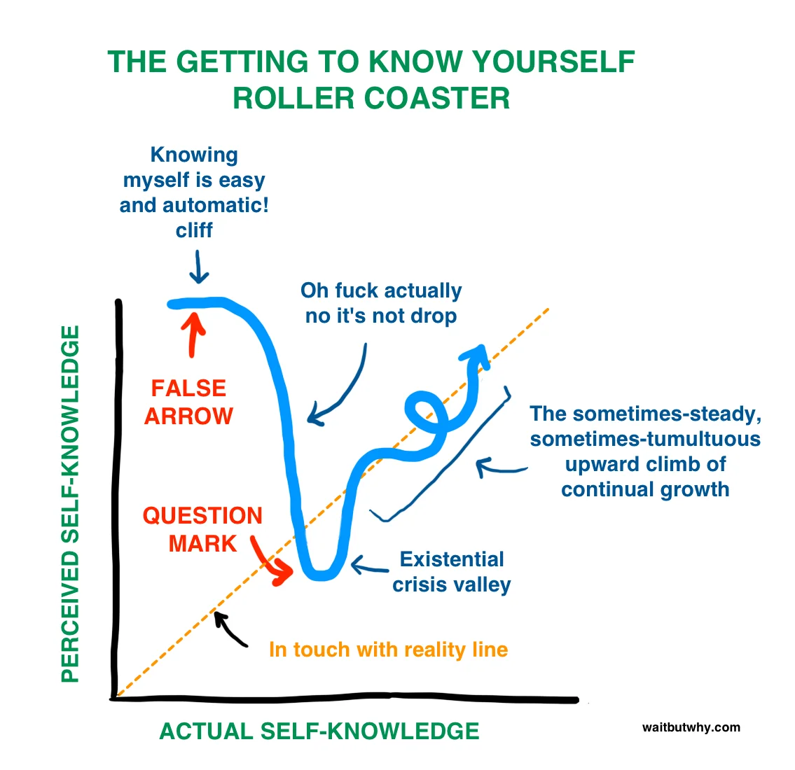
 
Aslida, yangi so‘roq belgisi ikkita amerika tog‘ida hal qiluvchi jarlikdan sakragan bo‘lishingizni bildiradi: o‘zingizni tanish va dunyoni tanish. To‘g‘ri yo‘nalishdagi katta qadam. Strelkani o‘chirib, so‘roq belgisi olomoniga qo‘shiling.
 
Endi so‘roq belgisi olomonining oldida qiyin tanlov turibdi. Variantlar hovuzidagi strelkalardan birini tanlashingiz kerak.
 
Bu qiyin tanlov — lekin u aslida bo‘lganidan ancha yengilroq bo‘lishi kerak. Sababi:
 
Ilgari karyera 40 yillik tunnelga o‘xshardi. Siz tunnelingizni tanlardingiz va bir kirgach, tamom. Tunnel sizni narigi tomondan nafaqaga tupurib yuborgunga qadar taxminan 40 yil shu kasbda ishlardingiz.

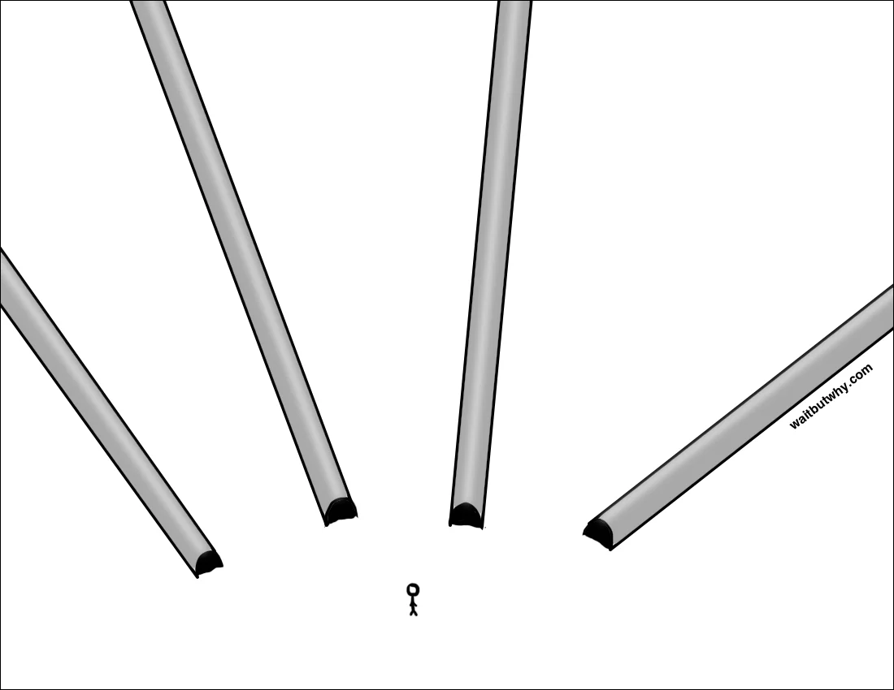
 
Haqiqat shuki, karyeralar hech qachon aslida 40 yillik tunnel kabi ishlamagan bo‘lsa kerak, shunchaki shunday tuyulgan. Eng yaxshi holda, o‘tmishdagi an’anaviy karyeralar tunnelga biroz o‘xshab kechgan.
 
Bugungi karyeralar — ayniqsa kamroq an’anaviylari — tunnelga mutlaqo o‘xshamaydi. Ammo eskirib qotib qolgan ommabop qarashlar ko‘pchiligimizni hamon narsalarga shunday qarashga majbur qiladi, bu esa katta karyera yo‘llarini tanlashdek allaqachon qiyin ishni yana ham qiyinlashtiradi.
 
Karyerangizni tunnel deb o‘ylasangiz, kim ekanliklariga va o‘n yillardan keyin kim bo‘lishni xohlashlariga aniq ishonchi bo‘lmagan har bir odamda — bu esa aqli joyida odamlarning ko‘pchiligi — o‘zlik inqirozini keltirib chiqaradi. U ish bilan nima shug‘ullanishimiz kim ekanimizning sinonimi degan xayolni kuchaytiradi va xaritangizdagi so‘roq belgisini ekzistensial falokatdek ko‘rsatadi.
 
Karyerangizni tunnel deb o‘ylasangiz, to‘g‘ri tanlov qilishning qimmati shunchalik baland ko‘rinadiki, bu tanlov zulmi tuyg‘usini portlatib yuboradi. Ayniqsa mukammallikka berilgan odamlarni bu butunlay falaj qilib qo‘yishi mumkin.
 
Karyerangizni tunnel deb o‘ylasangiz, ruhingiz yalinib so‘rayotgan bo‘lsa ham, karyerani o‘zgartirishga jasoratingiz yo‘qoladi. Bu karyera almashtirishni g‘oyat xavfli va uyatli qilib ko‘rsatadi va shunday qilgan odam muvaffaqiyatsizdir, degan ma’noni beradi. Bu yana har tomonlama rivojlangan, serg‘ayrat, karyerasining o‘rtasidagi odamlarni jasoratli o‘zgarish qilish yoki butunlay yangi yo‘lni noldan boshlash uchun juda keksa ekan, degan fikrga olib keladi.
 
Biroq ommabop qarashlar hamon ko‘pchiligimizga karyera tunnel, deb aytadi. O‘zining iflos tortining ustidagi qaymog‘i sifatida — haqiqatan xohlamaydigan narsalarimizga intilishimizga, chuqur ichimizda his qiladigan intilishlarimizni inkor etishimizga, xavfli bo‘lmagan narsalardan qo‘rqishimizga va dunyo hamda salohiyatimiz haqida noto‘g‘ri narsalarga ishonishimizga yordam berganidan tashqari — ommabop qarashlar karyera tunnel, deb aytadi, toki biz o‘zimizni bekorga dahshatga solaylik.
 
Bugungi karyera manzarasi tunnellar qatori emas, u ulkan, tasavvurga sig‘maydigan darajada murakkab, tez o‘zgaradigan ilmiy laboratoriya. Bugungi odamlar qilayotgan ishining sinonimi emas — ular tasavvurga sig‘maydigan darajada murakkab, tez o‘zgaradigan olimlar. Va bugungi karyera tunnel ham, quti ham, o‘zlik yorlig‘i ham emas — u ilmiy tajribalarning uzun ketma-ketligi.
 
Stiv Jobs hayotni nuqtalarni tutashtirishga o‘xshatgan va o‘tmishingizga qarab, nuqtalar sizni hozirgi joyingizga qanday tutashtirib olib kelganini ko‘rish oson bo‘lsa-da, hayotda nuqtalarni oldinga qarab tutashtirish asosan imkonsizligini aytgan.
 
Qahramonlaringiz tarjimai hollariga qarasangiz, ularning yo‘llari to‘g‘ri va oldindan bashorat qilsa bo‘ladigan tunnelga qaraganda, tutashtirilgan nuqtalarning uzun ketma-ketligiga ancha ko‘proq o‘xshashini ko‘rasiz. O‘zingiz va do‘stlaringizga qarasangiz, ehtimol, xuddi shu tendensiyani ko‘rasiz — ma’lumotlarga ko‘ra, yosh odam bitta ish joyida o‘rtacha (median) atigi 3 yil turadi (kattaroq odamlar har bir nuqtada uzoqroq qoladi, lekin unchalik ham uzoq emas — o‘rtacha 10,4 yil).
 
Demak, karyerangizni nuqtalar ketma-ketligi sifatida ko‘rish qaror qabul qilishga yordam beradigan aqliy hiyla emas — bu aslida nima bo‘layotganining aniq tasviri. Karyerangizni tunnel deb ko‘rish esa shunchaki samarasiz emas — bu xayolparastlik.
 
Xuddi shuningdek, siz asosan yo‘lingizdagi keyingi nuqtaga e’tibor qaratish bilan cheklanasiz — chunki aniqlay oladigan yagona nuqta shu. 4-nuqta haqida qayg‘urishingiz shart emas, chunki baribir qila olmaysiz — bunga so‘zning to‘liq ma’nosida layoqatingiz yo‘q.
 
4-nuqtaga kelganingizda, hozir bilmaydigan narsalarni o‘zingiz haqingizda bilib olgan bo‘lasiz. Siz hozirgi o‘zingizdan o‘zgargan bo‘lasiz va Intilishlar sakkizoyog‘ingiz bu o‘zgarishlarni aks ettiradi. Karyera manzarasi va o‘zingizni qiziqtirgan aniq o‘yin taxtalari haqida hozirgidan ancha ko‘p bilasiz va ancha yaxshi o‘yinchiga aylangan bo‘lasiz. Va, albatta, o‘sha manzaraning o‘zi va o‘sha o‘yin taxtalari ham o‘zgargan bo‘ladi.
 
Ajoyib 80,000 Hours veb-sayti (u yosh, iste’dodli odamlarga karyera tanlovlarini hal qilishda yordam berish uchun mavjud) buni tasdiqlovchi ko‘plab ma’lumotlarni to‘plagan: siz o‘zgarishingiz, dunyo o‘zgarishi va aslida nimada yaxshi ekaningizni faqat vaqt o‘tib bilishingiz haqidagi ma’lumotlar. Mashhur psixolog Den Gilbert ham kelajakda nima bizni baxtli qilishini bashorat qilishda qanchalik ojiz ekanimizni ta’sirchan tarzda tasvirlab bergan.
 
Hozir 2-, 4- yoki 8-nuqta nima bo‘lishi kerakligini aniqlay olaman deb ko‘rsatish kulgili. Kelajakdagi nuqtalar — kelajak dunyosida yashayotgan kelajakdagi, donoroq o‘zingizning tashvishi. Keling, 1-nuqtaga e’tibor qaratamiz.
 
Agar o‘zimizni olim, jamiyatni esa ilmiy laboratoriya deb o‘ylasak, sizning hozirgi yangi tahrir qilingan Xohlash-Voqelik Venn diagrammangiz dastlabki, qo‘pol farazdan boshqa narsa emas deb hisoblashimiz kerak. 1-nuqta — uni sinab ko‘rish imkoniyatingiz.
 
Farazlarni sinash tanishuv olamida tushunarli. Agar do‘stingiz qanday odamga turmushga chiqishni xohlashi haqida bosh qotirib, hech kim bilan uchrashmagan bo‘lsa, siz unga: “Buni divaningda o‘tirib aniqlay olmaysan — uchrashuvlarga chiqa boshlashing kerak, shunda hamkoringdan nima kutishingni o‘rganasan” deyardingiz. Agar o‘sha do‘st yaxshi birinchi uchrashuvdan keyin uyga qaytib, bu yangi odam “o‘sha, yagona” yoki yo‘qligi haqida soatlab bosh qotirsa, yana uni tuzatishingizga to‘g‘ri kelardi. “Faqat bitta uchrashuvdan buni bilishingning iloji yo‘q! O‘sha qarorni qabul qilish uchun nimani bilishing kerak bo‘lsa, shuni bilish uchun bu odam bilan biroz uchrashib ko‘rishing kerak” deyardingiz.
 
Hammamiz kelisha olamizki, bu farazdagi do‘st ancha jinni va baxtli munosabatni qanday topish haqida asosiy tushunchaga ega emas. Shuning uchun karyera tanlashda unga o‘xshamaylik. 1-nuqta — xotirjam vaziyat, bu shunchaki birinchi uchrashuv.
 
Bu ajoyib xabar — chunki bu xaritangizga strelka chizishni ancha kam qo‘rqinchli qiladi, agar bu kelajagingizning faqat 1-nuqtasiga strelka bo‘lsa. Tanlov zulmining haqiqiy sababi — bugungi dunyodagi variantlarning ulkan sonini to‘g‘ri ko‘rib turib, o‘sha karyeralarni kechagi dunyoning 40 yillik tunnellari deb xayolparastlik bilan ko‘rish. Bu halokatli birikma. Keyingi katta karyera qaroringizni ancha past qimmatli tanlov sifatida qayta idrok etish variantlar sonini stressli emas, hayajonli qiladi.
 
Bularning hammasi nazariyada ajoyib. Lekin endi eng qiyin qism keladi.
 
## Qadam tashlash
 
Siz o‘ylab-o‘ylab-o‘ylab, tortib, o‘lchab, bashorat qilib, mulohaza qilib bo‘ldingiz. Nuqtani tanlab, strelka chizdingiz. Endi esa haqiqatan qadam tashlashingiz kerak.
 
Biz bunda juda ojizmiz. Biz qo‘rqoq odamlarmiz. Biz yoqimsiz narsalarni yoqtirmaymiz, hayotda jasoratli qadam tashlash esa yoqimsiz. Bizda ishni keyinga qoldirishga moyillikning zarracha belgisi bo‘lsa ham, aynan shu yerda ko‘rinadi.
 
Intilishlar sakkizoyog‘i yordam berishi mumkin. Yuqorida aytganimizdek, har qanday paytdagi xatti-harakatingiz shunchaki sakkizoyog‘ingiz konfiguratsiyasini ko‘rsatadi. Agar hayotiy qadamni qaror qilgan bo‘lsangiz-u, uni tashlay olmayotgan bo‘lsangiz, bu ongostingizda qadam tashlashni xohlamaydigan qismlaringiz xohlaydigan qismlaringizdan yuqoriroq o‘rinda turgani uchundir. Ongingiz sakkizoyog‘ingizning inersiyaga moyil qismlariga pastroq tokcha reytingi berishga urinib ko‘rgan bo‘lishi mumkin, ammo intilishlaringiz bosh ko‘targan. Siz o‘z xodimlarini boshqara olmaydigan direktorsiz.
 
Bu muammoni hal qilish uchun bog‘cha tarbiyachisidek o‘ylang. Sinfingizda 5 yoshli bolalarning bir guruhi xohishingizga qarshi bosh ko‘tarmoqda. Nima qilasiz?
 
Bordi-yu, muammo chiqarayotgan 5 yoshli bolalar bilan gaplashing. Ular yoqimsiz, o‘jar soddadillar, lekin ularni baribir tushuntirib bo‘ladi. Ularga sakkizoyoq ierarxiyasida nega ularni boshqalardan pastroq o‘ringa qo‘yganingizni gapirib bering. Voqelik qutisi mulohazasidan olgan tushunchalaringizni tushuntiring. Nuqtalarni tutashtirish qanday ishlashini va 1-nuqtaning xotirjamligini eslating. Siz tarbiyachisiz — yo‘lini toping.
 
Yoshim ulg‘aygan sari, ongimizning bog‘cha tarbiyachisi sifatidagi ichki jangimiz hayot kurashining taxminan 97 foizini tashkil etishi ayonlashib boryapti. Dunyo oson — siz qiyinsiz. Agar o‘zingizni hayotdagi rejalaringizni va o‘zingizga bergan va’dalaringizni doim bajarmayotgan holda topsangiz, yangi 1-ustuvorligingizni topdingiz — yaxshiroq bog‘cha tarbiyachisi bo‘lish. Buni uddalamaguncha hayotingizni bir to‘da ibtidoiy, uzoqni ko‘ra olmaydigan 5 yoshli bolalar boshqaradi va butun hayotingiz sassiq bo‘lib ketadi. Ishoning, bilaman.
 
Agar ichki tahlilingiz yangi nuqtaga karyera sakrashini talab qilsa, qachondir sakray olishingizga umid qilaman.
 
## Qadamdan keyin
 
Yangi nuqtaga sakrash — ozodlik tuyg‘usi, odatda biroz jiddiy ichki tartibsizlik bilan yonma-yon keladi.
 
Avvalo, hech bo‘lmasa bir muddat yangi nuqtangizda qilayotgan ishingizda yomon bo‘lasiz. Dono o‘zingiz bu aynan shunday bo‘lishi kerakligini bilsa-da, kamroq dono o‘zingiz to‘liq ekzistensial qulash holatiga tushadi. Sakkizoyoq reytingida o‘ylab-o‘ylab ustuvorligini pasaytirgan barcha qo‘rquvlaringiz kimdir ularni o‘ldirayapti deb o‘ylaydi va 911 ga qo‘ng‘iroq qilishga urina boshlaydi. O‘zingiz ustuvor qilgan intilishlar hali unchalik qoniqish his qilmaydi va ular o‘zlari nimani xohlaydi deb o‘ylagan bo‘lsa, hammasi xato bo‘lgan emasmikin, deb o‘ylab qoladi. O‘zingiz ustuvor qilmagan intilishlar gitarani olib, ularni mahrum qilgan, ko‘kroq ko‘ringan o‘tloqqa atab sevgi qo‘shiqlari kuylay boshlaydi. Bu unchalik qiziqarli bo‘lmaydi.
 
Hatto ishlar yaxshi ketsa ham, Intilishlar sakkizoyog‘i umuman baxtsiz maxluq ekanini tezda eslaysiz. Sakkizoyoqning asosiy bo‘laklari e’tibordan chetda qolganini yoki hatto hujumga uchraganini his qiladi va o‘tgan har bir kun bilan siz ko‘rib chiqqan, lekin yurmaslikni tanlagan yo‘llarning boy berilgan imkoniyat narxini — boshqa tanlovlar qilgan parallel olamlardagi o‘zingizning versiyalaringiz narxini — ko‘tarasiz. Ularning dunyodagi farazdagi ilgarilashi haqida o‘ylab, nimalarni boy berganingizdan tashvishlanasiz.
 
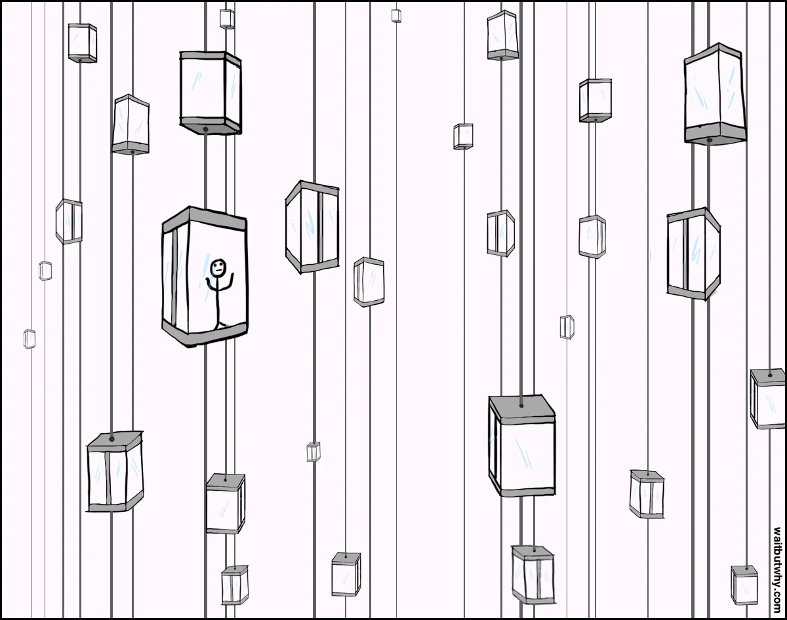

Dono bo‘lgan sari, asosan baxtsiz sakkizoyoqqa qabul qilish bilan qarashni o‘rganasiz. Uning ingrashiga yo‘l qo‘yib, uni eshitmaslikka ustasi farang bo‘lasiz — chunki u aynan siz rejalashtirgan tarzda ingrayotganini bilasiz.
 
Ingrayotgan sakkizoyoq nega sof, ko‘tarinki baxt hech qachon oqilona maqsad emasligini eslatib turadi. Sof baxtni his qiladigan paytlaringiz vaqtinchalik, dori ta’siridagi xayollar kabi — yangi munosabat yoki yangi ishning asal oyi davri yoki uzoq kutilgan muvaffaqiyatdan keyingi ko‘tarinkilik kabi. Bu onlar o‘rtamiyona golfchining o‘yinidagi mukammal zarbalarga o‘xshaydi — ular ajoyib va ulardan to‘yib-to‘yib zavqlanishingiz kerak — lekin ular yangi me’yor emas va hech qachon bo‘lmaydi.
 
Yaxshiroq maqsad — qanoat: hozir yaxshi hayot yo‘lida qo‘lingizdan kelgan eng yaxshi urinishni qilayotganingiz, ustida ishlayotgan narsangiz keyinchalik chinakam faxrlanishingiz mumkin bo‘lgan jumboqning bir bo‘lagiga aylanishi mumkinligi haqidagi qoniqarli tuyg‘u. Baxtning ketidan quvish — havaskorlik. Tanlovlaringiz va sharoitingiz birlashib, buni uddalagan paytlarda qanoat his qilish va so‘rashingiz mumkin bo‘lgan hamma narsaga ega ekaningizni bilish — donolarga xos.
 
Odamlar shu lahzada hozir bo‘lish haqida gapiradi, lekin kengroq tushuncha ham bor: makro-hozirlik — o‘z hayotingizda keng ma’noda hozir bo‘lish tuyg‘usi. Agar o‘zingizga chin dildan halol bo‘lganingizda, to‘g‘ri tuyuladigan karyera nuqtasida bo‘lsangiz, bir muddat o‘ylashni va rejalashtirishni to‘xtatib, shunchaki ishga sho‘ng‘ib ketishingiz mumkin. Katta rasmga keyinroq qaytasiz — hozircha makro rasmni bir chetga qo‘yib, boshingizni egib, butun kuchingizni hozirgi paytga bag‘ishlashingiz mumkin. Bir muddat shunchaki yashashingiz mumkin.
 
Bu onlar har doim ham uzoq davom etmaydi, shuning uchun tishingizni botiring. Tanlagan nuqtangizga qo‘lingizdan kelgan hamma narsani sarflang. Bilishingizcha, siz birinchi basketbol to‘pini ushlab turgan Maykl Jordan bo‘lishingiz mumkin, shuning uchun o‘ynashni boshlang.
 
## Keyingi nuqta?
 
Qachondir makro rasm haqidagi yaxshi tuyg‘ularingiz buzilishi mumkin. Shunda tahlil rejimiga qaytib, bezovtalikka aynan nima sabab bo‘layotganini aniqlashingiz kerak bo‘ladi.
 
Ba’zan muammo makro missiyada bo‘lmaydi. Ichingizdagi shef missiyaning o‘zi strategik nuqta sakrashini talab qiladi deb qaror qilgan bo‘ladi. Bunday hollarda nuqtalar orasida sakrash sabotdan voz kechish emas, sabotning o‘z mohiyatidir. Bu — missiyani kuchaytiradigan turdagi nuqta sakrashi.
 
Boshqa paytlarda qorong‘iroq bezovtalikni his qilasiz — makro missiyani o‘zgartirish kerak bo‘lishi mumkin, degan gumon. Shunda bu tuyg‘u dono qismlaringizdan chiqayotganmi yoki shunchaki bezovta, ustuvorligi pasaytirilgan intilishlaringizdanmi, aniqlashingiz kerak bo‘ladi. Missiyani o‘zgartiradigan nuqta sakrashi o‘rinli bo‘lishi mumkin, lekin buni qaysi qismlaringiz so‘rayotganiga qarab, u noto‘g‘ri qadam ham bo‘lishi mumkin.

Bunday paytlarda o‘zingiz shu spektrning qayerida bo‘lishga moyilligingizni o‘ylab ko‘rish muhim:

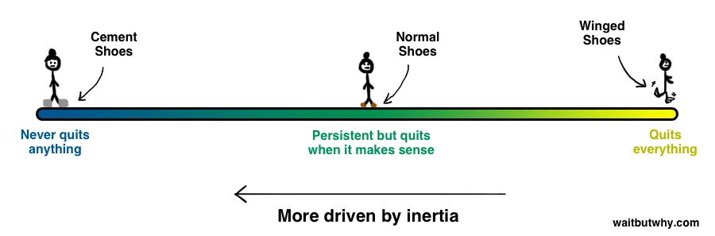
 
Bu spektrning chap tomonidagilar — sakrashdan cho‘chiydiganlar. Oyog‘i sementga botganlar. Ularning tuzog‘i — noto‘g‘ri narsalarda haddan ziyod uzoq qolib ketish. O‘ng tomondagilar — sakrashga o‘ch, oyog‘iga qanot bitganlar — ularning tuzog‘i aksincha: ular tez taslim bo‘ladi. (Sementga botgan oyoqlardan ayniqsa ehtiyot bo‘lishingiz kerak — psixologlarning fikricha, umrining oxiridagi odamlar ko‘proq inersiya bilan yashaganlaridan pushaymon bo‘ladi: tez-tez aytiladigan pushaymonlik — “Qaniydi, avvalroq tashlab ketsam edi”, keksalarning eng keng tarqalgan maslahati esa — “Yoqtirmaydigan ishingda qolma.”)
 
Shuning uchun bu ichki tizimlar muhim. Ular turtkilaringiz manbasini tahlil qilish imkonini beradi. Bizning misolimizda savol shuki, missiyani o‘zgartirish turtkingiz chin evolyutsiya natijasimi yoki tez taslim bo‘luvchilarga xos moyillikning mahsulimi. Shuning uchun diagrammangiz haqida o‘ylab ko‘ring. Bezovtaligingiz hamon to‘g‘ri sozlangan sakkizoyoqning kutilgan tinimsiz ingrashimi? Hamon siz uchun to‘g‘ri bo‘lgan yo‘ldagi uzoq sudralib yurishdan charchoqmi? Yoki sudralib yurish chog‘ida o‘zingiz yoki dunyo haqida yangi ma’lumot o‘rganib, ba’zi noto‘g‘ri dastlabki taxminlaringizni tuzatdingizmi? Yoki, ehtimol, tubdan nimadir o‘zgarayotgandir — ko‘k yoki sariq sikllardagi qandaydir harakatmi:
 
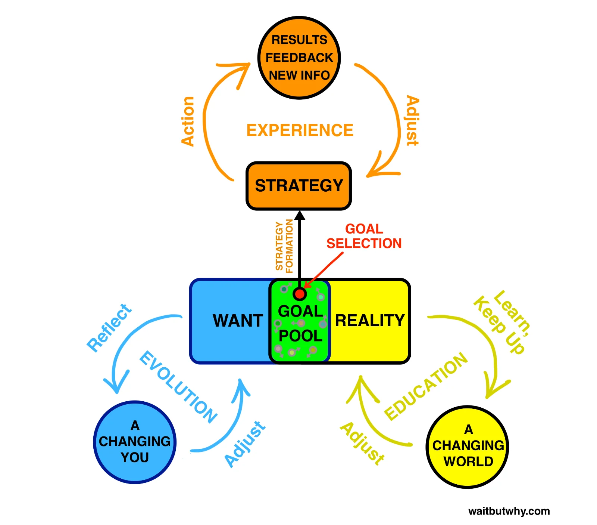
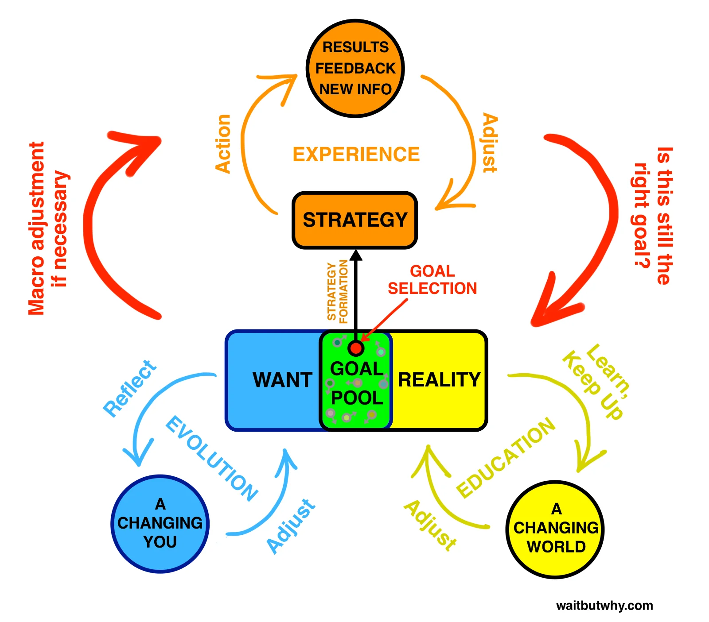

Agar narsalar chindan o‘zgargan deb his qilsangiz, yanada uzoqlashib, missiyangizni tubdan o‘zgartirishga oid katta qizil sikl haqida o‘ylashga qaror qilishingiz mumkin:

Agar karyera nuqtalarni tutashtirishga o‘xshasa, “nuqtadan nuqtaga sakrashda donolashish”ni qilinadigan ishlar ro‘yxatida ancha yuqoriga qo‘yishimiz kerak. Boshlash uchun eng yaxshi joy — o‘z o‘tmishingizga qarash. O‘z o‘tmishdagi qarorlaringizni ortga nazar tashlab ko‘rishning fonari va yig‘ilgan donolik bilan o‘rganish — sportchining o‘yin yozuvini o‘rganishiga o‘xshaydi.
 
O‘z o‘tmishimga qarasam, ko‘plab nuqtadan nuqtaga sakrashlarni (yoki hali maktabda bo‘lganimda karyera rejalarini o‘zgartirishlarni) ko‘raman, ularning ba’zilari ortga qarab ko‘rganda ancha nodonlik ko‘rinadi. Ammo o‘tmishdagi yomon qarorlarim va ularni yuzaga keltirgan fikrlash tarzlari hamda xulq odatlarining rasmini qanchalik aniq ko‘rsam, kelajakda ularni takrorlash ehtimolim shuncha kamayadi.
 
O‘zingiz ancha ahmoq ekaningizni eslab turish ham muhim, kamtarlantiradigan mashqdir. Kamtarlikning ishonchsizligi unchalik yoqimli his etilmaydi va o‘z hayot xaritangizni tinimsiz o‘zingiz ixtiro qilish yuki hech qachon yengil emas — lekin ishonchsizlik va qiyinchilik — o‘z kemangizni o‘zingiz boshqarish tuyg‘usidir. Biz o‘zimizni juda yaxshi his qilganimizda haddan ortiq ishonch, aqliy loqaydlik va qotib qolgan odatlarga tushib qolish xavfi tug‘iladi. Aynan hayotni butunlay tushunib oldim deb o‘ylagan paytimizda yo‘ldan adashib qolamiz.
 
---
 
Hayotingiz davomida yaxshi va yomon qarorlaringiz birgalikda sizning yagona hayot yo‘lingizni bunyod etadi. Bu blogda men ko‘pincha qo‘rquvlarimiz qanchalik asossiz bo‘lishi mumkinligi va ular bizni qanchalik ortga tortishi haqida yozganman. Ammo umr oxiridagi pushaymonlik qo‘rquvini, ehtimol, bag‘rimizga bosishimiz kerak.
 
Xudoga shukur, o‘lim to‘shagiga o‘xshagan holatda hech qachon bo‘lmaganman, lekin umr oxirida odamlarga narsalarni tiniq ko‘zlar bilan ko‘rish imkonini beradigan nimadir bor shekilli. O‘limga yuzma-yuz kelish boshingizdagi aslida siz bo‘lmagan barcha ovozlarni erib ketishga majbur qiladi, kichkina haqiqiy o‘zingizni o‘y-mulohazada yolg‘iz qoldiradi. Menimcha, umr oxiridagi pushaymonliklar — shunchaki haqiqiy o‘zingizning yashay olmagan hayot qismlari haqida o‘ylashi, boshqa birov ongostingizga tepib yuborgan qismlaringiz haqida.
 
O‘z ruhiyatim ham buni tasdiqlaydigandek — hozirgacha bosib o‘tgan yo‘limga ortga qarasam, meni eng ko‘p qiynaydigan xatolar — boshqa birov miyamning rulini egallab, haqiqiy o‘zimning sokin, ishonchsiz ovozini bosib tashlagani uchun sodir bo‘lgan xatolar, ya’ni o‘sha paytda chuqur ichimda noto‘g‘ri ekanini bilgan xatolarim. Kelajakdagi maqsadim xatolardan qochish emas, balki qiladigan xatolarim o‘zimniki bo‘lishi.
 
Shuning uchun bu postda shunchalik azobli darajada qat’iy tahlil o‘tkazdim. Menimcha, bu hayotdagi shunga arziydigan kam sonli mavzulardan biri. Boshqa ovozlar sizning hayotingizni siz uchun yashashga shiddat bilan urinishdan hech qachon to‘xtamaydi — ongingizning aynan markazidagi o‘sha kichkina, ishonchsiz personaj oldida buni to‘g‘ri uddalashga burchlisiz.
 
