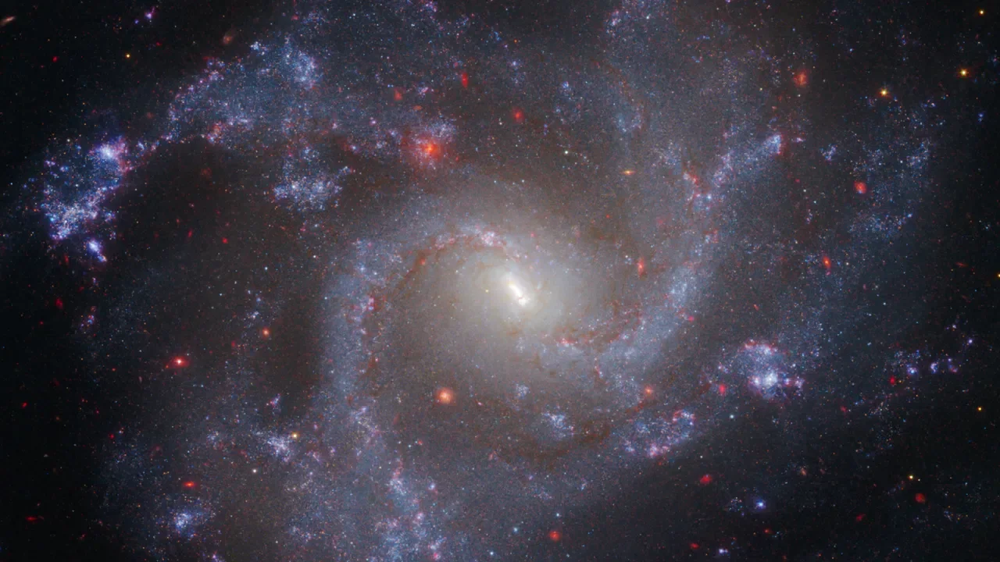
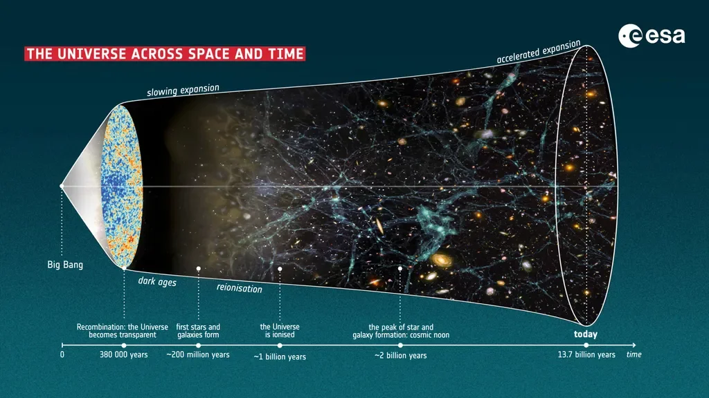

 

So‘nggi tadqiqotlar shuni ko‘rsatmoqdaki, kosmik kengayish tezligi vaqt o‘tishi bilan keskin o‘zgaradi, agar bu rost bo‘lsa, u holda yangi tadqiqot natijalariga ko‘ra, koinot biz o‘ylaganimizdan ham ancha oldinroq tugashi mumkin.

Olimlar uzoq vaqt davomida bizning koinotimiz yana trillionlab yillar davom etadi deb taxmin qilib kelishgan edi. Biroq yangi tadqiqot koinot uchun ancha qisqa umrni o‘rtaga tashlamoqda: olamimiz yana bor-yo‘g‘i 33 milliard yil yashashi mumkin xolos.

Bu hamma narsa o‘z-o‘ziga qulab tushishidan oldingi kosmik ko‘z qisib qo‘yishdek bir lahzadir — ushbu jarayon **"Katta siqilish" (Big Crunch)** deb nomlanadi. Unda kengayish ortga qaytib, butun materiya va fazo-vaqt "Katta portlash" sharoitlariga o‘xshash o‘ta zich holatga qaytishiga olib keladi. Koinotning kengayishi tezlashib borayotgani sababli bu holat uzoq vaqt davomida koinot taqdiri uchun imkonsiz deb rad etib kelingan edi. Ammo ushbu yangi tadqiqot kutilmagan va biroz xavotirli bu ehtimolni qayta ochib berdi.

Bu hayratlanarli xulosaga kelish koinot xaritasini tuzish izlanishlarimizdan boshlandi. Bunda e’tiborimiz koinotni tezlashib borayotgan sur’atda kengaytirayotgan sirli kuch — qorong‘u energiyaga qaratildi. Qorong‘u energiya tadqiqoti (Dark Energy Survey, DES) va Qorong‘u energiya spektroskopik uskunasi (Dark Energy Spectroscopic Instrument, DESI) orqali olingan so‘nggi ma’lumotlar ushbu kengayishni o‘rganish maqsadida yuz millionlab galaktikalar xaritasini tuzib chiqishga yordam berdi. Bu muhim vositalar juda katta ishonch bilan shuni ko‘rsatmoqdaki, qorong‘u energiyaning "holat tenglamasi" — ya’ni uning bosim va energiya zichligi nisbati (bu uning kengayishga ta’sirini belgilaydi) — shunchaki o‘zgarmas son emas. Aksincha, uning ta’siri vaqt o‘tishi bilan o‘zgarib borayotganga o‘xshaydi.

Bu g‘ayrioddiy dinamika qorong‘u energiya aslida nimalardan tashkil topgani haqidagi muqobil izohlarga eshik ochadi. Shu tariqa aksion qorong‘u energiya (aDE) modeli yuzaga keldi. Bu modelga ko‘ra, qorong‘u energiya ikki narsadan: aksion maydoni (koinot bo‘ylab harakatlanib yuruvchi qorong‘u materiyaning o‘ta yengil shakli) hamda kosmologik doimiylik (yoki fazo-vaqt tuzilishiga singib ketgan barqaror fon kengayishi)dan iborat.

arXiv pre-print serveriga yuklangan yangi maqolada tadqiqotchilar ushbu gibrid modelni DES o‘lchovlariga qo‘llashdi. Ular bu kombinatsiya DES va DESI natijalarini izohlab bera olishi mumkinligini aniqlashdi, biroq kutilmagan burilish bilan: koinotning uzoq kelajagida aksion maydoni va kosmologik doimiylik o‘rtasidagi o‘zaro ta’sir koinotni yana faol ravishda bir-biriga tortadi va oxir-oqibat o‘sha mudhish "Katta siqilish"ga olib keladi.

Kuzatishlarga eng mos keladigan modelni tanlab, simulyatsiyani vaqt bo‘yicha oldinga harakatlantirish orqali tadqiqotchilar kosmik halokatning aniq vaqtini hisoblab chiqishdi: bundan 33,3 milliard yil o‘tib. Bunday keskin qisqargan kelajak an’anaviy ravishda taxmin qilingan trillion yillik umrga butunlay zid keladi. Kosmik kengayish koinotni kimsasiz, mangu avtomagistral kabi cho‘zish o‘rniga, bizni sayohatimiz boshlangan nuqtaga qaytaradigan kosmik "U-burilish"ni yuzaga keltiradi.

Bu mutlaqo yangi soha va garchi dalillar bunga undayotgan bo‘lsa-da, ilm-fanda doimo ogohlantirishlar mavjud bo‘ladi. DES va DESI ning kosmologik doimiylik barqaror emasligini ko‘rsatuvchi kuzatishlari juda qiziqarli, biroq buni yana sinovdan o‘tkazib tasdiqlash kerak. Ushbu model ko‘plab o‘zgaruvchilarga bog‘liq va ularning bir nechta turli xil kombinatsiyalari ham kuzatuvlarni tushuntirib bera olishi mumkin. Shunga qaramay, manfiy kosmologik doimiylik — va uning natijasida kelib chiqadigan "Katta siqilish" — ularning tahlilida eng katta ehtimol bo‘lib qolmoqda.

Ushbu modelni qat’iy sinovdan o‘tkazish uchun ko‘proq ma’lumotlar kerak. Koinot — murakkab yakkalik; bizning tushunchamiz doimiy ravishda rivojlanib bormoqda. O‘sib borayotgan ma’lumotlar oqimlarini qamrab olar ekanmiz, biz shu paytgacha aytilgan eng buyuk hikoyani qismlardan yig‘ib bormoqdamiz — ammo bu hikoya biz kutgandan ham ertaroq yakun topishi mumkin.
