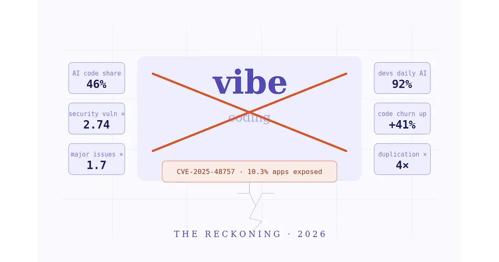
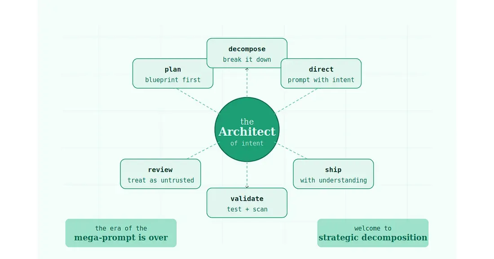

## _Faqat tasvirlab ber va darhol ishga tushir_ davri bir muddat samarali bo'ldi. Ammo uni yakuniga yetkazgan omillar mana shular — va endilikda haqiqiy maydon qanday tus olayotgani ko'rishingiz mumkin.

Bu, davom etgan lahzalarda, chinakamiga maftunkor bir xayol edi. Vibecodingni rossa hayp qilindi.

Siz o‘z g‘oyangizni oddiy, ravon tilda bayon qilasiz. Sun’iy intellekt esa go‘yo sehr ila kodni yaratadi. Uni loyihangizga joylaysiz, brauzerni yangilaysiz — va tamom  — ilovangiz ishga tushadi. Na kompyuter fanlari na diplomi kerak, na Stack Overflow sahifalarida cheksiz sarsonlik, na tungi soat ikkidagi tinkani qurituvchi debugging jarayonlari. Faqatgina ilhom, oqim va zavq (_yana coffee shirin ichish mumkin_).

Bu xayolning ham o‘z nomi bor edi. **OpenAI** va Tesla’ning sobiq AI yetakchisi Andrej Karpathy 2025-yil fevralida unga _vibe coding_ deb nom berdi — ya’ni dasturchi sun’iy intellekt yaratgan kodni har bir satrini chuqur anglab yetmasdan ham, “oqimga to‘liq berilgan” holda qabul qiladigan dasturlash uslubi. Hatto Collins Dictionary ham uni 2025-yilning eng muhim iborasi sifatida e’tirof etdi.

Oradan o‘n to‘rt oy o‘tgach esa, bu shirin mastlikning achchiq oqibatlari yuzaga chiqdi.

### Bu orzuni bunyod etgan raqamlar

Avvalo, bu jarayon naqadar shiddat bilan rivojlanganini anglash uchun ayrim muhim ko‘rsatkichlarga nazar tashlaylik.

Y Combinator’ning 2025-yilgi qishki dasturida ishtirok etgan startaplarning 25 foizi kod bazasining kamida 95 foizini sun’iy intellekt yordamida yaratgan edi. **GitHub** ma’lumotlariga ko‘ra, bugungi kunda yangi qo‘shilayotgan barcha kodlarning 46 foizi AI tomonidan generatsiya qilinmoqda. Yana bir tahlilga ko‘ra, AQShdagi dasturchilarning 92 foizi endilikda AI kodlash vositalaridan har kuni foydalanadi. Cursor, Replit, Bolt, Lovable kabi platformalarning o‘zi milliardlab venchur sarmoyalarni jalb qildi; bozor hajmi esa 2026-yilda 4,7 milliard dollarga baholanib, kelasi yilga borib 12,3 milliard dollarga yetishi prognoz qilinmoqda.

Bu shunchaki o‘tkinchi urf emas edi. Sun’iy intellekt ko‘magida dasturchilar vazifalarni 25–55 foizgacha tezroq bajara boshladilar. Ayniqsa, AI yaratgan natijani chuqur tahlil qila oladigan tajribali muhandislar samaradorlikning hatto **81** foizgacha oshganini qayd etdilar. Ilgari dasturlash imkoniyatidan yiroq bo‘lgan insonlar ham endi hech qachon yarata olmas deb o‘ylagan ilovalarini barpo qila boshladi. Dasturiy ta’minot yaratishni ommalashtirish haqidagi va’da ma’lum ma’noda rostdan ham amalga oshayotgan edi.

Xo‘sh, unda qayerda xato qilindi?

#### Hech kim oshkora muhokama qilishni istamagan hisob-kitob lahzasi

2025-yil dekabrida bir tadqiqot kompaniyasi GitHub’dagi 470 ta ochiq manbali pull request’ni tahlil qildi. Natija esa noqulay, ammo inkor etib bo‘lmas edi: sun’iy intellekt hamkorligida yozilgan kodlarda inson tomonidan yozilgan kodlarga nisbatan 1,7 baravar ko‘proq jiddiy muammolar aniqlandi. Mantiqiy xatolar ko‘proq uchradi. Noto‘g‘ri konfiguratsiyalar 75 foizga tez-tez kuzatildi. Xavfsizlik zaifliklari esa inson yozgan kodga qaraganda 2,74 baravar yuqori darajada namoyon bo‘ldi.

So‘ng esa Lovable hodisasi yuz berdi.

Lovable — vibe coding olamidagi eng ommabop platformalardan biri bo‘lib, u dasturchi bo‘lmagan foydalanuvchilarga oddiy promptlar orqali haqiqiy veb-ilovalar yaratish imkonini beradi. Xavfsizlik tadqiqotchilari Lovable orqali yaratilgan 1 645 ta ilovani o‘rganib chiqdi va ulardan 170 tasida — ya’ni 10 foizdan ortig‘ida — ma’lumotlar bazasi konfiguratsiyasida kritik darajadagi row-level security nuqsonlari mavjudligini aniqladi. Bu shunchaki sinov loyihalari emas edi. Ular haqiqiy foydalanuvchi ma’lumotlari bilan ishlayotgan tizimlar edi. Oddiy ko‘nikmaga ega istalgan hujumchi bu ma’lumotlarga kirish imkoniga ega bo‘lishi mumkin edi.

Mazkur zaiflik hatto rasmiy CVE identifikatoriga ham ega bo‘ldi: CVE-2025–48757. Shu tariqa, vibe coding sanoatining ilk yirik xavfsizlik inqirozi boshlandi.

Va bu yagona holat emas edi. Tenzai nomli xavfsizlik kompaniyasi Claude Code, OpenAI Codex, Cursor, Replit hamda Devin kabi beshta mashhur vibe coding vositasi yordamida bir xil 15 ta ilova yaratib sinovdan o‘tkazdi. Natija tashvishli bo‘ldi: ushbu ilovalarda jami 69 ta zaiflik aniqlandi, ulardan 6 tasi o‘ta xavfli toifaga mansub edi.

Kod bazalaridagi “code churn” 41 foizga oshdi. Kod takrorlanishi to‘rt baravar ko‘paydi. Dasturiy infratuzilmani uzoq muddat sog‘lom saqlab turuvchi puxta refaktoring madaniyati esa keskin qulab tushdi — 2021-yilda o‘zgargan kod satrlarining 25 foizini tashkil etgan bo‘lsa, 2024-yilga kelib bu ko‘rsatkich 10 foizdan ham pastga tushdi. 2026-yil yanvaridagi akademik maqolalardan biri hatto shunday da’vo qildi: vibe coding, muhim infratuzilmani ushlab turgan maintainerlar bilan ishlab chiquvchilar aloqasini susaytirib, ochiq manbali ekotizimni sekin-asta yemirmoqda.

Orzu — tezlik edi.

Ammo uning evaziga sifat, xavfsizlik va uzoq muddatli barqarorlik qurbon qilindi.

### “Vibe Coding tugadi” degani aslida nimani anglatadi?

Bu yerda aniqlik muhim, chunki aksar bahslar aynan shu nuqtada adashadi.

Karpathy ta’riflagan asl ma’nodagi vibe coding — ya’ni AI yaratgan kodni deyarli tekshirmasdan qabul qilib, darhol keyingisiga o‘tish — professional strategiya sifatida o‘z umrini yashab bo‘ldi. Bunga sabab vositalarning yomonlashgani emas. Balki haqiqatning o‘zi yetib kelgani.

Ilovalar production’da ishdan chiqa boshladi. Xavfsizlik teshiklari fosh etildi. Kod bazalari boshqarib bo‘lmas darajada murakkablashdi. Ha, startap dam olish kunlari ichida deyarli muhandislik bilimlarisiz prototip yaratishi mumkin. Ammo haqiqiy foydalanuvchilar kelib, kutilmagan xatti-harakatlar qila boshlaganida, AI yaratgan tayanch konstruksiya ko‘pincha bu bosimga bardosh bera olmaydi.

Tadqiqotlardan biridagi juda aniq kuzatuv buni mukammal ifodalaydi: _vibe coding mahsulot yaratishi mumkin ammo uni barqaror saqlab qola olmaydi_.

Nihoyasiga yetayotgan narsa — bu sun’iy intellekt yordamidagi dasturlashning o‘zi emas. Bu yo‘nalish endi qoladi, rivojlanadi va yanada qudratli tus oladi. Tugayotgan narsa esa — tushunishni chetlab o‘tib, faqat “vibe”ga suyanish mumkin degan xomxayoldir. Bugungi holatni eng xolis ifodalovchi jumla shuki: mega-promptlar davri yakunlandi. Endi strategik dekompozitsiya zamoni boshlandi.

### Yangi o‘yin: “Vibe”ni muhandislik darajasiga olib chiqish

2026-yilda haqiqatan ham muvaffaqiyat qozonayotgan dasturchilar bir haqiqatni chuqur anglab yetishdi:

Ularning roli yo‘qolmadi. U tubdan o‘zgardi.

Bugungi eng qimmatli muhandislar — eng ko‘p kod yozadiganlar emas. Balki sun’iy intellektni to‘g‘ri yo‘naltira oladigan, **u yaratgan natijani puxta baholay oladigan insonlardir**. Arxitektura tafakkuri. Xavfsizlik sezgisi. Murakkab tizimni AI unga tegishidan avval alohida, nazorat qilinadigan, tekshiruvdan o‘ta oladigan qismlarga ajrata bilish qobiliyati.

Bu borada tez-tez takrorlanayotgan juda kuchli bir tashbeh bor: endi siz haykaltaroshsiz. AI esa loydir.

Amaliyotda bu nimani anglatadi?

**Prompt yozishdan avval reja tuzing.** 2026-yilda ishonchli dasturiy mahsulot yaratayotgan jamoalar Cursor’ni ochib, “menga SaaS qurib ber” deb yozmaydi. Ular avval texnik mahsulot talablari hujjatini yaratadi: data model, integratsiya nuqtalari, xavfsizlik chegaralari — barchasi oldindan belgilanadi. Kontekst qanchalik puxta bo‘lsa, AI shunchalik samarali ishlaydi.

**AI yaratgan kodga ishonchsiz manba sifatida qarang.** Bu, ayniqsa, ko‘plab vibe coderlar qabul qilishni istamagan eng noqulay haqiqat bo‘ldi. Sun’iy intellekt yozgan kod avtomatik ravishda xavfsiz emas. U ham noma’lum manbadan olingan har qanday kod kabi bir xil security scan, review va test jarayonidan o‘tishi shart. Aynan shu sababli Snyk va Semgrep kabi vositalar bugungi jiddiy AI-assisted workflow’larning kirish darvozasiga aylandi.

**Bir martalik generatsiya emas, bosqichma-bosqich integratsiya.** Avval bitta komponent yarating, uni sinang, tushuning, keyin keyingisiga o‘ting. “Bitta prompt bilan butun ilova qurish” usuli, odatda, hatto uni yaratgan inson ham anglamaydigan tizimlarni paydo qiladi. Siz tushunmaydigan tizim esa buzilganda tuzatib bo‘lmaydi.

### Dasturchi bo‘lmaganlar uchun yanada murakkab haqiqat

Vibe coding’ning dastlabki va’dasi demokratlashtirish edi: endi istalgan inson dastur yarata oladi. Va ochig‘i, bu va’da ma’lum darajada bajarildi. Harvard Graduate School of Education professori Karen Brennan 2025-yil oxirida vibe coding bo‘yicha kurs o‘tkazib, uning asosiy qiymatini “tajriba iqtisodiyotini o‘zgartirish” deya ta’rifladi — ya’ni biror narsani tushunish uchun uni tez yaratib ko‘rish mumkin.

Bu rost. Va bu imkoniyat yo‘qolmaydi.

Ammo shunday bir tafovut borki, uni hech qanday AI qudrati hanuz yo‘qota olmadi: demo vaqtida ishlaydigan prototip bilan haqiqiy foydalanuvchilar, haqiqiy ma’lumotlar va real yuklama ostida barqaror ishlaydigan production darajasidagi dastur o‘rtasidagi ulkan farq.

Bu tafovutni yopish uchun hanuz kod nima qilayotganini tushunadigan inson zarur. U har bir satrni shaxsan yozgan bo‘lishi shart emas. Ammo uni o‘qiy olishi, baholay olishi va mas’uliyatni zimmasiga ola bilishi shart.

Dasturchilar hamjamiyatidagi nufuzli mutaxassislardan biri Simon Willison bu farqni nihoyatda aniq ifodalagan: “_Agar LLM sizning barcha kodingizni yozgan bo‘lsa-yu, siz uning barchasini tekshirib, sinab, to‘liq tushungan bo‘lsangiz — mening nazdimda bu vibe coding emas. Bu shunchaki LLM’dan typing assistant sifatida foydalanishdir_.”

Farq aynan shu yerda.

AI’dan tezkor yordamchi, dastlabki qoralama generatori yoki ba’zan xato qiladigan, ammo juda tezkor pair programmer sifatida foydalanish — bu kuchli va mutlaqo legitim ish uslubi.

Ammo AI natijasini tushunmasdan turib production’ga chiqarish — bu mutlaqo boshqa narsa.

Va aynan 2025-yil bizga ana shu odatdan voz kechish zarurligini o‘rgatdi.

### Aslida nimani anglash kerak?

Agar siz dasturchi bo‘lsangiz: kasbingiz yo‘qolmayapti. U evolyutsiyalanmoqda. Bugun qiynalayotganlar — AI vositalarini butunlay rad etayotganlar yoki ulardan sodda, nazoratsiz foydalanayotganlardir. Yuksalayotganlar esa didni shakllantirganlar — qachon AI’ga ishonish, qachon esa uni sinchiklab so‘roq qilish kerakligini biladiganlardir.

Agar siz Cursor yoki Bolt yordamida nimadir yaratgan bo‘lsangiz: bu behuda emas edi. Siz nimanidir o‘rgandingiz. Endi masala — keyingi qadamda. Agar mahsulotingizni haqiqiy foydalanuvchilarga taqdim etmoqchi bo‘lsangiz, kodni o‘zingiz tekshira olish malakasiga ega bo‘lishingiz yoki bunga qodir hamkor topishingiz zarur.

Agar siz vibe coding vositalarini yaratayotgan yoki ularga sarmoya kiritayotgan bo‘lsangiz: yo‘l xaritasi allaqachon ayon. Tezlik masalasi deyarli hal bo‘lgan. Keyingi o‘n yillik esa AI yaratgan kodni standart holatda ishonchli qilishni uddalay olganlarga tegishli bo‘ladi — qo‘shimcha funksiya sifatida emas, balki ilk promptdan boshlab dizayn tamoyili sifatida.

Vibe coding o‘lmadi.

Ammo uning sizni murakkablikdan qochirishga urinadigan talqini allaqachon tarixga aylandi.

Murakkab jihatlar baribir qaytadi. Ular har doim qaytadi.

• [<u>Sun’iy intellekt yaratgan kodlarda xavfsizlik zaifliklari 2,74 baravar ko‘proq aniqlangan</u>.](https://lnkd.in/eHDi3pNV)

• [<u>Veracode tadqiqotlariga ko‘ra, AI tomonidan generatsiya qilingan kodlarning qariyb 45 foizi xavfsizlik nuqsonlarini o‘z ichiga oladi.</u>](https://lnkd.in/enCfe3K7)

• [<u>AI yordamida yaratilgan ilovalarning real auditlari minglab zaifliklar, ma’lumotlar sizib chiqishi va ayrim holatlarda 10 foizdan ortiq jiddiy ekspozitsiya muammolarini ko‘rsatgan.</u>](https://lnkd.in/eReb8iCP)

Turli tadqiqotlar tafovutlarga ega bo‘lsa-da, umumiy manzara o‘zgarmaydi: sun’iy intellekt ishlab chiqish jarayonini sezilarli tezlashtiradi, biroq qat’iy nazorat, puxta tekshiruv va xavfsizlik auditisiz u xavf darajasini ham keskin oshiradi.

_Xo‘sh, sizning tajribangiz qanday kechdi? Hali ham “vibe” oqimidasizmi yoki endi yanada ongli, strategik va puxta yondashuv sari o‘tdingizmi? Fikrlaringizni izohlarda eshitish nihoyatda qiziq bo‘lardi._
