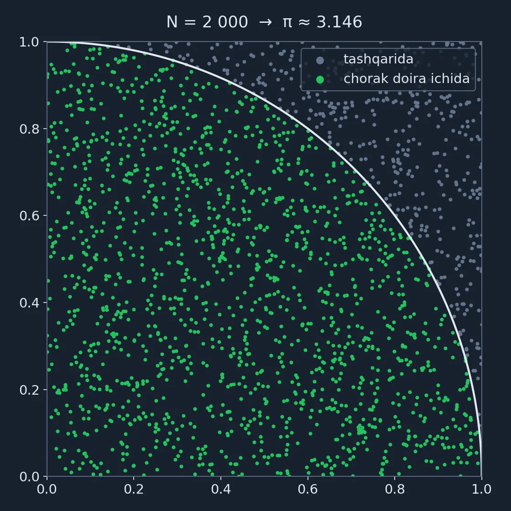
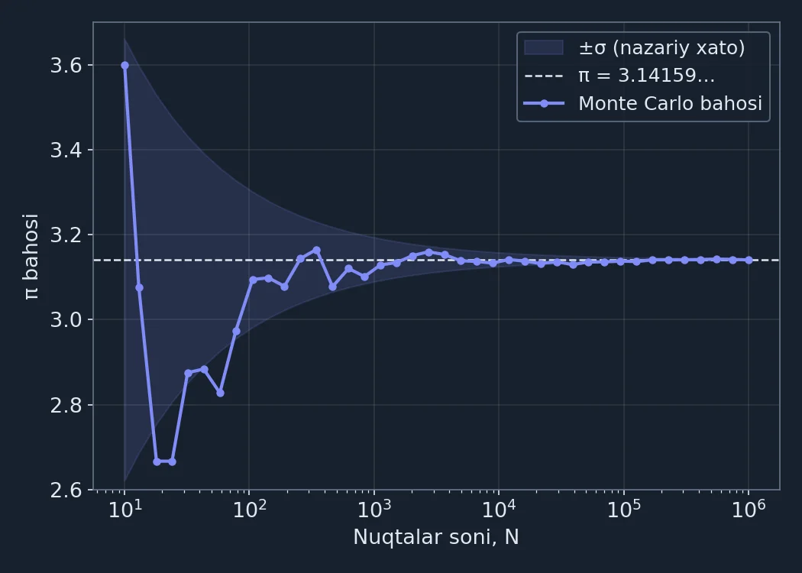

π sonini hisoblash uchun murakkab qatorlar yoki geometriya bilimi shart emas. Kvadratga **tasodifiy nuqtalar** tashlab, ularning qanchasi doira ichiga tushganini sanash kifoya. Bu yondashuv *Monte Carlo usuli*[^1] deb ataladi va fizikadan tortib moliyagacha keng qo'llaniladi. Batafsil ma'lumot: [Wikipedia: Monte Carlo method](https://en.wikipedia.org/wiki/Monte_Carlo_method).

## G'oya: chorak doira va kvadrat

Tomoni 1 ga teng kvadrat olamiz va uning ichiga radiusi 1 bo'lgan chorak doira chizamiz. $(x, y)$ nuqta chorak doira ichida bo'lishi uchun $x^2 + y^2 \le 1$ shart bajarilishi kerak.

Ikki shakl yuzalarining nisbati:

$$
\frac{S_{\text{chorak doira}}}{S_{\text{kvadrat}}} = \frac{\pi r^2 / 4}{r^2} = \frac{\pi}{4}
$$

Demak, kvadratga $N$ ta nuqta tashlasak va ulardan $N_{\text{ichida}}$ tasi doira ichiga tushsa:

$$
\pi \approx 4 \cdot \frac{N_{\text{ichida}}}{N}
$$



*1-rasm. 2 000 ta nuqtadan 1 573 tasi doira ichiga tushdi: 4 · 1573 / 2000 = 3.146.*

## Python'da yozamiz

Butun algoritm bitta funksiyadan iborat. Natijani har safar bir xil olish uchun tasodifiy sonlar generatoriga `seed` beramiz:

```python
import random


def estimate_pi(n: int, seed: int = 42) -> float:
    """Birlik kvadratga n ta tasodifiy nuqta tashlab, π ni taxminlaydi."""
    rng = random.Random(seed)
    inside = 0
    for _ in range(n):
        x, y = rng.random(), rng.random()
        if x * x + y * y <= 1:
            inside += 1
    return 4 * inside / n


if __name__ == "__main__":
    for n in [100, 1_000, 10_000, 100_000, 1_000_000]:
        pi = estimate_pi(n)
        print(f"N = {n:>9,}   π ≈ {pi:.5f}   xato = {abs(pi - 3.141592653589793):.5f}")
```

Ishga tushiramiz:

```bash
python3 monte_carlo.py
```

```text
N =       100   π ≈ 3.12000   xato = 0.02159
N =     1,000   π ≈ 3.12800   xato = 0.01359
N =    10,000   π ≈ 3.12600   xato = 0.01559
N =   100,000   π ≈ 3.13728   xato = 0.00431
N = 1,000,000   π ≈ 3.14059   xato = 0.00100
```

## Natijalar

| Nuqtalar soni, N | π bahosi | Xato |
|---:|---:|---:|
| 100 | 3.12000 | 0.02159 |
| 1 000 | 3.12800 | 0.01359 |
| 10 000 | 3.12600 | 0.01559 |
| 100 000 | 3.13728 | 0.00431 |
| 1 000 000 | 3.14059 | 0.00100 |

E'tibor bering: 10 000 nuqtadagi xato 1 000 nuqtadagidan kattaroq. Natija tasodifga bog'liq, shuning uchun xato har qadamda kamayavermaydi. Lekin **o'rtacha** u aniq bir qonuniyat bilan kamayadi.

## Xato qanchalik tez kamayadi?

Har bir nuqta doira ichiga $p = \pi / 4$ ehtimollik bilan tushadi. Ehtimollar nazariyasidan bahoning standart chetlanishi quyidagicha chiqadi:

$$
\sigma_\pi = 4 \sqrt{\frac{p(1 - p)}{N}} \approx \frac{1.64}{\sqrt{N}}, \qquad p = \frac{\pi}{4}
$$

Xato $1/\sqrt{N}$ tezlikda kamayadi. Ya'ni natijani **10 barobar** aniqroq qilish uchun nuqtalarni **100 barobar** ko'paytirish kerak.



*2-rasm. Ko'k chiziq: turli N uchun baho. Soyali soha: nazariy ±σ koridori. N katta bo'lgan sari baho π ga yopishib boradi.*

## Tezroq variant: NumPy

Sikl o'rniga NumPy massivlari bilan barcha nuqtalarni bir vaqtda hisoblash mumkin:

```python
import numpy as np


def estimate_pi_numpy(n: int, seed: int = 42) -> float:
    rng = np.random.default_rng(seed)
    points = rng.random((n, 2))
    inside = np.count_nonzero((points**2).sum(axis=1) <= 1)
    return 4 * inside / n
```

Million nuqta uchun oddiy Python taxminan 0.14 soniya, NumPy esa 0.04 soniya ishladi, ya'ni ~3 barobar tezroq. NumPy boshqa tasodifiy sonlar generatoridan foydalanadi, shuning uchun uning natijasi biroz farq qiladi: π ≈ 3.14298.

> **Eslatma:** π ni hisoblash uchun Monte Carlo eng tez usul emas. Uning haqiqiy kuchi formulasi topish qiyin bo'lgan ko'p o'lchovli integrallar, risklarni baholash va fizik simulyatsiyalarda ko'rinadi.

## Xulosa

- Tasodifiy nuqtalar va oddiy shart ($x^2 + y^2 \le 1$) π ni taxminlash uchun yetarli
- Baho $\pi \approx 4 \cdot N_{\text{ichida}} / N$ formulasi bilan hisoblanadi
- Xato $1/\sqrt{N}$ tezlikda kamayadi: 10 barobar aniqlik uchun 100 barobar ko'p nuqta kerak
- Katta $N$ uchun NumPy bilan yozilgan variant tezroq ishlaydi

[^1]: Usul 1940-yillarda Stanislav Ulam va Jon fon Neyman ishlarida paydo bo'lgan. Nomini Nikolas Metropolis Monakodagi Monte Carlo kazinosiga ishora qilib taklif qilgan.
