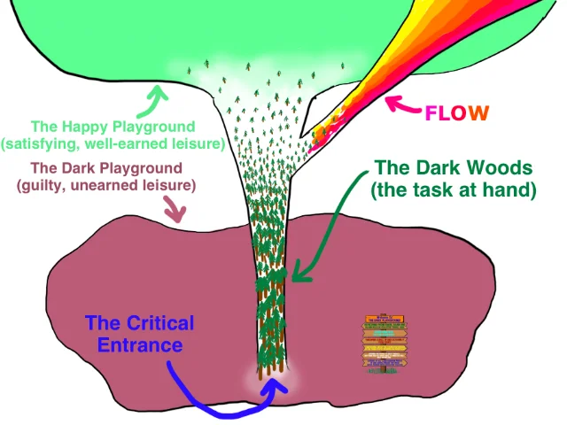
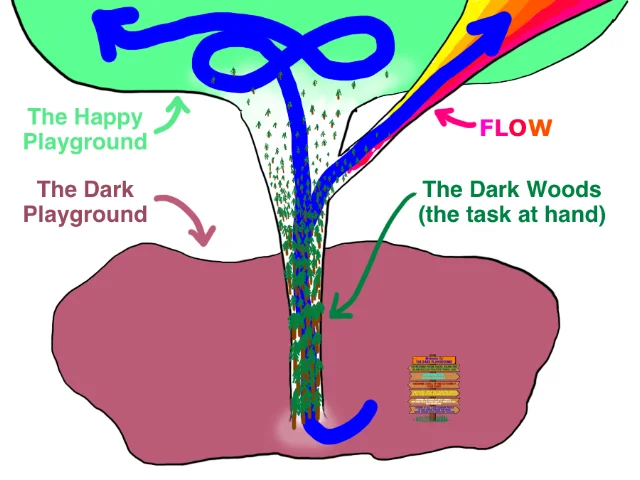
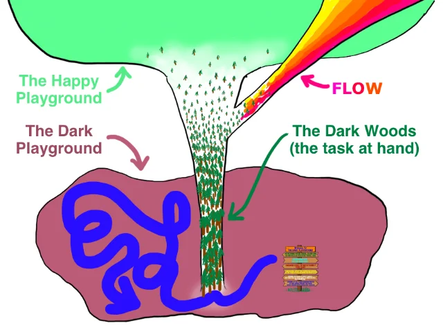
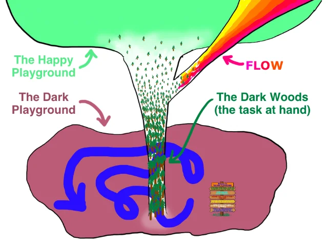
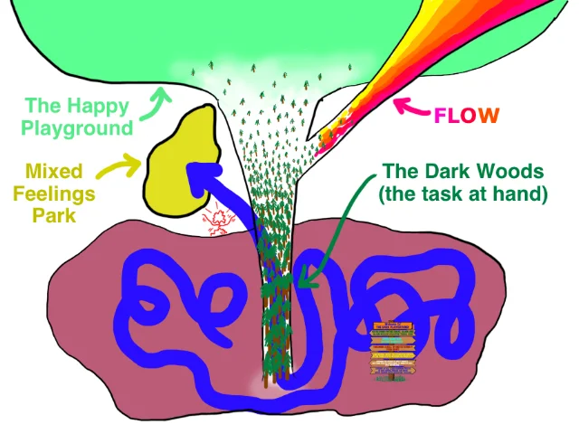
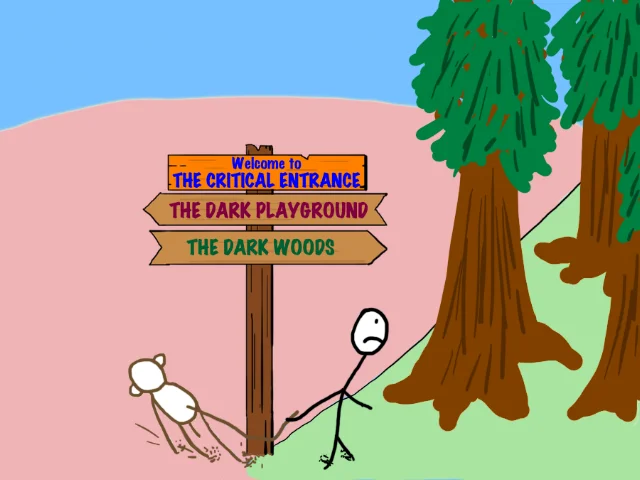
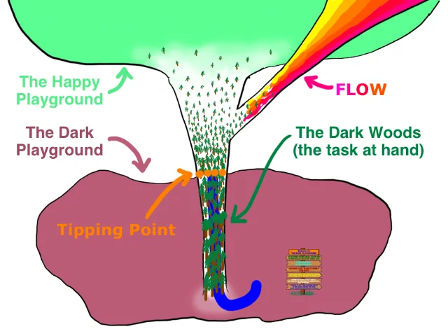
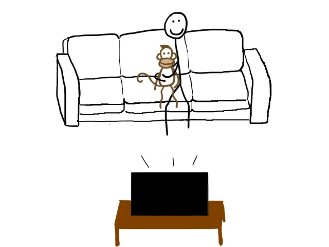

> **Eslatma:** Bu — maqolaning 2-qismi. 1-qismni o‘qimagan bo‘lsangiz, bu qismni to‘liq tushunishingiz qiyin bo‘lishi mumkin. [Avval 1-qismni o‘qing.](https://blog.kamalovic.uz/posts/nega-prokrastinatsiyachilar-ishni-ortga-surishadi)

---

## Hech qanday aniq sababsiz o‘z hayotingni barbod qilish jarayoni.

Shuni aytishdan boshlay: ishni ortga surish haqida maqolalar yozishga urinib, shu ishning o‘zini uddalash uchun jon-jahdim bilan kurashish naqadar istehzoli ekanidan rosa to‘yib ketdim. So‘nggi ikki haftani xuddi qurol xavfsizligi haqida gapirayotib, o‘z oyog‘iga o‘q uzadigan odamdek o‘tkazdim. Bu maqolani tugatganimdan keyin, istehzodan xoli odatiy prokrastinatsiyamga qaytishni intiqlik bilan kutyapman.

Boshlashdan oldin bir-ikki narsani aytib o‘tay:

Men bu borada mutaxassis emasman. Shunchaki butun umri davomida ishni ortga surib kelgan va bu mavzu haqida tinimsiz o‘ylaydigan odamman. Hali ham o‘z odatlarim bilan jiddiy kurashyapman, ammo so‘nggi bir necha yil ichida muayyan yutuqlarga erishdim. Quyida aytadigan fikrlarim — o‘zimga yordam bergan tajribalarimdan kelib chiqqan.

Bu maqola kech chiqdi. Bunga nafaqat uni yozish uchun ikki ming yil sarflaganim sabab bo‘ldi, balki dushanba kuni kechqurun birdan Google Earth’ni ochish, Hindistonning janubiy chekkasidan bir necha yuz fut balandlikda turib, butun mamlakat bo‘ylab shimolga qarab aylantirish va «Hindistonni yaxshiroq his qilish» istagi ham sabab bo‘ldi. Menda muammolar bor.

Xo‘sh, o‘tgan hafta biz prokrastinatorning kundalik ichki kurashiga sho‘ng‘ib, uning zamirida qanday psixologik jarayonlar yotganini ko‘rib chiqdik. Ammo bu hafta, ya’ni muammoni amalda hal qilishga kirishayotganimizda, yanada chuqurroq kovlashimiz kerak. Keling, prokrastinatorning ruhiy olamini qatlamma-qatlam ochib, muammoning asl ildizi nimada ekanini aniqlaylik.

Biz Darhol Rohatlanishni Xohlaydigan Maymun — ya’ni ishni ortga surishimizga sabab bo‘ladigan miya qismi — va uning Aql bilan Qaror Qabul Qiluvchi ustidan hukmronligini bilamiz. Ammo aslida bu yerda nima sodir bo‘lmoqda?

Prokrastinator Maymunga g‘alaba qozonishga yo‘l berishni yomon odatga aylantirib olgan; bu odat hatto qaramlikka ham o‘xshaydi. U Maymunni nazorat qilish niyatida bo‘lishda davom etadi, lekin buning uchun ojizgina harakat qiladi: yillar davomida sinab ko‘rib, ish bermasligini bilib bo‘lgan o‘sha usullarni yana qo‘llaydi. Ich-ichidan esa Maymun baribir g‘alaba qozonishini biladi. O‘zgarishga qasam ichadi, ammo odatiy ssenariy o‘zgarmay qolaveradi. Xo‘sh, qobiliyatli odam nega qayta-qayta shunchalik sust va samarasiz urinish qiladi?

Javob shuki, u hayotining aynan shu jihatiga kelganda o‘ziga nihoyatda kam ishonadi. Natijada o‘zini mag‘lubiyatga yetaklaydigan, o‘zi-o‘zini ro‘yobga chiqaradigan bashoratning quliga aylantiradi. Bu bashoratni **Hayotiy Ssenariy** deb ataylik. Prokrastinatorning Hayotiy Ssenariysi taxminan shunday jaranglaydi:

> Hayotimdagi bajarishim shart bo‘lgan ishlarni baribir oxirgi daqiqagacha cho‘zaman, keyin vahimaga tushaman va yo qo‘limdan kelgan eng yaxshi ishni qilolmayman, yo umuman qotib qolib, hech narsa qilmayman. O‘zim xohlagan ishlar-chi? To‘g‘risini aytsam, ulardan birini boshlab, tashlab qo‘yaman yoki, ehtimol, unga hech qachon qo‘l urmayman.

Prokrastinatorning muammolari chuqur ildiz otgan. Shuning uchun uning o‘zgarishi uchun shunchaki «*o‘zini ko‘proq nazorat qilish*» yoki «*yomon odatlarini o‘zgartirish*»ning o‘zi yetmaydi. Muammoning ildizi uning Hayotiy Ssenariysiga singib ketgan. Demak, o‘zgarishi kerak bo‘lgan narsa ham aynan shu Ssenariydir.

---

Hayotiy Ssenariy qanday o‘zgarishi haqida gapirishdan oldin, prokrastinator aslida qanday odamga aylanishni istayotganini aniq ko‘rib chiqaylik. To‘g‘ri odatlar qanday ko‘rinadi? Prokrastinator qaysi nuqtalarda qiyinchilikka duch keladi?

Biror natijaga sog‘lom va samarali yo‘l bilan erishishning ikki tarkibiy qismi bor: **rejalashtirish** va **bajarish**. Keling, avval osonrog‘idan boshlaymiz.

## Rejalashtirish

Prokrastinatorlar rejalashtirishni yaxshi ko‘radi. Sababi juda oddiy: rejalashtirish ishni bajarishni talab qilmaydi, bajarish esa prokrastinatorning eng zaif nuqtasi.

Biroq ular reja tuzayotganda tafsilotlar va voqelikni yetarlicha hisobga olmay, mavhum tarzda rejalashtirishga moyil bo‘lishadi. Natijada tuzilgan reja hech narsani amalga oshirmaslik uchun juda qulay sharoit yaratib beradi. Prokrastinator rejalashtirishni tugatganda, ishni bajarishi kerak bo‘lgan odam uchun haqiqiy dahshat manzarasi paydo bo‘ladi:

Yoqimsiz va mavhum vazifalardan iborat uzun ro‘yxat Darhol Rohatlanishni Xohlaydigan Maymunni kuldiradi. Shunday ro‘yxat tuzganingizda, Maymun: «Ajoyib, bunisi juda oson ekan», deydi. Hatto ishonuvchan ongli fikringiz ro‘yxatdagi bandlarni tartibli va samarali bajarishga qat’iy bel bog‘lagan bo‘lsa ham, Maymun ongingizning tubida bunday niyat yo‘qligini biladi.

Samarali rejalashtirish esa, aksincha, muvaffaqiyatga erishishingiz uchun zamin yaratadi. Uning vazifasi yuqorida aytilganlarning aynan teskarisini qilish:

**Samarali rejalashtirish katta ro‘yxatdan eng muhim vazifani tanlab oladi.**

Katta ro‘yxat rejalashtirishning dastlabki bosqichi bo‘lishi mumkin. Ammo rejalashtirish qat’iy ustuvorliklar belgilash va ro‘yxatdan bitta vazifani ajratib olish bilan yakunlanishi kerak. Bu — birinchi navbatda bajaradigan ishingiz. Tanlangan vazifa siz uchun eng katta ahamiyatga ega, baxtingizga eng ko‘p ta’sir qiladigan ish bo‘lishi kerak. Agar shoshilinch vazifalar bo‘lsa, avval ularni bajarishga to‘g‘ri keladi. Muhim ishlarga joy ochish uchun ularni imkon qadar tez tugatish lozim. (Prokrastinatorlar ko‘pincha ahamiyatsiz, ammo shoshilinch ishlarni muhim vazifalarni cheksiz ortga surish uchun bahona qilib ishlatadi.)

**Samarali rejalashtirish yoqimsiz vazifani yoqimsiz bo‘lmagan holga keltiradi.**

Yoqimsiz vazifa nima ekanini hammamiz bilamiz. U mavhum, noaniq bo‘ladi: nimadan boshlashni, uni qanday bajarishni yoki savollaringizga javobni qayerdan topishni bilmaysiz.

Tasavvur qilaylik, orzuingiz — o‘zingizning mobil ilovangizni yaratish. Muvaffaqiyatli ilova ishlab chiqsangiz, ishingizdan ketib, to‘liq stavkada dasturchi bo‘lib ishlashingiz mumkinligini bilasiz. Bundan tashqari, dasturlashni bilish XXI asr savodxonligi deb hisoblaysiz. Dastur yaratishni boshqa birovga topshirishga esa pulingiz yo‘q. Shunday qilib, ro‘yxatingizdagi «Dasturlashni o‘rganish» bandini eng muhim vazifa, birinchi ustuvor maqsad deb belgilaysiz. Hayajonli tuyulyaptimi?

Aslida esa yo‘q. Chunki «Dasturlashni o‘rganish» nihoyatda noaniq va yoqimsiz vazifa. Har safar uni boshlash vaqti keldi deb qaror qilganingizda, tasodifan elektron pochtangizni tartibga solish va oshxona polini artish ham zudlik bilan bajarilishi kerak bo‘lib qoladi. Bu ish hech qachon amalga oshmaydi.

Vazifani yoqimsiz bo‘lmagan holga keltirish uchun o‘qib-o‘rganishingiz, izlanishingiz va savollar berishingiz kerak. Dasturlashni aynan qanday o‘rganish mumkinligini, yo‘lning har bir bosqichida nimalar qilish kerakligini va har bir bosqich qancha vaqt olishini aniqlab oling. Ro‘yxatdagi bandni shu tarzda aniqlashtirsangiz, u quyidagi ko‘rinishdan…

…mana bunday aniq bosqichlarga ajraladi:

**Samarali rejalashtirish qo‘rqinchli darajada katta vazifani kichik, tushunarli va boshqarish mumkin bo‘lgan ishlarga ajratadi.**

Noaniqlik va qo‘rqinchlilik birlashsa, Darhol Rohatlanishni Xohlaydigan Maymun uchun kuchli steroidga o‘xshash aralashma paydo bo‘ladi. Vazifani aniqlashtirganingiz bilan, u hali ham juda katta va qo‘rqinchli bo‘lib qolishi mumkin. Uni ko‘zga kichikroq va yengilroq ko‘rsatishning kaliti esa quyidagi haqiqatni anglashdir:

> **Hayratlanarli, ulug‘vor yutuq — uzoqdan qaralganda, oddiy va ko‘zga tashlanmaydigan vazifalarning uzun ketma-ketligidan boshqa narsa emas.**

Hech kim «uy qurmaydi». Ular birin-ketin g‘isht terishadi, yana g‘isht terishadi, yana va yana — oxirida uy paydo bo‘ladi. Prokrastinatorlar buyuk tasavvur sohiblari: bir kuni quradigan hashamatli qasrini xayolida tasvirlashni yaxshi ko‘rishadi. Ammo ularga kerak bo‘lgani — har kuni, taslim bo‘lmasdan, birin-ketin g‘isht teradigan tirishqoq quruvchiga aylanish.

Deyarli har qanday katta ishni taraqqiyotning eng kichik birligiga — uning **g‘ishtiga** ajratish mumkin. Masalan, jismonan chiniqqan bo‘lish yo‘lidagi bitta g‘isht — sport zalida 45 daqiqa shug‘ullanish. Zo‘r gitarachi bo‘lish yo‘lidagi bitta g‘isht esa 30 daqiqalik mashq.

Yozuvchi bo‘lishni orzu qilayotgan odamning haftalik kuni bilan haqiqiy yozuvchining kuni deyarli bir xil ko‘rinadi. Haqiqiy yozuvchi bir necha sahifa yozadi — yana bitta g‘isht qo‘yadi. Yozuvchi bo‘lishni orzu qilayotgan odam esa hech narsa yozmaydi. Kunlarining qolgan 98 foizi esa deyarli bir xil o‘tadi. Ammo bir yil o‘tgach, haqiqiy yozuvchining qo‘lida kitobning tugallangan ilk qoralamasi bo‘ladi, orzu qilayotgan odamda esa… hech narsa yo‘q.

Hammasi shu g‘ishtlarga borib taqaladi.

Yaxshi xabar shuki, bitta g‘isht terish qo‘rqinchli ish emas. Ammo g‘isht terish uchun jadval kerak. Shu sababli rejalashtirishning oxirgi bosqichi — **G‘ishtlar jadvali**ni tuzish. Bu jadval g‘ishtlarni taqvimdagi aniq vaqt oralig‘iga joylashtiradi. Belgilangan vaqtlar qat’iy bo‘lishi, ularni bekor qilish yoki boshqa vaqtga ko‘chirish mumkin bo‘lmasligi kerak. Axir bu sizning birinchi ustuvor vazifangiz va siz uchun eng muhim ish-ku, shunday emasmi?

Eng muhim sana — birinchisi. «Noyabrda» dasturlashni o‘rganishni boshlay olmaysiz. Ammo 21-noyabr kuni soat 18:00 dan 19:00 gacha boshlashingiz mumkin.

Endi rejangiz aniq va samarali. Jadvalga amal qilsangiz, dasturchi bo‘lasiz. Qolgan yagona ish — bajarish…

## Bajarish

Prokrastinatorlar ishni bajarish g‘oyasini yoqtirmaydi, degani emas. Ular taqvimdagi g‘ishtlarga qarab: «Zo‘r, bu qiziqarli bo‘ladi», deb o‘ylashadi. Chunki kelajakda stolga o‘tirib, rejalashtirilgan ish mashg‘ulotini bajaradigan paytlarini tasavvur qilganlarida, Darhol Rohatlanishni Xohlaydigan Maymun yo‘qdek o‘ylashadi. Prokrastinatorlarning kelajak haqidagi tasavvurlarida Maymun hech qachon ko‘rinmaydi.

Ammo jadval bo‘yicha g‘isht terishni boshlash vaqti kelganda, prokrastinator o‘zining eng yaxshi bilgan ishini qiladi: Maymunga boshqaruvni topshiradi va hammasini barbod qiladi.

Yuqorida barcha yutuqlar taqvimda belgilangan vaqtda bitta g‘ishtni terish qobiliyatiga borib taqalishini ta’kidlagandik. Demak, biz muammoning eng asosiy nuqtasini aniqladik. Keling, aynan bitta g‘ishtni terish bilan bog‘liq qiyinchilikni ko‘rib chiqamiz:

Bu diagramma ish uchun PowerPoint tayyorlash, yugurishga chiqish, ssenariy ustida ishlash yoki hayotingizdagi boshqa har qanday vazifani bajarishga kirishganingizda duch keladigan muammoni ko‘rsatadi. **Muhim Kirish Darvozasi** — vazifani rasman boshlaydigan nuqta. **Qorong‘i O‘rmon** — ishning o‘zini bajarish jarayoni. Ishni tugatganingizdan so‘ng esa **Baxtli Maydon**ga yetib borasiz. Bu yerda o‘zingizni mamnun his qilasiz, dam olish va bo‘sh vaqt ham yoqimli hamda mazmunli bo‘ladi, chunki qiyin ishni ortda qoldirgansiz. Ba’zan hatto qilayotgan ishingizga shu qadar berilib ketasizki, **Oqim holati**ga kirasiz: vazifaga shu qadar sho‘ng‘iysizki, vaqt qanday o‘tganini sezmaysiz.

Bu yo‘llar taxminan quyidagicha ko‘rinadi:

Juda oddiy tuyulyaptimi?

Afsuski, prokrastinatorlar ko‘pincha Baxtli Maydon va Oqim holatiga yetib bora olmaydi.

Masalan, mana bu prokrastinator bajarishi kerak bo‘lgan ishni umuman boshlamaydi, chunki Muhim Kirish Darvozasidan o‘ta olmaydi. Buning o‘rniga u soatlab **Qorong‘i Maydon**da o‘tirib, o‘zidan nafratlanadi:

Yana bir prokrastinator ishni boshlaydi, ammo diqqatini jamlay olmaydi. Internetda aylanib yurish va ovqat tayyorlash uchun uzoq-uzoq tanaffuslar qiladi. Natijada vazifani tugatmaydi:

Yana bir prokrastinator ishni boshlashga o‘zini majbur qila olmaydi, holbuki topshirish muddati tobora yaqinlashmoqda. U Qorong‘i Maydonda soatlab vaqt o‘tkazadi. Muddat yaqinlashayotganini biladi, ishni boshlamayotgani bilan o‘z hayotini yanada qiyinlashtirayotganini ham tushunadi. Oxiri muddat shu qadar yaqinlashadiki, **Vahima Mahluqi** birdan xonaga otilib kiradi, uni dahshatga soladi va u vazifani muddatga ulgurish uchun shosha-pisha bajarib chiqadi.

Ishni tugatgach, u nimanidir uddalaganidan o‘zini ancha yaxshi his qiladi. Ammo unchalik mamnun ham bo‘lmaydi: shoshilganidan loyiha kutilgan darajada chiqmaganini biladi. Bundan tashqari, kunining katta qismini hech qanday sababsiz ishni ortga surib o‘tkazganini o‘ylab, afsuslanadi. Natijada u **Aralash Hislar Bog‘i**ga tushib qoladi.

Xo‘sh, agar siz prokrastinator bo‘lsangiz, keling, sizni ancha baxtli qiladigan to‘g‘ri yo‘lga tushish uchun nimalar qilishingiz kerakligini ko‘rib chiqaylik.

Birinchi qilishingiz kerak bo‘lgan ish — Muhim Kirish Darvozasidan o‘tish. Buning ma’nosi shuki, vazifani boshlash vaqti kelganda hozir qilayotgan ishingizni to‘xtating, barcha chalg‘ituvchi narsalarni chetga olib qo‘ying va ishga kirishing. Bu oddiy tuyuladi, ammo eng qiyin qadam aynan shu. Darhol Rohatlanishni Xohlaydigan Maymun eng qattiq qarshilikni shu yerda ko‘rsatadi:

Maymun qiziqarli mashg‘ulotni to‘xtatib, qiyin ishni boshlashni mutlaqo yomon ko‘radi. Aynan shu paytda siz eng qat’iyatli bo‘lishingiz kerak. Agar ishni boshlab, Maymunni Qorong‘i O‘rmon tomon sudrab kira olsangiz, uning irodasini biroz bo‘lsa-da sindirgan bo‘lasiz.

Albatta, u tez orada taslim bo‘lmaydi.

Siz ishlayotganingizda Qorong‘i O‘rmonda bo‘lasiz. Bu yerda bo‘lish maroqli emas, Darhol Rohatlanishni Xohlaydigan Maymun esa bu joyga yaqinlashishni ham istamaydi. Ishni qiyinlashtiradigan yana bir jihat bor: Qorong‘i O‘rmonni Maymunning eng sevimli joylaridan biri — Qorong‘i Maydon o‘rab turadi. U bu joyning qanchalik yaqinligini ko‘rib turgani uchun O‘rmondan chiqib ketishga bor kuchi bilan urinadi.

Bundan tashqari, ish davomida ba’zan to‘siqqa duch kelasiz. Masalan, yugurish yo‘lingiz tepaga ko‘tariladigan ko‘chaga olib chiqishi mumkin; Excel’da o‘zingiz bilmaydigan formuladan foydalanishingizga to‘g‘ri keladi; yoki yozayotgan qo‘shig‘ingiz siz kutgandek chiqmayotgandir. Ana shunday paytda Maymun qochishga eng dadil urinishini qiladi.

Qorong‘i O‘rmonni tashlab, Qorong‘i Maydonga o‘tishning hech qanday mantiqi yo‘q. Ikkalasi ham qorong‘i. Har ikkisi ham yoqimsiz. Ammo katta farq shundaki, Qorong‘i O‘rmon baxt sari olib boradi, Qorong‘i Maydon esa faqat yanada ko‘proq azob-uqubat keltiradi. Lekin Darhol Rohatlanishni Xohlaydigan Maymun mantiq bilan ish tutmaydi. Uning nazarida Qorong‘i Maydon ancha qiziqarli ko‘rinadi.

Yaxshi xabar shuki, Qorong‘i O‘rmon bo‘ylab biroz bo‘lsa ham oldinga siljiy olsangiz, qiziq bir narsa yuz beradi. Vazifada taraqqiyotga erishish odamda muvaffaqiyat hissini uyg‘otadi va o‘ziga bo‘lgan ishonchini oshiradi. Maymun esa kuchni o‘ziga past baho berishdan oladi. O‘zingizdan mamnunlikni his qilganingizda, Maymun yo‘lida **Yuqori O‘ziga Ishonch Banani** paydo bo‘ladi. Bu uning qarshiligini butunlay yo‘q qilmaydi, ammo bir muddat chalg‘itish uchun yetarli. Natijada ishni ortga surish istagi kamayganini sezasiz.

Agar davom etsangiz, yana bir sehrli hodisa yuz beradi. Vazifaning uchdan ikki yoki to‘rtdan uch qismiga yetganingizda, ayniqsa ish yaxshi ketayotgan bo‘lsa, o‘zingizni juda yaxshi his qila boshlaysiz. Birdan ishning oxiri ko‘rina boshlaydi. Bu — juda muhim burilish nuqtasi:

**Burilish Nuqtasi** muhim, chunki oldinda Baxtli Maydon borligini faqat siz emas, Maymun ham sezadi. Maymun uchun darhol rohatlanish siz bilan birga keladimi yoki sizning hisobingizdan bo‘ladimi — buning farqi yo‘q. U shunchaki oson va maroqli narsalarni yaxshi ko‘radi. Burilish Nuqtasiga yetganingizdan so‘ng, Maymun Qorong‘i Maydonga qaraganda Baxtli Maydonga yetib borishga ko‘proq qiziqa boshlaydi. Shunda ishni ortga surish istagi yo‘qoladi va endi siz ham, Maymun ham marraga qarab shiddat bilan harakat qilasiz.

Ko‘z ochib yumguningizcha ish tugaydi va siz Baxtli Maydonga yetib kelasiz. Uzoq vaqtdan beri ilk bor siz bilan Maymun bir jamoaga aylanasiz. Ikkalangiz ham dam olib, rohatlanishni xohlaysiz. Bu safar esa rohatlanish mehnat bilan qo‘lga kiritilgani uchun yanada yoqimli tuyuladi. Siz va Maymun bir jamoa bo‘lganingizda, deyarli har doim o‘zingizni baxtli his qilasiz.

Burilish Nuqtasidan o‘tgach, vazifaning turiga va uning qay darajada yaxshi ketayotganiga qarab, yana bir holat yuz berishi mumkin. Qilayotgan ishingizdan shu qadar zavqlana boshlaysizki, uni davom ettirish dam olish uchun to‘xtashdan ko‘ra maroqliroq tuyuladi. Vazifaga mukkasidan ketasiz, ovqat va vaqtni ham unutib, deyarli hamma narsaga qiziqishingiz yo‘qoladi. Bu holat **Oqim** deb ataladi. Oqim nafaqat nihoyatda yoqimli kechinma, balki odatda eng zo‘r ishlarni amalga oshiradigan paytingiz hamdir.

Maymun ham bu huzurga siz kabi berilib ketadi va yana bir bor ikkalangiz bir jamoaga aylanasiz.

Burilish Nuqtasigacha yetib borish qiyin. Ammo prokrastinatsiyani yengishni bunchalik mushkul qiladigan narsa shuki, Darhol Rohatlanishni Xohlaydigan Maymunning xotirasi juda qisqa. Dushanba kuni ajoyib natijaga erishgan bo‘lsangiz ham, seshanba kuni yangi vazifani boshlayotganingizda Maymun hamma narsani unutgan bo‘ladi. U yana Qorong‘i O‘rmonga kirishga yoki u yerda ishlashni davom ettirishga qarshilik ko‘rsatadi.

Shu sababli muvaffaqiyat uchun qat’iyat va izchillik juda muhim. Har bir g‘ishtni terish ichki kurashni talab qiladi. Oxir-oqibat, aynan shu muayyan kurashda g‘alaba qozonish va kun sayin, g‘ishtma-g‘isht oldinga siljish qobiliyatingiz prokrastinatorning o‘z hayotini nazorat qilishga intilishidagi eng muhim masaladir.

Demak, nimalar sodir bo‘lishi kerakligini bilamiz. Ammo prokrastinatsiyani blogdagi bitta maqolani o‘qish bilangina hal qilish mumkin bo‘lganida, u bunchalik ko‘p odamlarning hayotida katta muammo bo‘lib qolmasdi. Prokrastinatsiyani chinakam yengishning faqat bitta yo‘li bor:

> **Buni uddalay olishingizni o‘zingizga isbotlashingiz kerak.**

O‘zingizga buni aytib qo‘yish emas, amalda ko‘rsatishingiz kerak. O‘zgarishlar faqat o‘zingizga o‘zgarish mumkinligini ko‘rsatganingizda yuz beradi. Ungacha bunga ishonmaysiz va hech narsa o‘zgarmaydi. O‘zingizni omadsiz seriya davom etayotgan basketbolchi deb tasavvur qiling. Basketbolchilar uchun o‘ziga ishonch juda muhim. Ketma-ket savatga tushira olmayotgan o‘yinchi o‘ziga ming marta: «Men yaxshi o‘yinchiman, keyingi to‘pni aniq tushiraman», deb aytishi mumkin. Ammo o‘ziga bo‘lgan ishonchi qaytishi va zarbasi yana joyiga tushishi uchun avval to‘pni savatga tushirishi kerak.

Xo‘sh, to‘pni savatga tushirishni qanday boshlash mumkin?

### 1. Qilayotgan har bir ishingiz tanlov ekanini anglashga harakat qiling.

Avvalo, ushbu maqolalarda ishlatgan atamalarimiz haqida o‘ylab ko‘ring. Agar ular sizga ma’noli tuyulgan bo‘lsa, yozib qo‘ying. Men turli his-tuyg‘u va hodisalarga — Darhol Rohatlanishni Xohlaydigan Maymun, Aql bilan Qaror Qabul Qiluvchi, Vahima Mahluqi, Qorong‘i Maydon, Yoqimsizlik, G‘ishtlar, Muhim Kirish Darvozasi, Qorong‘i O‘rmon, Burilish Nuqtasi, Baxtli Maydon, Oqim va Hayotiy Ssenariyga — alohida nom berganimning sababi ham shu: atamalar qilayotgan tanlovlaringizni aniqroq anglashga yordam beradi. Ular noto‘g‘ri tanlovlarni ko‘rsatib beradi va aynan qaysi paytda to‘g‘ri qaror qabul qilish muhimligini eslatadi.

### 2. Maymunni yengishga yordam beradigan usullarni yarating.

Quyida sinab ko‘rishingiz mumkin bo‘lgan ayrim usullar keltirilgan:

- Tashqi yordam so‘rang: erishmoqchi bo‘lgan maqsadingiz haqida bir yoki bir nechta do‘stingizga yoxud oila a’zolaringizga ayting va sizdan va’dangizda turishni talab qilib turishlarini so‘rang. Nima uchundir buni qilish qiyin bo‘lsa, menga elektron xat yozing — men notanish odamman (**contact@waitbutwhy.com**). Maqsadingizni yozib, uni haqiqiy odamga yuborishning o‘zi ham uni aniqroq va jiddiyroq qilib ko‘rsatishi mumkin. (Ba’zi mutaxassislar maqsadlaringizni boshqalarga aytish aks ta’sir qilishi mumkinligini ta’kidlashadi. Shuning uchun bu usul sizning vaziyatingizga bog‘liq.)
- Agar hali Vahima Mahluqi bo‘lmasa, uni o‘zingiz yarating. Masalan, albomni tugatmoqchi bo‘lsangiz, bir necha oy keyinga chiqish belgilang, joy band qiling va bir guruh odamga taklifnoma yuboring.
- Haqiqatan ham biznes boshlamoqchi bo‘lsangiz, ishdan bo‘shang — shunda Vahima Mahluqi yangi xonadoshingizga aylanadi.
- Muntazam blog yozmoqchi bo‘lsangiz, sahifaning eng tepasiga «Har seshanba yangi maqola» deb yozib qo‘ying…
- O‘zingizga to‘g‘ri qarorlar qabul qilishni eslatib turadigan yopishqoq qog‘ozlarni ko‘rinadigan joylarga yopishtiring.
- Vazifani boshlash vaqti kelganini yoki uning ahamiyatini eslatish uchun budilnik yoki signal o‘rnating.
- Chalg‘ituvchi narsalarni har qanday yo‘l bilan kamaytiring. Televizor katta muammo bo‘lsa, televizoringizni sotib yuboring. Internet katta muammo bo‘lsa, Wi-Fi’i o‘chirilgan, faqat ish uchun mo‘ljallangan ikkinchi kompyuter oling. Ish mashg‘ulotlari paytida telefoningizni parvoz rejimiga qo‘ying.
- O‘zingizni biror majburiyatga bog‘lab qo‘ying: darslar yoki a’zolik uchun qaytarib berilmaydigan pul to‘lang.
- Agar yaratgan usullaringiz ish bermayotgan bo‘lsa, ularni o‘zgartiring. Bir oydan keyinga «*Ishlar yaxshilandimi? Yaxshilanmagan bo‘lsa, usullarimni o‘zgartir*» degan eslatma qo‘ying.

### 3. Sekin, ammo muntazam oldinga intiling — Hayotiy Ssenariy bir sahifadan qayta yoziladi.

Ulkan yutuq ko‘zga tashlanmaydigan g‘ishtlarni birin-ketin terish orqali yuzaga kelgani kabi, prokrastinatsiyadek chuqur singib ketgan odat ham birdaniga o‘zgarmaydi. U bir vaqtning o‘zida emas, kichik-kichik yaxshilanishlar orqali o‘zgaradi. Esingizda bo‘lsin, gap o‘zingizga buni uddalay olishingizni ko‘rsatishda. Shuning uchun asosiy maqsad mukammal bo‘lish emas, shunchaki oldingidan yaxshiroq bo‘lishdir. Har kuni bir sahifadan yozadigan muallif bir yil ichida kitob yozib tugatadi. Har hafta biroz yaxshilanib boradigan prokrastinator esa bir yil o‘tgach, butunlay o‘zgargan odamga aylanadi.

Shuning uchun A nuqtadan birdaniga Z nuqtaga sakrash haqida o‘ylamang. Avval A dan B ga o‘ting. «*Men har qanday qiyin ishni ortga suraman*» degan Hayotiy Ssenariyni «*Haftada bir marta qiyin ishni ortga surmasdan bajaraman*» degan ssenariyga almashtiring. Bunga erisha olsangiz, o‘zgarish yo‘lini boshlab yuborgan bo‘lasiz. Men hali ham ishni ortga surish borasida ayanchli darajada ojizman, ammo o‘tgan yilgiga qaraganda ancha yaxshilanganman. Shu bois kelajakka umid bilan qarayapman.

Nega men bu mavzu haqida bunchalik ko‘p o‘ylayman? Nega hozirgina bu haqda 3 500 so‘zli maqola yozdim?

Chunki prokrastinatsiyani yengish — o‘z hayotingizni nazorat qilishni qo‘lga olish bilan barobar. Odamlarning baxtli yoki baxtsiz bo‘lishiga ta’sir qiladigan juda ko‘p narsalar — hayotdan qoniqish va mamnunlik darajasi, o‘ziga bo‘lgan hurmat, ichida olib yuradigan afsuslari, munosabatlariga vaqt ajratish uchun qancha bo‘sh vaqti borligi — prokrastinatsiya ta’sirida keskin o‘zgaradi. Shuning uchun bu masalaga juda jiddiy qarash kerak. Yaxshilanishni boshlash vaqti esa — hozir.

---
