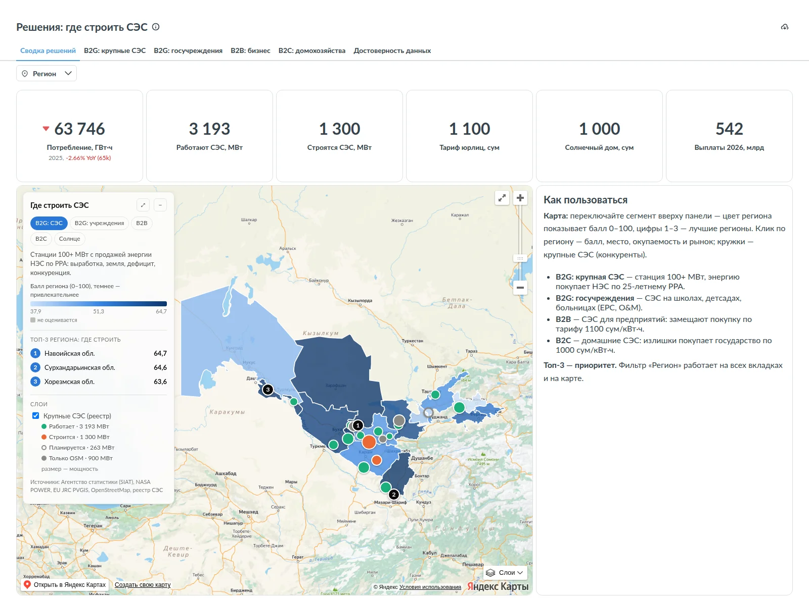
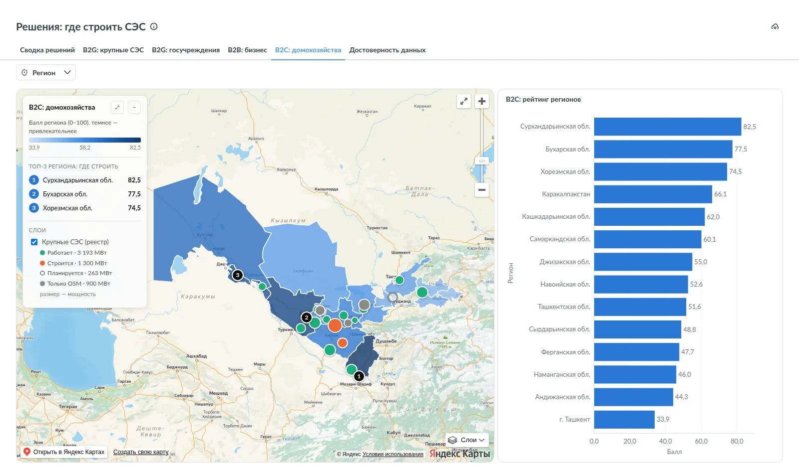
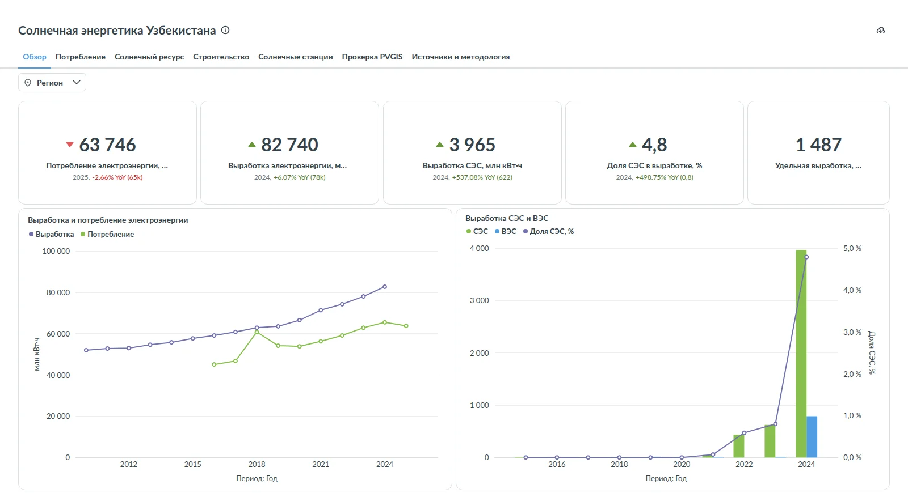
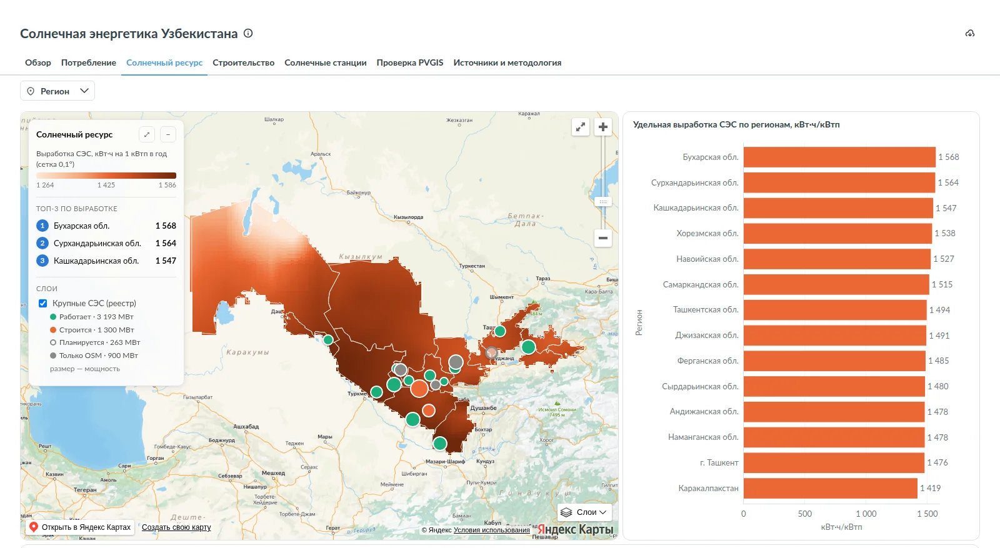
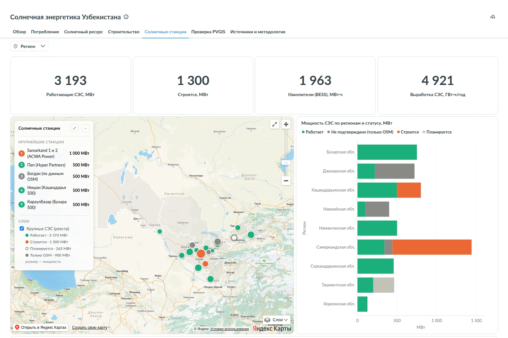
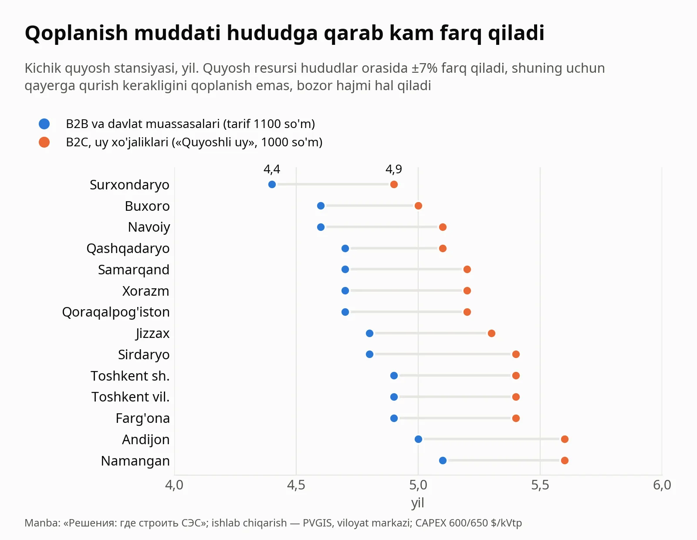
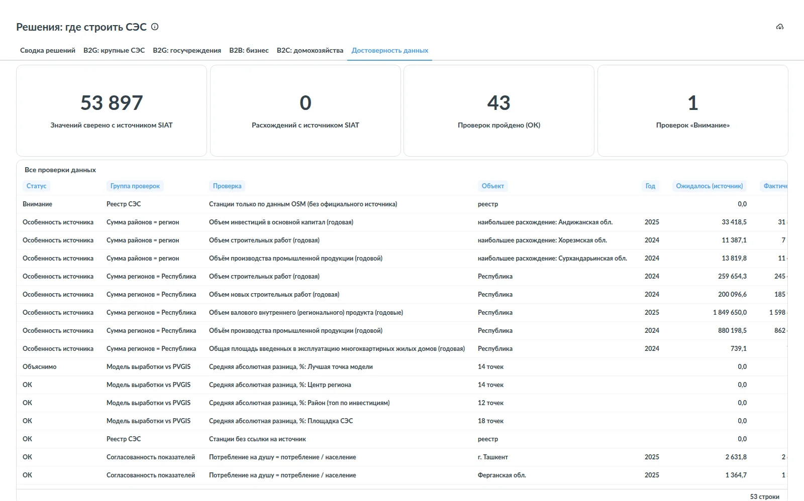
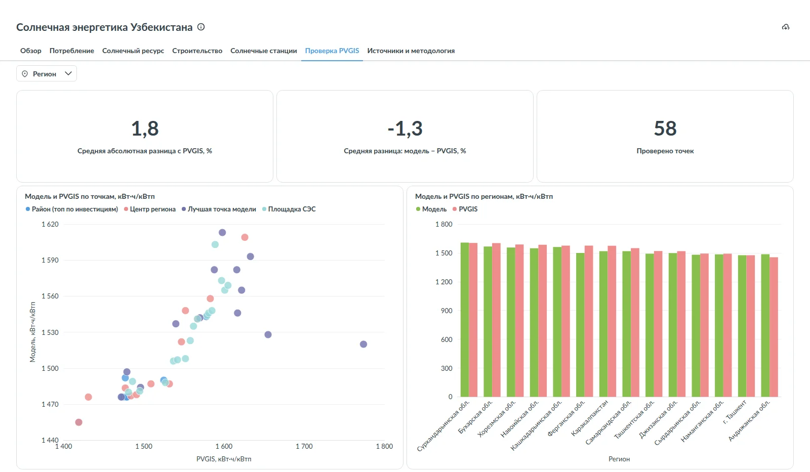
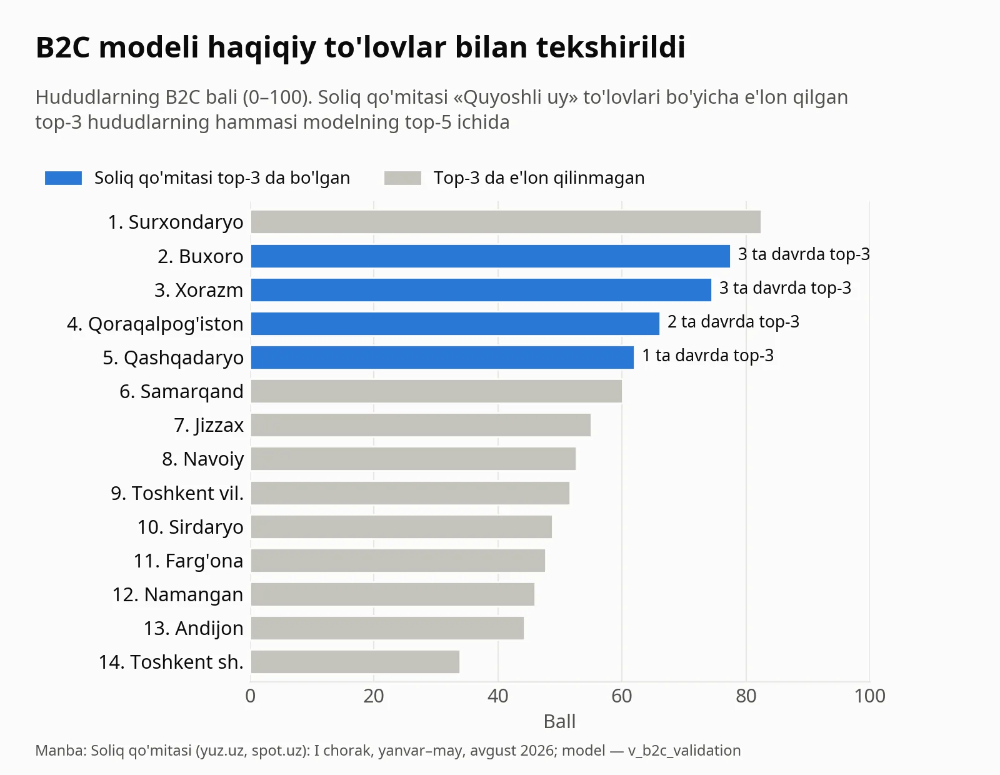

O'zbekistonda quyosh energetikasi juda tez o'smoqda. 2023 yilda quyosh mamlakatdagi elektrning 0,8 foizini ishlab chiqargan bo'lsa, 2024 yilda bu ulush 4,8 foizga yetdi. Hozir 3,2 GVt quvvatli 12 ta yirik stansiya ishlayapti, yana 1,3 GVt qurilmoqda. Uylar tomida ham panellar ko'paymoqda: faqat avgust oyida «Quyoshli uy» dasturi bo'yicha 61,5 mingdan ortiq oila tarmoqqa elektr sotib, pul oldi.

Bunday bozorda quyosh kompaniyasi egasi oldida doim bir savol turadi: keyingi loyihani qayerda va kim uchun qilish kerak? Shu savolga javob beradigan ikkita dashboard yasadim va ularni hamma uchun ochiq qildim.

## Loyiha nima uchun kerak va maqsadi nima

Maqsad oddiy: quyosh kompaniyasi hudud va segmentni taxmin bilan emas, tekshirilgan raqamlar bilan tanlasin.

Dashboardlar to'rtta savolga javob beradi:

1. **Qaysi segment?** Yirik stansiya (B2G), davlat muassasalari (B2G), biznes (B2B) yoki uy xo'jaliklari (B2C).
2. **Qaysi hudud?** Har bir segmentda 14 hududdan qaysi uchtasi eng istiqbolli.
3. **Qachon o'zini oqlaydi?** Stansiya necha yilda qoplanadi.
4. **Raqobatchilar kim?** Hududda qaysi stansiyalar ishlayapti va qurilmoqda.

## Biznes egasi uchun: muammo, oqibat va yechim

### Muammo

Kerakli ma'lumot bor, lekin u o'nlab joyga tarqalgan:

- elektr iste'moli, qurilish, korxonalar va aholi Statistika agentligining SIAT tizimida (40 ta ko'rsatkich);
- quyosh resursi NASA POWER va Yevrokomissiyaning PVGIS kalkulyatorida;
- tariflar Vazirlar Mahkamasining qarorida (№243, 15.05.2026), imtiyozlar PQ-57 da;
- «Quyoshli uy» to'lovlari Soliq qo'mitasining yangiliklarida;
- stansiyalar ro'yxati investorlar saytlarida, OAV va OpenStreetMap'da.

Ularning formati, yillari va hudud nomlari har xil. Hammasini bitta jadvalga yig'ib solishtirishga ko'pincha vaqt topilmaydi. Natijada hudud "hamma Toshkentga ketyapti" yoki "u yerda quyosh ko'p" degan tamoyil bilan tanlanadi.

### Oqibat

- **Quyoshga qarab tanlangan hududda mijoz bo'lmasligi mumkin.** Surxondaryoda quyosh eng kuchli (yiliga 1 626 kVt·soat/kVtp), lekin B2B reytingida u 14 hududdan 10-o'rinda turadi, chunki sanoat korxonalari kam.
- **Stansiya ko'p qurilgan hududda raqobat kuchli.** Buxoroda ishlayotgan va qurilayotgan stansiyalar iste'molning 31,6 foizini qoplaydi, Navoiyda esa atigi 2,5 foizini. Tarmoqqa ulanish uchun kurash birinchi hududda ancha qattiq bo'ladi.
- **B2C'da byudjet xavfi bor.** «Quyoshli uy» uchun 2026 yilga 100 mlrd so'm limit belgilangan, 8 oyda esa 542 mlrd so'm to'langan va to'lovlar kechikkan. Faqat subsidiyaga tayangan savdo rejasi buzilishi mumkin.
- **Savdo jamoasining vaqti behuda ketadi.** Oylar mijoz kam bo'lgan tumanda qidiruvga sarflanadi.

### Yechim

Barcha manbalar bitta bazaga yig'ildi, tekshirildi va ikkita dashboardga aylantirildi. Biznes egasi bir sahifada ko'radi: qaysi segment, qaysi hudud, qancha vaqtda qoplanadi va raqobatchilar kim.

## 1-dashboard: «Решения: где строить СЭС»

Bu biznes egasi uchun qaror paneli. Har bir segment uchun alohida tab bor. 14 hudud 0 dan 100 gacha ball oladi, xaritada top-3 hudud raqam bilan belgilangan, doiralar esa yirik stansiyalar, ya'ni raqobatchilar.




| Segment | Kim sotib oladi | Top-3 hudud | Qoplanish (top-3) |
|---|---|---|---|
| B2G: yirik SES (100+ MVt) | Milliy elektr tarmoqlari, 25 yillik PPA | Navoiy, Surxondaryo, Xorazm | tenderda belgilanadi |
| B2G: davlat muassasalari | maktab, bog'cha, kasalxona, poliklinika | Samarqand, Qashqadaryo, Surxondaryo | 4,4–4,7 yil |
| B2B: biznes | sanoat va tijorat korxonalari | Toshkent sh., Toshkent vil., Navoiy | 4,6–4,9 yil |
| B2C: uy xo'jaliklari | aholi («Quyoshli uy») | Surxondaryo, Buxoro, Xorazm | 4,9–5,2 yil |

Tablar:

- **«Сводка решений»**: asosiy ko'rsatkichlar, xarita, har bir segmentda top-3 hudud va 14 hudud bo'yicha tavsiya.
- **«B2G: крупные СЭС»**: reyting omillari (ishlab chiqarish, yer, defitsit, bo'sh nisha, iste'mol o'sishi) va manba havolasi bilan raqobatchilar reestri.
- **«B2G: госучреждения»**: hududlar bo'yicha maktab, bog'cha, kasalxona va poliklinikalar soni, top-25 tuman.
- **«B2B: бизнес»**: iste'mol, sanoat korxonalari, investitsiya, top-25 tuman va PQ-57 dagi imtiyozlar.
- **«B2C: домохозяйства»**: «Quyoshli uy» to'lovlari, modelni tekshirish va top-25 tuman.
- **«Достоверность данных»**: barcha tekshiruvlar (pastda batafsil).

«Регион» filtri barcha tablarda va xaritada ishlaydi.

## 2-dashboard: «Солнечная энергетика Узбекистана»

Bu batafsil tahlil, ya'ni qarorlar ortidagi ma'lumotlar.




- **«Обзор»**: ishlab chiqarish va iste'mol, quyosh va shamol ulushi. 2024 yilda quyosh 3 965 mln kVt·soat elektr berdi.
- **«Потребление»**: hududlar bo'yicha iste'mol, jon boshiga iste'mol, defitsit va 4 yillik o'sish.
- **«Солнечный ресурс»**: 0,1° to'rdagi quyosh resursi xaritasi, oylar bo'yicha ishlab chiqarish va tijorat stansiyasining qoplanishi.
- **«Строительство»**: qurilish ishlari, uy-joy topshirish va top-30 tuman.
- **«Солнечные станции»**: stansiyalar reestri (quvvat, holat, investor, ishga tushish sanasi va manba). Ishlayotgan stansiyalar 3 193 MVt, qurilayotganlari 1 300 MVt, akkumulyatorlar 1 963 MVt·soat.
- **«Проверка PVGIS»**: modelni Yevrokomissiya kalkulyatori bilan solishtirish.
- **«Источники и методология»**: barcha taxminlar, tariflar, valyuta kursi va SIAT ko'rsatkichlari katalogi.






## Quyosh kompaniyasi bundan nima oladi

1. **Segment va hudud tanlovi.** 4 segment × 14 hudud, har biri uchun ball va "nega" degan izoh, masalan: "sanoat korxonalari soni va iste'mol".
2. **Mijoz qayerdaligi.** Har bir segment uchun top-25 tuman: B2B uchun investitsiya va sanoat, B2C uchun uy-joy fondi va ish haqi, muassasalar uchun kasalxona va poliklinikalar.
3. **Iqtisod.** Har bir hudud uchun qoplanish muddati va 100 MVt stansiyaning yillik ishlab chiqarishi.
4. **Raqobat.** Har bir yirik stansiyaning quvvati, investori, holati va manba havolasi.
5. **Bozor signallari.** «Quyoshli uy» to'lovlari va qatnashchilar soni davrlar bo'yicha, byudjet limiti bilan birga.
6. **Davlat imtiyozlari.** PQ-57 dagi soliq imtiyozlari va tarmoq bilan oylik hisob-kitob shartlari bir joyda.

Ishlash davomida kutilmagan bir xulosa chiqdi:



Quyosh resursi hududlar orasida bor-yo'g'i ±7% farq qiladi. Shuning uchun kichik stansiya hamma joyda 4,4 yildan 5,6 yilgacha qoplanadi. Qayerda qurishni quyosh emas, bozor hal qiladi: mijozlar soni, iste'mol va raqobat. Dashboard aynan shu omillarni o'lchaydi.

## Raqamlarga qanday ishonish mumkin

Ikki narsaga alohida e'tibor berdim: har bir raqamning manbasi bor va har bir hisobning formulasi ochiq. Mana asosiylari.

### 1. Stansiya qancha elektr ishlab chiqaradi

```
Ishlab chiqarish (kVt·soat/kVtp, yiliga) =
    Σ 12 oy [ GHI × kunlar × 1,13 × 0,82 × (1 − 0,0035 × (T + 22 − 25)) ]
```

- **GHI**: NASA POWER bo'yicha 2001–2025 yillardagi o'rtacha quyosh nurlanishi, kVt·soat/m² kuniga;
- **1,13**: panel optimal qiyalikda o'rnatilganda nurlanishning ortishi;
- **0,82**: tizim samaradorligi (chang, inverter, kabellardagi yo'qotishlar);
- **T**: havoning o'rtacha oylik harorati. Panel havodan ~22 °C issiqroq bo'ladi va 25 °C dan yuqori har bir gradus quvvatni 0,35% ga kamaytiradi.

NASA ma'lumoti 1° to'rda keladi, model uni hudud ichidagi 0,1° nuqtalarga interpolyatsiya qiladi. Bu formula xarita va yirik stansiyalar uchun ishlatiladi. Qoplanish esa viloyat markazidagi PVGIS qiymati bilan hisoblanadi.

### 2. B2B va davlat muassasalari uchun qoplanish

```
Qoplanish (yil)  = CAPEX / yillik tejash
CAPEX            = 600 $/kVtp × 11 919 so'm = 7 151 400 so'm/kVtp
Yillik tejash    = ishlab chiqarish × 1 100 so'm × 0,9
```

1 100 so'm 01.06.2026 dan yuridik shaxslar uchun amaldagi tarif (VMQ №243). 0,9 esa elektrning 90 foizi korxonaning o'zida ishlatilib, tarif bo'yicha xaridni almashtirishini bildiradi.

Misol, Surxondaryo: 1 626 × 1 100 × 0,9 = 1 609 740 so'm yillik tejash, 7 151 400 / 1 609 740 = **4,4 yil**.

### 3. Uy xo'jaliklari (B2C) uchun qoplanish

```
Qoplanish (yil) = (650 $ × 11 919 so'm) / (ishlab chiqarish × (0,3 × 900 + 0,7 × 1 000))
```

Uy elektrning 30 foizini o'zi ishlatadi (900 so'm, aholi tarifining 2-pog'onasi), qolgan 70 foizini «Quyoshli uy» bo'yicha tarmoqqa 1 000 so'mdan sotadi. Bu ulush Soliq qo'mitasi ma'lumotiga asoslangan: qatnashchilar oyiga ~1,3–1,7 ming kVt·soat elektrni tarmoqqa beradi.

Misol, Surxondaryo: 7 747 350 / (1 626 × 970) = 7 747 350 / 1 577 220 = **4,9 yil**.

### 4. Yirik stansiyalar (B2G)

```
100 MVt stansiyaning yillik energiyasi (GVt·soat) = ishlab chiqarish × 100 / 1 000
Defitsit (%)      = (iste'mol − ishlab chiqarish) / iste'mol × 100
To'yinganlik (%)  = ishlayotgan va qurilayotgan SES energiyasi / iste'mol × 100
```

PPA narxi tenderda belgilanadi, shuning uchun bu segmentda qoplanish hisoblanmaydi. Navoiyda 100 MVt stansiya yiliga 1 527 × 100 / 1 000 ≈ 153 GVt·soat beradi. Navoiyda elektr ortiqcha (profitsit 57%), lekin yer ko'p, quyosh kuchli va stansiyalar iste'molning atigi 2,5 foizini qoplaydi. Shuning uchun u birinchi o'rinda.

### 5. Hudud bali

```
omil = (x − min) / (max − min)                  14 hudud bo'yicha, 0 dan 1 gacha
Ball = 100 × Σ (og'irlik × omil) / Σ og'irlik
```

Katta sonlar (iste'mol, korxonalar soni) avval ln(1 + x) bilan siqiladi, aks holda Toshkent hamma omilda boshqalarni bosib ketadi.

Misol, Surxondaryo B2C: 100 × (0,30 × 1,000 + 0,25 × 0,952 + 0,20 × 0,970 + 0,15 × 0,597 + 0,10 × 0,036) = **82,5**.

| Segment | Omillar va og'irliklar |
|---|---|
| B2G: yirik SES | ishlab chiqarish 30%, yer 20%, defitsit 20%, bo'sh nisha 20%, iste'mol o'sishi 10% |
| B2G: muassasalar | muassasalar soni 70%, PVGIS ishlab chiqarish 30% |
| B2B | iste'mol 20%, sanoat korxonalari 20%, sanoat hajmi 15%, investitsiya 15%, barcha korxonalar 10%, qurilish o'sishi 10%, ishlab chiqarish 10% |
| B2C | ishlab chiqarish 30%, qishloq aholisi ulushi 25%, jon boshiga past iste'mol 20%, yangi xususiy uylar 15%, daromad 10% |

### Tekshiruvlar




1. **Manba bilan solishtirish.** Bazadagi 53 897 ta qiymat (40 ta SIAT ko'rsatkichi) SIAT'dan yangi yuklangan nusxa bilan birma-bir solishtirildi: **0 ta farq**.
2. **Yig'indilar.** Hududlar yig'indisi respublikaga, tumanlar yig'indisi viloyatga teng bo'lishi, jon boshiga iste'mol esa iste'mol / aholiga mos kelishi tekshiriladi. 53 ta tekshiruvdan 43 tasi to'liq mos. 8 tasida farq manbaning o'zida: masalan, respublika YaIMga hududlarga taqsimlanmagan soliqlar kiradi, shuning uchun hududlar yig'indisi 13,6% kam. Bunday holatlar izohlab qo'yilgan.
3. **Quyosh modeli PVGIS bilan.** 58 nuqtada (stansiyalar, viloyat markazlari, top tumanlar) model Yevrokomissiyaning PVGIS kalkulyatori bilan solishtirildi. O'rtacha mutlaq farq 1,8%, model o'rtacha 1,3% past baholaydi, ya'ni ehtiyotkor. Tog'li hududlarda farq 14 foizgacha yetadi, bu ham ko'rsatilgan.
4. **B2C modeli haqiqiy to'lovlar bilan.** Soliq qo'mitasi «Quyoshli uy» bo'yicha faqat top-3 hududni e'lon qiladi. Uchta davrda (I chorak, yanvar–may va avgust 2026) e'lon qilingan barcha top-3 hududlar modelning top-5 ichida. Model birinchi o'ringa qo'ygan Surxondaryo esa e'lon qilingan top-3 ga kirmagan, buni ham yashirmayman.
5. **Stansiyalar reestri.** Har bir stansiyada manba havolasi va tasdiq darajasi bor (rasmiy, investor, xalqaro moliya tashkiloti, OAV). Faqat OpenStreetMap'da ko'ringan 3 ta stansiya (900 MVt) «Внимание» deb belgilangan.






### Cheklovlar

Nima yo'qligini ham ochiq aytaman:

- podstansiyalarning bo'sh quvvati va yer toifalari bo'yicha ochiq ma'lumot yo'q, shuning uchun yirik loyiha uchun baribir Milliy elektr tarmoqlaridan texnik shartlar olish kerak;
- CAPEX (600 va 650 $/kVtp) bozor bahosi, omillar og'irligi esa ekspert bahosi. Ikkalasi ham «Источники и методология» va «Достоверность данных» tablarida ochiq turibdi;
- qoplanish soddalashtirilgan: kredit, panellarning eskirishi va tarif o'sishi hisobga olinmagan;
- «Quyoshli uy» bo'yicha hududiy statistika faqat top-3 uchun e'lon qilinadi.

## Qanday foydalanish kerak

1. «Сводка решений» tabini oching va xarita panelida segmentni tanlang.
2. Top-3 jadvalida qoplanish va "kuchli tomonlar" ustunini o'qing.
3. Segment tabiga o'ting: omillar jadvali va top-25 tumandan mijoz qidirish ro'yxatini oling.
4. Biror raqamga shubha bo'lsa, «Достоверность данных» tabida uning tekshiruvini ko'ring.

## Havolalar

Ikkala dashboard ochiq, login kerak emas:

- **Решения: где строить СЭС**: https://analytics.kamalovic.uz/public/dashboard/b6e141f5-4d83-4975-b274-95fc1999b0b1
- **Солнечная энергетика Узбекистана**: https://analytics.kamalovic.uz/public/dashboard/75b46627-b70e-4188-9af6-016ebc30701f

Agar quyosh sohasida ishlasangiz, fikringizni yozing: qaysi ko'rsatkich yetishmayapti va qaysi raqam sizning tajribangizga to'g'ri kelmaydi? Bu men uchun eng foydali fikr bo'ladi.
