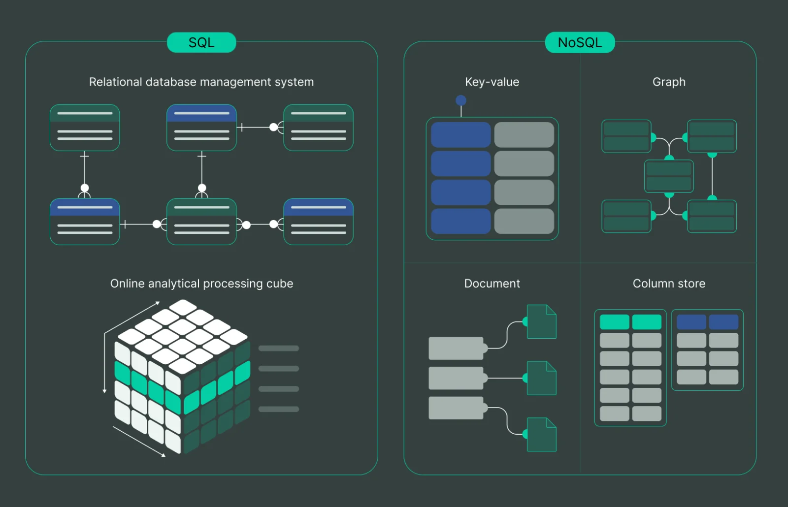

****

Software engineers muhandislari muntazam ravishda texnologiya tanlashdek jiddiy qarorlarga duch kelishadi. Eng muhim qarorlardan biri — qanday turdagi ma'lumotlar bazasidan foydalanishni aniqlashdir. Loyiha yo'nalishiga qarab, tanlov MySQL yoki Oracle kabi SQL (**Structured Query Language**) bazalari hamda MongoDB yoki Cassandra singari NoSQL bazalari o'rtasida bo'lishi mumkin. Ushbu maqola ikkala tur o'rtasidagi farqlarni yoritib, sizga oqilona qaror qabul qilishda yordam berishni maqsad qilgan.

----

##  **Overview Comparison Table**

Quyida SQL va NoSQL bazalarining asosiy farqlari bilan qisqacha tanishishingiz mumkin:

| Xususiyat | SQL | NoSQL |
| --- | --- | --- |
| **Turi** | Relational Database | Non-Relational ma'lumotlar bazasi |
| **Modeli** | Jadvallar va ustunlarga asoslangan relational model | Hujjat (document), kalit-qiymat (key-value), graf va keng ustunli modellar kabi xilma-xil modellar |
| **Sxemasi** | Oldindan belgilangan (qat'iy) sxema | Moslashuvchan yoki dinamik sxema |
| **ACID muvofiqligi** | Ha (ACID xususiyatlari: Atomicity, Consistency, Isolation, Durability) | Har doim ham emas (Asosan BASE tamoyillariga: Asosiy mavjudlik, Moslashuvchan holat, Yakuniy muvofiqlikka tayanadi) |
| **Kengayuvchanligi** | Vertikal (bitta serverda protsessor, operativ xotira, SSD kabilarni kuchaytirish orqali) | Gorizontal (yuklamani taqsimlash uchun qo'shimcha serverlar qo'shish orqali) |
| **Misollar** | MySQL, Oracle, SQL Server va boshqalar | MongoDB, Cassandra, Redis, HBase va boshqalar |
| **Dasturlash vaqti** | Qat'iy tuzilma tufayli boshlang'ich sozlash ko'proq vaqt talab etadi | Moslashuvchan sxema sababli tezroq sozlanadi va dasturlash vaqtini tejaydi |




Maqolaga ko'ra, SQL va NoSQL ma'lumotlar bazalari o'rtasidagi asosiy farq ularning ma'lumotlarga qanday yondashishidadir: SQL bazalari oldindan belgilangan, qat'iy sxemadan foydalanadi va murakkab so'rovlarni bajarish hamda ma'lumotlar butunligini ta'minlash uchun ideal hisoblanadi, biroq kengayish imkoniyatlari biroz cheklangan. NoSQL bazalari esa, aksincha, moslashuvchan bo'lib, aniq bir sxemani talab qilmaydi. Ular asosan turli formatdagi katta hajmdagi ma'lumotlarni saqlash va tezkor tranzaksiyalarni bajarishga moslashgan, biroq SQL darajasidagi murakkab so'rovlar va mutlaq ma'lumotlar ishonchliligini taklif qila olmasligi mumkin.

## **SQL nima?**

SQL – Structured Query Language (Strukturaviy so'rov tili) so'zlarining qisqartmasi. U MySQL, Oracle va SQL Server kabi relational ma'lumotlar bazasini boshqarish tizimlari (RDBMS) tomonidan ishlatiladigan dasturlash tilidir. SQL turli jadvallardagi strukturaviy ma'lumotlarni samarali boshqarish imkoniyati bilan kuchlidir. U ma'lumotlarni yuqori aniqlik va moslashuvchanlik bilan aniqlaydi hamda o'zgartiradi. SQL ma'lumotlar bazasida yozuvlarni yaratish, o'qish, yangilash va o'chirish (CRUD) imkonini beradi. Qisqa qilib aytganda, bu ma'lumotlar bazasi bilan ishlash va yuqori darajadagi tahlillarni amalga oshirish uchun universal vositadir.

**SQL bazalariga misollar**

Eng mashhur SQL relational ma'lumotlar bazalariga quyidagilar kiradi:

1. **MySQL:** SQL'dan foydalanadigan, bepul ochiq kodli RDBMS. MySQL asosan veb-loyihalarning ma'lumotlar bazasi sifatida keng qo'llaniladi va katta hajmdagi ma'lumotlar bilan muammosiz ishlay oladi.
2. **Oracle:** Oracle korporatsiyasi tomonidan taqdim etiluvchi ko'p modelli ma'lumotlar bazasini boshqarish tizimi. Katta hajmdagi ma'lumotlar va murakkab tahlillarni qo'llab-quvvatlaydi.
3. **SQL Server:** Microsoft tomonidan yaratilgan ushbu RDBMS tranzaksiyalarni qayta ishlash, biznes intellekti (BI) va tahliliy dasturlarning keng ko'lamini qamrab oladi.
4. **PostgreSQL:** Bu kuchli va ochiq kodli object-relational ma'lumotlar bazasi tizimi bo'lib, ko'p versiyali parallel boshqaruv (MVCC) kabi ilg'or xususiyatlarni taklif etadi.

Ushbu misollar SQL'ning ma'lumotlar bazasini boshqarish va tahlil qilishning turli yo'nalishlarida naqadar keng qo'llanilishini ko'rsatadi.

## **NoSQL nima?**

**NoSQL **an'anaviy relational bazalardan (ya'ni SQL ishlatiladigan tizimlardan) farqli ravishda ma'lumotlarni saqlash va olishning boshqacha usulini taklif qiluvchi tizimlar guruhidir. "NoSQL" nomi aslida "not only SQL" (faqatgina SQL emas) degan ma'noni anglatadi. Ya'ni, bu bazalar faqat strukturaviy so'rov tiliga tayanmaydi. NoSQL bazalari o'zining moslashuvchan sxemalari bilan mashhur. Ular qat'iy jadvallar va kalitlarni talab qilmaydi. Bu esa, juda katta hajmga ega yoki murakkab tuzilmali ma'lumotlar bilan ishlaganda NoSQL ajoyib tanlov ekanini anglatadi.

### **NoSQL bazalariga misollar**

Keling, eng ko'p qo'llaniladigan NoSQL ma'lumotlar bazalarini ko'rib chiqamiz:

1. **MongoDB:** Hujjatga yo'naltirilgan (document-oriented) ochiq kodli mashhur NoSQL bazasi. U ma'lumotlarni BSON (Binary JSON) hujjatlari ichida saqlaydi. Bu unga har xil turdagi ma'lumotlarni saqlashda yuqori moslashuvchanlikni beradi.
2. **Cassandra:** Apache tomonidan taqdim etilgan Cassandra bir qancha oddiy serverlar bo'ylab ulkan ma'lumotlarni boshqara olishi bilan tanilgan. U tizimning yagona zaif nuqtasiz (no single point of failure) yuqori darajada mavjudligini ta'minlaydi.
3. **Redis:** Redis ochiq kodli, ma'lumotlarni tezkor xotirada (in-memory) saqlaydigan tuzilma bo'lib, ma'lumotlar bazasi, kesh yoki xabar vositachisi (message broker) sifatida ishlatilishi mumkin. O'zining yuqori unumdorligi, soddaligi va kengayuvchanligi bilan ajralib turadi.
4. **HBase:** Bu Hadoop tarqatilgan fayl tizimi (HDFS) ustiga qurilgan, ustunga yo'naltirilgan non-relational baza. High performance klasterlarida milliardlab qator va millionlab ustunlardan iborat ulkan jadvallarni saqlashga mo'ljallangan.

Ushbu ma'lumotlar bazalari NoSQL'ning qo'llanilish doirasi kengligini ko'rsatib, noyob yechimlar orqali ma'lumotlarni boshqarishdagi turli muammolarni hal etadi.

--------

## **SQL va NoSQL afzalliklari va kamchiliklari**

SQL va NoSQL o'rtasida tanlov qilish ma'lumotlarni boshqarishdagi eng muhim qadamlardan biridir. Keling, har ikkalasining yutuq va kamchiliklarini tahlil qilamiz.

**SQL'dan foydalanishning afzalliklari:**

1. **ACID muvofiqligi:** SQL bazalari ACID tamoyillariga to'la javob beradi, ya'ni tizim ishdan chiqqan taqdirda ham ma'lumotlar butunligi kafolatlanadi.
2. **Ma'lumotlar tuzilmasi:** SQL bazalari oldindan belgilangan sxemani talab qiladi. Agar barcha ma'lumotlar bir xil standartda kiritilishini xohlasangiz, bu juda foydali xususiyatdir.
3. **Kuchli so'rov tili:** SQL'ning so'rov tili nihoyatda murakkab mantiqiy so'rovlarni oson bajarishga qodir.

**SQL'dan foydalanishning kamchiliklari:**

1. **Cheklangan kengayish:** SQL bazalari gorizontal kengayish (horizontal scaling) uchun ideal emas, garchi ular vertikal ravishda yaxshi kengaysa-da.
2. **Qat'iy sxema:** Ma'lumotlarni saqlashdan oldin barcha jadvallar tuzilishi aniq belgilanishi shart. Bu loyihalash jarayonida ko'p vaqt talab etadi va ehtiyojlar o'zgarganda migratsiya jarayonini qiyinlashtiradi.

**NoSQL'dan foydalanishning afzalliklari:**

1. **Moslashuvchan ma'lumotlar modeli:** NoSQL bazalari aniq sxema talab qilmaydi, shuning uchun ba'zi ma'lumot turlari uchun sezilarli darajada moslashuvchan.
2. **Gorizontal kengayuvchanlik:** Ular ma'lumotlarni ko'plab serverlar bo'ylab taqsimlash orqali osongina kengayishga moslashtirilgan.
3. **Tezkor amallar:** Agar juda katta ma'lumotlar bilan ishlayotgan bo'lsangiz, NoSQL bazalarida qo'shish (INSERT), yangilash (UPDATE) va o'chirish (DELETE) amallari sezilarli darajada tezroq bajariladi.

**NoSQL'dan foydalanishning kamchiliklari:**

1. **Less Mature:** SQL'ga qaraganda NoSQL bazalari nisbatan yangi. Shu sababli texnik yordam topish qiyinroq va barqarorlik bo'yicha kamchiliklar kuzatilishi mumkin.
2. **Nomuvofiqlik:** NoSQL bazalari ma'lumotlarning ishonchliligini ta'minlovchi ACID xususiyatlari bo'yicha doim ham barqaror emas.
3. **So'rovlardagi cheklovlar:** NoSQL bazalari SQL taklif qiladigan darajadagi murakkab so'rovlarni amalga oshirish imkoniyatiga ega emas.

Xulosa qilib aytganda, agar sizga aniq tuzilgan sxema va murakkab so'rovlarni bajarish kerak bo'lsa, SQL'ni tanlang. Ammo katta hajmdagi ma'lumotlar va tezkor tranzaksiyalar talab etilsa, NoSQL ma'lumotlar bazalariga e'tibor qaratganingiz ma'qul.

---

## **Qachon SQL'dan foydalanish kerak?**

Murakkab so'rovlar, ma'lumotlar butunligi va tranzaksiyalar ishonchliligi asosiy o'rinda turgan hollarda SQL eng yaxshi tanlov hisoblanadi. SQL quyidagi holatlarda zarur:

1. Vaqt o'tishi bilan o'zgarmaydigan, aniq belgilangan ma'lumotlar sxemasi mavjud bo'lganda.
2. Ma'lumotlar o'rtasidagi aloqalar murakkab va ular bilan qiyin amallarni bajarish talab qilinganda.
3. Bir nechta jadvallarga ta'sir qiluvchi (multi-row) yagona tranzaksiyalarni amalga oshirish kerak bo'lganda.

### **SQL'ning amaliyotdagi misollari**

Quyida murakkab so'rovlarni va munosabatlarni boshqarish orqali SQL o'z kuchini ko'rsatadigan ikkita hayotiy misol keltirilgan.

1. **Ombor nazorati (Inventory Management):** Mahsulot, Yetkazib beruvchi va Buyurtma kabi jadvallar o'rtasidagi uzviy bog'liqlikni boshqarishda SQL o'ta muhimdir.

```sql
-- Muayyan yetkazib beruvchi tomonidan taqdim etilgan barcha mahsulotlarni topish
SELECT Products.ProductName
FROM Products
JOIN Suppliers ON Products.SupplierID = Suppliers.SupplierID
WHERE Suppliers.SupplierName = 'mening_hamkorim';

```

2. **Bank tizimi:** Bir hisobdan boshqasiga pul o'tkazish holatini ko'rib chiqaylik. Bunda bitta tranzaksiya ichida ikkita amal bajarilishi shart: bitta hisobdan pul yechib olinadi va ikkinchisiga o'tkaziladi.

```sql
BEGIN TRANSACTION;

UPDATE Accounts
SET balance = balance - 100
WHERE account_id = 1;

UPDATE Accounts
SET balance = balance + 100
WHERE account_id = 2;

COMMIT;
```

Har ikkala holatda ham SQL o'zining ACID xususiyatlari va kuchli so'rov tili tufayli ko'p qatorli tranzaksiyalarni va murakkab munosabatlarni bexato bajaradi.

----

## **Qachon NoSQL'dan foydalanish kerak?**

Juda ko'p miqdordagi strukturaviy, yarim strukturaviy yoki tuzilmagan ma'lumotlarni saqlashingiz zarur bo'lganda, NoSQL zo'r variantdir. U quyidagi holatlarda yaxshi ishlaydi:

1. Loyiha sxemasi hali to'liq aniq bo'lmaganda yoki vaqt o'tishi bilan tez-tez o'zgarishi kutilganda.
2. Yuqori yuklamani ko'tarish uchun bazani gorizontal kengaytirish (bir nechta serverlarga taqsimlash) kerak bo'lganda.
3. Asosiy ma'lumotlar to'plami JSON formatidagi hujjatlardan yoki kalit-qiymat (key-value) juftliklaridan iborat bo'lganda.

### **NoSQL'ning amaliyotdagi misollari**

Qachon NoSQL eng zo'r yechim bo'lishini tushunish uchun amaliy misollar va oddiy kod namunalariga e'tibor qaratamiz.

1. **Foydalanuvchi profili ombori:** Ijtimoiy tarmoqlar yoki foydalanuvchiga yo'naltirilgan boshqa ilovalarda har bir foydalanuvchi haqidagi ma'lumotlar turlicha bo'ladi va bitta standart jadvalga sig'maydi. Aynan shunday vaziyatda MongoDB kabi hujjatga asoslangan baza ish beradi.

```javascript
// MongoDB
// foydalanuvchi yaratish

db.users.insertOne({
  username: "zor_foydalanuvchi",
  email: "zor_foydalanuvchi@example.com",
  age: 25,
  hobbies: ["rassomchilik", "o'yinlar"],
});
```

2. **Real-Time tahlil:** Real vaqtda tahlil olib borish uchun ulkan oqimdagi ma'lumotlarni tezkor ushlab qolish kerak bo'lsa, Redis kabi kalit-qiymat (key-value) xotiralari bu vazifani mukammal uddalaydi.

```python
import redis

# connect to redis
r = redis.Redis(host='localhost', port=6379, db=0)

# set a key-value pair
r.set('user:1000', "Jon Dou")
```

Bunday holatlarda NoSQL ma'lumotlar bazalari ishonchli va miqyoslana oladigan (scalable) ilovalar yaratish uchun kerakli moslashuvchanlik va tezlikni beradi.

-----

## **SQL va NoSQL'dan birgalikda foydalanish (Gibrid yondashuv)**

Ba'zi loyihalarda butun boshli tizim ehtiyojlarini qondirish uchun bitta turdagi baza yetarli bo'lmasligi mumkin. Shunday vaziyatlar bo'ladiki, SQL va NoSQL'ning o'ziga xos imkoniyatlarini birlashtirish ma'lumotlarni samarali boshqarishda eng optimal yechimga aylanadi.

### **Bitta ma'lumotlar bazasi yetarli bo'lmaganda**

Keling, elektron tijorat (***e-commerce***) ilovasini tasavvur qilamiz. Ombor nazorati, buyurtmalar va mijozlar ma'lumotlari kabi bir-biriga qattiq bog'langan ma'lumotlarni saqlashda MySQL kabi SQL bazasidan foydalanish mantiqan to'g'ri. Bu yerda SQL taqdim etuvchi qat'iy tuzilma juda muhim:

```sql
-- SQL: Barcha kutilayotgan (Pending) buyurtmalarni olish
SELECT Products.ProductName
FROM Products
JOIN Orders ON Products.ProductID = Orders.ProductID
WHERE Orders.OrderStatus = 'Pending';
```

Biroq, aynan shu ilova foydalanuvchilarga tovar tavsiya qilish maqsadida, ularning saytdagi harakatlarini (bosgan tugmalari, ko'rgan tovarlarini) xotirada saqlab borishi kerak bo'ladi. Tuzilmasi tinimsiz o'zgarib turuvchi bunday katta ma'lumotlar oqimini yozib borish uchun MongoDB kabi moslashuvchan NoSQL bazasidan foydalangan ma'qul:

```javascript
// MongoDB: Foydalanuvchi harakatini qayd etish
db.userInteractions.insertOne({
  userID: "123",
  pageVisited: "/products/456",
  interactionType: "click",
  timestamp: new Date(),
});
```

### **Bir nechta bazalardan foydalanishning yutuq va kamchiliklari**

Murakkab tizimlarda turli xil bazalarni birlashtirish eng yaxshi arxitektura bo'lishi mumkin.
Afzalliklari:

* Har bir ma'lumot turi o'z tabiatiga mos keluvchi bazada ishlanganligi sababli, tizim unumdorligi maksimallashadi.
* Moslashuvchanlik: Kerakli joyda SQL'ning qat'iy tuzilmasidan, boshqa joyda esa NoSQL'ning tezligidan unumli foydalanasiz.

Kamchiliklari:

* Murakkablik: Bir vaqtning o'zida bir nechta texnologiyalarni boshqarish va ta'mirlash loyiha murakkabligini oshiradi.
* Bir nechta turli bazalarni qamrab oluvchi tranzaksiyalarni nazorat qilish texnik jihatdan ancha qiyin bo'ladi.

Xulosa qilib aytganda, tizim sodda bo'lishi uchun odatda faqat bitta ma'lumotlar bazasidan foydalanish afzal ko'rilsa-da, SQL va NoSQL'ning gibrid kombinatsiyasi loyiha samaradorligini keskin oshirib yuboradigan stsenariylar ham bor. Hammasi ilovangiz talablariga bog'liq. To'g'ri tanlov – ilovangizning tez, ishonchli va barqaror ishlashini kafolatlab beradi.

-----

## **Xulosalar**

SQL yoki NoSQL'ni tanlash ma'lumotlar bilan qanday ishlashingizga kuchli ta'sir o'tkazadi. Ularning har birining o'ziga xos yutuq va kamchiliklarini tushunish loyihangiz uchun eng munosibini tanlashga yordam beradi.

### **Tanlovdagi hal qiluvchi omillar:**

* **Structure:** Munosabatlari aniq belgilangan ma'lumotlaringiz bormi yoki ularning tuzilishi vaqt o'tishi bilan doim o'zgarib turadimi?
* **Ma'lumot hajmi:** Agar ulkan hajmdagi ma'lumotlarni saqlash talab etilsa, ko'pincha NoSQL ustunlik qiladi. Murakkab munosabatlarga ega, biroq kichikroq o'lchamdagi ma'lumotlar uchun SQL ancha samaralidir.
* **Tezlik va Aniqlik:** Yashing tezligidagi ma'lumot almashinuvi kerak bo'lsa, NoSQL mos keladi. Aksincha, yuqori aniqlik va ma'lumotlar xavfsizligi mutlaq muhim bo'lsa, SQL tanlanishi shart.

### **SQL va NoSQL kelajagi**

SQL va NoSQL bazalarining har ikkisi ham o'zining qadrli xususiyatlariga ega va sanoatdan hech qachon yo'qolib ketmaydi. Eng muhimi – sizning ehtiyojingizga qaysi biri mos kelishini anglashdir. Balki, ba'zi hollarda bu ikkalasining qorishmasi eng zo'r yechim bo'lar!

Texnologiya rivojlangani sari biz SQL va NoSQL imkoniyatlarining o'zaro yanada zichroq integratsiyalashuvini kuzatmoqdamiz. Keyingi loyihangiz bazasini tanlashda ana shu zamonaviy tendensiyalardan xabardor bo'lishingiz muhimdir.

> Esda tuting, loyihangizni kattalashtirayotganingizda to'g'ri tanlangan ma'lumotlar bazasi tizimning xotirjam yohud muammosiz ishlashini belgilab beradi. — Oqilona tanlov qiling!

------

## **Ko'p beriladigan savollar (FAQs)**

Database technologies bo'yicha qaror qabul qilish oson kechmaydi. Quyidagi ko'p uchraydigan savollar javoblari fikringizni yanada tiniqlashtirishga yordam berishi mumkin.

### **Katta hajmli dasturlar uchun qaysi biri yaxshiroq: SQL yoki NoSQL?**
Odatda yirik hajmga ega ma'lumotlar yig'iladigan tizimlar uchun NoSQL bazalari asosiy variant hisoblanadi. Ularning gorizontal kengaya olishi, strukturaviy va tuzilmagan ma'lumot turlarini oson boshqarishi kattagina hajmdagi oqim bilan kurashishda yordam beradi. Biroq, tanlov baribir ma'lumotlarning murakkablik darajasi va ularning o'zaro qat'iy munosabatiga qarab farq qilishi mumkin.

### **SQL va NoSQL ma'lumotlar bazalari integratsiya jarayoniga qanday ta'sir qiladi?**
Integratsiya jarayoni SQL va NoSQL bazalarida bir-biridan farq qiladi. Qat'iy sxemaga ega va muvofiqlikni ta'minlovchi SQL bazalar xuddi shunday murakkab va qat'iy tizimlarga muammosiz birlashadi. O'zining moslashuvchanligi bilan mashhur NoSQL bazalari esa doim o'zgarib turuvchi ulkan ma'lumotlarni qabul qiluvchi va tizimni gorizontal kengaytirish imkoni bor muhitlarga oson integratsiya qilinadi.
