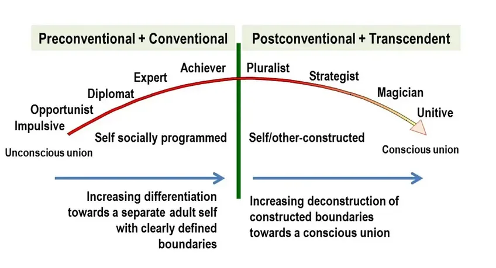

*Ko‘pchilik soxta yutuq ortidan quvib ketgan va bu yaqqol sezilib turibdi.*
 
Hozir hamma muvaffaqiyatga erishish uchun poygada.
 
Tasavvur qilganingizdek, ularning 99,99 foizi hech qachon muvaffaqiyatga erisha olmaydi.
 
Chunki ularning hammasi noto‘g‘ri narsaga berilib ketgan.
 
Instagramda ommalashib ketgan eng so‘nggi Claude Code skill’i.
 
Biznesni 5 ta amaliy qadamda qanday boshlashni o‘rgatadigan YouTube videosi (odamlarning «amaliy qadamlar»ga bo‘lgan chanqoqligi ularga zarracha ham yordam bermasligini nega tushunmasligiga hanuz aqlim yetmaydi).
 
Ular taktikaga berilib ketgan.
 
Bilasiz-ku... hamma ham ega bo‘la oladigan o‘sha bir xil bilimlar. 100 million dollar topish uchun kerak bo‘ladigan barcha ma’lumot internetda, kitoblarda yoki sun’iy intellekt bilan suhbatda tayyor turganini tushunmaysizmi?
 
Hech to‘xtab, nega dunyodagi hamma odam hozir millionlab dollar ishlamayotganini o‘ylab ko‘rganmisiz? Siz shunchalik intilayotgan «amaliy maslahatlar» yig‘ib yurgan bo‘laklaringiz butun jumboqda qayerga to‘g‘ri kelishini bilmasangiz, sizni hech qayoqqa olib bormasligi xayolingizga kelganmi?
 
Bu odamlarning ko‘pchiligi nima uchun astoydil intilayotgan muvaffaqiyatiga aslida erisha olmasligi ayon.
 
Birinchidan, ular arzon dofaminning bir turini boshqasiga, ancha makkorroq turiga almashtirgan, xolos. U ularda aslida bir qadam ham siljimayotgan bo‘lsa-da, haqiqiy taraqqiyotga erishayotgandek tuyg‘u uyg‘otadi. Mening fikrimcha, tinimsiz taktika yig‘ish g‘azabni qo‘zg‘atadigan videolarni tinimsiz varaqlashdan ham battar.
 
Ikkinchidan, ularda yig‘ib yurgan taktikalarini eng yuqori samara bilan ishlatishga imkon beradigan strategiya yo‘q. Ularning vujudida strategik tafakkurdan zarracha yo‘q. Tavba, vaqtning yarmida ular umuman o‘ylamaydi ham. Ularni internet-marketingni yaxshi biladigan odamlar qo‘g‘irchoqdek o‘ynatib yuribdi (o‘z ongingizni boshqara olmasangiz, bunda marketologlarning aybi yo‘q).
 
Agar siz ham shu toifaga kirsangiz, sizni kamsitmoqchi emasman.
 
6 yil oldin men ham xuddi shu tuzoqqa tushgandim. Hozir ham tez-tez tushib turaman. Bu maqola siz uchun qanchalik bo‘lsa, men uchun ham shunchalik. Men bir biznesdan keyin boshqasini boshladim (Facebook reklamalari, SEO, dropshipping, raqamli san’at va yana bir nechtasi), lekin ular hamma narsadan ko‘ra ko‘proq hobbiga o‘xshardi. Hamma qatori pul topib, ishimni tashlamoqchi edim, ammo qilgan ishlarim buni ko‘rsatmasdi. Pul topishdan boshqa hamma narsani qildim.
 
«Yuqori qiymatli ko‘nikma»ni o‘rgandim. Ko‘nglim yayrab ketdi.
 
Veb-saytni qurdim. Ko‘nglim yayrab ketdi.
 
MChJni (LLC) ro‘yxatdan o‘tkazdim. Ko‘nglim yayrab ketdi.
 
Ammo birovdan xizmatim uchun pul to‘lashni so‘rash vaqti kelganda, men hech qayerdan topilmasdim.
 
Yetishmayotgan bo‘lak strategiya edi.
 
Lekin shunchaki strategiya emas... strategik fikrlay olish qobiliyati; buni o‘rganish nihoyatda qiyin.
 
Bu maqolada sizga hamma narsani o‘rgata olmasligim mumkin, lekin topgan yoki o‘zim o‘ylab chiqargan eng ishonarli g‘oyalardan 4 tasini ulashmoqchiman.
 
Strategiya yo‘qligi nega hayotingiz natijasi ustidan nazorat yo‘qligini anglatishini, usta strategning 9 ta xislatini va nihoyat, o‘z hayotiy strategiyangizni qanday yaratish hamda strategik fikrlash qobiliyatini qanday rivojlantirishni muhokama qilamiz.
 
Bu maqola uzun bo‘ladi, mening ko‘pchilik maqolalarim kabi.
 
O‘qish uchun vaqt ajratishingizni va cheksiz varaqlash istagiga berilmasligingizni tavsiya qilaman.
 
## I — Strategiya — o‘zingizni ustun mavqega chiqarish va shu bilan birga raqibingiz yomonroq mavqeda qolishini ta’minlashdir.
 
> Taktika ustun mavqedan kelib chiqadi.
>
> — Bobbi Fisher (Bobby Fischer), shaxmat grossmeysteri
 
Keling, oddiy shaxmat o‘yinini ko‘rib chiqaylik.
 
Sizni zeriktirmaslikka harakat qilaman, toki asosiy gapga o‘tib olaylik.
 
Birinchi o‘yinchi o‘yinning dastlabki qismini zerikarli ko‘rinadigan ishlar bilan o‘tkazadi.
 
U hujum qilmaydi ham, birorta donani olmaydi ham.
 
Tashqaridan qaraganda hech narsa qilmayotgandek ko‘rinadi... shunchaki donalarini taxtadagi ma’lum kataklarga ko‘chirib turibdi.
 
Shaxmatdek o‘yinda siz katakli maydonda o‘ynaysiz, ammo bu maydondagi kataklarning hammasi ham teng emas. Taxta markazidagi dona burchakda qisilib qolgan donaga qaraganda ko‘proq joyga yetib bora oladi.
 
Birinchi o‘yinchi ruxni hech narsa to‘smaydigan ochiq vertikalga suradi.
 
Filni to‘g‘ri raqib shohiga qaratilgan yo‘lga qo‘yadi.
 
Otni taxtaning o‘rtasiga yaqin katakka qo‘yadi.
 
Shu orada ikkinchi o‘yinchining donalari bir-birining yo‘liga g‘ov bo‘lib turibdi.
 
Eng kuchli donalari o‘z piyodalari ortida qamalib qolgan.
 
Shohi taxtaning o‘rtasida qolib ketgan, chunki uni xavfsiz burchakka yashirib qo‘yishga hech qulay payt topmagan.
 
U faqat birinchi o‘yinchining yurishlariga javob qaytarib o‘ynagan.
 
Birinchi o‘yinchi otini ikkinchi o‘yinchining shohi va farzinini bir vaqtning o‘zida urishi mumkin bo‘lgan katakka suradi.
 
Shaxmatda bu «vilka» (fork) deyiladi. Raqibingiz faqat bittasini qutqara oladi. Ikkalasidan qaysi birini yo‘qotsa ham yaxshi emas.
 
Shunday qilib, ikkinchi o‘yinchi, tabiiyki, shohi olinmasligi uchun uni olib qochishga majbur bo‘ladi, lekin shu sababli birinchi o‘yinchi taxtadagi eng kuchli dona — farzinni ola oladi. O‘yin tugadi.
 
Tomoshabinlar jo‘shib ketadi.
 
Gap shundaki, donalarning aynan shunday joylashuviga yetib kelgan har qanday o‘yinchi bu yurishni qila olardi.
 
Birinchi o‘yinchining shu holatga yetib kelishiga sabab — u butun o‘yin davomida shunga tayyorgarlik ko‘rgani.
 
Agar o‘sha zerikarli qadamlarning istalganini boshidan olib tashlasangiz, vilka, ya’ni o‘yinni yutuvchi taktika paydo bo‘lmasdi. Ot to‘sib qo‘yilgan bo‘lardi, himoyachi dona yetib kelgach esa shoh qochib qutulardi.
 
Xulosa: strategiya — o‘zingizni ustun mavqega chiqarish va shu bilan birga raqibingiz yomonroq mavqeda qolishini ta’minlashdir.
 
Strategiya — o‘z mavqeingizni yaxshilash va raqibingiz mavqeini yomonlashtirish ishi, yurishma-yurish, ikkovi orasidagi tafovut shunchalik kattalashib, taktikalar o‘z-o‘zidan paydo bo‘la boshlaguncha.
 
Lekin hayot o‘yinida siz ham o‘yinchi, ham raqibsiz. Har bir qaroringiz mavqeingizni o‘zgartiradi, ko‘pchilik esa o‘zi qayerda turganini umuman ko‘rmaydi.
 
Oddiy odamning hayoti shaxmat o‘yini bo‘lganida, u hech qachon vilka holatiga yetib bormasdi, yetib borsa ham buni anglamasdi. O‘yindagi eng kuchli taktikalardan biri uning uchun ham qo‘l yetmas, ham sezilmas bo‘lib qolardi.
 
Shuning uchun strategiya birinchi o‘rinda turishi kerak.
 
Agar qo‘shimcha biznesingizda haqiqatan muvaffaqiyat qozonmoqchi bo‘lsangiz, ko‘rkam gavda qurmoqchi bo‘lsangiz yoki shunchaki hayotdan istaganingizni olmoqchi bo‘lsangiz, ko‘pchilik kabi bo‘la olmaysiz.
 
Ko‘pchilik strategiya o‘ylashga umuman vaqt sarflamaydi.
 
Jamiyatga razm solsangiz, taktika darajasida fikrlashning oqibati halokatli ekanini ko‘rasiz. O‘z yetishmovchiliklaringizni yengish uchun strategik fikrlashga vaqt ajratmasangiz, albatta, boshqalar kabi o‘sha ongsiz kundalik takrorga tushib qolasiz.
 
## II — Oddiy odam qutula olmaydigan mashaqqatlarning ongsiz aylanasida yashaydi.
 
Xudoga shukr, siz haqiqiy jang maydonida emassiz.
 
Chunki bo‘lganingizda, allaqachon o‘lgan bo‘lardingiz.
 
Ko‘pchilik shunday oldindan bashorat qilish mumkin bo‘lgan strategik xatolarga yo‘l qo‘yadiki, haqiqiy zo‘ravonlik sharoitida bo‘lganlarida yutqazgan bo‘lardi, g‘oliblar esa ularning qilgan ishlarini o‘rganib, aynan teskarisini qilgan bo‘lardi.
 
Juda erta (yoki kech) turmush qurish, birorta sohada mahoratga erishmaslik, sun’iy intellekt sizning o‘rningizga hamma narsani qila oladi deb ishonish (buni sun’iy intellekt tarafdori sifatida aytyapman), ma’no o‘rniga pul ketidan quvish, mas’uliyatsiz qarzga botish, yomon munosabatda qolib ketish, ta’limga sarmoya kiritmaslik, hech qayoqqa olib bormaydigan korporativ zinapoyadan ko‘tarilish. Ro‘yxat shu bilan tugamaydi.
 
Oddiy odam muammolari yoki mashaqqatlarini hal qilishga urinmaydi. U kundalik tartibga qamalib qoladi va bir xil kunni qayta-qayta yashaydi. Uning xayoliga bu holatdan o‘zini silkib chiqish, strategik fikrlashga kirishish va yo‘nalishni o‘zgartirib, oxir-oqibat hayotda qulayroq mavqega chiqish kelmaydi ham.
 
Agar odamlarning 99 foizidan o‘zib ketmoqchi bo‘lsangiz, to‘xtab, o‘ylab ko‘rishingiz va ro‘baro‘ kelgan qiyinchilikni yengishga haqiqatan urinib ko‘rishingiz kifoya; shu bilan birga, bunday qiyinchilikka boshqa duch kelmaydigan yo‘lni ham o‘ylab ko‘ring.
 
Siz haqiqiy jang maydonida bo‘lmasligingiz mumkin, lekin doim majoziy jang maydonidasiz. Bu maydonda siz ham qahramon, ham antagonistsiz. 18 yoshga to‘lgunga qadar hayotiy strategiyangizni asosan ota-onangiz boshqaradi, ularga esa o‘z ota-onalari va madaniyat katta ta’sir qilgan. Buni o‘qiyotganlarning ko‘pchiligi uchun bu shuni anglatadiki, sizning butun «strategiyangiz» — maktabda o‘qish, ishga kirish va ma’lum yoshda nafaqaga chiqish, lekin ichingizning bir burchagida shu yo‘l sizni aniq pushaymonlikka olib borishini pichirlab turgan ovoz bor.
 
Voyaga yetishingiz bilan ongingiz ma’lum bir mavqedan, asosan sizga yordam bermaydigan taktikalar to‘plami bilan ishlay boshlaydi va aynan shu payt dushmanlar hujumga o‘tadi. Asta-sekin ustingizga to‘lovlar, mas’uliyatlar, o‘ylar, tuyg‘ular va umringizning qolgan qismida nima bilan shug‘ullanmoqchi ekaningiz haqidagi savol yog‘ila boshlaydi.
 
Zamonaviy qulayliklar odamlarga hayotni oqimga qo‘yib ham yashab ketish imkonini berishi ahvolni yanada og‘irlashtiradi, holbuki haqiqiy urushda sarkardaning o‘z joni xavf ostida edi. Bu uni strategik chuqurlikka majbur qilardi. Siz esa shunchaki «qilish kerak bo‘lgan ishni» qilasiz-u, shu bilan cheklanasiz, chunki ma’nosiz kunning ko‘p qismiga chidasangiz, hech bo‘lmasa uyga borib video o‘yin o‘ynaysiz yoki do‘stlaringiz bilan bir-ikki krujka pivo ichasiz.
 
Sizga bosim kerak.
 
Taktik zo‘riqish.
 
O‘zingizni strategiya ishlab chiqish shart bo‘lgan, aks holda yutqazadigan holatga qo‘yish.
 
Qurbingiz yetmaydigan kvartiraga ko‘chib o‘ting. Hech qachon bormagan joyingizga samolyot chiptasini band qiling. Biznes dasturiga, kursga yoki kouchingga — hatto aldamchi deb o‘ylasangiz ham — pul tikib ko‘ring, chunki hech bo‘lmasa moliyaviy ahvolingiz xavf ostida qoladi va endi soxta qulaylik pardasi ostida yashay olmaysiz.
 
Xo‘p, tushundingiz.
 
Sizga strategiya kerak va strategik fikrlash ko‘nikmasini rivojlantirish kerak, chunki ularsiz qabul qilgan har bir qaroringiz tasodifiy bo‘lib qoladi.
 
Hayotingiz natijasi qarorlaringizdan kelib chiqadigan oqibatlarning yig‘indisi bo‘lsa, shunga e’tibor qaratish nihoyat hayotingiz ustidan aniqroq, nozikroq nazorat berishi mumkin.
 
## III — Har bir qilayotgan ishingizda qonuniyatlarni ko‘radigan darajada chuqurlashib, hayotda ustun mavqeni qanday qurish kerak
 
Miyamoto Musashining «Besh halqa kitobi»da (The Book of 5 Rings) har bir strateg amal qilishi kerak bo‘lgan 9 ta qoida/tamoyil bor:
 
- Fikrlashda yolg‘onchilik qilma
- Mashq — yo‘lning o‘zi
- Har bir san’at bilan tanish bo‘l
- Barcha kasblarning yo‘llarini bil
- Dunyoviy ishlarda yutuq va yo‘qotishni tushun
- Har bir narsa haqida sezgir hukm chiqarishni o‘rgan
- Ko‘zga ko‘rinmaydiganni ko‘ra bil
- Mayda narsalarga ham e’tibor ber
- Befoyda ish qilma
Musashining fikricha, strateg — bitta yo‘nalishga shunchalik chuqur kirib borgan odamki, uning tubida hamma sohaga xos bo‘lgan umumiy narsaga duch keladi.

 
Siz na biznesga, na munosabatlarga, na qilichbozlikka, na shaxmatga xos bo‘lmagan qonuniyatlarni payqay boshlaysiz. Ular o‘zgarmas narsa, va bu qonuniyatlarni ko‘rib, turli sohalarda sezgach, hamma sohada ancha samaraliroq bo‘lib qolasiz, chunki hech qachon noldan boshlamaysiz: voqelikni yaxlit tushunish sizning tarafingizda bo‘ladi.
 
Bu 9 qoida shunday odamning tashqaridan qanday ko‘rinishini belgilaydi.
 
Generalist haqidagi zamonaviy tasavvur odatda ko‘p narsadan ozgina xabardor odam degani. Har ishga qo‘l uradigan odam, ammo Musashi bu yerda sal boshqacha narsani tasvirlayapti.
 
Generalist bor.
 
Mutaxassis bor.
 
Va nihoyat, usta (strateg) bor.
 
Bu ego rivojlanish bosqichlari va Spiral Dynamics modeliga ham ancha yaxshi mos tushadi: strateg bosqichiga erishish mumkin va u quyidagi sifatlar bilan keladi:
 
- Tizimli fikrlash — Strateglar bir-biri bilan raqobatlashuvchi tizimlar va nuqtai nazarlarni bir vaqtda ko‘radi, Erishuvchilar (o‘z-o‘zini rivojlantirish bilan shug‘ullanuvchilar, biznesmenlar) esa muvaffaqiyat va yutuqning yagona tizimi doirasida harakat qiladi.
- Paradoksga ko‘nikkanlik — Ular zidiyatlarni (masalan, sun’iy intellektning ham tarafdori, ham muxolifi bo‘lishni) aniq (soxta) javoblarga aylantirib hal qilib yubormaydi, balki o‘zida ushlab turadi.
- Natijadan ko‘ra jarayon — Ular faqat natijani emas, ishlar qanday sodir bo‘lishini va ularning ortidagi tamoyillarni ham muhim biladi.
- Cheklovlarni anglash — Ular o‘z farazlari va ramkalari idrokini qanday shakllantirishini ko‘radi.
- Meta-anglash — Strateglar shunchaki mahoratini ishga solmaydi yoki ijtimoiy muhitda yo‘l topmaydi, balki o‘zining ma’no yaratish jarayonini ham kuzata oladi.
- Tamoyilli moslashuvchanlik — Ularning qadriyatlari mustahkam, biroq usullarni qat’iy qoidalardan yoki ijtimoiy konformizmdan farqli o‘laroq, erkin o‘zgartira oladi.
Eng muhimi, strategning asosiy xislati — bir nechta ramka yoki nuqtai nazarni bir vaqtda ushlab tura olish qobiliyati. Ular ko‘pincha dogmatik emas va oq yoki qora tomonni tanlamaydi. Ijtimoiy tarmoqlardagi ko‘pchilik bahslashib-bahslashib o‘zini adoyi tamom qiladi, chunki ularda bunga hali aqliy salohiyat yetishmaydi.
 
Strateglar o‘zi qurgan narsalarni tanlov deb biladi: o‘z shaxsiyatini, qadriyatlarini va dunyoqarashini.
 
Usta/strateg ham generalistning, ham mutaxassisning afzalliklaridan foydalanadi. U ham ko‘p narsada yaxshi bo‘la oladi (shuning uchun ongini bitta o‘rganish sohasiga toraytirib, imkoniyatlarini cheklab qo‘ymaydi), ham bitta narsada ancha ustun chiqa oladi (shuning uchun, imkon bo‘lsa, mazmunli sohada, juda katta natijalarga erishadi).
 
Bizning maqsadimiz shu va ko‘plab odamlar bu qoidalarga amal qilmasligini oson ko‘rishingiz mumkin.
 
Ko‘pchilik mafkuraga shunchalik singib ketganki (masalan: din, sun’iy intellektga tarafdor/qarshi bo‘lish, har kuni almashadigan modali chalg‘itkichlar), «Fikrlashda yolg‘onchilik qilma» qoidasini tushunib ham yetmaydi, chunki ular doimiy o‘z-o‘zini aldash aylanasida. Ularning ongini haddan tashqari oq-qora qarashlar (aql-zakovatning eng quyi shakli) egallab olgan, fikrlari esa haqiqatga yaqin ham kelmaydi. Haqiqatdan qanchalik uzoq bo‘lsangiz, ta’rifga ko‘ra, shunchalik yolg‘onchisiz. Ko‘pchilik ekstremal qarashlar ko‘r-ko‘rona yolg‘on bo‘lib, ularni internetda hamma yerda ko‘rasiz. Aldanmang, ular ortidagisini ko‘ring.
 
Strategik fikrlashni o‘rganganimizda bu qoidalarga boshqa nuqtai nazardan qarashni ham ko‘rsataman, lekin «Fikrlashda yolg‘onchilik qilma» qoidasi «Befoyda ish qilma» qoidasi bilan yaxshi bog‘lanadi, chunki doimiy yolg‘on holatida bo‘lish va ongsiz ravishda hiyla o‘ylash befoyda.
 
Ongsiz hayot tarzi — befoyda hayot tarzi.
 
Agar fikr va xatti-harakatlaringizni shunchaki foydalilik nuqtai nazaridan tekshirib chiqsangiz, hayotingizni tez orada o‘zgartirib yuborasiz.
 
Endi savollar quyidagicha:
 
- Siz nimaning ustasi bo‘lasiz?
- Sizning «mashq»ingiz qanday shaklda?
- Yutuq va yo‘qotishni tushunishni qanday boshlaysiz?
- Usta strateg tamoyillarini o‘zingizda qanday mujassam qila boshlaysiz?
- Va mening nazarimda eng muhimi: qanday qilib foydali ish qilasiz?
## IV — Shunchalik strategik fikrlangki, nihoyat hayotingiz nazoratini qaytarib olasiz
 
Ko‘pchilikning hayoti mazasiz, bunga sabab omadsizlik, yomon sharoit yoki imkoniyat yo‘qligi emas, balki oddiy odam hayotidagi muammolarni hal qilish haqida o‘ylab ham ko‘rmasligidir.
 
Muammolar ular uchun shunchaki ko‘nikib yashaydigan narsa.
 
Ular o‘zlarini shunday darajaga yetkazmagan: muammolarni jumboq deb ko‘rish va barcha muammolar yetarlicha uzoq vaqt ichida, kerakli resurslar bilan hamda oldingi muammolar ketma-ketligi hal bo‘lgan sharoitda oxir-oqibat yechilishini anglash darajasiga (masalan: avval dvigatel yasamay turib, raketa yasay olmaysiz. Raketalar o‘tmishda imkonsiz tuyulgan, ammo kosmik sayohat muammosi strategik uzoq muddatli fikrlash sharofati bilan oxir-oqibat hal qilindi).
 
Sizga raketa yasash qiziq bo‘lmasligi mumkin, lekin o‘z hayotingizga shunga o‘xshash kattalikdagi ta’sir ko‘rsata olasiz. Hayotni o‘zgartiradigan pul topadigan biznes qurishingiz, sog‘lig‘ingizni tubdan yaxshilashingiz yoki chalg‘imasangiz, nimaga ko‘nglingizni qo‘ysangiz, shunga haqiqatan erishishingiz mumkin.
 
Yaxshiyamki, yaxshi strategiyani nima tashkil etishini o‘rganishimiz mumkin.
 
Tamoyillar harbiy ishda, biznesda va sportda asrlar davomida sayqallanib kelgan. Sizda tarixiy yutuq va mag‘lubiyatlarning ulkan to‘plami bor, ularni orqaga qarab tahlil qilib o‘rganishingiz mumkin.
 
Eng yaxshisi shundaki, ularning hammasi sizning shaxsiy hayotingiz va muvaffaqiyatingizga ham tatbiq etiladi. Tamoyillar sohalar chegarasini kesib o‘tadi.
 
Men ulardan 7 tasini jamladim.
 
Agar o‘tirib, vaqt ajratib, buni haqiqatan bajarsangiz, hayotingiz o‘zgaradi.
 
Bu strategiyangiz yutuqli ekaniga kafolat bermaydi, lekin raqibingiz oyoq osti qilmasligi uchun albatta yordam beradi; ko‘pincha bu raqib o‘zingizsiz.
 
### 1-tamoyil — Viziyon (Vision)
 
> Hech kim to‘satdan omadli bo‘lib qolmaydi. Agar yulduzlar to‘satdan sizga mos kelib qolsa, ularni o‘zingiz — ongli yoki ongsiz ravishda — tizgan bo‘lasiz: qayerda yashashni, kimdan o‘rganishni, kim bilan oila qurishni, kim bilan do‘stlashishni, qanday turmush tarzini davom ettirishni, qanday tavakkalga borishni va qanday viziyonga ishonishni tanlash orqali.
>
> — @orangebook_, X’da
 
Viziyoningiz bo‘lmasa, adashgansiz.
 
Harakatlaringiz ortida niyat yo‘q. Qo‘lingizda 10 ta dart o‘qi bor — hayotingiz natijasini belgilaydigan 10 ta dadil qaror — lekin mo‘ljalga oladigan dart nishoningiz ham yo‘q.
 
Nishonga tegish imkoningiz ham yo‘q... markazga (bullseye) urishni-ku aytmasa ham bo‘ladi, garchi dartda markazga urish eng ko‘p ball beradigan zarba emas. Dart o‘yinida bu ahmoqona, lekin hayot o‘yinida shu qoida o‘rinli, chunki markazga aniq tekkizish sizga hech narsa o‘rgatmaydi.
 
Albatta, adashishning ham foydasi bor.
 
Yo entropiya sizni yo‘qlikka sudrab ketishiga yo‘l qo‘yasiz, yoki buni tushunib olishga, viziyonni topishga va o‘z yo‘lingizni boshlashga qaror qilasiz. Muvaffaqiyat bo‘shliqda tug‘iladi.
 
Viziyon — siz intilayotgan yakuniy natija.
 
U mavhum orzu emas. U iloji boricha aniq bo‘lishi kerak. U har bir harakatni ruhlantirib, yo‘naltira oladigan darajada jozibali bo‘lishi kerak. Chunki nimani xohlayotganingiz aniq bo‘lmaguncha, strategiyangiz umuman bo‘lmaydi. Aniq bo‘lgach esa, har bir qadamni orqaga qarab ishlab chiqib, yo‘l-yo‘lakay takomillashtirib borishingiz mumkin.
 
Agar 35 yoshga borib hissiy jihatdan chidamli, o‘zini chuqur anglaydigan va moliyaviy jihatdan mustaqil odamga aylanmoqchi bo‘lsangiz — bu aniq maqsad. U har bir kundalik qarorni shunga qarab baholash imkonini beradi. Ikki soat ijtimoiy tarmoqni varaqlash sizni bunga yaqinlashtirmasa kerak, viziyonsiz esa buni hayotingizdagi muammo deb payqamas ham edingiz.
 
Agar 18 oy ichida ishingizni tashlashga yetadigan daromad keltiradigan, shaxsiy rivojlanish sohasida 50 ming auditoriyali axborot byulleteni (newsletter) qurmoqchi bo‘lsangiz — endi har bir kontent, har bir platforma tanlovi, har bir monetizatsiya qarori shu niyatga qarab baholanishi mumkin. Bundan tashqari, ijtimoiy tarmoqlarda sizga zo‘rlab tiqishtirilayotgan taktikalarning hammasidan aynan sizga tegishlisini saralab olasiz. Chalg‘itadigan narsalarga «yo‘q» deyish — shunchaki sizning vazifangiz. Hozir hamma shaxsiy brend haqida gapiryapti, shuning uchun men sizning yo‘nalishingizni (niche) o‘rganib, strategiya + yaxshi natija berayotgan postlar to‘plamini (swipe file) beradigan kichkina bot yaratdim. U ancha zo‘r va bu yerda bepul.
 
Biroq «Men nimani xohlayman?» deb o‘ylashning o‘zi bilan viziyonni shakllantirish juda qiyin.
 
Buning o‘rniga anti-viziyon va post-mortemdan boshlash osonroq: shunda to‘liq muvaffaqiyatsizlik qanday ko‘rinishini tushunib, uni haqiqatan nimani xohlayotganingizni topish uchun inversiya (teskarilash) mexanizmi sifatida ishlatasiz.
 
Bu — birinchi qadam.
 
Shu hozir o‘qishni to‘xtatib, bajaradigan ishingiz.
 
Anti-viziyon — natija aynan qanday bo‘lishini xohlamasligingizni o‘ylab ko‘ring.
 
Post-mortem — o‘sha anti-viziyon dastlab nima sababdan yuz berganini orqaga qarab tahlil qiling. Qanday xatolarga yo‘l qo‘yilgan va ulardan qanday qochasiz?
 
Shundan so‘ng MVV — har bir qadam bilan kuchayib, aniqlashib boradigan minimal hayotiy viziyon (minimum viable vision) — yaratish uchun ancha qulay mavqedasiz.
 
Agar sizdan ayovsiz intervyu olinib, MVV’ingizni aniqlashni istasangiz, men shu hayotiy strategiya promptini yaratganman.
 
### 2-tamoyil — Tadqiqot (Research)
 
> Sun’iy intellekt qaysi «kasbiy ko‘nikmalar»ni egallab olishi haqida kamroq tashvishlaning, ko‘proq esa o‘zingizni va farzandlaringizni bilib bo‘lmaydigan kelajakda moslashuvchan aql bilan yo‘l topa oladigan, tashabbuskor, ziyrak, o‘zini o‘zi harakatga keltira oladigan insonlar bo‘lishga tayyorlayotganingiz haqida o‘ylang.
>
> — Devon Eriksen
 
Urushda sarkarda josuslar yuboradi, hududni o‘rganadi, dushmanning odatlari va moyilliklarini bilib oladi, chunki harakat qilishdan oldin razvedka ma’lumoti kerak bo‘ladi.
 
O‘zingizni oxirgi marta qachon o‘rgangansiz? Odatlaringizni va ular qanday hayotni shakllantirayotganini oxirgi marta qachon tekshirgansiz? Ongingiz soatlab xayolingizni band qilib, sizni yo‘lingizdan chalg‘itadigan arzimas narsalarga qanday munosabat bildirishiga oxirgi marta qachon e’tibor bergansiz?
 
Ko‘pchilikda karyerani qanday qurish, sog‘lom munosabatlar qanday ishlashi, mahoratga erishish jarayoni qanday ko‘rinishda bo‘lishi va hokazolar haqida umuman ma’lumot yo‘q. Ular birdan motivatsiya portlashini his qilib, uzoq kechiktirib kelgan maqsadiga nihoyat erishmoqchi bo‘ladi, lekin nega puchga chiqishi ayon.
 
Hayotingizni ruhiy-ma’naviy amaliyot kabi biror narsa bilan yaxshilashni boshlashdan oldin bir nechta an’anani o‘rganing, turli usullar haqidagi tadqiqotlarni o‘qing, buni yillar davomida qilib kelayotgan odamlar bilan gaplashing, bir qator ijtimoiy tarmoq akkauntlarini kuzating va o‘z ruhiy qonuniyatlaringizni hamda sizni nima qo‘zg‘atishini tushunib oling.
 
Instagram reklamasi sifatida chiqqan birinchi meditatsiya ilovasini shunchaki olib qo‘ymang.
 
Ijtimoiy tarmoqqa post yoki maqola yozishdan oldin nima yutayotgani va nima yutqazayotganini o‘rganasiz va bu strategiyangizga yo‘l ko‘rsatishiga imkon berasiz (buning uchun tadqiqot vositasidan foydalanishni tavsiya qilaman, shunda kunlab keraksiz narsalarni saralab o‘tirmaysiz). Kontent yaratuvchilar ro‘yxatini tuzasiz, raqobatchilar kontentini ko‘rib-o‘qiysiz va o‘zingizga yutuqli mavqeda joy ochib kirish haqida o‘ylay boshlaysiz.
 
Agar «shunchaki yozmoqchi» bo‘lsangiz, bemalol yozing, lekin yana takror aytaman: aqlli fikrlaringiz borligining o‘zi uchun hech kim sizga e’tibor qaratishini kutmang. Yozish ajoyib hobbi bo‘lishi mumkin, lekin buni mazmunli mehnat shakli sifatida qilayotgan bo‘lsangiz, bu strategik tamoyillar o‘z kuchiga kiradi, chunki shu payt bu biznesdir.
 
### 3-tamoyil — Tayyorgarlik (Preparation)
 
Resurslaringiz va yetishmayotgan jihatlaringizni aniqlab olishingiz kerak.
 
Chunki jangga ovqatsiz, ta’minotsiz, qurolsiz va yordamsiz shunchaki tushib ketmaysiz-ku.
 
Resurslaringiz nima ekanini va nimadan kamligingizni bilib olgach, zaxira yig‘ishni boshlaysiz: pul, vaqt, bilim, ko‘nikmalar, yashaydigan joyingiz, aloqalar va munosabatlar.
 
Hayotingizda katta o‘zgarishga (ishdan ketish, munosabatni tugatish, yangi loyiha yoki tadbirkorlik ishini boshlash) urinishdan oldin moliyaviy zaxirangizni (financial runway) yarating, xarajatlarni kamaytiring, kerak bo‘ladigan hissiyotlarni boshqarish ko‘nikmalarini rivojlantiring va qo‘llab-quvvatlovchi tizimlarni tayyorlab qo‘ying. Jangga shunchaki otilib kirmang.
 
Boshqacha aytganda, xavfdan sug‘urtalanishingiz (hedge) kerak.
 
Har bir maqsad o‘zi bilan xavf olib keladi, xavf qanchalik yuqori bo‘lsa, odatda mukofot ham shunchalik yuqori bo‘ladi va siz buni hisobga olib moslashishingiz kerak.
 
Ko‘proq pul topmoqchi bo‘lgan odam dasturiy ta’minot yaratishi, info-mahsulot sotishi, agentlik ochishi, kripto savdoni o‘rganishi va yana ko‘plab boshqa yo‘llarni tanlashi mumkin, ularning har biri o‘z xavf darajasiga ega.
 
Bozor info-mahsulotlarga to‘lib ketgan, chunki (1) ular ishlaydi va (2) xavfi past. Foyda marjalari ajoyib. SaaS esa, garchi uni yaratish osonroq bo‘lsa ham, ancha yuqori xavf profiliga ega, marjalar esa kichrayib bormoqda, chunki imkoniyatning kengayishi uni yaratish uchun to‘lashingiz kerak bo‘lgan texnologiyalarning ko‘payishini bildiradi, xolos.
 
Ko‘pchilik uchun qila oladigan eng yaxshi ish — qo‘lingizdan kelgan har qanday yo‘l bilan xavfdan sug‘urtalanishdir.
 
Agar yosh bo‘lsangiz, bu o‘zingizning ishingizni qurishda maksimal ustunlik qo‘lingizda bo‘lishi uchun egalik qilgan hamma narsangizni sotish, yomon kvartirada yashash va barcha xarajatlarni qisqartirishni anglatadi.
 
Yoshlarda vaqt resursi bor, lekin pul yo‘q, shuning uchun ular buni o‘zlari boshqara oladigan omillarni nazorat qilish orqali to‘ldirishi kerak.
 
Yo‘qotadigan hech narsasi bo‘lmagan odam ancha yaxshi mavqeda, uning ixtiyorida moliyaviy jihatdan mas’uliyatsiz odamlardagidan ancha ko‘p taktikalar mavjud.
 
### 4-tamoyil — Diqqatni jamlash (Focus)
 
> Ko‘proq ish qilish ko‘proq natija bermay qo‘yadigan nuqta bormi? Kamroq ish qilish (lekin ko‘proq o‘ylash) haqiqatan yaxshiroq natija beradigan nuqta bormi?
>
> — Greg Makkeun, «Essentializm» (Essentialism)
 
Kuchlarni jamlash.
 
Bu — resurslaringizni yupqa taqsimlab yubormay, hal qiluvchi nuqtaga jamlash degan harbiy tamoyil.
 
Eng yaxshi misol — 1940-yildagi Fransiya.
 
Fransuzlarda nemislarnikidan ko‘proq tank va qo‘shin bor edi. Xom resurslari ham ancha ko‘p edi. Lekin ular zirhli texnikasini butun front bo‘ylab tekis taqsimladi, shuning uchun har bir uchastkada bir nechtadan tank bor edi.
 
Nemislar qo‘llaridagi barcha «Panzer»larni olib, ularni yagona nuqta — Arden o‘rmoni orqali o‘tkazdi; fransuzlar bu yerdan o‘tib bo‘lmaydi deb hisoblagani uchun uni deyarli himoya qilmagan edi.
 
Diqqatni jamlash — qo‘lingizdagini qayerga qo‘yishingiz haqida.
 
Hayotda esa istalgan paytda sizda bor narsa chegaralangan. Ko‘pchilik hayotini o‘zgartirmoqchi bo‘lib, e’tiborining 10 foizini ovqatlanish, uyqu, mashq, meditatsiya, munosabatlar, qo‘shimcha daromad manbai va boshqalarga sarflaydi, holbuki, ularni eng ko‘p to‘xtatib turgan yagona tor nuqtaga (bottleneck) e’tibor qaratsa, bularning hammasida tezroq yaxshilanardi.
 
Agar avval katta moliyaviy qiyinchilikni hal qilishga e’tibor qaratsangiz, bu keyingi muammoga, masalan, ovqatlanishga yo‘naltira oladigan ko‘proq resurslarni bo‘shatadi. Shunda yuqori sifatli ovqatni oson sotib olasiz, u esa munosabatlaringizga sarflash mumkin bo‘lgan energiya resursini beradi.
 
Xuddi shunday biznesda ham. Ijtimoiy tarmoqlarda o‘sish faqat kontentdan iborat emas. Barcha platformalarga bir xil narsani joylash o‘sishingizga yordam beradigan odamlar bilan aloqa qurishga sarflashingiz mumkin bo‘lgan vaqtni olib qo‘yadi. Avval bitta platformaga e’tibor qaratib, ancha ko‘p obunachi to‘plagan bo‘lardingiz, so‘ng undan boshqa platformalarda o‘sish uchun tayanch sifatida foydalanish mumkin — kuchingizni barcha platformalar bo‘ylab sochib yuborganingizga qaraganda, shuncha vaqtda tezroq o‘sasiz. Bu «Creator Bootcamp»dagi asosiy o‘rgatuvchi nuqtalardan biri: algoritmga tayanish yetarli strategiya emas.
 
Bitta narsaga e’tibor qaratish vaqt o‘tib, hamma ishni yaxshiroq qilish imkonini beradi.
 
### 5-tamoyil — Amalga oshirish (Execute)
 
> Strategiya — cheklangan resurslaringizni cheksiz variantlar orasida qanday taqsimlashni tanlashingizdir.
>
> — Aleks Xormozi (Alex Hormozi)
 
Strategiyani to‘g‘ri amalga oshirish — makro (viziyon) va mikro (kundalik harakat) o‘rtasida to‘xtovsiz o‘tib turish, qabul qilgan qarorlaringizda mo‘ljal va niyat borligiga ishonch hosil qilishdir.
 
Strategiyaning mohiyati shu — odamlarning 99 foizi qiladigan ishning teskarisini qilish, chunki ko‘pchilik o‘zining shartlanganligi, tayinlab berilgan maqsadlari yoki takrorlanuvchi kundalik tartibidan tashqarida fikrlamaydi.
 
Lekin samarali amalga oshirishni qanday uddalaysiz?
 
Hamma narsa shu yerda birlashadi.
 
Viziyoningizni xayolingizning bir chekkasida ushlab turishni mashq qiling, uni biror joyga yozib qo‘ying va har tong qarab chiqing. Qayta-qayta ko‘rish orqali u kimligingizning bir qismiga aylanishi kerak.
 
Raqiblaringizni yoki o‘zingizni o‘rganishdan nimalarni bilib olganingizni qayd eting. Ular ustida mushohada qiling. Ular haqida chuqur o‘ylang. Ongingizda «pishib» yotsin, shunda u o‘zaro bog‘lanishlar hosil qila boshlaydi.
 
Tayanch bo‘la oladigan asosiy resursingizni aniqlang. Yoshlar uchun bu, ehtimol, vaqt va erkinlik. Ba’zilar uchun — kapital. Boshqalar uchun — internetdagi auditoriya. Yana ko‘pchilik uchun — g‘alati qiziqishlar va bilimlar to‘plami. Va ha, ko‘pchilik uchun bu — sun’iy intellekt, lekin past darajadagi, yuzaki ma’noda emas.
 
Kuchlarni jamlash yurishingizni tanlang. Eng katta ta’sir kuchiga ega yagona nuqta qayerda? Bir nechta sohada taraqqiyotni ochib beradigan nuqta? Qolgan hamma narsani osonlashtiradigan narsa?
 
Shundan so‘ng bizda dastlabki (yumshoq) reja bor, lekin u billurdek aniq bo‘lishi kerak.
 
Viziyonimizni orqaga qarab tahlil qilib, kundalik harakatlarimizga nisbatan to‘g‘ri nuqtai nazar hosil qilishga imkon beradigan maqsadlar ierarxiyasiga aylantirishimiz kerak.
 
Orqaga qarab ish yuriting: 1 yillik maqsadlar, 90 kunlik vazifalar, haftalik ustuvorliklar va kundalik odatlar. Har bir qadam niyat yoki viziyonga borib taqalishi kerak. Taqalmasa — chetga surib qo‘ying.
 
Yuqorida aytganimdek, bu jarayonda sizga yo‘l ko‘rsatadigan prompt yaratdim, chunki uni foydali deb o‘ylayman.
 
### 6-tamoyil — Moslashish (Adapt)
 
> Himoya qiluvchi odatiy tartiblarning xavfsizligidan voz kechishga tayyor bo‘lmasa, nazorat tuyg‘usini his qilib bo‘lmaydi. Natija shubhali bo‘lgan va inson shu natijaga ta’sir o‘tkaza oladigan holatdagina u o‘zi nazoratni qo‘lda ushlab turganini haqiqatan bila oladi.
>
> — Mihay Chiksentmihayi (Mihaly Csikszentmihalyi), «Oqim» (Flow)
 
Qotib qolgan strategiya — yutqazuvchi strategiya.
 
Ayniqsa, bugungi dunyoda. Muhit har 3–6 oyda o‘zgaradi va o‘zgarish tezligi faqat ortib boradi. Mening nazarimda kelajak strateglarniki, chunki ustalar yo‘l-yo‘lakay moslasha oladi. Ularga ko‘p miqdorda malaka oshirish va qayta o‘qish kerak emas. Ular hayot yo‘liga nima chiqarsa, sezgi bilan shunga hamohang ergasha oladi.
 
Sizning ishingiz — jang maydonida aynan o‘sha paytda, o‘sha yerda haqiqatda nima sodir bo‘layotganiga javob berish. Eng yomon stsenariylar haqidagi ongingiz to‘qigan xayollarga yoki hali haqiqat bo‘lmagan fantaziyalaringizga emas.
 
Agar ertalabki tartibga sodiq qolishga va’da bergan bo‘lsangiz-u, ish jadvalingiz o‘zgarsa, tartibni tashlab yubormaysiz. Ko‘pchilik shunday qiladi. Ko‘pchilik qiladigan ishni qilmang. Strategiyangizning viziyoni va niyati (yanada intizomli va barqaror bo‘lish) o‘zgarmaydi, lekin taktikalar o‘zgaradi. Muayyan meditatsiya yoki biznes strategiyasi olti oydan keyin ishlamay qolsa, tajriba qiling.
 
Tizimlar vaqt o‘tishi bilan buziladi. Buni kutishingiz kerak. Yuklab olgan Notion shabloningiz 3–6 oydan keyin ahamiyatini yo‘qotadi. Claude skill’ingiz ham. Har qanday sun’iy intellekt strategiyasi ham. Baribir nimadir ishlamay qolganini bila oladigan darajada mahoratli bo‘lishingiz kerak.
 
Ijtimoiy tarmoqda postlari yaxshi ishlamayotgani haqida mening oldimga doim odamlar kelib turadi. Javob — moslashish. Yangi taktika toping. Tajriba qiling. Boshqacha narsa qiling. Bir xil narsani takrorlayversangiz, natija olishda davom etmasligingiz ayon.
 
Ko‘rib chiqish, mulohaza yuritish va bashorat qilish.
 
Ularni haftalik jadvalga qo‘ying.
 
Haftangizni ko‘rib chiqing. Yo‘lda ekaningizni tekshiring. Taraqqiyotingiz haqida mulohaza yuriting. Qayoqqa ketayotganingizni bashorat qiling va kerak bo‘lsa, tuzatish kiriting.
 
### 7-tamoyil — Tamoyillarni o‘rganish (Study of Principles)
 
Sizni har qanday narsa ko‘nikma ekaniga ishonishga undayman.
 
Har qanday narsa tajriba to‘plashingiz mumkin bo‘lgan o‘rganish sohasidir.
 
Strategiyaning o‘zi ham sohalar bo‘ylab o‘z kuchini saqlaydigan tamoyillarga ega o‘rganish sohasidir. Tamoyillarni qancha ko‘p o‘rgansangiz, ularni o‘z hayotiy vaziyatingizga tatbiq etishda shuncha yaxshilanasiz. Bu — butun umr davom etadigan amaliyot.
 
Sun Szini o‘qing.
 
Kognitiv xatoliklar (cognitive biases) haqida o‘qing.
 
Odatlar qanday shakllanishini o‘rganing.
 
Muzokara tamoyillarini o‘rganing.
 
Kontent nega viral bo‘lishini o‘rganing.
 
Diqqat iqtisodiyoti qanday ishlashini o‘rganing.
 
Boshqa kontent yaratuvchilar qilayotgan narsani shunchaki ko‘chirmang. Tamoyillarni tushunib oling, shunda o‘z yurishlaringizni o‘ylab topasiz (va nima uchun shu harakatni qilayotganingizni haqiqatan anglaysiz).
 
Bundan tashqari, haqiqiy tamoyillarni o‘rganishning eng yaxshi yo‘li — voqelikning o‘zini o‘rganish, deb hisoblayman. Chunki strategiya — bu voqelik tamoyillarini inson maqsadlariga tatbiq etishdan boshqa narsa emas.
 
Sizga o‘rganishingiz mumkin bo‘lgan sohalar ro‘yxatini qoldirmoqchiman, bir necha mavzuga sho‘ng‘ib, bog‘lanishlarni topishni esa o‘zingizga havola qilaman.
 
Darhol o‘qishni boshlashingiz uchun oxirida bir nechta havola qoldiraman.
 
**Rasmiy (formal) tizimlar:**
 
- Kibernetika — har qanday tizimdagi (mexanik, biologik yoki ijtimoiy) teskari aloqa sirtmoqlari, boshqaruv va o‘z-o‘zini tartibga solishni o‘rganish.
- Tizimlar nazariyasi — yaxlitliklar, o‘zaro bog‘liqliklar, zaxiralar va oqimlar, paydo bo‘lish (emergentlik) va ta’sir nuqtalarini (leverage points) o‘rganish.
- Termodinamika — ayniqsa, ikkinchi qonun: entropiya doim ortadi. Har bir tartibli tizim yemirilishga qarshi turish uchun energiya talab qiladi. Aks holda odatlaringiz va tartibingiz ham parchalanib ketadi. Xonangizni yig‘ishtiring.
**Falsafiy an’analar:**
 
- Daosizm — Dao voqelikning so‘z bilan ifodalab bo‘lmaydigan tub tamoyili sifatida. Vu-vey (wu wei) — majburlanmagan, tabiatga muvofiq harakat; in va yan — bir-birini to‘ldiruvchi qarama-qarshiliklar; hamda zo‘riqishsiz mahoratni tarbiyalash.
- Abadiy falsafa (Perennial Philosophy) — barcha yirik donolik an’analari umumiy metafizik o‘zakka ega, degan da’vo. Oliy voqelik mavjud, inson o‘zligi unda ishtirok eta oladi va hayotning maqsadi buni anglab yetishdir.
**Integrativ meta-ramkalar:**
 
- Integral nazariya (Ken Uilber) — voqelikni kvadrantlar, rivojlanish darajalari, ong holatlari va tiplar bo‘yicha xaritalaydi.
- Spiral Dynamics — qadriyatlar tizimlarining pog‘onalar (tiers) orqali rivojlanish modeli. U odamlar turli bosqichlarda ma’noni qanday qurishini modellashtiradi, bu esa strateg uchun voqelikni o‘rganish demakdir, chunki voqelik kuzatuvchi tomonidan quriladi.
**Ezoterik / ramziy:**
 
- Germetik tamoyillar («Kibalion», The Kybalion) — mentalizm, mosliklik, tebranish, qutblilik, ritm, sabab va oqibat hamda jins. Ko‘plab yangi fikr an’analariga ta’sir qilgan ixcham nuqtai nazarlar to‘plami. «Yuqorida qanday bo‘lsa, pastda ham shunday.»
- Yung alkimyosi — o‘zgarishning ruhiy va ma’naviy jarayoni. Insonda yoki tizimda chuqur o‘zgarish haqiqatan qanday sodir bo‘lishini tushuntiruvchi ramka.
**Strategik / matematik:**
 
- O‘yinlar nazariyasi — strategik o‘zaro ta’sirning matematik o‘rganilishi. Nol yig‘indili va musbat yig‘indili o‘yinlar, mahbus dilemmasi, Nash muvozanati.
- Evolyutsiya nazariyasi — tanlanish, moslashish, moslik landshaftlari (fitness landscapes), o‘zgaruvchanlik va saqlanib qolish.
Bularning hammasi voqelikning turli qirrasi haqiqatan qanday ishlashini ko‘rsatadigan nuqtai nazarlardir.
 
Agar kelgusi bir yil davomida shularni shunchaki o‘rgansangiz, boshqa deyarli har bir ko‘nikma, soha yoki bilim yo‘nalishini tushunishingiz ham shu bilan birga ko‘tariladi. Hayotda qilgan har bir ishingizda tabiiy ravishda yaxshiroq bo‘lasiz.
 
O‘qishni davom ettirmoqchi bo‘lsangiz, «Human 3.0»ni tavsiya qilaman. Bu — shu ramkalarning ko‘pchiligining o‘zimning sintezim, unda oqim (flow) va samaradorlik psixologiyasidan olingan ko‘proq g‘oyalar ham bor.
 
Umid qilamanki, bularning hammasi foydali bo‘ldi.
 
Tez orada gaplashamiz.
 
— Dan
 
Agar maqolalar, havolalar, PDF va ePub fayllarini saqlash, o‘qish va belgilab chiqish uchun joy kerak bo‘lsa, Eden’ni sinab ko‘ring.
 
Agar kontent yaratuvchi bo‘lsangiz, Eden yordamida nima trendda ekanini o‘rganishingiz, kontent yaratuvchilarning eng yaxshi postlarini tahlil qilishingiz, kontentni barcha platformalarda rejalashtirishingiz (bu maqola ham Eden’da yozilgan va rejalashtirilgan) va boshqa ishlarni bajarishingiz mumkin.
 
Onlayn muhitda ajralib turish uchun bu eng katta ustunlik.
 
