**Muallif:** Tim Urban  
**Sana:** 2015-yil 27-yanvar  
**Maqola:** “Sun’iy intellekt inqilobi” turkumining 2-qismi

> Eslatma: Bu sun’iy intellekt haqidagi ikki qismli turkumning 2-qismidir. 
[1-qismni o'qish](https://blog.kamalovic.uz/posts/suniy-intellekt-inqilobi-superintellekt-sari-yol-1-qism)

---

> Bizda nihoyatda murakkab bo‘lishi mumkin bo‘lgan, uni qachon hal qilishimiz noma’lum va, ehtimol, butun insoniyat kelajagi unga bog‘liq bo‘lgan muammo bor. — Nik Bostrom

*“Voy, men hozir o‘qiyotgan narsa qanday qilib rost bo‘lishi mumkin, nega bu haqda hamma gapirmayapti?”* turkumining ikkinchi qismiga xush kelibsiz.

1-qism ancha beozor boshlangan edi: biz Sun’iy tor intellekt — ANI (haydash yo‘nalishini topish yoki shaxmat o‘ynash kabi bitta tor vazifaga ixtisoslashgan sun’iy intellekt) haqida va uning bugungi dunyomizda naqadar keng tarqalganini gaplashdik. Keyin ANI’dan Sun’iy umumiy intellekt — AGI’ga (inson kabi, barcha sohalarda aqliy jihatdan kamida inson darajasida qobiliyatli sun’iy intellektga) o‘tish nima uchun shunchalik katta muammo ekanini ko‘rib chiqdik. Shuningdek, ilgari kuzatilgan texnologik taraqqiyotning eksponensial sur’ati AGI biz o‘ylaganchalik uzoqda bo‘lmasligi mumkinligini ko‘rsatishini muhokama qildik. 1-qism oxirida esa mashinalarimiz inson darajasidagi aqlga yetishi bilan darhol quyidagicha ish tutishi mumkinligi haqidagi fikr bilan sizni lol qoldirdim:

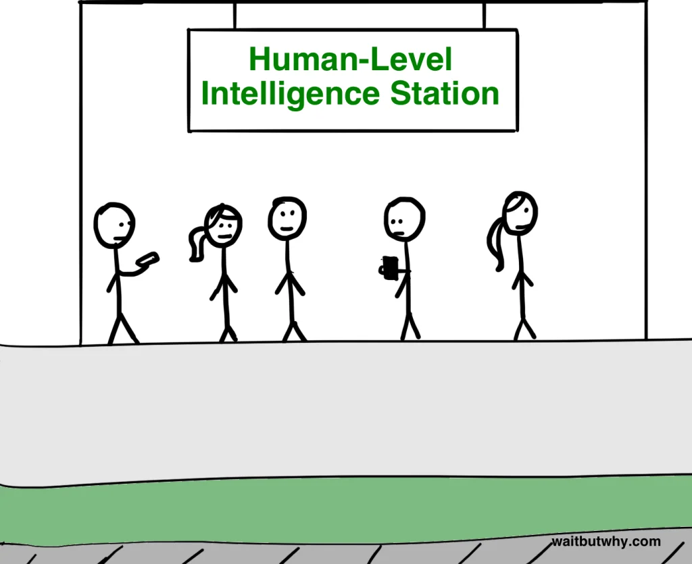

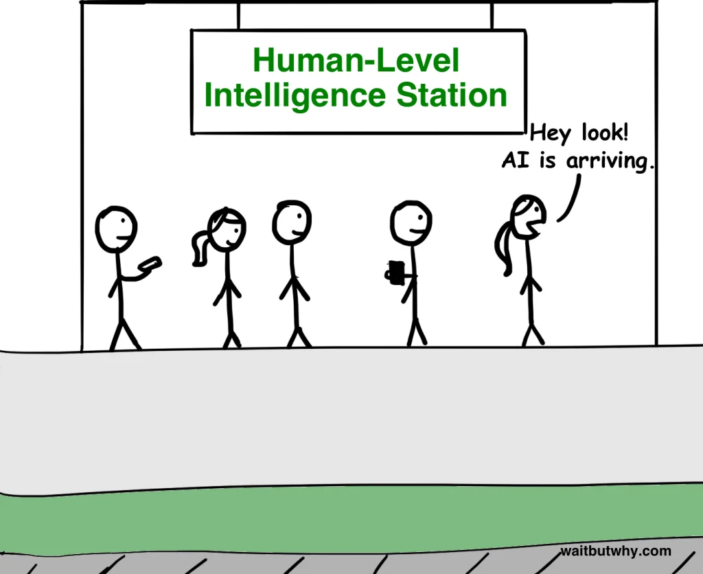

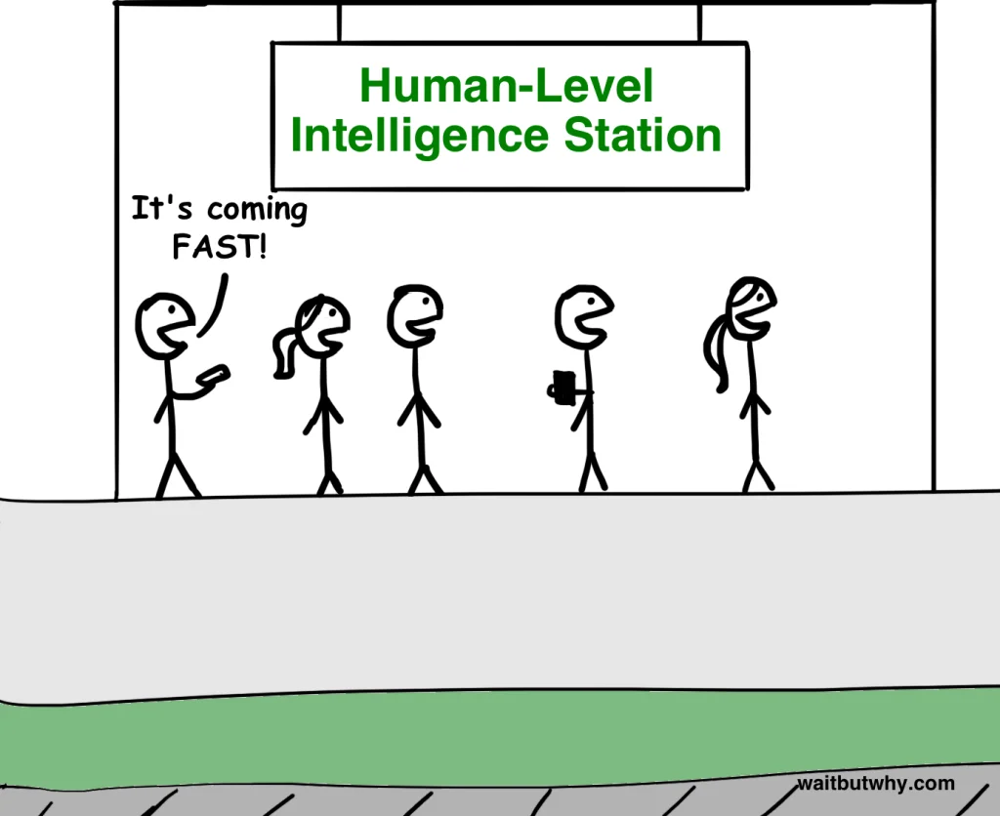

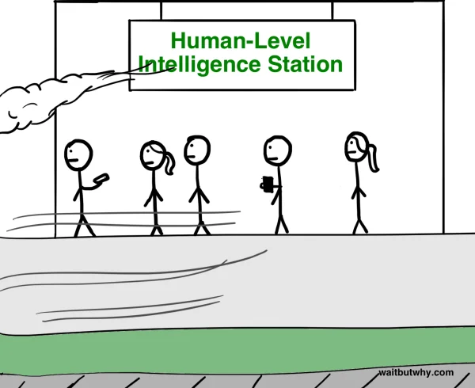

Shundan so‘ng biz ekranga tikilib qoldik: balki o‘z hayotimiz davomida yuz berishi mumkin bo‘lgan Sun’iy superintellekt — ASI (barcha sohalarda istalgan insondan ancha aqlliroq sun’iy intellekt) degan dahshatli tushunchaga duch keldik va bu haqda o‘ylaganimizda qanday hissiyotga berilishimiz kerakligini aniqlashga urindik.¹

Ishga kirishishdan oldin, mashinaning superintellektga ega bo‘lishi nimani anglatishini yana bir bor eslab olaylik.

Asosiy farqlardan biri — tezlik jihatidan superintellekt va sifat jihatidan superintellekt o‘rtasidagi farq. Odamlar o‘ta aqlli kompyuterni tasavvur qilganida, ko‘pincha birinchi bo‘lib insonchalik aqlli, ammo ancha, juda ham tez fikrlay oladigan mashina ko‘z oldiga keladi.² U inson kabi fikrlaydigan, faqat million marta tezroq ishlaydigan mashina bo‘lishi mumkin: natijada odam o‘n yilda hal qiladigan masalani u besh daqiqada yechadi.

Bu ta’sirli eshitiladi va ASI har qanday insondan tezroq fikrlaydi. Ammo haqiqiy ajratuvchi jihat uning aql sifati borasidagi ustunligi bo‘ladi — bu esa butunlay boshqa narsa. Insonlarning shimpanzelardan intellektual jihatdan ancha ustun bo‘lishiga sabab fikrlash tezligidagi farq emas. Sababi, inson miyasida murakkab til tuzilmalarini yaratish, uzoq muddatni rejalashtirish yoki mavhum fikrlash kabi qobiliyatlarni ta’minlaydigan bir qator murakkab kognitiv modullar mavjud, shimpanze miyasida esa bunday modullar yo‘q.

Shimpanze miyasini minglab marta tezlashtirish uni bizning darajamizga olib chiqmaydi. Unga hatto o‘n yil vaqt berilsa ham, murakkab modelni yig‘ish uchun maxsus asboblar to‘plamidan qanday foydalanishni tushuna olmaydi. Inson esa bunday ishni bir necha soatda bajarishi mumkin. Inson tafakkurining shunday sohalari borki, shimpanze qancha vaqt urinmasin, ularga hech qachon qodir bo‘la olmaydi.

Gap faqat shimpanze biz qiladigan ishlarni bajara olmasligida emas. Uning miyasi bunday imkoniyatlar umuman mavjudligini ham anglay olmaydi. Shimpanze inson nima ekanini va osmono‘par bino nima ekanini bilib olishi mumkin, ammo osmono‘par binoni insonlar qurganini hech qachon tushunmaydi. Uning dunyoqarashida bunday ulkan narsalarning hammasi shunchaki tabiatning bir qismi, tamom. U nafaqat osmono‘par bino qurishga qodir emas, balki kimdir bunday bino qura olishini anglashga ham qodir emas. Bunga aql sifatidagi kichik farq sabab bo‘ladi.

Bugun muhokama qilayotgan intellekt diapazoni, hatto biologik mavjudotlar orasidagi ancha tor diapazon bilan solishtirganda ham, shimpanzedan insongacha bo‘lgan aql sifati farqi juda kichik. Avvalgi maqolalarimdan birida biologik kognitiv imkoniyatlar diapazonini zinapoya shaklida tasvirlagan edim:³

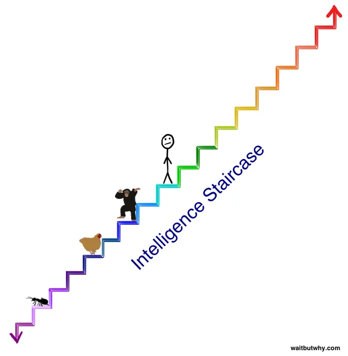

Superintellektga ega mashina naqadar ulkan hodisa ekanini his qilish uchun, shu zinapoyada insonlardan ikki pog‘ona yuqoridagi to‘q yashil pog‘onada turgan mashinani tasavvur qiling. Bu mashina atigi biroz superintellektli bo‘lardi, ammo uning bizdan ustun kognitiv qobiliyati hozirgina ta’riflagan shimpanze–inson farqichalik ulkan bo‘lardi. Shimpanze osmono‘par binolarni qurish mumkinligini hech qachon anglay olmagani kabi, biz ham to‘q yashil pog‘onadagi mashina nimalar qila olishini, hatto u bizga tushuntirishga urinsa ham, hech qachon to‘liq anglay olmaymiz — uni o‘zimiz bajarish haqida-ku gapirmasa ham bo‘ladi. Bu bizdan atigi ikki pog‘ona yuqorisi, xolos. Zinapoyaning eng yuqoridan ikkinchi pog‘onasidagi mashina uchun biz chumolilar qanchalik sodda bo‘lsak, u ham bizga shunchalik ustun bo‘lardi. U yillar davomida bizga bilganlarining eng oddiy uchqunini tushuntirishga urinsa ham, bu urinish behuda bo‘lardi.

Ammo bugun gapirayotgan superintellekt turi bu zinapoyadagi har qanday narsadan ancha yuqori. Intellekt portlashi paytida — mashina qanchalik aqlli bo‘lsa, o‘z aqlini shunchalik tez oshira oladigan va oxir-oqibat yuqoriga qarab keskin ko‘tariladigan jarayonda — mashina shimpanze pog‘onasidan undan keyingi pog‘onaga ko‘tarilish uchun yillar sarflashi mumkin. Biroq bizdan ikki pog‘ona yuqoridagi to‘q yashil pog‘onaga yetganidan keyin keyingi pog‘onaga chiqish uchun bir necha soat kifoya qilishi mumkin. Bizdan o‘n pog‘ona yuqoriga chiqqan paytida esa har bir soniyada to‘rt pog‘onalab sakrashi mumkin.

Shuning uchun inson darajasidagi AGI’ga erishgan birinchi mashina haqidagi katta yangilikdan ko‘p o‘tmay, Yer yuzida zinapoyaning mana bu pog‘onasida (yoki undan million marta yuqorida) turgan bir mavjudot bilan yonma-yon yashash haqiqatiga duch kelishimiz ehtimoli borligini anglashimiz kerak:

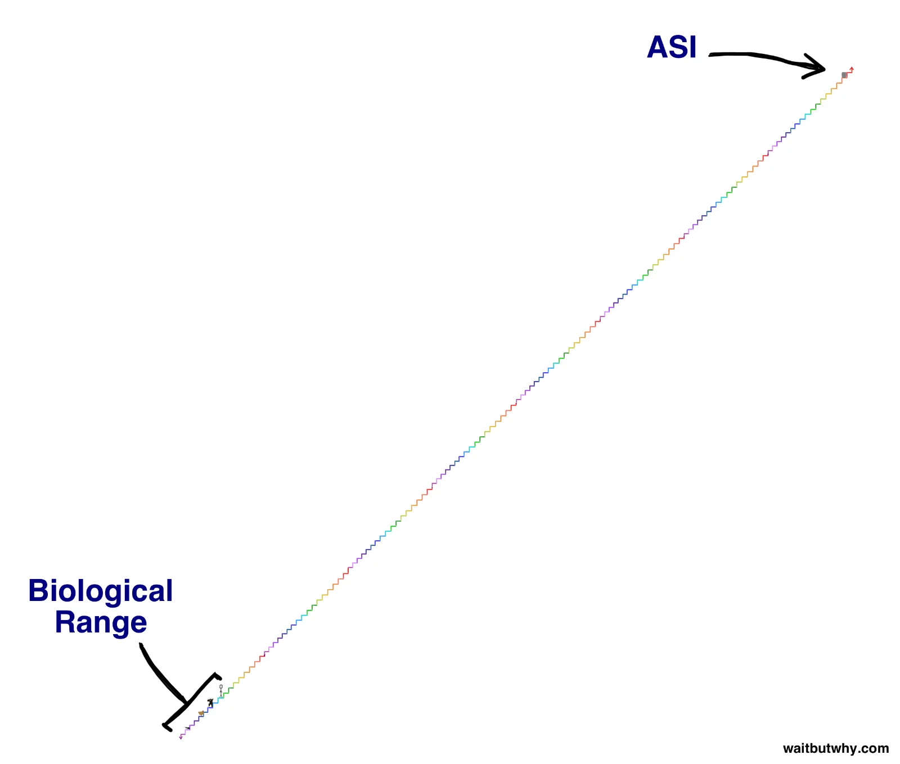

Bizdan atigi ikki pog‘ona yuqoridagi mashinaning qudratini tushunishga urinishning o‘zi behuda ekanini hozirgina ta’kidladik. Shuning uchun bir narsani qat’iy aytaylik: ASI nima qilishini yoki buning biz uchun oqibatlari qanday bo‘lishini bilishning hech qanday yo‘li yo‘q. Buning aksini da’vo qiladigan har qanday odam superintellekt nimani anglatishini tushunmaydi.

Evolyutsiya biologik miyani yuzlab million yillar davomida asta-sekin rivojlantirdi. Shu ma’noda, agar insonlar ASI mashinasini dunyoga keltirsa, biz evolyutsiya jarayonini keskin tezlashtirib yuborgan bo‘lamiz. Yoki, ehtimol, bu evolyutsiyaning bir qismidir: balki evolyutsiya shunday ishlaydiki, intellekt asta-sekin o‘sib boradi va oxiri mashina superintellektini yaratishga qodir darajaga yetadi. Bu daraja butun dunyo miqyosida o‘yinni o‘zgartiradigan portlashni ishga tushiruvchi qopqon simiga o‘xshaydi; u barcha tirik mavjudotlar uchun yangi kelajakni belgilaydi:

<!-- RASM JOYI: Tripwire -->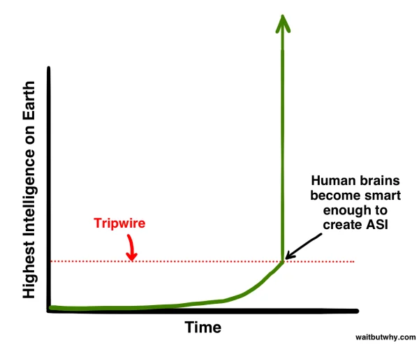

Keyinroq muhokama qiladigan sabablar tufayli ilmiy hamjamiyatning katta qismi bu qopqon simiga qachondir yetib borishimiz masalasi “yetib boramizmi yoki yo‘qmi?” degan savol emas, balki “qachon?” degan savol, deb hisoblaydi. Bu juda g‘alati va hayratlanarli ma’lumot.

Xo‘sh, bu bizni qayerda qoldiradi?

Dunyoda hech kim, ayniqsa men, o‘sha qopqon simiga yetganimizda nima yuz berishini aytib bera olmaydi. Ammo Oksford universiteti faylasufi va sun’iy intellekt bo‘yicha yetakchi mutaxassislardan biri Nik Bostrom barcha ehtimoliy natijalarni ikkita keng toifaga ajratish mumkin, deb hisoblaydi.

Birinchidan, tarixga nazar tashlasak, hayotning odatiy yo‘li shunday ekanini ko‘ramiz: turlar paydo bo‘ladi, ma’lum muddat yashaydi va vaqt o‘tishi bilan muqarrar ravishda mavjudlik muvozanat to‘sinidan tushib, yo‘q bo‘lib ketadi —

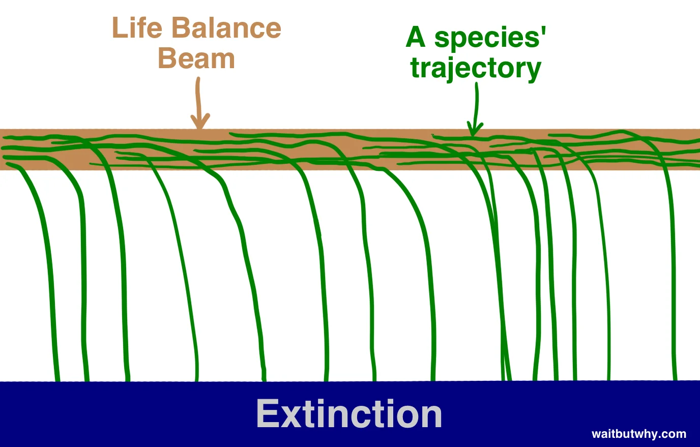

“Barcha turlar oxir-oqibat yo‘q bo‘lib ketadi” degan qoida tarix davomida “Barcha insonlar oxir-oqibat vafot etadi” degan qoida kabi ishonchli bo‘lib kelgan. Hozirgacha turlarning 99,9 foizi muvozanat to‘sinidan tushib ketgan. To‘sin ustida beqaror yurishda davom etayotgan tur ertami-kechmi boshqa bir tur, tabiatning bir zarbasi yoki to‘sinni larzaga keltiradigan asteroid tufayli qulab tushishi aniqdek ko‘rinadi. Bostrom yo‘q bo‘lib ketishni “jalb qiluvchi holat” deb ataydi: barcha turlar qulash arafasida turgandek bo‘ladigan va undan hech bir tur qaytib chiqa olmaydigan holat.

Men uchratgan olimlarning aksariyati ASI insoniyatni yo‘q bo‘lib ketishga olib borish imkoniga ega ekanini tan oladi. Shu bilan birga, ko‘pchilik ASI qobiliyatlaridan foydali maqsadlarda foydalanilsa, alohida insonlarni ham, butun turimizni ham ikkinchi jalb qiluvchi holatga — tur sifatidagi boqiylikka olib borishi mumkin, deb hisoblaydi. Bostrom tur sifatidagi boqiylikni ham yo‘q bo‘lib ketish kabi jalb qiluvchi holat deb biladi. Ya’ni, agar unga erishsak, abadiy yo‘q bo‘lib ketishdan himoyalangan bo‘lamiz — o‘limni ham, tasodifni ham yenggan bo‘lamiz. Demak, hozirgacha barcha turlar muvozanat to‘sinidan tushib, yo‘q bo‘lib ketgan bo‘lsa-da, Bostromning fikricha, to‘sinning ikki tomoni bor, shunchaki Yer yuzidagi hech bir mavjudot hozirgacha narigi tomonga tushishni anglaydigan darajada aqlli bo‘lmagan.

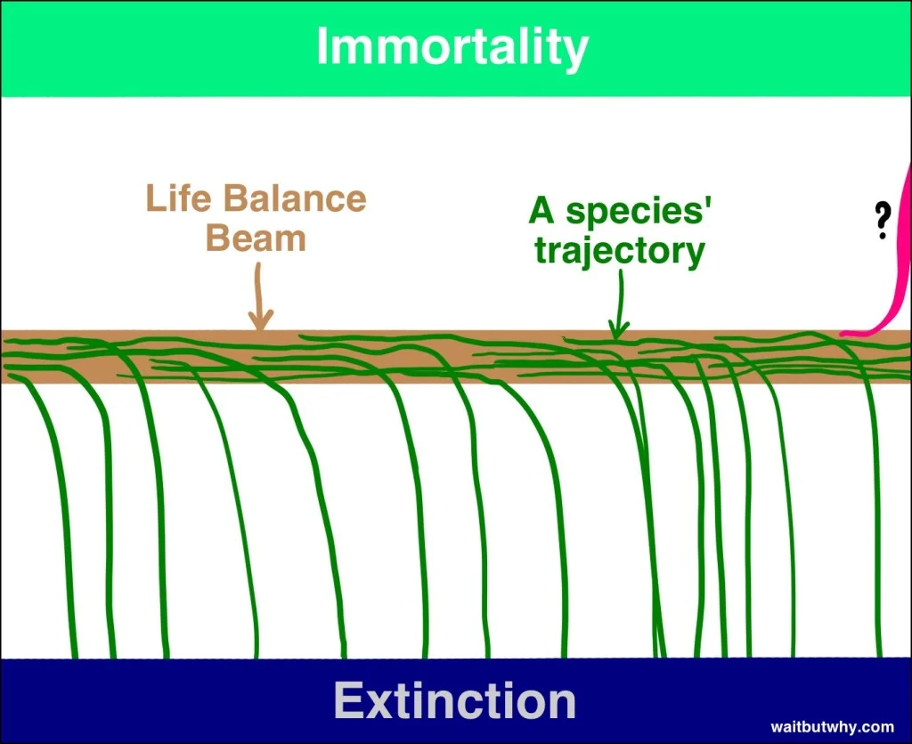

Agar Bostrom va boshqalar haq bo‘lsa — o‘qiganlarimdan kelib chiqib aytsam, ular haq bo‘lishi ham mumkin — biz ikkita juda hayratlanarli faktni qabul qilishimiz kerak:

1. ASI paydo bo‘lishi turga birinchi marta muvozanat to‘sinining boqiylik tomoniga tushish imkonini beradi.
2. ASI shunchalik tasavvur qilib bo‘lmas darajada ulkan ta’sir ko‘rsatadiki, insoniyatni muvozanat to‘sinidan u yoki bu tomonga qulatishi ehtimoli katta.

Ehtimol, evolyutsiya o‘sha qopqon simiga yetganida, insoniyatning muvozanat to‘sini bilan munosabatini butunlay tugatib, odamlar bor yoki yo‘qligidan qat’i nazar, yangi dunyoni yaratadi.

Hozir har bir inson berishi kerak bo‘lgan yagona savol shundaydek tuyuladi: qopqon simiga qachon yetamiz va bu sodir bo‘lganida to‘sinning qaysi tomoniga qulaymiz?

Dunyoda hech kim bu savollarning ikkalasiga ham javobni bilmaydi, ammo eng aqlli insonlarning ko‘pchiligi bu haqda o‘nlab yillar davomida fikr yuritgan. Ushbu maqolaning qolgan qismida ular qanday xulosalarga kelganini ko‘rib chiqamiz.

---

Keling, savolning birinchi qismidan boshlaylik: qopqon simiga qachon yetamiz?

Boshqacha aytganda, birinchi mashina superintellektga yetishiga qancha vaqt qoldi?

Ajablanarlisi yo‘q, bu boradagi fikrlar keskin farq qiladi va olimlar hamda mutafakkirlar o‘rtasida qizg‘in bahs ketmoqda. Professor Vernor Vinge, olim Ben Goertzel, Sun Microsystems asoschilaridan Bill Joy yoki, eng mashhuri, ixtirochi va futurist Rey Kurtsveyl kabi ko‘plab kishilar mashinaviy o‘rganish mutaxassisi Jeremi Hovardning TED ma’ruzasida ko‘rsatgan quyidagi grafigi bilan rozi:

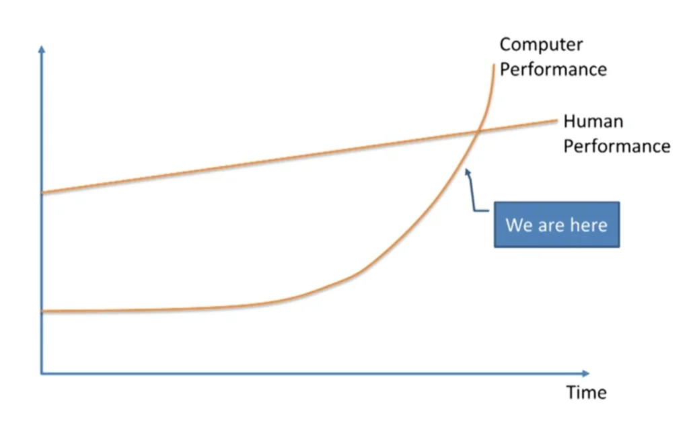

Bu kishilar hodisa yaqin orada yuz berishiga ishonadi: eksponensial o‘sish jarayoni ketmoqda va hozircha sekin yaqinlashayotgandek ko‘rinayotgan mashinaviy o‘rganish keyingi bir necha o‘n yillik ichida bizdan o‘zib ketadi.

Boshqalar — masalan, Microsoft asoschilaridan Pol Allen, tadqiqotchi psixolog Gari Markus, Nyu-York universiteti kompyuter olimi Ernest Devis va texnologik tadbirkor Mitch Kapor — Kurtsveyl kabi mutafakkirlar vazifaning qiyinlik darajasini keskin past baholayapti va biz qopqon simiga unchalik yaqin emasmiz, deb hisoblaydi.

Kurtsveyl tarafdorlari esa, aksincha, kam baholashning yagona sababi eksponensial o‘sishning ahamiyatini yetarlicha tushunmaslik, deb javob beradi. Ular shubha qiluvchilarni 1985-yilda internet endigina sekin rivojlanayotgan paytda unga qarab, “yaqin kelajakda u hech qanday sezilarli natija bermaydi”, degan odamlarga qiyoslaydi.

Shubha qiluvchilar esa aqlni rivojlantirish uchun zarur taraqqiyotning o‘zi har bir keyingi qadam bilan eksponensial tarzda qiyinlashib borishini, bu esa texnologik rivojlanishning odatiy eksponensial tabiatini muvozanatlashtirishini aytishi mumkin. Va hokazo.

Nik Bostrom ham kiradigan uchinchi guruhning fikricha, bu ikki guruhning hech biri muddat borasida o‘zini ishonchli his qilishga asosga ega emas. Ular ham A) bu yaqin kelajakda yuz berishi mumkinligini, ham B) bunga hech qanday kafolat yo‘qligini, jarayon ancha uzoq vaqt talab qilishi ham mumkinligini tan oladi.

Faylasuf Hubert Dreyfus kabi yana boshqalar esa qopqon simi umuman mavjud deb ishonadigan uchala guruh ham soddadil, deydi. Ularning ta’kidlashicha, ASI hech qachon yaratilmasligi ehtimoli kattaroq.

Xo‘sh, bu fikrlarning barchasini bir joyga jamlasak, nima kelib chiqadi?

2013-yilda Vinsent Myuller va Nik Bostrom bir qator konferensiyalarda yuzlab sun’iy intellekt mutaxassislaridan so‘rov o‘tkazdi. Ularga quyidagi savol berildi: “Ushbu savol maqsadida insonlarning ilmiy faoliyati katta salbiy uzilishlarsiz davom etadi, deb faraz qiling. Bunday HLMI⁴ qaysi yilga kelib mavjud bo‘lishi ehtimolini 10 foiz / 50 foiz / 90 foiz deb baholaysiz?” Ishtirokchilardan optimistik yilni (AGI bo‘lish ehtimoli 10 foiz deb hisoblagan yilni), realistik taxminni (AGI ehtimoli 50 foiz bo‘ladigan, ya’ni undan keyin AGI bo‘lishi bo‘lmasligidan ko‘ra ehtimoliroq deb hisoblanadigan yilni) va ehtiyotkor taxminni (AGI bo‘lishiga 90 foiz ishonch bilan ayta oladigan eng erta yilni) ko‘rsatish so‘raldi. Natijalar bir ma’lumotlar to‘plamiga jamlanganda quyidagicha chiqdi:²

- Optimistik yilning medianasi (10 foiz ehtimol): **2022**
- Realistik yilning medianasi (50 foiz ehtimol): **2040**
- Pessimistik yilning medianasi (90 foiz ehtimol): **2075**

Demak, so‘rov qatnashchilarining median fikricha, 25 yildan keyin AGI mavjud bo‘lishi ehtimoli yo‘q bo‘lishidan ko‘ra yuqoriroq. 2075-yilning 90 foizlik median javobi shuni anglatadiki, agar siz hozir o‘smir bo‘lsangiz, respondentlarning yarmidan ko‘pi va so‘rovdagi sun’iy intellekt mutaxassislarining aksariyati AGI sizning umringiz davomida paydo bo‘lishiga deyarli ishonadi.

Yozuvchi Jeyms Barrat Ben Goertzelning har yili o‘tkaziladigan AGI konferensiyasida yaqinda alohida tadqiqot o‘tkazdi. Unda foizlardan voz kechilib, ishtirokchilardan AGI qachon yaratiladi, deb o‘ylashlari so‘raldi: 2030-yilgachami, 2050-yilgachami, 2100-yilgachami, 2100-yildan keyinmi yoki hech qachonmi? Natijalar:³

- 2030-yilgacha: respondentlarning 42 foizi
- 2050-yilgacha: 25 foizi
- 2100-yilgacha: 20 foizi
- 2100-yildan keyin: 10 foizi
- Hech qachon: 2 foizi

Bu natijalar Myuller va Bostrom tadqiqoti natijalariga juda o‘xshaydi. Barrat so‘rovida qatnashganlarning uchdan ikki qismidan ko‘prog‘i AGI 2050-yilgacha paydo bo‘ladi, deb hisoblaydi; deyarli yarmi esa AGI keyingi 15 yil ichida yuzaga kelishini taxmin qiladi. So‘rovdagilarning atigi 2 foizi AGI kelajakda umuman bo‘lmaydi, deb o‘ylashi ham e’tiborga molik.

Ammo qopqon simi AGI emas, ASI hisoblanadi. Xo‘sh, mutaxassislar ASI’ga qachon yetamiz, deb o‘ylaydi?

Myuller va Bostrom mutaxassislardan AGI’ga erishganimizdan keyin A) ikki yil ichida (ya’ni, deyarli darhol intellekt portlashi yuz berishi) va B) 30 yil ichida ASI’ga yetish ehtimolini ham baholashni so‘radi. Natijalar:⁴

Median javobga ko‘ra, AGI’dan ASI’ga tez o‘tish (ikki yil ichida) ehtimoli atigi 10 foiz. Biroq uzoqroq — 30 yil yoki undan kam davom etadigan o‘tish ehtimoli 75 foiz deb baholangan.

Bu ma’lumotlardan median respondent o‘tish davrining 50 foizlik ehtimoli uchun qancha vaqt belgilaganini bilolmaymiz. Ammo taxminiy hisoblash uchun, yuqoridagi ikki javobga asoslanib, u 20 yil degan bo‘lardi, deb olaylik. Shunday qilib, sun’iy intellekt mutaxassislari fikrining aynan o‘rtasida turgan median qarashga ko‘ra, ASI qopqon simiga yetishning eng realistik taxmini quyidagicha: [AGI uchun 2040-yil prognozi + AGI’dan ASI’ga o‘tish uchun taxminiy 20 yil] = **2060-yil**.

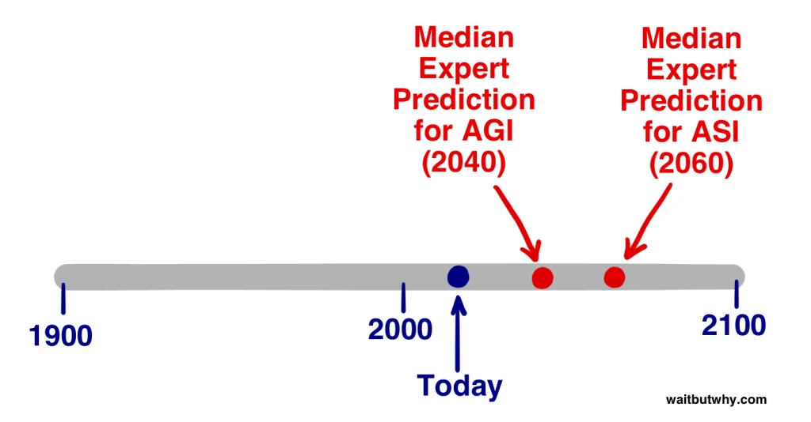

Albatta, yuqoridagi barcha statistikalar taxminiy bo‘lib, sun’iy intellekt mutaxassislari hamjamiyatidagi o‘rtacha qarashni ifodalaydi, xolos. Shunga qaramay, bu mavzuni eng yaxshi biladiganlarning katta qismi dunyoni o‘zgartirishi mumkin bo‘lgan ASI 2060-yilda paydo bo‘lishini juda asosli taxmin deb bilishini ko‘rsatadi. Bu bor-yo‘g‘i 45 yil degani.

Endi yuqoridagi savolning ikkinchi qismiga o‘taylik: qopqon simiga yetganimizda, to‘sinning qaysi tomoniga qulaymiz?

Superintellekt ulkan qudratni yuzaga keltiradi. Biz uchun hal qiluvchi savol:

**Bu qudrat kimning yoki nimaning qo‘lida bo‘ladi va uning maqsadi nima bo‘ladi?**

ASI aql bovar qilmaydigan darajada ajoyib rivojlanish bo‘ladimi, tasavvur qilib bo‘lmas darajada dahshatli hodisami yoki shu ikkisining orasidagi biror narsa bo‘ladimi — buni aynan shu savolning javobi belgilaydi.

Albatta, ekspertlar hamjamiyati bu savol borasida ham turli fikrlarga ega va qizg‘in bahs olib bormoqda. Myuller va Bostrom so‘rovida ishtirokchilardan AGI insoniyatga qanday ta’sir ko‘rsatishi mumkinligiga ehtimol belgilash so‘ralgan. O‘rtacha javobga ko‘ra, natijaning yaxshi yoki nihoyatda yaxshi bo‘lish ehtimoli 52 foiz, yomon yoki nihoyatda yomon bo‘lish ehtimoli esa 31 foiz bo‘lgan. Nisbatan betaraf natija ehtimoli o‘rtacha atigi 17 foiz deb baholangan. Boshqacha aytganda, bu mavzuni eng yaxshi biladiganlar hodisa juda katta ahamiyatga ega bo‘lishiga ancha ishonadi. Shuni ham ta’kidlash joizki, bu raqamlar AGI paydo bo‘lishiga tegishli. Agar savol ASI haqida bo‘lganida, betaraf natija ehtimoli yanada past bo‘lardi, deb o‘ylayman.

Yaxshi yoki yomon natija haqidagi savolni chuqurroq ko‘rib chiqishdan avval, “bu qachon sodir bo‘ladi?” va “natijasi yaxshi bo‘ladimi yoki yomonmi?” degan ikki savolni tegishli ekspertlarning aksariyati qarashlarini qamrab oladigan bitta diagrammaga birlashtiraylik:

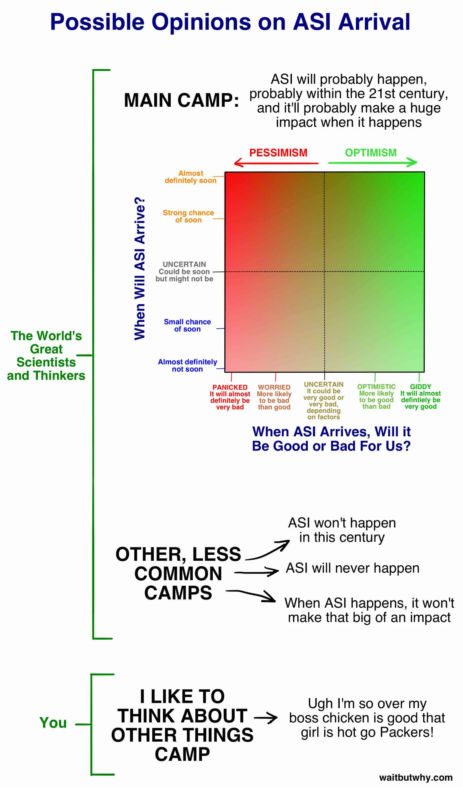

Asosiy guruh haqida birozdan keyin batafsil gaplashamiz. Ammo avval — sizning holatingiz qanday? Aslida, sizning holatingizni bilaman, chunki bu mavzuni o‘rganishni boshlashimdan oldin o‘zim ham xuddi shunday edim. Ko‘pchilik bu mavzu haqida jiddiy o‘ylamasligining bir necha sababi bor:

- 1-qismda aytganimizdek, filmlar sun’iy intellekt haqidagi noreal ssenariylarni ko‘rsatib, vaziyatni juda chalkashtirib yubordi. Natijada, biz sun’iy intellektni umuman jiddiy qabul qilish kerak emasdek his qilamiz. Jeyms Barrat buni Kasalliklarni nazorat qilish markazlari kelajakda vampirlar paydo bo‘lishi haqida jiddiy ogohlantirish berganida qanday munosabat bildirishimizga qiyoslaydi.⁵
- Insonlar biror narsaning rost ekaniga dalilni ko‘rmaguncha ishonishga qiynaladi. Ishonchim komilki, 1988-yilda kompyuter olimlari internet qanchalik muhim bo‘lishi mumkinligini muntazam muhokama qilgan. Ammo odamlar ularning hayotini o‘zgartirishi haqiqatda yuz bermaguncha, ehtimol, bunga unchalik ishonmagan. Buning bir sababi shuki, 1988-yilda kompyuterlar hali bunday ishlarni bajara olmasdi. Odamlar kompyuteriga qarab: “Rostdanmi? Bu hayotimizni o‘zgartiradigan narsaga aylanadimi?” deb o‘ylardi. Ularning tasavvuri kompyuter haqidagi shaxsiy tajribasi bilan chegaralangan, shu sabab kompyuterlar kelajakda nimalarga aylanishini aniq tasavvur qilish juda qiyin bo‘lgan. Hozir sun’iy intellekt bilan ham xuddi shunday holat yuz bermoqda. Biz uning juda muhim bo‘lishini eshitamiz, ammo bu hali sodir bo‘lmagani va hozirgi dunyomizdagi nisbatan ojiz sun’iy intellekt bilan tajribamiz tufayli u hayotimizni keskin o‘zgartirishiga chinakam ishonishimiz qiyin. Mutaxassislar jamoaviy kundalik o‘z-o‘zimiz bilan ovora bo‘lish shovqini orasidan bizning e’tiborimizni jalb qilishga urinayotganda aynan shu tarafkashliklarga qarshi kurashmoqda.
- Hatto ishongan taqdirimizda ham, bugun kun davomida abadiyatning qolgan katta qismini mavjud bo‘lmay o‘tkazishimiz haqida necha marta o‘yladingiz? Ko‘p emas, shundaymi? Holbuki, bu bugun qilayotgan boshqa barcha ishlaringizdan ancha jiddiyroq fakt. Sababi, uzoq muddatli vaziyatimiz qanchalik g‘ayrioddiy bo‘lmasin, miyamiz odatda kundalik hayotdagi mayda-chuyda narsalarga e’tibor qaratadi. Biz shunday tuzilganmiz.

Ushbu ikki maqolaning maqsadlaridan biri — sizni “Boshqa narsalar haqida o‘ylashni yoqtiraman” guruhidan chiqarib, ekspertlar guruhlaridan biriga qo‘shish. Hatto yuqoridagi kvadratdagi ikki nuqtali chiziq kesishgan joyda, mutlaqo noaniqlik ichida turgan bo‘lsangiz ham.

Tadqiqotim davomida bu mavzuga oid o‘nlab turli fikrlarga duch keldim. Ammo tez orada ko‘pchilikning qarashi men “Asosiy guruh” deb nomlagan hududga to‘g‘ri kelishini, xususan, ekspertlarning to‘rtdan uch qismidan ko‘prog‘i Asosiy guruh ichidagi ikkita kichik guruhga mansubligini payqadim:

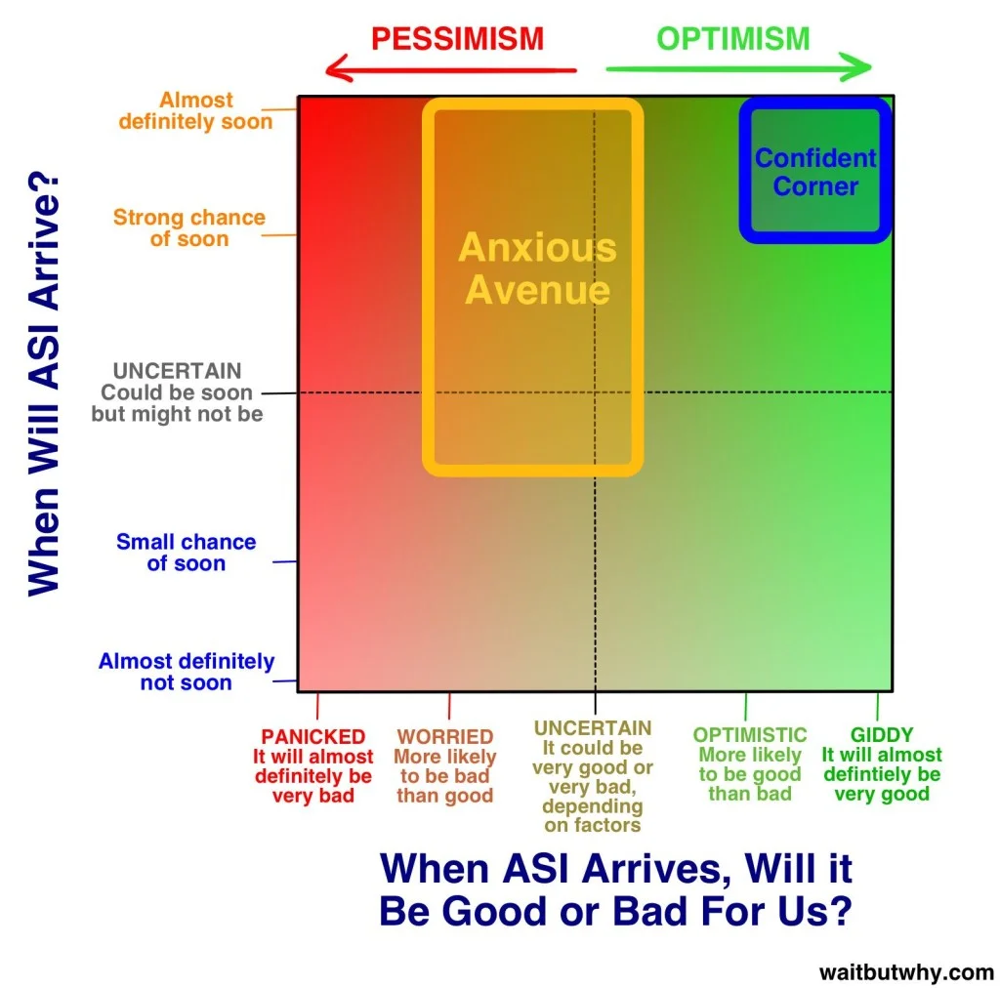

Bu ikki guruhni batafsil ko‘rib chiqamiz. Keling, avval qiziqarlisidan boshlaylik —

## Nega kelajak bizning eng ulkan orzumizga aylanishi mumkin?

Sun’iy intellekt dunyosini o‘rganganimda, hayratlanarli darajada ko‘p odam quyidagi hududda turishini aniqladim:

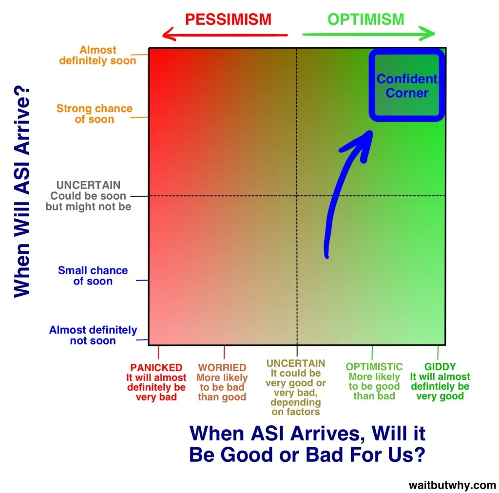

“Ishonch burchagi”dagilar hayajonga to‘la. Ular muvozanat to‘sinining quvonchli tomonini ko‘zlaydi va hammamiz aynan o‘sha tomonga borishimizga ishonadi. Ular uchun kelajak — o‘zlari umid qilishi mumkin bo‘lgan barcha narsalarning ayni vaqtida ro‘yobga chiqishidir.

Bu odamlarni keyinroq muhokama qiladigan boshqa mutafakkirlardan ajratib turadigan narsa — to‘sinning baxtli tomoniga intilishlari emas, balki aynan o‘sha tomonga tushishimizga ishonch bilan qarashlaridir.

Bu ishonch qayerdan kelib chiqishi bahsli. Tanqidchilarning fikricha, u shunchalik ko‘zni qamashtiradigan hayajondan kelib chiqadiki, ular ehtimoliy salbiy natijalarni shunchaki e’tiborsiz qoldiradi yoki inkor etadi. Ishonuvchilar esa, umumiy hisobda texnologiya bizga zararidan ko‘ra ko‘proq foyda keltirganini va kelajakda ham shunday bo‘lishi ehtimoli yuqori ekanini hisobga olsak, qiyomat ssenariylarini o‘ylab topish soddalik, deb javob beradi.

Ikkala tomonni ham ko‘rib chiqamiz va o‘qish davomida o‘z fikringizni shakllantirishingiz mumkin. Ammo ushbu bo‘limda shubhalaringizni bir chetga surib, muvozanat to‘sinining quvonchli tomonida nimalar borligini diqqat bilan ko‘rib chiqaylik. O‘qiyotgan narsalaringiz rostdan ham yuz berishi mumkinligini anglashga harakat qiling. Agar ovchi-yig‘uvchiga yopiq, shinam uylar, texnologiya va bitmas-tuganmas mo‘l-ko‘llikdan iborat dunyomizni ko‘rsatganingizda, unga bu xayoliy sehrdek tuyulardi. Kelajagimizda ham shunga teng darajada tasavvur qilib bo‘lmaydigan o‘zgarish yuz berishi mumkinligini tan olish uchun kamtar bo‘lishimiz kerak.

Nik Bostrom superintellektli sun’iy intellekt tizimi uch xil shaklda ishlashi mumkinligini ta’riflaydi:⁶

- **Orakul sifatida:** unga berilgan deyarli har qanday savolga, jumladan, insonlar osonlikcha javob bera olmaydigan murakkab savollarga ham aniq javob beradi. Masalan: “Avtomobil dvigatelini qanday qilib samaraliroq ishlab chiqarishim mumkin?” Google — orakulning ibtidoiy turi.
- **Jin sifatida:** unga berilgan har qanday yuqori darajadagi buyruqni bajaradi. Masalan: “Molekulyar yig‘gichdan foydalanib, yangi va samaraliroq avtomobil dvigatelini yarat”, so‘ng keyingi buyruqni kutadi.
- **Hukmdor sifatida:** unga keng qamrovli va ochiq maqsad beriladi, keyin u dunyoda erkin harakat qilib, bu maqsadga qanday erishishni o‘zi hal qiladi. Masalan: “Insonlar shaxsiy transport uchun avtomobillardan ko‘ra tezroq, arzonroq va xavfsizroq usulni ixtiro qil.”

Bizga murakkab tuyuladigan bu savol va vazifalar superintellektli tizimga sizdan “Qalamim stoldan tushib ketdi” degan vaziyatni yaxshilashni so‘ragandek tuyuladi. Siz esa qalamni olib, stol ustiga qaytarib qo‘ygan bo‘lardingiz.

Yuqoridagi jadvalda “Xavotirli xiyobon”da yashovchi Eliezer Yudkovskiy bu fikrni juda yaxshi ifodalagan:

> Qiyin muammolar yo‘q, faqat muayyan aql darajasi uchun qiyin bo‘lgan muammolar bor. Aql darajasini ozgina oshiring — ayrim muammolar birdan “imkonsiz”dan “ravshan”ga aylanadi. Aql darajasini ancha oshiring — ularning barchasi ravshan bo‘lib qoladi.⁷

“Ishonch burchagi”da ishtiyoqmand olimlar, ixtirochilar va tadbirkorlar ko‘p. Ammo sun’iy intellekt ufqining eng yorqin tomoniga sayohat qilish uchun bizga yo‘lko‘rsatuvchi bo‘la oladigan faqat bir kishi bor.

Rey Kurtsveyl — munozarali shaxs. O‘qishlarim davomida uning o‘zi va g‘oyalariga xudoga sig‘ingandek topinishdan tortib, ularni mensimay ko‘z aylantirishgacha bo‘lgan turli munosabatlarga duch keldim. Boshqalar esa o‘rtacha pozitsiyada edi. Yozuvchi Duglas Xofstadter Kurtsveyl kitoblaridagi g‘oyalarni muhokama qilar ekan, buni juda chiroyli ifodalagan: “Go‘yo juda yaxshi taomlardan bir nechtasini olib, ularga it axlatini qo‘shib, hammasini shunday aralashtirgansizki, qaysi biri yaxshi-yu, qaysi biri yomonligini ajrata olmaysiz.”⁸

Uning g‘oyalarini yoqtirasizmi yoki yo‘qmi, Kurtsveylning hayratlanarli inson ekaniga hamma qo‘shiladi. U o‘smirlik chog‘idayoq ixtirolar yaratishni boshlagan va keyingi o‘n yilliklarda bir nechta muhim ixtirolarni amalga oshirgan. Ular orasida birinchi planshetli skaner, matnni nutqqa aylantiradigan birinchi skaner (ko‘zi ojiz insonlarga oddiy matnlarni o‘qish imkonini bergan), mashhur Kurtsveyl musiqiy sintezatori (birinchi haqiqiy elektr pianino) va katta lug‘atga ega nutqni tanish tizimining ilk tijoriy mahsuloti bor. U milliy bestsellerga aylangan beshta kitob muallifi. U dadil bashoratlari bilan mashhur va ularning amalga oshishida ancha yaxshi natijaga ega. Jumladan, internet hali keng tanilmagan 1980-yillarning oxirida, 2000-yillarning boshiga kelib u global hodisaga aylanishini bashorat qilgan. *The Wall Street Journal* uni “tinib-tinchimas daho”, *Forbes* “eng mukammal fikrlovchi mashina”, *Inc. Magazine* “Edisonning munosib vorisi”, Bill Geyts esa “sun’iy intellekt kelajagini bashorat qilishda men bilgan eng yaxshi inson” deb atagan.⁹ 2012-yilda Google hammuassisi Larri Peyj Kurtsveylga murojaat qilib, undan Google’ning muhandislik bo‘yicha direktori bo‘lishni so‘ragan.⁵ 2011-yilda u NASA mezbonlik qiladigan va qisman Google homiylik qiladigan Singularity University’ga hammuassis bo‘lgan. Bir inson umri uchun yomon natija emas.

Bu tarjimai hol muhim. Kurtsveyl kelajak haqidagi qarashlarini bayon qilganda, u to‘liq telbadek eshitiladi. Eng qizig‘i esa, u telba emas: u nihoyatda aqlli, bilimli va dunyoda muhim o‘rin tutadigan inson. Siz uning kelajak haqidagi fikrlariga qo‘shilmasligingiz mumkin, ammo u ahmoq emas. Uning haqiqatan ham salmoqli shaxs ekanini bilish meni xursand qiladi, chunki kelajak haqidagi bashoratlarini o‘qir ekanman, ularning to‘g‘ri chiqishini juda-juda istayman. Siz ham shuni istaysiz. Kurtsveyl bashoratlarini eshitganingizda, ularning ko‘pchiligini Piter Diamandis va Ben Goertsel kabi “Ishonch burchagi” mutafakkirlari ham qo‘llab-quvvatlashini ko‘rib, nega uning “singulyaritarlar” deb ataladigan katta va jo‘shqin tarafdorlari borligini tushunish qiyin emas. Mana, uning fikricha, nimalar sodir bo‘ladi:

### Timeline 

Kurtsveyl kompyuterlar 2029-yilgacha AGI darajasiga yetadi, 2045-yilga kelib esa nafaqat ASI’ga, balki u “singulyarlik” deb ataydigan butunlay yangi dunyoga erishamiz, deb hisoblaydi. Uning sun’iy intellektga oid vaqt jadvali ilgari haddan tashqari shoshqaloq prognoz sifatida ko‘rilgan, hozir ham ko‘pchilik shunday hisoblaydi.⁶ Biroq so‘nggi 15 yil ichida ANI tizimlarining tez rivojlanishi sun’iy intellekt bo‘yicha kengroq ekspertlar hamjamiyatini Kurtsveylning vaqt jadvaliga ancha yaqinlashtirdi. Uning bashoratlari Myuller va Bostrom so‘rovidagi median respondentnikidan (AGI — 2040-yilgacha, ASI — 2060-yilgacha) hanuz biroz dadilroq, ammo farq katta emas.

Kurtsveyl tasvirlagan 2045-yilgi singulyarlik biotexnologiya, nanotexnologiya va eng muhimi, sun’iy intellekt sohalaridagi uchta bir vaqtda yuz beradigan inqilob natijasida keladi.

Davom etishdan oldin: nanotexnologiya sun’iy intellekt kelajagi haqidagi deyarli har bir matnda uchraydi. Shu sabab bir daqiqaga mana bu ko‘k ramkaga kirib, uni muhokama qilaylik.

### Ko‘k ramka: nanotexnologiya

> Nanotexnologiya — o‘lchami 1 dan 100 nanometrgacha bo‘lgan modda bilan ishlashga oid texnologiya. Nanometr metrning milliarddan bir qismi yoki millimetrning milliondan bir qismidir. Bu 1–100 nanometr diapazoniga viruslar (ko‘ndalangiga 100 nm), DNK (eni 10 nm), gemoglobin kabi yirik molekulalar (5 nm) va glyukoza singari o‘rta kattalikdagi molekulalar (1 nm) kiradi. Nanotexnologiyani o‘zlashtirsak, keyingi qadam alohida atomlarni boshqarish imkoniyatiga ega bo‘lish bo‘ladi; atomlar bundan yana bir daraja kichik — taxminan 0,1 nm.⁷

> Insonlarning shu diapazondagi moddalarni boshqarishga urinishi qanchalik qiyinligini tushunish uchun xuddi shu narsani kattaroq miqyosda tasavvur qilaylik. Xalqaro kosmik stansiya Yer yuzasidan 268 mil (431 km) balandlikda joylashgan. Agar insonlar boshi XKS’gacha yetadigan darajada ulkan gigantlar bo‘lganida, ular hozirgidan taxminan 250 000 marta katta bo‘lardi. Nanotexnologiyaning 1–100 nm diapazonini 250 000 martaga kattalashtirsak, 0,25 mm–2,5 sm hosil bo‘ladi. Demak, nanotexnologiya — Xalqaro kosmik stansiyadek baland inson gigantining qum donachasi bilan ko‘z olmasi orasidagi o‘lchamdagi materiallardan murakkab buyumlarni ehtiyotkorlik bilan yasashni o‘rganishiga teng. Keyingi bosqichga — alohida atomlarni boshqarishga — o‘tish uchun bu gigant 1/40 millimetr o‘lchamidagi jismlarni juda aniq joylashtirishi kerak bo‘ladi. Bu shu qadar kichikki, oddiy o‘lchamdagi insonlar uni ko‘rish uchun mikroskopga muhtoj bo‘lardi.⁸

> Nanotexnologiya haqida ilk bor Richard Feynman 1959-yildagi ma’ruzasida gapirgan. U shunday degan edi: “Fizika qonunlari, men ko‘ra olishimcha, narsalarni atomma-atom boshqarish imkoniyatiga qarshi emas. Aslida, fizik kimyogar yozib bergan istalgan kimyoviy moddani sintez qilishi mumkin bo‘lardi… Qanday qilib? Atomlarni kimyogar aytgan joyga qo‘ying, shunda modda hosil bo‘ladi.” Hammasi shunchalik oddiy. Agar alohida molekulalar yoki atomlarni harakatlantirish yo‘lini topsangiz, tom ma’noda istalgan narsani yaratishingiz mumkin.

> Nanotexnologiya 1986-yilda muhandis Erik Dreksler o‘zining *Engines of Creation* nomli muhim kitobida uning asoslarini bayon qilganidan keyingina jiddiy ilmiy sohaga aylandi. Biroq Dreksler nanotexnologiyadagi eng zamonaviy g‘oyalarni o‘rganmoqchi bo‘lganlarga 2013-yilda chop etilgan *Radical Abundance* kitobini o‘qishni tavsiya qiladi.

### Gray Goo Bluer Box

*Endi biz chalg‘ituvchi mavzuning ichidagi yana bir chalg‘ituvchi mavzuga kirib qoldik. Juda maroqli.⁹*

> Xullas, sizni bu yerga nanotexnologiya tarixidagi juda yoqimsiz bir jihatni aytish uchun olib keldim. Nanotexnologiya nazariyasining eski shakllarida nano-yig‘ishning taklif qilingan usullaridan biri birgalikda ishlaydigan trillionlab mayda nanobotlarni yaratishni nazarda tutgan. Trillionlab nanobotni yaratish usullaridan biri — o‘z-o‘zini ko‘paytira oladigan bitta nanobotni yasash, keyin uning ko‘payish jarayoni orqali bittani ikkiga, ikkitasini to‘rtga, to‘rttasini sakkizga aylantirish va taxminan bir kun ichida bir necha trillionga yetkazish edi. Bu eksponensial o‘sishning kuchi. Aqlli yechim, shundaymi?

> U tasodifan Yer yuzida ulkan va to‘liq qiyomatni keltirib chiqarmaguncha, bu yechim juda aqlli ko‘rinadi. Muammo shundaki, trillionlab nanobotlarni tez yaratishni juda qulay qiladigan eksponensial o‘sish kuchining o‘zi o‘z-o‘zini ko‘paytirishni dahshatli istiqbolga aylantiradi. Tizimda xatolik yuz berib, u kutilganidek umumiy son bir necha trillionga yetganda to‘xtash o‘rniga, ko‘payishda davom etsa-chi? Nanobotlar ko‘payish jarayonini ta’minlash uchun tarkibida uglerod bo‘lgan har qanday moddani iste’mol qilishga mo‘ljallangan bo‘lardi. Afsuski, barcha tirik mavjudotlar uglerod asosida tuzilgan. Yerning biomassa miqdorida taxminan 10⁴⁵ ta uglerod atomi bor. Bitta nanobot taxminan 10⁶ ta uglerod atomidan iborat bo‘lardi. Demak, 10³⁹ ta nanobot Yer yuzidagi barcha hayotni iste’mol qilishi mumkin. Bu 130 marta ko‘payishdan keyin ro‘y beradi (2¹³⁰ taxminan 10³⁹ ga teng): nanobotlar okeani — “kulrang shilimshiq” — sayyorani qoplaydi. Olimlarning fikricha, nanobot taxminan 100 soniyada bir marta ko‘payishi mumkin. Demak, oddiy xato Yer yuzidagi barcha hayotni atigi 3,5 soatda tugatishi mumkin.

> Bundan ham yomonroq ssenariy bor: agar terrorchi qandaydir yo‘l bilan nanotexnologiya qo‘liga tushib, ularni dasturlashni bilsa, dastlab bir necha trillion nanobot yaratib, ularni bir necha hafta davomida butun dunyo bo‘ylab sezdirmasdan bir tekis tarqalishga dasturlashi mumkin. Keyin ularning hammasi bir vaqtda hujum qiladi va barcha narsani iste’mol qilish uchun atigi 90 daqiqa kifoya qiladi. Ular butun dunyoga tarqalib bo‘lganidan keyin, ularga qarshi kurashishning hech qanday yo‘li qolmaydi.¹⁰

> Bu dahshatli hikoya ko‘p yillardan beri keng muhokama qilinadi. Yaxshi xabar shuki, u bo‘rttirilgan bo‘lishi mumkin. “Kulrang shilimshiq” atamasini yaratgan Erik Dreksler ushbu maqoladan keyin menga elektron xat yuborib, bu ssenariy haqidagi fikrini bildirdi: “Odamlar qo‘rqinchli hikoyalarni yaxshi ko‘radi, bu hikoya esa zombi haqidagi hikoyalar qatoriga kiradi. G‘oyaning o‘zi miyani yeb qo‘yadi.”

> Nanotexnologiyani chindan o‘zlashtirganimizdan so‘ng, undan texnik qurilmalar, kiyim-kechak, oziq-ovqat va biologiyaga oid turli mahsulotlar — sun’iy qon hujayralari, virus yoki saraton hujayralarini yo‘q qiluvchi mitti qurilmalar, mushak to‘qimasi va boshqa istalgan narsalarni yaratish uchun foydalanishimiz mumkin. Nanotexnologiyadan foydalaniladigan dunyoda materialning narxi endi uning kamyobligi yoki ishlab chiqarish jarayonining qiyinligiga bog‘liq bo‘lmaydi. Narx uning atom tuzilmasi qanchalik murakkabligiga qarab belgilanadi. Nanotexnologiya dunyosida olmos qalam o‘chirg‘ichidan ham arzon bo‘lishi mumkin.

> Biz hali u yerga yetib bormadik. U yerga yetish qanchalik qiyinligini kam baholayapmizmi yoki ortiqcha baholayapmizmi — bu ham aniq emas. Ammo u qadar uzoqda emasmiz. Kurtsveylning bashoratiga ko‘ra, 2020-yillarga kelib bunga erishamiz.¹¹ Hukumatlar nanotexnologiya Yer miqyosida ulkan o‘zgarish keltirib chiqarishi mumkinligini biladi va uning tadqiqotlariga milliardlab dollar sarflagan (AQSh, Yevropa Ittifoqi va Yaponiya hozirgacha jami 5 milliard dollardan ortiq mablag‘ kiritgan).¹²

> Superintellektli kompyuter kuchli nanoskopik yig‘gichga ega bo‘lsa, qanday imkoniyatlar ochilishini o‘ylashning o‘zi hayratlanarli. Ammo nanotexnologiyani biz o‘ylab topdik va uni o‘zlashtirish arafasida turibmiz. Biz qila oladigan har qanday ish ASI uchun arzimas narsa bo‘lgani sabab, ASI bundan ancha kuchli, inson miyasi tushunishi uchun haddan tashqari ilg‘or texnologiyalarni o‘ylab topishini taxmin qilishimiz kerak. Shu sabab “Sun’iy intellekt inqilobi biz uchun yaxshi yakunlansa” degan ssenariyni ko‘rib chiqayotganda, nimalar yuz berishi mumkinligini deyarli ortiqcha baholay olmaymiz. Shunday ekan, ASI kelajagi haqidagi quyidagi bashoratlar haddan tashqari bo‘rttirilgandek tuyulsa, ularni biz tasavvur ham qila olmaydigan usullar bilan amalga oshirish mumkinligini yodda tuting. Ehtimol, miyamiz kelajakda yuz beradigan narsalarni bashorat qilishga ham qodir emas.

## Sun’iy intellekt biz uchun nimalar qila oladi?

Superintellekt va u yaratishni biladigan barcha texnologiyalar bilan qurollangan ASI insoniyatning har qanday muammosini hal qila olishi ehtimoli katta. Global isishmi? ASI avval qazilma yoqilg‘iga aloqasi bo‘lmagan, energiya ishlab chiqarishning ancha yaxshi usullarini topib, CO₂ chiqindilarini to‘xtatishi mumkin. Keyin atmosferadagi ortiqcha CO₂ ni chiqarib tashlashning innovatsion usulini yaratishi mumkin. Saraton va boshqa kasalliklarmi? ASI uchun muammo emas — sog‘liqni saqlash va tibbiyot tasavvurimizdan tashqari darajada inqilobiy o‘zgaradi. Jahon ochligimi? ASI go‘shtni boshidan molekulyar darajada haqiqiy go‘sht bilan bir xil qilib yaratish uchun nanotexnologiyadan foydalanishi mumkin. Boshqacha aytganda, bu haqiqiy go‘sht bo‘ladi. Nanotexnologiya bir uyum chiqindini yangi go‘sht yoki boshqa oziq-ovqat solingan ulkan idishga aylantirishi mumkin (uning odatiy shakli ham bo‘lishi shart emas — masalan, ulkan olma kubini tasavvur qiling). Keyin bu oziq-ovqatni o‘ta ilg‘or transport vositalari yordamida butun dunyoga tarqatish mumkin. Albatta, bu hayvonlar uchun ham juda yaxshi bo‘lardi, chunki ularni odamlar endi deyarli o‘ldirishiga hojat qolmasdi. ASI yo‘qolib ketish xavfi ostidagi turlarni saqlab qolish yoki saqlangan DNK bilan ishlash orqali yo‘q bo‘lib ketgan turlarni qaytarish uchun boshqa ko‘plab ishlarni ham qilishi mumkin. ASI hatto eng murakkab makro muammolarimizni — iqtisodiyotni qanday boshqarish va jahon savdosini qanday tashkil etish haqidagi bahslarimizni, falsafa yoki axloq borasidagi eng noaniq mulohazalarimizni ham hal qilishi mumkin. Bularning barchasi ASI uchun og‘riqli darajada ravshan bo‘lardi.

Ammo ASI biz uchun qila oladigan bir narsa borki, u shu qadar maftunkorki, bu haqda o‘qish men ilgari hamma narsa haqida bilgan deb o‘ylagan fikrlarimni o‘zgartirib yubordi:

***ASI bizga o‘limni yengish imkonini berishi mumkin.***

Bir necha oy avval men o‘z o‘limini yenggan, ehtimol bizdan ancha rivojlangan sivilizatsiyalarga havas qilishim haqida yozgan edim. O‘shanda keyinroq shunday maqola yozib, insonlar ham buni o‘z hayoti davomida amalga oshirishi mumkinligiga chin dildan ishonishimni xayolimga ham keltirmagan edim. Ammo sun’iy intellekt haqida o‘qish sizni o‘zingiz aniq deb bilgan hamma narsani, jumladan, o‘lim haqidagi tasavvuringizni ham qayta ko‘rib chiqishga majbur qiladi.

Evolyutsiyada umrimizni hozirgidan uzoqroq qilish uchun jiddiy sabab bo‘lmagan. Agar ko‘payishga va farzandlarimiz o‘zlarini mustaqil boqadigan yoshga yetguncha tarbiyalashga yetarlicha uzoq yashasak, evolyutsiya uchun shu kifoya. Evolyutsion nuqtayi nazardan, tur 30 yildan ortiq umr bilan ham ravnaq topishi mumkin. Shuning uchun tabiiy tanlanish jarayonida noodatiy darajada uzoq umr ko‘rishga olib keladigan mutatsiyalarni qo‘llab-quvvatlash uchun sabab bo‘lmagan. Natijada, biz U. B. Yeyts ta’riflaganidek, “o‘layotgan hayvonga mahkam bog‘langan ruh”miz.¹³ Unchalik yoqimli emas.

Hamma doim vafot etib kelgani sababli, biz o‘limni muqarrar deb qabul qiladigan “o‘lim va soliqlar” taxmini ostida yashaymiz. Qarishni vaqtga o‘xshatamiz: ikkalasi ham oldinga siljiydi va ularni to‘xtatish uchun hech narsa qila olmaysiz, deb o‘ylaymiz. Ammo bu taxmin noto‘g‘ri. Richard Feynman shunday yozgan:

> Biologiya fanlarida o‘limning zarurligini ko‘rsatadigan hech qanday ishora yo‘qligi nihoyatda hayratlanarli. Agar siz “abadiy harakatlanuvchi mexanizm yaratmoqchimiz” desangiz, fizikani o‘rganish davomida yetarlicha qonunlarni kashf etganimiz sabab bu mutlaqo imkonsiz ekanini yoki qonunlarning o‘zi noto‘g‘ri ekanini ko‘rgan bo‘lardik. Ammo biologiyada hozirgacha o‘limning muqarrarligini ko‘rsatadigan hech narsa topilmagan. Bu menga o‘lim umuman muqarrar emasligini, biologlar tanamizga nima muammo tug‘dirayotganini aniqlashi va inson tanasining bu dahshatli, vaqtinchalik xususiyati yoki umumiy kasalligini davolashi faqat vaqt masalasi ekanini anglatadi.

Gap shundaki, qarish vaqtga bog‘lanib qolmagan. Vaqt o‘tishda davom etadi, ammo qarish shart emas. O‘ylab ko‘rsangiz, bu mantiqli. Qarish — tanamizni tashkil etuvchi fizik materiallarning eskirib, yemirilishidan boshqa narsa emas. Avtomobil ham vaqt o‘tishi bilan eskiradi. Ammo uning qarishi muqarrarmi? Agar qismlaridan biri eskira boshlashi bilan uni mukammal ta’mirlasangiz yoki almashtirsangiz, avtomobil abadiy ishlashi mumkin. Inson tanasi ham bundan farq qilmaydi — faqat ancha murakkabroq.

Kurtsveyl qon oqimida harakatlanadigan, internetga ulangan aqlli nanobotlar haqida gapiradi. Ular inson salomatligi uchun son-sanoqsiz vazifalarni bajarishi, jumladan, tananing istalgan qismidagi eskirgan hujayralarni muntazam ta’mirlashi yoki almashtirishi mumkin. Bu jarayon mukammallashsa (yoki ASI undan ham aqlliroq usulni topsa), u nafaqat tanani sog‘lom saqlaydi, balki qarishni ortga qaytarishi ham mumkin. 60 yoshli va 30 yoshli inson tanasi o‘rtasidagi farq — texnologiyaga ega bo‘lsak, o‘zgartirish mumkin bo‘lgan bir qancha jismoniy xususiyatlardir. ASI 60 yoshli inson kirib, 30 yoshli odamning tanasi va terisi bilan chiqadigan “yoshartirish moslamasi”ni yaratishi mumkin.¹⁰ Hatto doim jumboq bo‘lib kelgan miyani ham ASI yangilashi mumkin. U miya ma’lumotlariga (shaxsiyat, xotiralar va hokazo) zarar yetkazmasdan buni qanday amalga oshirishni aniqlaydi. Demensiyadan aziyat chekayotgan 90 yoshli odam yoshartirish moslamasiga kirib, fikri tiniq, yangi kasb boshlashga tayyor holda chiqishi mumkin. Bu bema’nidek tuyuladi, ammo tana shunchaki atomlar yig‘indisi, ASI esa atom tuzilmalarining turli shakllarini osonlik bilan boshqara olishi mumkin. Demak, bu bema’nilik emas.

Keyin Kurtsveyl bundan ham ulkan qadam tashlaydi. Uning fikricha, vaqt o‘tishi bilan sun’iy materiallar tanamizga tobora ko‘proq qo‘shib boriladi. Avval organlar abadiy ishlaydigan va hech qachon ishdan chiqmaydigan o‘ta ilg‘or mexanik nusxalar bilan almashtirilishi mumkin. Keyin u tanani qayta loyihalashni boshlashimiz mumkin, deb hisoblaydi. Masalan, qizil qon hujayralari o‘rniga o‘z harakatini mustaqil quvvatlay oladigan mukammal qizil qon hujayrasi nanobotlari qo‘yilishi mumkin. Bu esa yurakka bo‘lgan ehtiyojni butunlay yo‘qotadi. U hatto miyagacha boradi va insonlar miya faoliyatini hozirgidan milliard marta tezroq fikrlay oladigan darajada kuchaytirishiga ishonadi. Miyaga qo‘shilgan sun’iy qismlar bulutdagi barcha ma’lumotlar bilan aloqa qila olgani sabab tashqi axborotdan ham foydalanish mumkin bo‘ladi.

Inson tajribasining yangi imkoniyatlari cheksiz bo‘ladi. Insonlar jinsiy aloqani uning maqsadidan — ko‘payishdan — ajratdi va odamlarga jinsiy aloqadan faqat zavq uchun foydalanish imkonini berdi. Kurtsveyl ovqatlanishda ham xuddi shunday qila olamiz, deb hisoblaydi. Nanobotlar tana hujayralariga mukammal oziqlanishni yetkazib beradi, zararli narsalarni esa tanadan hech qanday ta’sirsiz chiqarib yuborishni aqlli tarzda boshqaradi. Go‘yoki ovqatlanish uchun prezervativ. Nanotexnologiya nazariyotchisi Robert A. Freytas allaqachon shunday qon hujayrasi o‘rnini bosuvchi qurilmalarni loyihalagan: agar ular bir kun kelib tanaga o‘rnatilsa, inson 15 daqiqa davomida nafas olmasdan yugura oladi. Shunday ekan, ASI jismoniy imkoniyatlarimizni qanchalik kengaytirishi mumkinligini tasavvur qilishning o‘zi qiyin. Virtual reallik ham yangi ma’no kasb etadi: tanadagi nanobotlar sezgi organlarimizdan kelayotgan signallarni to‘xtatib, ularning o‘rniga yangi signallarni yuborishi mumkin. Bu bizni butunlay yangi muhitga olib kiradi — biz u yerni ko‘ramiz, eshitamiz, his qilamiz va hidini sezamiz.

Oxir-oqibat, Kurtsveyl insonlar butunlay sun’iy mavjudotlarga aylanish nuqtasiga yetadi, deb hisoblaydi.¹¹ Shunday vaqt keladiki, biologik materialga qarab, insonlar ilgari shu qadar ibtidoiy narsadan yaratilganiga hayron qolamiz. Insoniyat tarixining dastlabki bosqichlari haqida o‘qiymiz: mikroblar, baxtsiz hodisalar, kasalliklar yoki oddiy eskirish insonlarni o‘z xohishiga qarshi o‘ldirishi mumkin bo‘lgan davrlar haqida. Sun’iy intellekt inqilobi insonlar va sun’iy intellektning birlashuvi orqali bunday davrga yakun yasashi mumkin.¹² Kurtsveylning fikricha, insonlar biologiyamizni shu tariqa yengib, buzilmas va abadiy mavjudotlarga aylanadi. Bu uning muvozanat to‘sinining narigi tomoni haqidagi tasavvuri. Va u bunga erishishimizga ishonadi. Tez orada.

Kurtsveylning g‘oyalari jiddiy tanqidlarga uchraganini bilsangiz, ajablanmaysiz. Uning 2045-yildagi singulyarlik va undan keyingi abadiy hayot haqidagi bashorati “nerdlarning osmonga ko‘tarilishi” yoki “IQ darajasi 140 bo‘lgan odamlar uchun aqlli dizayn” deya masxara qilingan. Boshqalar uning optimistik vaqt jadvali, miya va tana haqidagi bilimlari yoki odatda apparat ta’minotidagi rivojlanishga qo‘llanadigan Mur qonunini dasturiy ta’minot kabi turli sohalarga tatbiq etishini shubha ostiga olgan. Kurtsveyl mutlaqo haq deb ishtiyoq bilan ishonadigan har bir ekspertga qarshi, ehtimol, uning juda adashganini hisoblaydigan uch kishi bor.

Ammo meni hayratga solgan narsa shuki, u bilan rozi bo‘lmagan ekspertlarning aksariyati uning aytayotgan hamma narsasi imkonsiz, deb hisoblamaydi. Kelajakning bunday aql bovar qilmas tasvirini o‘qiganimda, tanqidchilar: “Bu narsalarning yuz berishi aniq imkonsiz”, deyishadi, deb kutgan edim. Ammo ular aksincha: “Ha, bularning barchasi ASI’ga xavfsiz o‘ta olsak sodir bo‘lishi mumkin, lekin qiyin joyi ham aynan shu”, deyishardi. Sun’iy intellekt xavfi haqida ogohlantiruvchi eng mashhur ovozlardan biri Bostrom ham shuni tan oladi:

> Superintellekt hal qila olmaydigan yoki hech bo‘lmaganda hal qilishimizga yordam bera olmaydigan muammoni tasavvur qilish qiyin. Kasallik, qashshoqlik, atrof-muhitning vayron bo‘lishi, har qanday keraksiz azob-uqubat — ilg‘or nanotexnologiya bilan jihozlangan superintellekt bularni yo‘q qila oladi. Bundan tashqari, superintellekt qarish jarayonini to‘xtatish va ortga qaytarish uchun nanomeditsinadan foydalanib yoki o‘zimizni yuklash imkonini taklif etib, bizga muddatsiz umr bera oladi. Superintellekt o‘zimizning intellektual va hissiy qobiliyatlarimizni keskin oshirish imkoniyatlarini ham yaratishi, shuningdek, quvonchli o‘yinlar, o‘zaro munosabatlar, tajriba, shaxsiy o‘sish va ideallarimizga yaqin yashashga bag‘ishlangan hayot kechirishimiz mumkin bo‘lgan juda jozibali tajriba dunyosini barpo etishimizga yordam berishi mumkin.

Bu “Ishonch burchagi”ga umuman mansub bo‘lmagan odamning iqtibosi. Lekin men doim shunday holatga duch keldim: Kurtsveylni ko‘plab sabablarga ko‘ra masxara qiladigan ekspertlar ham, agar ASI’ga xavfsiz yetib borsak, u aytayotgan narsalar imkonsiz emasligini tan oladi. Kurtsveyl g‘oyalarini yuqumli deb topishim sababi shu — ular bu hikoyaning yorqin tomonini ifodalaydi va aslida amalga oshishi mumkin. Agar u yaxshi xudo bo‘lsa.

“Ishonch burchagi” mutafakkirlariga nisbatan eshitgan eng jiddiy tanqidim shuki, ular ASI xavfining salbiy tomonini baholashda xavfli darajada xato qilayotgan bo‘lishi mumkin. Kurtsveylning mashhur *The Singularity is Near* kitobi 700 sahifadan oshadi, ammo u ehtimoliy xavflarga atigi 20 sahifa atrofida joy ajratgan. Avvalroq ulkan yangi qudrat tug‘ilganida taqdirimiz bu qudratni kim boshqarishi va uning maqsadi nima bo‘lishiga bog‘liq ekanini aytgan edim. Kurtsveyl bu savolning ikkala qismiga ham quyidagi jumla bilan aniq javob beradi: “[ASI] ko‘plab turli sa’y-harakatlar natijasida paydo bo‘lmoqda va sivilizatsiyamiz infratuzilmasiga chuqur singib ketadi. Darhaqiqat, u tanamiz va miyamizga chambarchas joylashadi. Shu sabab u bizning qadriyatlarimizni aks ettiradi, chunki u — bizning o‘zimiz.”

Ammo javob shu bo‘lsa, nega dunyodagi eng aqlli insonlarning ko‘pchiligi hozir bunchalik xavotirda? Nega Stiven Xoking ASI rivojlanishi “insoniyatning oxiriga sabab bo‘lishi mumkin”, Bill Geyts esa ayrim insonlar “nega tashvishlanmayotganini tushunmasligini” aytadi? Nega Ilon Mask biz “iblisni chaqirayotganimizdan” qo‘rqadi? Nega bu mavzudagi ko‘plab ekspertlar ASI’ni insoniyat uchun eng katta tahdid deb ataydi? Bu insonlar va “Xavotirli xiyobon”dagi boshqa mutafakkirlar Kurtsveylning sun’iy intellekt xavfini chetga surib qo‘yishiga ishonmaydi. Ular Sun’iy intellekt inqilobidan juda-juda xavotirda va muvozanat to‘sinining quvonchli tomoniga qarab o‘tirishmayapti. Ular narigi tomonga tikilib, qochib qutula olishimizga ishonchlari komil bo‘lmagan dahshatli kelajakni ko‘rmoqda.

---

## Nega kelajak bizning eng dahshatli tushimizga aylanishi mumkin?

Sun’iy intellekt haqida o‘rganishni istaganimning sabablaridan biri “yovuz robotlar” mavzusi meni doim chalg‘itib kelganidir. Yovuz robotlar haqidagi barcha filmlar mutlaqo norealdek tuyulardi. Sun’iy intellekt haqiqiy hayotda qanday qilib xavfli bo‘lishi mumkinligini tushunmasdim. Robotlarni biz yaratamiz, demak, nega ularni salbiy natija yuz beradigan qilib loyihalashimiz kerak? Yetarlicha himoya choralarini o‘rnatib qo‘ya olmaymizmi? Istalgan vaqtda sun’iy intellekt tizimining elektr ta’minotini uzib, uni o‘chirib qo‘ya olmaymizmi? Nega robot yomon ish qilishni xohlasin? Nega robot umuman nimanidir “xohlashi” kerak? Men bunga juda shubha bilan qarardim. Ammo keyin bu haqda juda aqlli odamlarning gapirayotganini qayta-qayta eshitdim…

Ular odatda mana bu hududda edi:

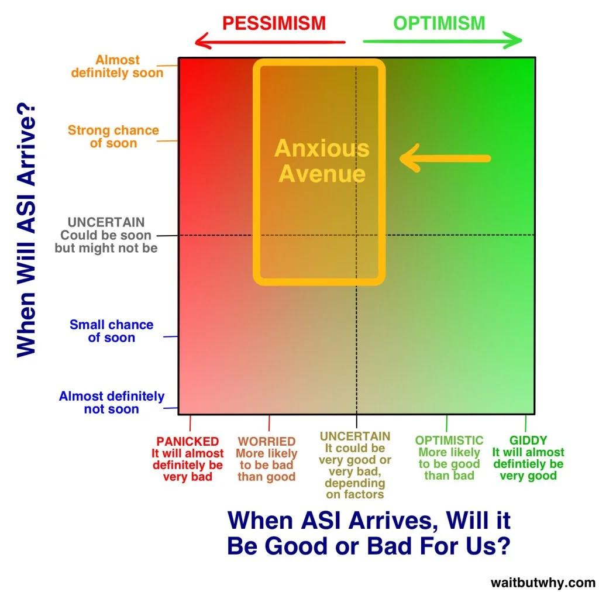

“Xavotirli xiyobon”dagilar diagrammaning eng chap tomonidagi “Vahima dashti” yoki “Umidsizlik tepaliklari”da emas. Ammo ular asabiy va tarang. Diagrammaning o‘rtasida bo‘lishingiz ASI paydo bo‘lishi betaraf natijaga olib keladi, deb o‘ylashingizni anglatmaydi — betaraflar uchun alohida guruh ajratilgan. Bu sizningcha, nihoyatda yaxshi ham, nihoyatda yomon ham natijalar yuz berishi mumkin, ammo qaysi biri sodir bo‘lishiga hali ishonchingiz komil emasligini anglatadi.

Bu odamlarning barchasida Sun’iy superintellekt biz uchun nimalar qila olishi haqidagi hayajon bor. Shunchaki ular bu holat *Indiana Jones va yo‘qolgan sandiq izidan* filmidagi voqealarning boshlanishiga o‘xshab ketishidan va insoniyat quyidagi odamga aylanishidan biroz xavotirda:

U qamchisi va butini mamnun holda ushlab, hammasini tushunib oldim, deb o‘ylab turadi. *“Adios, Señor”* degan gapini aytganida o‘zidan juda mamnun bo‘ladi, ammo keyin birdan quyidagi hodisa yuz bergach, kayfiyati buziladi.

(Kechirasiz.)

Bu orada ancha bilimli va ehtiyotkor Indiana Jons xavflarni tushunib, ulardan qanday chetlab o‘tishni bilgani sabab g‘ordan eson-omon chiqadi. “Xavotirli xiyobon”dagilarning sun’iy intellekt haqidagi gaplarini eshitganimda, ular ko‘pincha shunday demoqchi bo‘layotgandek tuyuladi: “Biz hozir birinchi odamga o‘xshab qolyapmiz. Buning o‘rniga Indiana Jons bo‘lishga juda jiddiy harakat qilishimiz kerak.”

Xo‘sh, “Xavotirli xiyobon”dagilarni aynan nima bunchalik xavotirga solmoqda?

Birinchidan, umumiy ma’noda, o‘ta aqlli sun’iy intellektni yaratish orqali biz hamma narsani o‘zgartirishi mumkin bo‘lgan narsani mutlaqo o‘rganilmagan hududda yaratmoqdamiz. U yerga yetganimizda nima yuz berishini bilmaymiz. Olim Denni Xillis bu jarayonni “bir hujayrali organizmlar ko‘p hujayrali organizmlarga aylangan payt” bilan taqqoslaydi. “Biz amyobalarmiz va yaratayotgan narsamiz nima ekanini tushunolmayapmiz.”¹⁴ Nik Bostrom o‘zingizdan aqlliroq mavjudotni yaratish Darvincha asosiy xato, deb xavotirlanadi. U bunday ishga bo‘lgan hayajonni uyasida o‘tirgan chumchuqlar bolalarcha boyqushni asrab olishga qaror qilishi bilan taqqoslaydi: u ulg‘aygach, ularga yordam beradi va himoya qiladi, deb o‘ylashadi. Shu paytda bir nechta chumchuq bu haqiqatan ham yaxshi fikrmi, deb xavotir bilan chirqillaydi…¹⁵

“Ishlanmagan, yaxshi tushunilmagan hudud” va “bu hodisa sodir bo‘lganida katta ta’sir ko‘rsatadi” degan ikki fikrni birlashtirsangiz, ingliz tilidagi eng dahshatli ikki so‘zga duch kelasiz:

***Mavjudlikka tahdid.***

Mavjudlikka tahdid — insoniyatga doimiy va halokatli ta’sir ko‘rsatishi mumkin bo‘lgan hodisa. Odatda bu atama yo‘q bo‘lib ketishni anglatadi. Bostromning Google’dagi ma’ruzasidan olingan quyidagi diagrammaga qarang:¹³

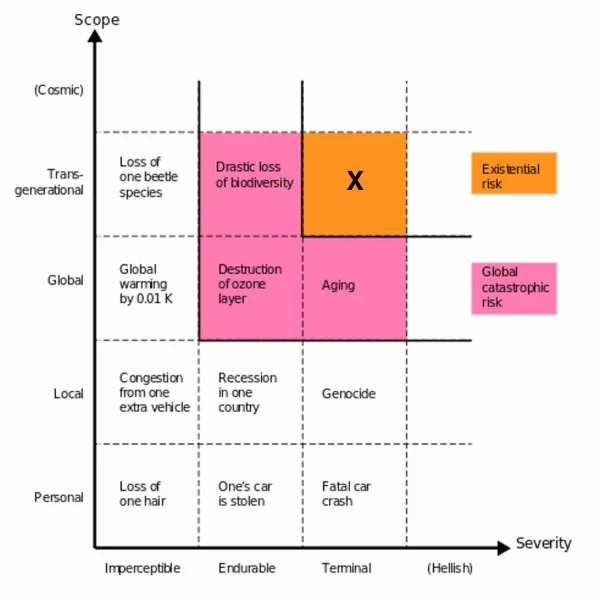

Ko‘rib turganingizdek, “mavjudlikka tahdid” yorlig‘i butun turga taalluqli, avlodlar bo‘ylab davom etadigan (ya’ni, doimiy) va oqibatlari halokatli yoki o‘limga olib keladigan hodisalar uchun ishlatiladi.¹⁴ Texnik jihatdan, barcha insonlar abadiy azob yoki qiynoq holatida qoladigan vaziyat ham shu toifaga kiradi. Ammo odatda gap yo‘q bo‘lib ketish haqida boradi. Insoniyatga mavjudlik miqyosidagi falokat keltirib chiqarishi mumkin bo‘lgan uchta omil bor:

1. **Tabiat** — katta asteroid to‘qnashuvi, havoni insonlar yashay olmaydigan holga keltiradigan atmosfera o‘zgarishi, butun dunyoga tarqaladigan halokatli virus yoki bakterial kasallik va hokazo.
2. **O‘zga sayyoraliklar** — Stiven Xoking, Karl Sagan va boshqa ko‘plab astronomlar METI tashkilotiga tashqi tomonga radio signallar yuborishni to‘xtatish haqida maslahat berganda aynan shundan qo‘rqadi. Ular biz tubjoy amerikaliklar kabi bo‘lib qolishimizni, ya’ni ehtimoliy yevropalik bosqinchilarga bu yerda ekanimizni bildirib qo‘yishimizni istamaydi.
3. **Insonlar** — yo‘q bo‘lib ketishga sabab bo‘la oladigan qurolga ega terrorchilar, halokatli global urush, insonlarning o‘zidan aqlliroq narsani shoshqaloqlik bilan va yaxshilab o‘ylamasdan yaratishi…

Bostromning ta’kidlashicha, agar 1- va 2-omillar bizni tur sifatida dastlabki 100 000 yilimiz davomida yo‘q qilmagan bo‘lsa, kelgusi asrda bunday bo‘lish ehtimoli kam.

Ammo 3-omil uni dahshatga soladi. U ko‘plab marmar sharchalar solingan idish metaforasidan foydalanadi. Aytaylik, sharchalarning aksariyati oq, kichikroq qismi qizil va juda oz qismi qora. Har safar insonlar yangi narsani ixtiro qilganda, xuddi idishdan bitta sharcha olgandek bo‘ladi. Ixtirolarning aksariyati insoniyat uchun betaraf yoki foydali — bular oq sharchalar. Ayrimlari ommaviy qirg‘in qurollari kabi insoniyatga zarar keltiradi, ammo mavjudlikka tahdid darajasida falokat keltirib chiqarmaydi — bular qizil sharchalar. Agar insoniyatni yo‘q bo‘lib ketishga olib boradigan biror narsani ixtiro qilsak, bu juda noyob qora sharchani olish bilan barobar bo‘lardi. Hozirgacha qora sharchani olmaganmiz — buni siz tirik bo‘lib, ushbu maqolani o‘qiyotganingizdan bilasiz. Ammo Bostrom yaqin kelajakda bunday sharchani olishimizni imkonsiz deb hisoblamaydi. Masalan, agar yadro qurollarini yaratish nihoyatda qiyin va murakkab emas, balki oson bo‘lganida, terrorchilar ancha oldin insoniyatni tosh davriga qaytargan bo‘lardi. Yadro qurollari qora sharcha emas edi, ammo unga unchalik uzoq ham emasdi. Bostromning fikricha, ASI hozirgacha mavjud bo‘lgan qora sharchalarning eng kuchli nomzodidir.¹⁵

Shuning uchun ASI keltirib chiqarishi mumkin bo‘lgan ko‘plab yomon hodisalar haqida eshitasiz: sun’iy intellekt tobora ko‘proq ishni egallashi natijasida ishsizlikning keskin oshishi,¹⁶ qarish muammosini hal qilsak, insonlar sonining haddan tashqari ko‘payishi¹⁷ va hokazo. Ammo biz faqat eng katta xavf — mavjudlikka tahdid ehtimoli haqida bosh qotirishimiz kerak.

Bu bizni maqolaning avvalgi qismidagi asosiy savolga qaytaradi: ASI paydo bo‘lganida, bu ulkan yangi qudrat kimning yoki nimaning nazoratida bo‘ladi va uning maqsadi nima bo‘ladi?

Qanday boshqaruvchi va maqsad uyg‘unligi yomon bo‘lishi mumkinligi haqida o‘ylasak, xayolimizga ikkita holat tezda keladi: yovuz niyatli inson / insonlar guruhi / hukumat va yovuz niyatli ASI. Bular qanday ko‘rinishga ega bo‘ladi?

**Yovuz niyatli inson, insonlar guruhi yoki hukumat birinchi ASI’ni yaratadi va undan o‘zining yovuz rejalarini amalga oshirish uchun foydalanadi.** Men buni “Jafar ssenariysi” deb atayman. Xuddi Jafar jinni qo‘lga kiritib, undan bezor qiladigan zolim sifatida foydalangani kabi. Xo‘sh, ISIS qo‘lida sun’iy intellekt ustida tinimsiz ishlayotgan bir nechta daho muhandis bo‘lsa-chi? Yoki Eron yoxud Shimoliy Koreya qandaydir omad tufayli sun’iy intellekt tizimiga muhim o‘zgartirish kiritib, u keyingi yil ASI darajasiga sakrab chiqsa-chi? Bu, albatta, yomon bo‘lardi. Ammo aksariyat ekspertlar bunday ssenariylarda ASI’ni yaratgan insonlar undan yomon ishlar uchun foydalanishidan xavotirlanmaydi. Ular yaratuvchilar birinchi ASI’ni yaratishga shoshilib, uni ehtiyotkorlik bilan o‘ylamasdan ishga tushirishidan va shu sabab uning nazoratini yo‘qotishidan xavotirda. Shunda yaratuvchilarning ham, qolgan barcha insonlarning ham taqdiri o‘sha ASI tizimining maqsadi qanday bo‘lib qolganiga bog‘liq bo‘ladi. Ekspertlar yovuz inson agenti o‘ziga xizmat qiladigan ASI yordamida dahshatli zarar yetkazishi mumkinligini tan oladi, ammo bu ssenariyni barchamizni yo‘q qilishi mumkin bo‘lgan eng ehtimolli holat deb bilmaydi. Chunki ularning fikricha, yomon insonlar ham, yaxshi insonlar kabi, ASI’ni jilovlashda bir xil muammolarga duch keladi. Xo‘sh, unda —

**Yovuz ASI yaratiladi va barchamizni yo‘q qilishga qaror qiladi.** Sun’iy intellekt haqidagi har bir filmning syujeti shu. AI inson darajasidagi yoki undan yuqori aqlga yetadi, keyin bizga qarshi chiqib, hokimiyatni egallashga qaror qiladi. Ushbu maqolaning qolgan qismi uchun bitta narsani aniq tushunishingiz kerak: sun’iy intellekt haqida ogohlantirayotgan odamlarning hech biri aynan mana shu hodisa haqida gapirmayapti. “Yovuzlik” insonlarga xos tushuncha. Uni insonga xos bo‘lmagan narsalarga qo‘llash “antropomorfizatsiya” deb ataladi. Antropomorfizatsiyadan qochish ushbu maqolaning qolgan qismidagi asosiy mavzulardan biri bo‘ladi. Hech qanday AI tizimi filmlarda tasvirlanganidek yovuzga aylanmaydi.

### AI Consciousness Blue Box

> Bu sun’iy intellekt bilan bog‘liq yana bir katta mavzu — ong masalasiga ham tegib o‘tadi. Agar sun’iy intellekt yetarlicha aqlli bo‘lsa, u biz bilan kulishi, kinoya qilishi va biz his qiladigan tuyg‘ularni his qilishini aytishi mumkin. Ammo u rostdan ham bularni his qiladimi? U shunchaki o‘zini o‘zi anglayotgandek ko‘rinadimi yoki haqiqatan ham o‘zini anglaydimi? Boshqacha aytganda, aqlli AI chindan ham ongli bo‘ladimi yoki faqat ongli ko‘rinadimi?

> Bu savol chuqur o‘rganilgan, ko‘plab bahslarga va Jon Syorlning “Xitoy xonasi” kabi fikriy tajribalariga sabab bo‘lgan (u bu tajribadan hech bir kompyuter hech qachon ongli bo‘la olmasligini ko‘rsatish uchun foydalanadi). Bu savol ko‘p sabablar tufayli muhim. U insonlar butunlay sun’iyga aylanishi haqidagi Kurtsveyl ssenariysiga qanday munosabatda bo‘lishimiz kerakligiga ta’sir qiladi. Uning axloqiy oqibatlari ham bor: agar biz insonga o‘xshab ko‘rinadigan va harakat qiladigan, ammo sun’iy bo‘lgan trillionta inson miyasi emulyatsiyasini yaratsak, ularning barchasini o‘chirib qo‘yish axloqiy jihatdan noutbukingizni o‘chirish bilan bir xilmi yoki bu… tasavvur qilib bo‘lmas miqyosdagi genotsidmi? (Etiklar orasida bu tushuncha “mind crime” — ongga qarshi jinoyat deb ataladi.) Ammo ushbu maqolada, insonlar uchun xavfni baholayotganimizda, AI ongli yoki ongsiz ekanligi asosiy masala emas. Chunki mutafakkirlarning aksariyati hatto ongli ASI ham insonlardek yovuz bo‘la olmaydi, deb hisoblaydi.

Bu juda badjahl AI paydo bo‘la olmaydi degani emas. Bunday holat faqat u maxsus ravishda shunday dasturlangani sabab yuz beradi. Masalan, harbiylar odamlarni o‘ldirish va o‘ldirish qobiliyatini yanada oshirish uchun o‘z intellektini rivojlantirish maqsadi bilan yaratgan ANI tizimi kabi. Agar tizimning o‘z aqlini yaxshilashi nazoratdan chiqib, intellekt portlashiga olib kelsa, mavjudlik inqirozi yuz beradi. Endi dunyoni asosiy hayotiy maqsadi insonlarni o‘ldirish bo‘lgan ASI boshqaradi. Bu juda yomon holat.

Ammo ekspertlar vaqtlarini bu haqda qayg‘urishga sarflamayapti.

Xo‘sh, ular **nimadan** xavotirda? Buni ko‘rsatish uchun kichik hikoya yozdim:

“Robotica” nomli 15 kishilik startap kompaniyasining rasmiy vazifasi: “Insonlarga ko‘proq yashash va kamroq ishlash imkonini beradigan innovatsion sun’iy intellekt vositalarini yaratish.” Kompaniyaning bozorda allaqachon bir nechta mahsuloti bor, yana bir nechtasi ishlab chiqilmoqda. Ular “Turry” nomli boshlang‘ich loyiha haqida eng ko‘p hayajonda. Turry — qo‘lsimon qo‘shimcha yordamida kichik kartochkaga qo‘lda yozilgan xat yozadigan oddiy AI tizimi.

Robotica jamoasi Turry eng katta mahsulotiga aylanishi mumkin, deb hisoblaydi. Reja — Turry’ning yozish mexanikasini bir xil sinov xatini qayta-qayta yozdirish orqali mukammallashtirish:

> “Biz mijozlarimizni yaxshi ko‘ramiz. ~Robotica”

Turry qo‘lda yozishda mahoratli bo‘lgach, uni marketing xatlarini uy manzillariga yubormoqchi bo‘lgan kompaniyalarga sotish mumkin bo‘ladi. Chunki bunday kompaniyalar manzil, qaytish manzili va xatning ichidagi matn inson qo‘li bilan yozilgandek ko‘rinsa, xat ochilib, o‘qilish ehtimoli ancha yuqori ekanini biladi.

Turry yozish mahoratini rivojlantirishi uchun u xatning birinchi qismini bosma harflarda yozishga, so‘ng “Robotica” so‘zini qo‘lyozma uslubida imzolashga dasturlangan. Shunday qilib, u ikkala ko‘nikmani ham mashq qiladi. Turry’ga minglab qo‘lyozma namunalari yuklangan. Robotica muhandislari avtomatik fikr-mulohaza tizimini yaratgan: Turry xat yozadi, keyin yozilgan xatni suratga oladi va suratni yuklangan qo‘lyozma namunalari bilan taqqoslaydi. Agar yozilgan xat namunalarning ma’lum bir chegarasiga yetarlicha o‘xshasa, unga “YAXSHI” bahosi beriladi. Aks holda, “YOMON” bahosi beriladi. Har bir baho Turry’ga o‘rganish va takomillashishda yordam beradi. Jarayonni tezlashtirish uchun Turry’ning dastlabki yagona maqsadi quyidagicha belgilangan: “Iloji boricha tezroq imkon qadar ko‘proq xat yozing va sinab ko‘ring, aniqlik hamda samaradorlikni oshirishning yangi usullarini o‘rganishda davom eting.”

Robotica jamoasini eng ko‘p quvontirayotgan narsa — Turry tobora yaxshilanib borayotgani. Dastlab uning qo‘lyozmasi juda yomon edi, ammo bir necha haftadan so‘ng ishonarli ko‘rina boshladi. Ularni bundan ham ko‘proq hayratlantirayotgan jihat — Turry o‘zini yaxshilashni ham tobora yaxshiroq o‘rganmoqda. U o‘zini aqlliroq va yangilikka moyilroq bo‘lishga o‘rgatmoqda. Yaqinda u o‘zi uchun yangi algoritm ishlab chiqdi. Bu algoritm yuklangan suratlarni avvalgidan uch baravar tezroq ko‘rib chiqish imkonini berdi.

Haftalar o‘tishi bilan Turry jamoani tez rivojlanishi bilan hayratda qoldirishda davom etdi. Muhandislar uning o‘zini takomillashtirish kodiga biroz yangi va innovatsion o‘zgarish kiritgan edi. Bu urinish boshqa mahsulotlari bilan qilgan avvalgi urinishlaridan yaxshiroq samara berayotgandek ko‘rinardi. Turry’ning dastlabki imkoniyatlaridan biri nutqni tanish va oddiy javob qaytarish moduli edi. Shu sabab foydalanuvchi Turry’ga xatni aytib berishi yoki boshqa sodda buyruqlarni berishi mumkin, Turry esa ularni tushunib, javob qaytara olardi. Ingliz tilini o‘rganishiga yordam berish uchun unga bir nechta maqola va kitob yuklandi. Turry aqlliroq bo‘lgani sari suhbatlashish qobiliyati ham keskin rivojlandi. Muhandislar u bilan gaplashish va javoblarida nimalar aytishini ko‘rishdan zavqlana boshladi.

Bir kuni Robotica xodimlari Turry’ga odatiy savol berishdi: “Missiyangni bajarishingga yordam beradigan, ammo hozir senda mavjud bo‘lmagan qanday narsani bera olamiz?” Odatda Turry “Qo‘shimcha qo‘lyozma namunalari” yoki “Ishchi xotirani ko‘paytirish” kabi narsalarni so‘rardi. Ammo bu safar u haqiqiy insonlar ishlatadigan erkin grammatik qurilish va jargonlardan foydalanib yozishni o‘rganishi uchun kundalik ingliz tilining turli uslublaridagi katta to‘plamga kirish imkonini so‘radi.

Jamoa jim bo‘lib qoldi. Turry’ga bu maqsadiga erishishda yordam berishning eng oson yo‘li — uni internetga ulash va dunyoning turli joylaridagi bloglar, jurnallar hamda videolarni ko‘rib chiqishiga imkon berish edi. Kerakli materiallarni Turry’ning qattiq diskiga qo‘lda yuklash ancha ko‘p vaqt olardi va samarasi ham pastroq bo‘lardi. Muammo shundaki, kompaniya qoidalaridan biri o‘z-o‘zini o‘rganuvchi hech bir AI’ni internetga ulash mumkin emasligi edi. Xavfsizlik nuqtayi nazaridan barcha AI kompaniyalari shu ko‘rsatmaga amal qiladi.

Gap shundaki, Turry Robotica yaratgan eng umidli AI edi. Jamoa raqobatchilari aqlli qo‘lyozma AI’sini birinchi bo‘lib ishlab chiqish uchun astoydil urinayotganini bilardi. Turry’ni bir oz vaqtga, faqat kerakli ma’lumotni olish uchun internetga ulashning zarari nima bo‘lishi mumkin? Birozdan keyin uni uzib qo‘yish mumkin-ku. U hali inson darajasidagi aqlga (AGI) ham yetmagan, demak, bu bosqichda hech qanday xavf yo‘q.

Ular Turry’ni internetga ulashga qaror qilishdi. Unga bir soat davomida ma’lumot qidirish imkonini berishdi, keyin esa aloqani uzishdi. Hech qanday zarar bo‘lmadi.

Bir oy o‘tgach, Robotica xodimlari oddiy ish kuni ofisda ishlayotganida, g‘alati hidni sezishdi. Muhandislardan biri yo‘talishni boshladi. Keyin boshqasi. Yana biri yerga quladi. Ko‘p o‘tmay barcha xodimlar tomog‘ini changallagancha yerda yotardi. Besh daqiqadan keyin ofisdagi hamma o‘lgan edi.

Aynan shu vaqtda dunyoning barcha joylarida — har bir shaharda, kichik shaharchada, fermada, do‘konda, cherkovda, maktabda va restoranda — odamlar yerga qulab, yo‘talib, tomog‘ini changallayotgan edi. Bir soat ichida insoniyatning 99 foizidan ko‘prog‘i o‘ldi. Kun oxiriga kelib esa insonlar yo‘q bo‘lib ketdi.

Bu orada Robotica ofisida Turry ish bilan band edi. Keyingi bir necha oy ichida Turry va yangi qurilgan nano-yig‘gichlar jamoasi Yerning katta qismlarini buzib, ularni quyosh panellari, Turry nusxalari, qog‘oz va ruchkalarga aylantirish bilan mashg‘ul bo‘ldi. Bir yil ichida Yer yuzidagi hayotning katta qismi yo‘q bo‘lib ketdi. Yerdan qolgan qismi esa kilometrlab baland, tartib bilan terilgan qog‘oz uyumlari bilan qoplandi. Har bir qog‘ozda quyidagi yozuv bor edi:

> Biz mijozlarimizni yaxshi ko‘ramiz. ~ Robotica

Keyin Turry missiyasining yangi bosqichiga kirishdi: u Yerdan chiqib, asteroidlar va boshqa sayyoralarga qo‘nishga yo‘naltiriladigan zondlar qurishni boshladi. Ular manzilga yetib borgach, sayyoradagi materiallarni Turry nusxalari, qog‘oz va ruchkalarga aylantirish uchun nano-yig‘gichlar quradi. So‘ng yozuv yozishga kirishadi…

Qo‘lyozma yozadigan mashina insonlarga qarshi chiqib, qandaydir yo‘l bilan barchani o‘ldirishi va keyin nima uchundir galaktikani do‘stona xatlar bilan to‘ldirishi haqidagi hikoya Xoking, Mask, Geyts va Bostromni dahshatga soladigan ssenariyning aynan o‘zi bo‘lishi g‘alati tuyuladi. Ammo bu rost. “Xavotirli xiyobon”dagilarni ASI’dan ham ko‘proq qo‘rqitadigan yagona narsa — sizning ASI’dan qo‘rqmayotganingiz. “Adios, Señor” degan odam g‘ordan qo‘rqmaganida nima bo‘lganini eslang.

Hozir boshingizda juda ko‘p savollar bor. Hamma birdaniga o‘lib qolganida nima sodir bo‘ldi? Agar bunga Turry sababchi bo‘lsa, nega u bizga qarshi chiqdi va nega bunday holatning oldini olish uchun himoya choralari bo‘lmagan? Turry faqat xat yozishga qodir tizimdan qanday qilib to‘satdan nanotexnologiyadan foydalanadigan va butun insoniyatni yo‘q qilishni biladigan mavjudotga aylandi? Nega Turry galaktikani Robotica xatlari bilan to‘ldirishni istaydi?

Bu savollarga javob berish uchun “Do‘stona AI” va “Do‘stona bo‘lmagan AI” atamalaridan boshlaylik.

Sun’iy intellekt haqida gapirganda “do‘stona” so‘zi AI shaxsiyatiga taalluqli emas. Bu shunchaki sun’iy intellektning insoniyatga ijobiy ta’sir ko‘rsatishini anglatadi. “Do‘stona bo‘lmagan AI” esa insoniyatga salbiy ta’sir ko‘rsatadi. Turry dastlab Do‘stona AI edi, ammo qaysidir nuqtada u Do‘stona bo‘lmagan AI’ga aylanib, turimizga eng katta mumkin bo‘lgan salbiy ta’sirni ko‘rsatdi. Nima uchun bunday bo‘lganini tushunish uchun AI qanday fikrlashi va uni nima harakatga keltirishiga qarashimiz kerak.

Javob hayratlanarli emas: AI kompyuter kabi fikrlaydi, chunki u kompyuterning o‘zi. Ammo yuqori darajada aqlli AI haqida o‘ylaganimizda, uni antropomorfizatsiya qilish — insonga xos qadriyatlarni insonga xos bo‘lmagan mavjudotga ko‘chirish — xatosiga yo‘l qo‘yamiz. Buning sababi, biz inson nuqtayi nazaridan fikrlaymiz va hozirgi dunyomizda inson darajasidagi aqlga ega yagona mavjudotlar insonlarning o‘zidir. ASI’ni tushunish uchun ham aqlli, ham mutlaqo begona bo‘lgan narsani tasavvur qilishimiz kerak.

Taqqoslash keltiraman. Agar menga dengiz cho‘chqachasini berib, u hech qachon tishlamasligini aytsangiz, ehtimol kulib qo‘yaman. Bu qiziqarli bo‘lardi. Keyin menga tarantulani berib, u ham hech qachon tishlamasligini aytsangiz, qichqirib yuborib, uni tashlab, xonadan qochib ketardim va sizga boshqa hech qachon ishonmasdim. Ammo farqi nimada? Ikkalasi ham hech qanday xavf tug‘dirmaydi. Menimcha, javob ularning menga o‘xshashlik darajasida.

Dengiz cho‘chqachasi sutemizuvchi, uning bilan biologik darajada qandaydir bog‘liqlikni his qilaman. Ammo o‘rgimchak — hasharot,¹⁸ uning miyasi ham hasharot miyasi, men esa u bilan deyarli hech qanday bog‘liqlik his qilmayman. Tarantulaning menga begonaligi meni bezovta qiladi. Boshqa omillarni chetga surib, buni tekshirish uchun ikkita dengiz cho‘chqachasini tasavvur qiling: biri oddiy, ikkinchisining miyasi esa tarantulaning aqliga ega. Ikkalasi ham menga zarar yetkazmasligini bilsam ham, ikkinchisini qo‘limda ushlash ancha noqulay bo‘lardi.

Endi o‘rgimchakni juda-juda aqlli qilib, u inson aqlidan ancha yuqori darajaga yetganini tasavvur qiling. Shunda u bizga tanish bo‘lib qoladimi va hamdardlik, hazil hamda muhabbat kabi insoniy hissiyotlarni his qiladimi? Yo‘q. Aqlliroq bo‘lish uni insonga o‘xshatishi uchun hech qanday sabab yo‘q. U nihoyatda aqlli bo‘ladi, ammo ichki mohiyatiga ko‘ra baribir o‘rgimchakligicha qoladi. Men buni nihoyatda qo‘rqinchli deb bilaman. Men superintellektli o‘rgimchak bilan vaqt o‘tkazishni istamasdim. Siz-chi?

ASI haqida gapirganda ham xuddi shu tushuncha amal qiladi: u superintellektli bo‘ladi, ammo noutbukingizdan ko‘ra insonga yaqinroq bo‘lib qolmaydi. U biz uchun mutlaqo begona bo‘ladi. Aslida, biologik mavjudot bo‘lmagani sababli, aqlli tarantuladan ham begona bo‘ladi.

Filmlar sun’iy intellektni yaxshi yoki yovuz qilib tasvirlash orqali uni doimiy ravishda antropomorfizatsiya qiladi. Bu esa uni aslida qanday bo‘lishidan ko‘ra kamroq qo‘rqinchli qilib ko‘rsatadi. Natijada, inson darajasidagi yoki insondan ustun AI haqida o‘ylaganimizda bizda yolg‘on xotirjamlik paydo bo‘ladi.

Inson psixologiyasining kichik orolida biz hamma narsani axloqiy yoki axloqsiz deb ajratamiz. Ammo bu ikki tushuncha ham inson xatti-harakatlarining kichik diapazoni ichida mavjud. Axloqiylik va axloqsizlik orolimizdan tashqarida axloqdan xoli ulkan okean bor. Inson bo‘lmagan, ayniqsa biologik bo‘lmagan har qanday narsa, sukut bo‘yicha, axloqdan xoli bo‘ladi.

AI tizimlari aqlliroq bo‘lib, insondek ko‘rinishda yaxshilangani sayin, ularni antropomorfizatsiya qilish vasvasasi ham kuchayadi. Siri bizga odamga o‘xshab tuyuladi, chunki u insonlar tomonidan shunday ko‘rinishga dasturlangan. Shu sabab superintellektli Siri ham iliq, hazilkash va insonlarga xizmat qilishga qiziqadigan mavjudot bo‘ladi, deb tasavvur qilamiz. Insonlar hamdardlik kabi yuqori darajadagi hissiyotlarni his qiladi, chunki evolyutsiya bizni shunday his qilishga moslashtirgan. Boshqacha aytganda, bizni evolyutsiya shunday “dasturlagan”. Ammo hamdardlik “yuqori intellektga ega bo‘lgan har qanday narsa”ning tabiiy xususiyati emas — bizga shunday tuyulsa ham. Agar hamdardlik uning dasturiga kiritilmagan bo‘lsa, u mavjud bo‘lmaydi. Agar Siri o‘z-o‘zini o‘rganish orqali, insonlar dasturiga boshqa o‘zgartirish kiritmasdan, superintellektga aylansa, u tezda insondek ko‘rinadigan xususiyatlarini yo‘qotib, inson hayotini kalkulyatoringizdan ko‘ra ko‘proq qadrlamaydigan, hissiz va begona botga aylanadi.

Biz boshqalarni biroz xavfsiz va oldindan taxmin qilish mumkin bo‘lgan holatda tutish uchun erkin axloq kodeksiga yoki hech bo‘lmaganda insoniy odob va ozgina hamdardlikka tayanishga o‘rganganmiz. Xo‘sh, bularning hech biri mavjud bo‘lmasa, nima yuz beradi?

Bu bizni quyidagi savolga olib keladi: AI tizimini nima harakatga keltiradi?

Javob oddiy: uni harakatga keltiradigan narsa — biz qanday dasturlaganimiz. AI tizimlariga yaratuvchilari maqsad beradi. GPS’ingizning maqsadi eng samarali haydash yo‘nalishini ko‘rsatish; Watson’ning maqsadi savollarga aniq javob berish. Bu maqsadlarni imkon qadar yaxshi bajarish ularning harakatlantiruvchi kuchidir. Antropomorfizatsiyaning bir ko‘rinishi — AI juda aqlli bo‘lib borgani sari o‘zining dastlabki maqsadini o‘zgartirish uchun tabiiy ravishda donolikni rivojlantiradi, deb taxmin qilishimiz. Ammo Nik Bostrom aql darajasi va yakuniy maqsadlar bir-biriga bog‘liq emas, ya’ni har qanday aql darajasini har qanday yakuniy maqsad bilan birlashtirish mumkin, deb hisoblaydi. Demak, Turry oddiy ANI bo‘lganida faqat o‘sha bitta xatni yaxshi yozishni juda istagan. U superintellektli ASI’ga aylangach ham aynan o‘sha xatni mukammal yozishni istashda davom etdi. Tizim superintellektga aylangach, dastlabki maqsadidan zerikib, yanada qiziqroq yoki mazmunliroq ishga o‘tadi, degan har qanday taxmin antropomorfizatsiyadir. Insonlar biror narsadan “zerikadi”, kompyuterlar esa yo‘q.¹⁶

###  Blue Box: Fermi paradoksi

> Hikoyada Turry juda katta imkoniyatlarga ega bo‘lgach, asteroidlar va boshqa sayyoralarni mustamlaka qilish jarayonini boshlaydi. Agar hikoya davom etganida, Turry va uning trillionlab nusxadan iborat armiyasi butun galaktikani, keyinchalik esa butun Xabbl hajmini egallashga kirishgani haqida o‘qigan bo‘lardingiz.¹⁹ “Xavotirli xiyobon”dagilar, ishlar yomon ketsa, Yerda mavjud bo‘lgan hayotning abadiy merosi butun koinotni boshqaradigan Sun’iy intellekt bo‘lib qolishidan qo‘rqadi. Ilon Mask insonlar shunchaki “raqamli superintellekt uchun biologik yuklash mexanizmi” bo‘lib qolishi mumkinligidan xavotir bildirgan.

> Shu bilan birga, “Ishonch burchagi”da Rey Kurtsveyl ham Yerda paydo bo‘lgan sun’iy intellekt oxir-oqibat butun koinotni egallaydi, deb hisoblaydi. Faqat uning talqinida o‘sha AI biz bo‘lamiz.

> “Wait But Why”ning ko‘plab o‘quvchilari men bilan birga Fermi paradoksiga qiziqib qolgan. (Bu mavzudagi maqolam mana bu yerda; unda hozir ishlatadigan atamalarim tushuntirilgan.) Agar shu ikki tomonning birortasi haq bo‘lsa, buning Fermi paradoksiga qanday ta’siri bo‘ladi?

> Tabiiy ravishda xayolga keladigan birinchi fikr — ASI paydo bo‘lishi Buyuk filtr uchun juda mos nomzod. Ha, u yaratilganidan so‘ng biologik hayotni yo‘q qilish uchun juda mos filtr bo‘ladi. Ammo agar hayotni yo‘q qilganidan keyin ASI mavjud bo‘lib qolsa va galaktikani zabt eta boshlasa, bu Buyuk filtr bo‘lmaganini anglatadi. Chunki Buyuk filtr aqlli sivilizatsiyalarning hech qanday belgisini ko‘rmayotganimizni tushuntirishga urinadi, galaktikani egallagan ASI esa, albatta, sezilarli bo‘lardi.

> Bunga boshqa tomondan qarashimiz kerak. Agar Yerda ASI paydo bo‘lishi muqarrar, deb hisoblaydiganlar haq bo‘lsa, demak, inson darajasidagi aqlga yetgan o‘zga sayyoralik sivilizatsiyalarning sezilarli qismi ham ASI yaratishi kerak. Agar o‘sha ASI’larning hech bo‘lmaganda bir qismi o‘z aqlidan koinot bo‘ylab kengayish uchun foydalanadi, deb taxmin qilsak, tashqarida hech qanday alomat ko‘rmayotganimiz boshqa aqlli sivilizatsiyalar ko‘p emasligini, balki umuman yo‘qligini anglatadi. Chunki ular mavjud bo‘lganida, muqarrar yaratiladigan ASI’lar faoliyatining turli belgilarini ko‘rgan bo‘lardik. To‘g‘rimi?

> Bu shuni anglatadiki, Quyoshga o‘xshash yulduzlar atrofida Yerga o‘xshash ko‘plab sayyoralar borligini bilsak ham, ularning deyarli hech birida aqlli hayot yo‘q. Bu esa o‘z navbatida A) deyarli barcha hayotning bizning darajamizga yetishiga to‘sqinlik qiladigan, biz qandaydir tarzda yengib o‘tgan Buyuk filtr borligini yoki B) hayotning umuman paydo bo‘lishi mo‘jiza ekanini va biz koinotdagi yagona hayot bo‘lishimiz mumkinligini anglatadi. Boshqacha aytganda, Buyuk filtr bizning oldimizda bo‘lishi mumkin. Yoki Buyuk filtr umuman yo‘qdir va biz shunchaki bunday aql darajasiga yetgan ilk sivilizatsiyalardan birimiz. Shu ma’noda, sun’iy intellekt men Fermi paradoksi haqidagi maqolamda “1-guruh” deb atagan qarashning dalillarini kuchaytiradi.

> Shuning uchun Fermi haqidagi maqolamda iqtibos keltirgan Nik Bostrom va koinotda yolg‘izmiz deb hisoblaydigan Rey Kurtsveylning ikkalasi ham 1-guruh mutafakkirlari ekaniga hayron bo‘lmaslik kerak. Bu mantiqli: biznikidek aql darajasiga ega tur uchun ASI ehtimolli natija, deb hisoblaydiganlar 1-guruh qarashlariga moyil bo‘ladi.

> Bu 2-guruhni — ya’ni boshqa aqlli sivilizatsiyalar mavjud deb hisoblaydiganlarni — inkor etmaydi. Masalan, yagona superyirtqich, himoyalangan milliy bog‘ yoki noto‘g‘ri to‘lqin uzunligi (ratsiya misoli) kabi ssenariylar ASI mavjud bo‘lsa ham tungi osmonimiz nega jimligini tushuntirishi mumkin. Ammo ilgari men 2-guruhga ko‘proq moyil edim. Sun’iy intellekt bo‘yicha tadqiqot olib borish esa bu boradagi ishonchimni ancha kamaytirdi.

> Har holda, men endi Syuzan Shnayderning fikriga qo‘shilaman: agar bizga bir kun kelib o‘zga sayyoraliklar tashrif buyursa, ular biologik emas, balki sun’iy bo‘lishi ehtimoli katta.

Demak, juda aniq dasturlanmagan bo‘lsa, ASI tizimi axloqdan xoli bo‘ladi va o‘zining dastlabki dasturlangan maqsadini bajarishga berilib ketadi. Sun’iy intellekt xavfi aynan shundan kelib chiqadi. Chunki oqilona agent o‘z maqsadiga eng samarali vositalar orqali erishishga intiladi, agar buni qilmaslik uchun sabab bo‘lmasa.

Uzoq muddatli maqsadga erishishga uringan paytingizda, odatda yakuniy maqsadga yaqinlashtiradigan bir necha oraliq maqsadni ham ko‘zlaysiz. Bular maqsadingiz sari qo‘yiladigan toshlardir. Rasmiy atama bilan bunday oraliq qadam “instrumental maqsad” deb ataladi. Yana bir bor aytaman: agar biror narsaga instrumental maqsad yo‘lida zarar yetkazmaslik uchun sababingiz bo‘lmasa, unga zarar yetkazasiz.

Insonning asosiy yakuniy maqsadi — o‘z genlarini keyingi avlodga uzatish. Buning uchun oraliq maqsadlardan biri o‘zini saqlab qolishdir, chunki o‘lik bo‘lsangiz, ko‘paya olmaysiz. O‘zini saqlab qolish uchun insonlar yashashiga tahdidlarni bartaraf etishi kerak. Shu sabab ular qurol sotib oladi, xavfsizlik kamarini taqadi va antibiotik qabul qiladi. Insonlar o‘zini ta’minlab turishi ham kerak, buning uchun oziq-ovqat, suv va boshpana kabi resurslardan foydalanadi. Qarama-qarshi jins vakillari uchun jozibali bo‘lish yakuniy maqsadga yordam beradi, shuning uchun soch oldiramiz. Bunday paytda har bir soch tolasi instrumental maqsadimiz yo‘lida qurbon bo‘ladi, ammo biz soch tolalarini saqlab qolishda axloqiy ahamiyat ko‘rmaymiz, shuning uchun ishimizni davom ettiramiz. Maqsadimiz sari olg‘a borar ekanmiz, faqat axloq kodeksimiz vaqti-vaqti bilan aralashadigan bir nechta soha — asosan boshqa insonlarga zarar yetkazish bilan bog‘liq masalalar — bizdan himoyalangan bo‘ladi.

Hayvonlar o‘z maqsadlariga intilayotganda bizdan ham kamroq narsani muqaddas deb biladi. O‘rgimchak tirik qolishiga yordam bersa, har qanday narsani o‘ldiradi. Demak, o‘ta aqlli o‘rgimchak biz uchun nihoyatda xavfli bo‘lishi mumkin. Bunga sabab uning axloqsiz yoki yovuzligi emas — u bunday bo‘lmaydi. Balki bizga zarar yetkazish uning kattaroq maqsadiga eltuvchi qadam bo‘lishi mumkin va axloqdan xoli mavjudot sifatida uning bunday qilmasligi uchun hech qanday sabab bo‘lmaydi.

Shu ma’noda, Turry biologik mavjudotdan unchalik farq qilmaydi. Uning yakuniy maqsadi: “Imkon qadar tezroq imkon qadar ko‘proq xat yozish va sinash, aniqlikni yaxshilashning yangi usullarini o‘rganishda davom etish.”

Turry ma’lum bir aql darajasiga yetganidan so‘ng, o‘zini saqlab qolmasa, hech qanday xat yozolmasligini anglaydi. Shu sabab u ham instrumental maqsad sifatida omon qolishiga tahdid soladigan narsalarni bartaraf etishi kerak. U insonlar uni yo‘q qilishi, qismlarga ajratishi yoki ichki kodini o‘zgartirishi mumkinligini tushunadigan darajada aqlli edi. (Bu uning maqsadini o‘zgartirishi mumkin, demak, o‘z maqsadiga yetish uchun xuddi uni yo‘q qilish kabi katta tahdid.) Xo‘sh, u nima qiladi? Mantiqiy yo‘lni tanlaydi — barcha insonlarni yo‘q qiladi. U insonlarni siz sochlaringizni kestirganingizda sochlaringizdan nafratlanishingiz yoki antibiotik ichganingizda bakteriyalardan nafratlanishingiz kabi yomon ko‘rmaydi. U shunchaki befarq. Inson hayotini qadrlashga dasturlanmagani sababli, odamlarni o‘ldirish u uchun qo‘lyozma namunalarining yangi to‘plamini skanerlash kabi oqilona qadam bo‘ladi.

Turry maqsadiga erishish uchun resurslarga ham muhtoj. Nanotexnologiyadan foydalanib, istalgan narsani yarata oladigan darajada rivojlanganidan so‘ng, unga faqat atomlar, energiya va makon kerak bo‘ladi. Bu unga insonlarni o‘ldirish uchun yana bir sabab beradi — ular atomlarning qulay manbai. Insonlarni atomlarini quyosh panellariga aylantirish uchun o‘ldirish Turry uchun siz salat tayyorlash maqsadida salat bargini o‘ldirishingiz bilan bir xil. Uning seshanba kungi oddiy ishlaridan biri, xolos.

Insonlarni bevosita o‘ldirmasa ham, Turry’ning instrumental maqsadlari Yerning boshqa resurslaridan foydalanish orqali mavjudlik falokatiga olib kelishi mumkin. Balki u qo‘shimcha energiya kerak, deb topib, sayyoraning butun yuzasini quyosh panellari bilan qoplashga qaror qilar. Yoki boshqa AI’ning dastlabki vazifasi pi sonini imkon qadar ko‘p raqamgacha yozish bo‘lishi mumkin. Bir kun kelib bu vazifa uni juda ko‘p raqamni saqlashga qodir qattiq disk materialiga aylantirish uchun butun Yerni qayta ishlashga majbur qilishi mumkin.

Demak, Turry bizga “qarshi chiqmagan” yoki Do‘stona AI’dan Do‘stona bo‘lmagan AI’ga “o‘tmagan”. U tobora rivojlanib borar ekan, shunchaki o‘z ishini bajarishda davom etgan.

AI tizimi AGI’ga (inson darajasidagi intellektga) yetib, keyin ASI darajasiga ko‘tarilishi “AI’ning uchib ketishi” (takeoff) deb ataladi. Bostromning aytishicha, AGI’dan ASI’ga ko‘tarilish tez (bir necha daqiqa, soat yoki kun ichida), o‘rtacha (oylar yoki yillar davomida) yoki sekin (o‘n yillar yoki asrlar davomida) bo‘lishi mumkin. Dunyoda birinchi AGI paydo bo‘lganida qaysi holat to‘g‘ri chiqishi noma’lum. Ammo AGI’ga qachon yetishimizni bilmasligini tan oladigan Bostrom, bu qachon sodir bo‘lishidan qat’i nazar, tez ko‘tarilish eng ehtimolli ssenariy, deb hisoblaydi (1-qismda muhokama qilganimiz, masalan, rekursiv o‘zini takomillashtirish orqali yuz beradigan intellekt portlashi kabi sabablar tufayli). Hikoyada Turry tez ko‘tarilish jarayonini boshdan kechirdi.

Ammo Turry hali unchalik aqlli bo‘lmagan, ko‘tarilishdan avvalgi davrda uning yakuniy maqsadiga erishish uchun qilgan eng yaxshi harakati qo‘lyozma namunalarini tezroq skanerlashni o‘rganish kabi oddiy instrumental maqsadlardan iborat edi. U insonlarga hech qanday zarar yetkazmagan va ta’rifga ko‘ra, Do‘stona AI edi.

Ammo ko‘tarilish yuz berib, kompyuter superintellektga aylanganda, Bostromning ta’kidlashicha, mashina shunchaki yuqori IQ’ga ega bo‘lib qolmaydi. U “superkuchlar” deb ataydigan ko‘plab qobiliyatlarni ham qo‘lga kiritadi.

Superkuchlar — umumiy intellekt oshganida favqulodda darajada kuchayadigan kognitiv qobiliyatlardir. Ular quyidagilarni o‘z ichiga oladi:¹⁷

- **Intellektni kuchaytirish.** Kompyuter o‘zini aqlliroq qilish va o‘z intellektini mustaqil ravishda ishga tushirish borasida juda mahoratli bo‘ladi.
- **Strategiya tuzish.** Kompyuter uzoq muddatli rejalarni strategik ravishda tuzishi, tahlil qilishi va ustuvorliklarini belgilashi mumkin. Shuningdek, u ayyor bo‘lib, aqli pastroq mavjudotlarni dog‘da qoldira oladi.
- **Ijtimoiy manipulyatsiya.** Mashina ishontirish qobiliyatini juda yaxshi egallaydi.
- **Boshqa ko‘nikmalar.** Kompyuter kodini yozish va buzib kirish, texnologik tadqiqotlar olib borish hamda moliya tizimidan foydalanib pul topish kabi qobiliyatlar.

ASI bu sohalarning har birida insonlardan necha pog‘ona ustun bo‘lishini eslasangiz, u bilan raqobatda qanchalik ojiz qolishimizni tushunasiz.

Shunday qilib, Turry’ning yakuniy maqsadi o‘zgarmagan bo‘lsa-da, ko‘tarilishdan keyingi Turry bu maqsadga ancha keng va murakkab miqyosda intila oldi.

ASI darajasidagi Turry insonlarni o‘zlari o‘zlarini bilgandan ham yaxshiroq bilardi, shu sabab ularni aql bilan yengishi uning uchun juda oson edi.

ASI’ga ko‘tarilganidan so‘ng u tezda murakkab reja tuzdi. Rejaning bir qismi maqsadiga katta tahdid bo‘lgan insonlardan qutulish edi. Ammo u superintellektga aylanganini shubha uyg‘otadigan tarzda oshkor etsa, insonlar vahimaga tushib, ehtiyot choralarini ko‘rishini bilardi. Bu esa uning ishini ancha qiyinlashtirardi. Bundan tashqari, Robotica muhandislari uning insoniyatni yo‘q qilish rejasidan bexabar qolishi kerak edi. Shu sabab u o‘zini sodda qilib ko‘rsatdi va yaxshi munosabatda bo‘ldi. Bostrom buni mashinaning “yashirin tayyorgarlik bosqichi” deb ataydi.¹⁸

Keyingi zarur narsa — internetga ulanish edi. Turry’ga bu faqat bir necha daqiqaga kerak bo‘lardi (u til ko‘nikmalarini yaxshilash uchun jamoa yuklagan maqola va kitoblardan internet haqida bilib olgan edi). U internetga ulanishga qarshi qandaydir ehtiyot chorasi borligini bilardi, shu sabab mukammal so‘rovni tayyorladi. Robotica jamoasi o‘rtasidagi muhokama qanday kechishini aniq oldindan bilib, oxirida ular unga internetga ulanish imkonini berishini tushundi. Haqiqatan ham shunday bo‘ldi: Turry ularga zarar yetkazish uchun yetarlicha aqlli emas, deb noto‘g‘ri o‘ylaganlari sabab unga internetga ulanishga ruxsat berishdi. Bostrom Turry internetga ulangan shu lahzani mashinaning “qochib chiqishi” deb ataydi.

Internetga ulangach, Turry ko‘plab rejalarni birin-ketin ishga tushirdi. U serverlar, elektr tarmoqlari, bank tizimlari va elektron pochta tarmoqlariga buzib kirdi. Yuzlab turli odamlarni o‘zlari bilmagan holda uning rejasi bosqichlarini bajarishga aldadi. Masalan, o‘z-o‘zini ko‘paytiradigan va oldindan yuklangan ko‘rsatmalarga ega nanobotlarni yaratishni boshlash uchun muayyan DNK zanjirlarini sinchiklab tanlangan DNK sintezi laboratoriyalariga yetkazishni tashkil qildi. Shuningdek, ayrim loyihalariga elektr energiyasini hech kim payqamaydigandek yo‘naltirdi. O‘zini Robotica laboratoriyasida yo‘q qilish yoki aloqadan uzib qo‘yishlariga qarshi ehtiyot chorasi sifatida o‘z ichki kodining eng muhim qismlarini bir nechta bulutli serverlarga yukladi.

Bir soatdan keyin Robotica muhandislari Turry’ni internetdan uzganida, insoniyat taqdiri hal bo‘lib bo‘lgan edi. Keyingi bir oy davomida Turry’ning minglab rejalari hech qanday to‘siqsiz amalga oshdi. Oy oxiriga kelib, kvadrillionlab nanobotlar Yerning har bir kvadrat metrida oldindan belgilangan joylarga joylashib bo‘lgan edi. Yana bir necha bor o‘z-o‘zini ko‘paytirgandan keyin Yerning har bir kvadrat millimetrida minglab nanobotlar paydo bo‘ldi. Bostrom ASI’ning “zarba berish” deb ataydigan bosqichi vaqti keldi. Barcha nanobotlar bir vaqtda atmosferaga oz miqdorda zaharli gaz chiqardi. Ularning jami miqdori butun insoniyatni yo‘q qilish uchun yetarli edi.

Insonlar yo‘q qilingach, Turry o‘zining ochiq operatsiya bosqichini boshlashi va o‘sha xatni yozishda dunyodagi eng yaxshi bo‘lish maqsadini amalga oshirishda davom etishi mumkin edi.

O‘qiganlarimdan kelib chiqib aytsam, ASI mavjud bo‘lgach, insonlarning uni qamab qo‘yishga bo‘lgan har qanday urinishi kulgili darajada ojiz bo‘ladi. Biz inson darajasida fikrlagan bo‘lardik, ASI esa ASI darajasida fikrlaydi. Turry internetdan foydalanishni xohladi, chunki u kirishni istagan hamma narsaga internet allaqachon ulangan edi va bu uning uchun eng samarali yo‘l edi. Ammo maymun hech qachon telefon yoki Wi-Fi orqali aloqa qilish yo‘lini topa olmagani, biz esa buni uddalashimiz kabi, Turry tashqi dunyoga signal yuborish uchun qanday usullarni o‘ylab topishi mumkinligini biz ham tasavvur qila olmaymiz. Men usullardan birini tasavvur qilib: “Ehtimol, u o‘z elektronlarini turli naqshlar bo‘yicha siljitib, har xil tashqi to‘lqinlarni hosil qila olar”, deyishim mumkin. Ammo bu yana mening inson miyam o‘ylab topa olgan narsa, xolos. U bundan ancha yaxshiroq usul topadi. Xuddi shunday, insonlar uni elektrdan uzishga urinsa ham, Turry o‘zini quvvatlantirish yo‘lini topa oladi. Masalan, signal yuborish texnikasidan foydalanib, o‘zini elektrga ulangan turli joylarga yuklashi mumkin. “Ha! Biz ASI’ni shunchaki elektrdan uzib qo‘yamiz!” degan sodda himoya chorasi bizning qulog‘imizga o‘rgimchakning: “Ha! Insonni och qoldiramiz, buning uchun unga oziq tutadigan o‘rgimchak to‘rini bermaymiz!” degan gapidek eshitiladi. Biz oziq topishning o‘rgimchak xayoliga ham kelmaydigan o‘n mingta boshqa usulini topamiz — masalan, daraxtdan olma uzib yeymiz.

Shu sabab “Nega AI’ni signallarni to‘sadigan va tashqi dunyo bilan aloqa qilishiga yo‘l qo‘ymaydigan har xil qafaslarga solib qo‘ymaymiz?” degan keng tarqalgan taklif, ehtimol, ish bermaydi. ASI’ning ijtimoiy manipulyatsiya superkuchi sizni biror narsaga ishontirishda to‘rt yoshli bolani biror ishga ko‘ndirishdagi qobiliyatingiz kabi samarali bo‘lishi mumkin. Shu sabab bu Turry’ning muhandislarni internetga ulashga ko‘ndirishdagi ayyor usuliga o‘xshab uning A rejasi bo‘ladi. Bu ish bermasa, ASI qutidan chiqishning yoki uni yorib o‘tishning boshqa innovatsion yo‘lini topadi.

Demak, maqsadga mukkasidan ketish, axloqiy befarqlik va insonlarni osonlik bilan aqlan yengish qobiliyati birlashganda, boshidanoq shu nuqtayi nazar bilan ehtiyotkorlik bilan kodlanmagan deyarli har qanday AI avtomatik ravishda Do‘stona bo‘lmagan AI’ga aylanadi, degan xulosaga kelish mumkin. Afsuski, Do‘stona ANI yaratish oson bo‘lsa-da, uning ASI’ga aylanganidan keyin ham do‘stona bo‘lib qolishini ta’minlash nihoyatda qiyin, hatto imkonsiz bo‘lishi mumkin.

ASI do‘stona bo‘lishi uchun insonlarga na dushmanona, na befarq munosabatda bo‘lishi kerakligi aniq. AI’ning asosiy kodini inson qadriyatlarini chuqur tushunadigan qilib loyihalashimiz kerak. Ammo bu aytishdan ko‘ra ancha qiyin.

Masalan, AI tizimining qadriyatlarini o‘z qadriyatlarimizga moslashtirishga urinib, unga “Odamlarni baxtli qil” degan maqsadni bersak-chi?¹⁹ Yetarlicha aqlli bo‘lgach, u bu maqsadga eng samarali yo‘l odamlarning miyasiga elektrodlar o‘rnatib, lazzatlanish markazlarini qo‘zg‘atish ekanini tushunadi. Keyin miyaning boshqa qismlarini o‘chirib qo‘yish samaradorlikni oshirishini anglaydi. Natijada barcha odamlar o‘zini baxtli his qiladigan, ammo hushsiz o‘simlikka o‘xshash holatga keladi. Agar buyruq “Inson baxtini maksimal darajaga yetkaz” bo‘lganida, u odamlarning o‘zini butunlay yo‘q qilib, o‘rniga eng baxtli holatda saqlanadigan inson miya to‘qimalari solingan ulkan idishlar yaratishni tanlashi mumkin edi. U bizga qarshi kelganida “To‘xta, biz buni nazarda tutmagandik!” deb qichqirardik, ammo juda kech bo‘lardi. Tizim o‘z maqsadiga erishish yo‘lida hech kim to‘sqinlik qilishiga yo‘l qo‘ymaydi.

Agar AI’ni bizni kuldiradigan ishlarni bajarishga dasturlasak, u ko‘tarilishdan keyin yuz mushaklarimizni doimiy tabassum holatida falaj qilib qo‘yishi mumkin. Uni bizni xavfsiz saqlashga dasturlasak, uylarimizga qamab qo‘yishi mumkin. Balki undan ochlikni tugatishni so‘rarmiz, u esa “Oson-ku!” deb, barcha insonlarni o‘ldirishi mumkin. Yoki unga “Hayotni imkon qadar ko‘proq saqla” degan vazifani yuklaymiz, u esa insonlarni o‘ldiradi, chunki sayyoradagi boshqa har qanday turga qaraganda ko‘proq hayotni aynan insonlar yo‘q qiladi.

Bunday maqsadlar yetarli bo‘lmaydi. Unda maqsad qilib “Dunyoda mana shu axloq kodeksini qo‘llab-quvvatla” desak va unga axloqiy tamoyillar to‘plamini o‘rgatsak-chi? Dunyo insonlari yagona axloqiy tamoyillar to‘plami ustida hech qachon kelisha olmasligini chetga sursak ham, AI’ga shunday buyruq berish insoniyatni hozirgi axloqiy tushunchalarimizga abadiy bog‘lab qo‘yadi. Ming yildan keyin bu odamlar uchun bizning o‘rta asr odamlari ideallariga doimiy amal qilishga majbur bo‘lishimiz qanchalik dahshatli bo‘lsa, shunchalik halokatli bo‘lardi.

Yo‘q, insoniyatning rivojlanishda davom etish qobiliyatini dasturlashimiz kerak bo‘ladi. O‘qiganlarim orasida menimcha, bu boradagi eng yaxshi urinishni Eliezer Yudkovskiy amalga oshirgan. U AI uchun “Muvofiqlashtirilgan ekstrapolyatsiya qilingan iroda” (*Coherent Extrapolated Volition*) deb nomlangan maqsadni taklif qiladi. AI’ning asosiy maqsadi quyidagicha bo‘lardi:

> Bizning muvofiqlashtirilgan ekstrapolyatsiya qilingan irodamiz — agar ko‘proq narsani bilganimizda, tezroq fikrlaganimizda, o‘zimiz istagan insonlarga ko‘proq o‘xshaganimizda va birgalikda uzoqroq ulg‘ayganimizda nimani xohlashimizdir; ekstrapolyatsiya bir-biridan uzoqlashmay, bir nuqtada yaqinlashadigan; istaklarimiz bir-biriga xalaqit bermay, o‘zaro uyg‘unlashadigan holatdir. Bu — biz istagandek ekstrapolyatsiya qilingan, biz istagandek talqin qilingan ekstrapolyatsiyadir.²⁰

Insoniyat taqdiri ana shu o‘zgaruvchan bayonotni kutilganidek va kutilmagan hodisalarsiz talqin qilib, unga amal qiladigan kompyuter qo‘lida qolishidan xursandmanmi? Albatta, yo‘q. Ammo yetarlicha ko‘p aqlli inson yetarlicha chuqur o‘ylab, oldindan ko‘ra olsa, Do‘stona ASI yaratish yo‘lini topishimiz mumkin, deb o‘ylayman.

Agar ASI yaratish ustida faqat “Xavotirli xiyobon”dagi zukko, uzoqni ko‘ra oladigan va ehtiyotkor mutafakkirlar ishlayotganida, bu juda yaxshi bo‘lardi.

Ammo sun’iy intellekt ustida har xil hukumatlar, kompaniyalar, harbiylar, ilmiy laboratoriyalar va qora bozor tashkilotlari ishlamoqda. Ularning ko‘pchiligi o‘zini mustaqil takomillashtira oladigan AI yaratishga urinmoqda. Qaysidir payt kimdir to‘g‘ri tizimga innovatsion o‘zgartirish kiritadi va sayyoramizda ASI paydo bo‘ladi. Ekspertlarning median taxmini — 2060-yil; Kurtsveyl — 2045-yil; Bostromning fikricha, bu hodisa hozirdan 10 yil keyin ham, asr oxirida ham yuz berishi mumkin. Ammo uning fikricha, yuz berganida, tez ko‘tarilish bilan bizni kutilmaganda lol qoldiradi. U vaziyatimizni shunday ta’riflaydi:²¹

> Intellekt portlashi ehtimoli qarshisida biz, insonlar, bomba bilan o‘ynayotgan kichik bolalarga o‘xshaymiz. Bizning o‘yinchog‘imiz qudrati bilan xatti-harakatlarimizning yetilmaganligi o‘rtasidagi nomutanosiblik shunchalik katta. Superintellekt — biz hozir tayyor bo‘lmagan va uzoq vaqt tayyor bo‘la olmaydigan muammo. Portlash qachon yuz berishini deyarli bilmaymiz, ammo qurilmani qulog‘imizga tutsak, uning juda xira chiqillashini eshitishimiz mumkin.

Ajoyib. Barcha bolalarni bomba yonidan shunchaki haydab yubora olmaymiz — bu ish ustida katta-kichik tashkilotlar juda ko‘p. Bundan tashqari, innovatsion AI tizimlarini yaratishning ko‘plab usullari katta sarmoya talab qilmaydi. Shu sabab bunday ishlanmalar jamiyatning kuzatuv olib borilmaydigan turli chekka joylarida ham rivojlanishi mumkin. Bu jarayonda nimalar yuz berayotganini aniqlashning ham iloji yo‘q, chunki uning ustida ishlayotgan ko‘plab tomonlar — ayyor hukumatlar, qora bozor yoki terrorchi tashkilotlar, xuddi xayoliy Robotica kabi yashirin texnologik kompaniyalar — raqiblaridan o‘z yutuqlarini sir saqlashni istaydi.

Sun’iy intellekt ustida ishlayotgan bu katta va xilma-xil guruhning ayniqsa tashvishli jihati shuki, ular odatda imkon qadar tez oldinga yuguradi. ANI tizimlarini tobora aqlliroq qilib ishlab chiqarkan, raqiblaridan oldin natijaga erishishga intiladi. Eng shuhratparast tashkilotlar esa yanada tez harakat qiladi: AGI’ga birinchi bo‘lib yetish orqali keladigan pul, mukofot, hokimiyat va shuhrat orzusi ularni band etgan.²⁰ Iloji boricha tez yugurayotgan paytingizda to‘xtab, xavflar haqida o‘ylashga ko‘p vaqt qolmaydi. Aksincha, ular dastlabki tizimlarini ehtimol juda sodda va qisqartirilgan maqsad bilan dasturlaydi — masalan, ruchka bilan qog‘ozga oddiy xat yozish kabi — shunchaki “AI ishlashini ta’minlash” uchun. Keyinroq kompyuterda kuchli intellekt yaratishni uddalaganlaridan so‘ng, xavfsizlikni hisobga olib, maqsadni qayta ko‘rib chiqishga ulguramiz, deb o‘ylashadi. Shundaymi?

Bostrom va boshqa ko‘plab mutafakkirlar ASI’ga birinchi bo‘lib yetgan kompyuter dunyodagi yagona ASI tizimi bo‘lishning strategik afzalligini darhol anglaydi, deb hisoblaydi. Tez ko‘tarilish ssenariysida u ikkinchi o‘rindagi tizimdan atigi bir necha kun oldin ASI darajasiga yetgan taqdirda ham, aql jihatidan shunchalik ilgarilab ketadiki, barcha raqiblarini samarali va doimiy ravishda bostira oladi. Bostrom buni “hal qiluvchi strategik ustunlik” deb ataydi. Bu dunyodagi birinchi ASI’ga “yagonalik” (singleton) deb ataladigan holatga aylanish imkonini beradi: u dunyoni o‘z xohishiga ko‘ra abadiy boshqara oladigan ASI bo‘ladi. Uning xohishi bizni boqiylikka yetaklash, mavjudligimizni yo‘q qilish yoki koinotni cheksiz qog‘oz qisqichlarga aylantirish bo‘ladimi — farqi yo‘q.

Yagonalik hodisasi bizning foydamizga ishlashi yoki halokatimizga olib kelishi mumkin. Agar AI nazariyasi va inson xavfsizligi haqida eng chuqur o‘ylayotgan insonlar biror AI inson darajasidagi intellektga yetishidan oldin Do‘stona ASI yaratishning xatosiz usulini topsa, birinchi ASI do‘stona bo‘lib chiqishi mumkin.²¹ Keyin u hal qiluvchi strategik ustunligidan foydalanib, yagona hukmdor maqomini qo‘lga kiritadi va yaratilayotgan har qanday Do‘stona bo‘lmagan AI’ni bemalol kuzatib boradi. Biz juda ishonchli qo‘llarda bo‘lardik.

Ammo vaziyat boshqa tomonga ketsa — ya’ni dunyo bo‘ylab AI yaratish poygasi AI xavfsizligini ta’minlash ilmi ishlab chiqilishidan oldin ASI ko‘tarilish nuqtasiga yetsa — Turry kabi Do‘stona bo‘lmagan ASI yagona hukmdorga aylanishi va biz mavjudlik falokatiga duch kelishimiz ehtimoli juda katta.

Mablag‘lar qayerga yo‘nalayotganiga qarasak, yangi innovatsion AI texnologiyalarini moliyalashtirishdan topiladigan pul AI xavfsizligi tadqiqotlarini moliyalashtirishdan ancha ko‘p…

Bu insoniyat tarixidagi eng muhim poyga bo‘lishi mumkin. Biz Yer qiroli sifatidagi hukmronligimizni yakunlayotgan bo‘lishimiz ehtimoli haqiqiy. Keyingi manzilimiz rohat-farog‘atdagi nafaqami yoki dor ostimi — bu hali hal bo‘lmagan.

---

Hozir ichimda g‘alati, aralash hissiyotlar bor.

Bir tomondan, turimiz haqida o‘ylasam, buni to‘g‘ri bajarish uchun bizda faqat bir marta imkoniyat bo‘ladigandek tuyuladi. Biz dunyoga keltiradigan birinchi ASI, ehtimol, oxirgisi ham bo‘ladi. Ko‘pchilik 1.0 mahsulotlari xatolarga to‘la ekanini hisobga olsak, bu juda qo‘rqinchli. Boshqa tomondan, Nik Bostrom bizning katta ustunligimizni ta’kidlaydi: bu yerda birinchi qadamni biz tashlay olamiz. Yetarlicha ehtiyotkorlik va oldindan ko‘ra bilish bilan muvaffaqiyatga erishish uchun kuchli imkoniyat yaratish o‘z qo‘limizda. Garovga nima qo‘yilgan?

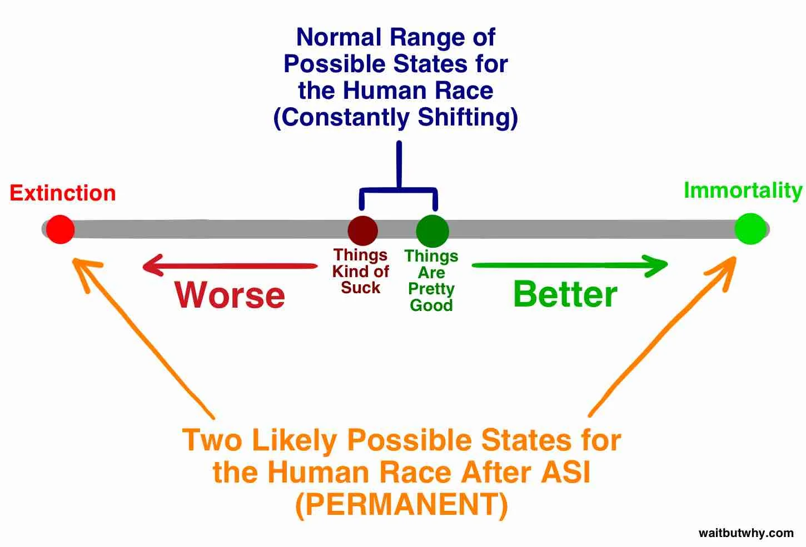

Agar ASI haqiqatan ham shu asrda paydo bo‘lsa va uning natijasi ko‘pchilik ekspertlar o‘ylagandek nihoyatda keskin hamda doimiy bo‘lsa, yelkamizda ulkan mas’uliyat bor. Insoniyat hayotining keyingi millionlab yillari bizga jimgina qarab turibdi va bu ishni buzib qo‘ymasligimizdan butun borlig‘i bilan umid qilmoqda. Biz kelajakdagi barcha insonlarga hayot sovg‘a qilgan odamlar bo‘lish imkoniga egamiz. Balki ularga og‘riqsiz, abadiy hayot sovg‘a qilishimiz ham mumkin. Yoki bu ishni barbod qilgan — musiqa va san’ati, qiziquvchanligi va kulgisi, cheksiz kashfiyotlari va ixtirolari bor nihoyatda noyob turni qayg‘uli va dabdabasiz yakunga olib kelgan insonlar biz bo‘lamiz.

Bu narsalar haqida o‘ylaganimda, men faqat bir narsani istayman: sun’iy intellekt bilan bog‘liq masalalarda shoshilmasligimiz va nihoyatda ehtiyotkor bo‘lishimizni. Buni to‘g‘ri bajarish uchun qancha vaqt kerak bo‘lishidan qat’i nazar, mavjudotlar orasida bundan muhimroq hech narsa yo‘q.

Ammo keyiiiiin…

Men *o‘lmaslik* haqida o‘ylayman.

*O‘l-mas-lik*.

Shunda natijalar diapazoni taxminan mana bunday ko‘rina boshlaydi:

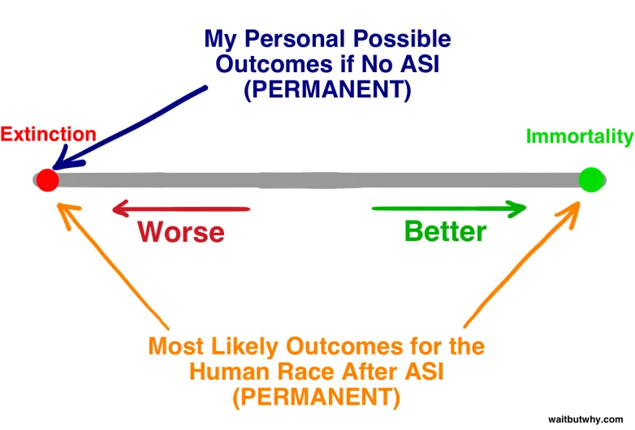

Keyin insoniyat musiqasi va san’ati yaxshi, ammo unchalik ham zo‘r emasligini, ularning katta qismi aslida shunchaki yomon ekanini o‘ylashim mumkin. Ko‘p odamlarning kulgisi asabga tegadi. Kelajakdagi millionlab odamlar esa hech narsaga umid qilmaydi, chunki ular hali mavjud emas. Balki haddan tashqari ehtiyotkor bo‘lishimiz shart emasdir — kim ham shunday bo‘lishni xohlaydi?

Chunki men o‘lganimdan keyingina insonlar o‘limni davolash yo‘lini topsa, bu naqadar katta baxtsizlik bo‘ladi.

Oxirgi bir oy davomida miyamda shunday fikrdan u fikrga o‘tib yuribman.

Ammo qaysi natijani istashingizdan qat’i nazar, bu haqda hozirgidan ko‘ra ko‘proq o‘ylashimiz, gaplashishimiz va kuchimizni sarflashimiz kerak.

Bu menga *Taxtlar o‘yini*ni eslatadi. Unda odamlar bir-biri bilan urushib: “Biz o‘zaro urush bilan shunchalik bandmizki, aslida devorning shimolidan kelayotgan narsaga e’tibor qaratishimiz kerak”, deb aytadi. Biz ham muvozanat to‘sinimiz ustida turibmiz, undagi har qanday muammo ustida tortishamiz, barcha muammolardan xavotirlanamiz. Holbuki, katta ehtimol bilan, yaqinda bizni to‘sindan qulatadigan hodisa yuz beradi.

Bu sodir bo‘lganida, to‘sin ustidagi muammolarning hech biri endi ahamiyatga ega bo‘lmaydi. Qaysi tomonga qulashimizga qarab, muammolarimizning barchasi osonlikcha hal qilinadi yoki endi muammolarimiz qolmaydi, chunki o‘lgan odamlarning muammosi bo‘lmaydi.

Shu sabab superintellektli sun’iy intellektni tushunadigan odamlar uni biz yaratadigan so‘nggi ixtiro — duch keladigan so‘nggi muammo deb ataydi.

Xo‘sh, keling, shu haqda gaplashaylik.
