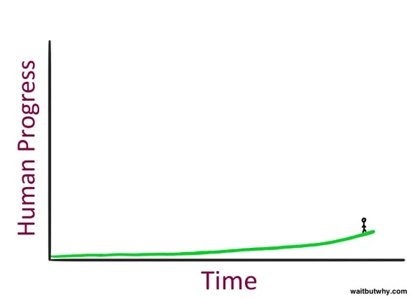
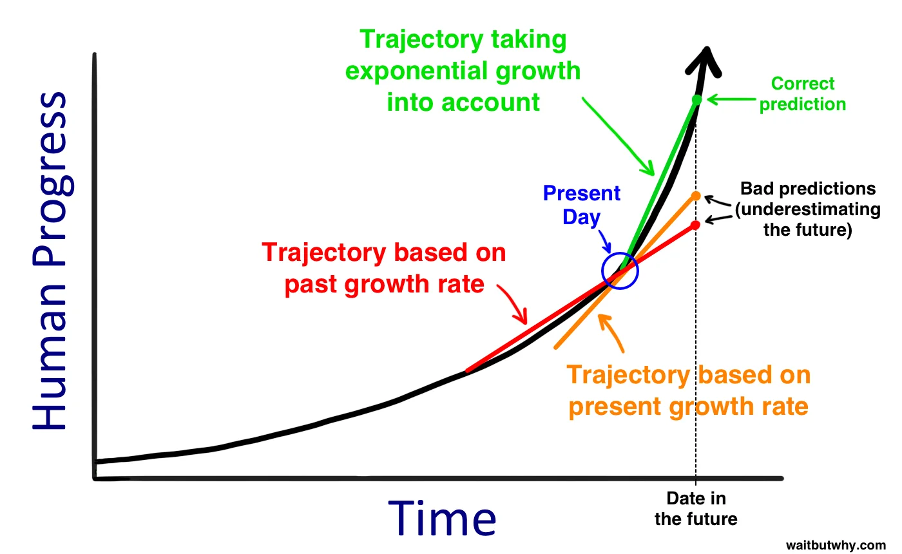
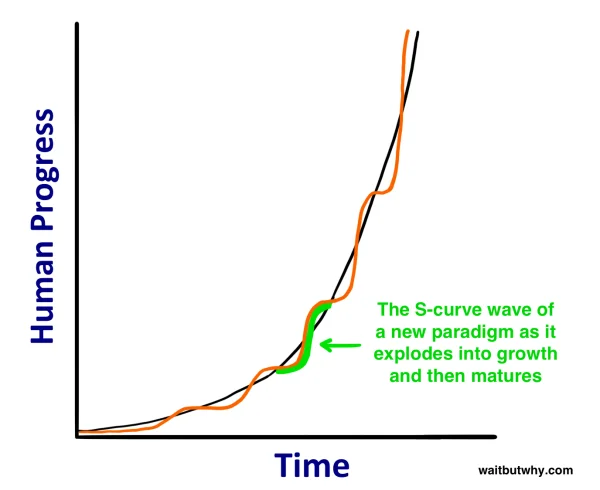
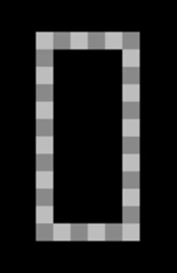
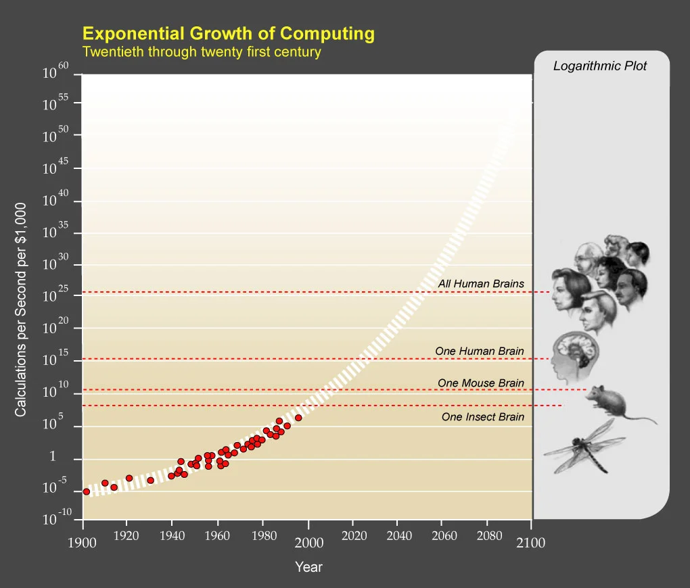
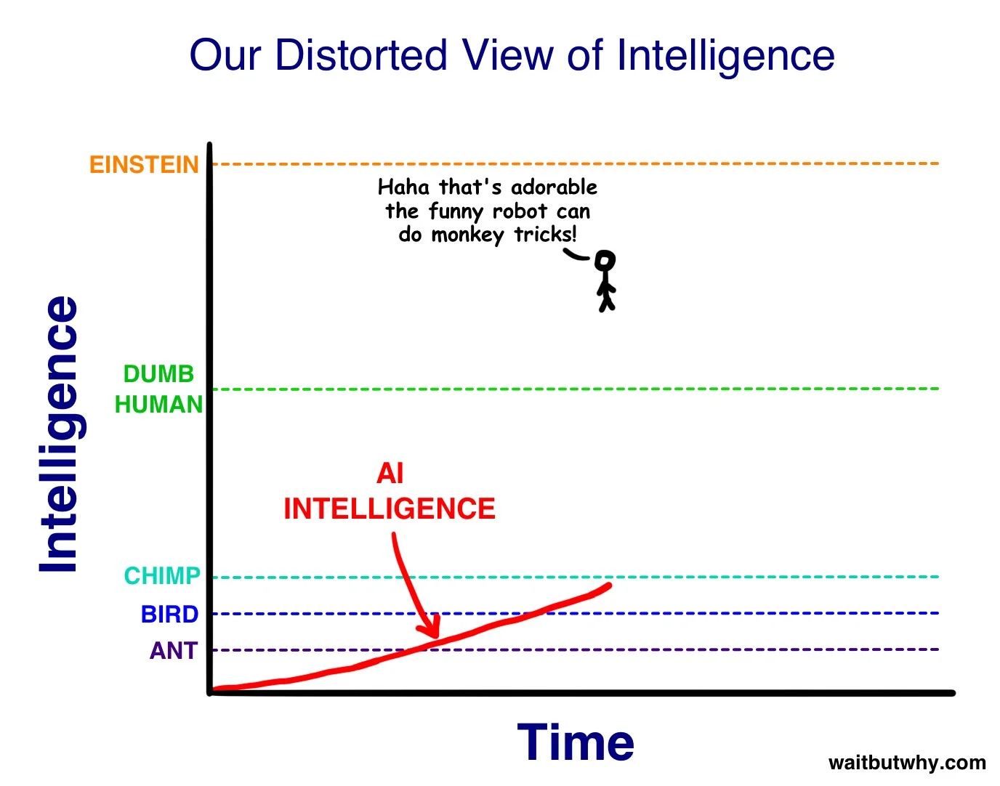
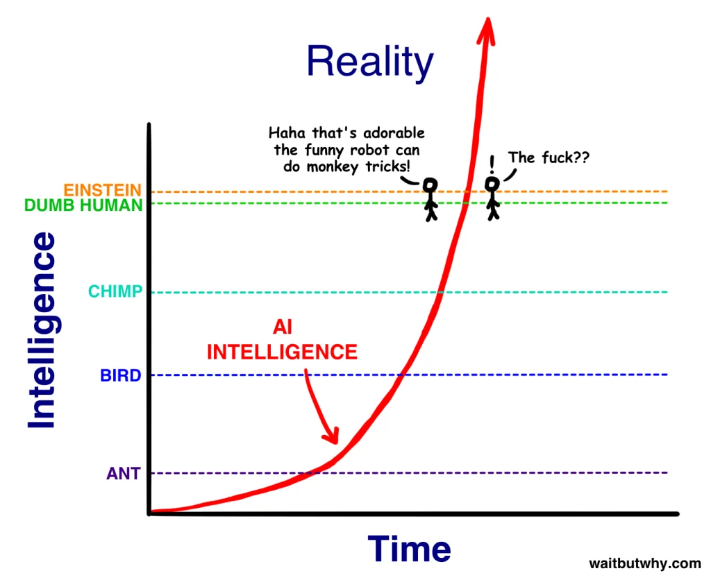

**Muallif:** Tim Urban  
**Asl maqola e’lon qilingan sana:** 2015-yil 22-yanvar  
**Tarjima tili:** o‘zbek tili   
**Manba:** [Wait But Why — The Artificial Intelligence Revolution: Part 1](https://waitbutwhy.com/2015/01/artificial-intelligence-revolution-1.html)

**PDF:** Ushbu maqolani chop etish va oflayn ko‘rish uchun maxsus PDF tayyorlaganmiz. Uni shu yerdan sotib olishingiz mumkin (yoki oldindan ko‘rishingiz mumkin).

**Eslatma:** Ushbu postni tugatishimga uch hafta ketganining sababi — sun’iy intellekt haqida tadqiqot olib borar ekanman, o‘qiyotganlarimga ishonolmay qolganim edi. Sun’iy intellekt olamida sodir bo‘layotgan voqealar shunchaki muhim mavzu emas, balki kelajagimiz uchun eng muhim mavzu ekanini juda tez angladim. Shuning uchun bu haqda imkon qadar ko‘proq bilib olishni istadim. Buni uddalaganimdan keyin esa butun vaziyatni va uning nega bunchalik muhimligini haqiqatan ham tushuntirib beradigan post yozishga qaror qildim. Ajablanarli joyi yo‘qki, post nihoyatda uzun bo‘lib ketdi, shu bois uni ikki qismga ajratdim. Bu — 1-qism. **2-qism** [bu yerda](https://waitbutwhy.com/2015/01/artificial-intelligence-revolution-2.html).

---

> Biz Yer yuzida inson hayoti paydo bo‘lishi bilan qiyoslash mumkin bo‘lgan o‘zgarish ostonasida turibmiz. — Vernor Vinge

#### Bu yerda turish qanday tuyuladi?

Bu yerda turish juda hayajonli holatdek ko‘rinadi. Lekin vaqt grafigida turishning bir jihatini yodda tutish kerak: o‘ng tomoningizda nima borligini ko‘ra olmaysiz. Demak, u yerda turish aslida mana bunday his qilinadi:

Bu esa, ehtimol, juda oddiy holatdek tuyular…

---

## Uzoq kelajak — tez orada keladi

Tasavvur qiling, vaqt mashinasida 1750-yilga qaytdingiz. U davrda dunyo go‘yo elektr uzilishi doimiy davom etadigan joy edi; uzoq masofaga xabar yuborish degani yo bor ovoz bilan baqirish, yo osmonga to‘pdan o‘q uzish edi; transportning hammasi esa pichan bilan ishlardi. U yerga yetib borgach, bir odamni topib, 2015-yilga olib kelasiz va uni turli joylarga aylantirib, hamma narsaga qanday munosabat bildirishini kuzatasiz.

Uning avtomagistralda yaltirab turgan kapsulalarning shiddat bilan o‘tib ketayotganini ko‘rishi, o‘sha kunning o‘zida okeanning narigi tomonida bo‘lgan odamlar bilan gaplashishi, ming mil uzoqlikda o‘ynalayotgan sport musobaqasini tomosha qilishi, 50 yil avval ijro etilgan musiqiy chiqishni tinglashi qanday bo‘lishini biz tasavvur ham qila olmaymiz. Yana unga mening sehrli to‘rtburchak qurilmamni berasiz: u bilan haqiqiy hayot tasvirini suratga olishi yoki ayni damdagi voqeani yozib olishi, qayerdaligini ko‘rsatadigan g‘ayritabiiy tarzda harakatlanuvchi ko‘k nuqtali xarita yaratishi, mamlakatning narigi chekkasida turgan bo‘lsa ham birovning yuziga qarab u bilan suhbatlashishi mumkin. Bularning ustiga, aql bovar qilmaydigan yana qancha sehr-jodu bor. Bularning hammasi unga internetni ko‘rsatishingizdan yoki Xalqaro kosmik stansiya, Katta adron kollayderi, yadro qurollari yoxud umumiy nisbiylik nazariyasi haqida tushuntirishingizdan oldin sodir bo‘ladi.

U uchun bu tajriba shunchaki hayratlanarli yoki shokka soladigan, hatto aqlni lol qoldiradigan hodisa ham bo‘lmaydi — bu so‘zlar uning holatini ifodalashga ojizlik qiladi. U hatto o‘lib qolishi ham mumkin.

Lekin qiziq tomoni shundaki, agar u keyin 1750-yilga qaytib, biz uning munosabatini ko‘rganimizga hasad qilsa va xuddi shunday tajribani o‘zi ham sinab ko‘rishga qaror qilsa, vaqt mashinasiga o‘tirib, xuddi shuncha vaqt orqaga qaytadi, taxminan 1500-yilda yashagan bir odamni topadi, uni 1750-yilga olib keladi va unga hamma narsani ko‘rsatadi. 1500-yildagi odam ko‘p narsadan hayratga tushadi, ammo o‘lib qolmaydi. Uning uchun bu tajriba ancha kamroq telbalarcha bo‘ladi, chunki 1500 va 1750-yillar juda farq qilgan bo‘lsa-da, ular orasidagi tafovut 1750-yildan 2015-yilgacha bo‘lgan farqchalik katta emas edi. 1500-yildagi odam kosmos va fizika haqida aqlni shoshiradigan narsalarni bilib oladi, Yevropaning yangi imperializm urfiga naqadar berilib ketganidan taassurotlanadi va dunyo xaritasi haqidagi tasavvurini jiddiy qayta ko‘rib chiqishiga to‘g‘ri keladi. Ammo 1750-yildagi kundalik hayotni — transport, aloqa va hokazolarni — kuzatish uni, albatta, o‘ldirib qo‘ymaydi.

Yo‘q, 1750-yildagi odam biz uning reaksiyasidan olganimizdek zavq olishi uchun ancha uzoq o‘tmishga — ehtimol, miloddan avvalgi 12 000-yilga, Birinchi qishloq xo‘jaligi inqilobi dastlabki shaharlar va sivilizatsiya tushunchasini yuzaga keltirishidan oldingi davrga qaytishi kerak bo‘lardi. Sof ovchi-yig‘uvchi jamiyatdan kelgan, ya’ni odamlar ozmi-ko‘pmi boshqa hayvon turlaridan biri bo‘lgan davrda yashagan kishi 1750-yildagi ulkan inson imperiyalarini, baland-baland cherkovlarni, okeanlarni kesib o‘tuvchi kemalarni, “ichkarida” bo‘lish tushunchasini hamda insoniyat birgalikda to‘plagan ulkan bilim va kashfiyotlar xazinasini ko‘rsa, ehtimol, o‘lib qolardi.

Undan keyin u o‘lgach, hasad qilib, xuddi shu ishni o‘zi ham qilishni istasa-chi? U 12 000 yil orqaga — miloddan avvalgi 24 000-yilga qaytib, bir odamni topib, miloddan avvalgi 12 000-yilga olib keladi. U odamga hamma narsani ko‘rsatadi, ammo u: “Xo‘sh, nima bo‘pti, buning nima ahamiyati bor?” degandek bo‘ladi. Miloddan avvalgi 12 000-yildagi odam ham shunday zavq olishi uchun u 100 000 yildan ko‘proq vaqt orqaga qaytib, olov va tilni birinchi marta ko‘rsatishi mumkin bo‘lgan odamni topishi kerak bo‘lardi.

Biror kishi kelajakka olib borilganda, u boshdan kechiradigan hayrat darajasidan o‘lib qolishi uchun yetarlicha oldinga — “o‘lim darajasidagi taraqqiyot”ga, ya’ni **Die Progress Unit (DPU)** ga erishilgan davrga ko‘chirilishi kerak. Ovchi-yig‘uvchilar davrida bitta DPUga erishish uchun 100 000 yildan ko‘proq vaqt kerak bo‘lgan, ammo Qishloq xo‘jaligi inqilobidan keyingi taraqqiyot sur’atida bunga atigi taxminan 12 000 yil ketgan. Sanoat inqilobidan keyingi dunyo shu qadar tez o‘zgardiki, 1750-yilda yashagan odam uchun bitta DPU sodir bo‘lishi uchun kelajakka atigi bir necha yuz yil borish kifoya.

Insoniyat taraqqiyotining vaqt o‘tishi bilan tobora tezlashib borishi modelini futurist Rey Kurtsveyl insoniyat tarixining **Tezlashib boruvchi daromadlar qonuni** (*Law of Accelerating Returns*) deb ataydi. Buning sababi shuki, rivojlangan jamiyatlar kamroq rivojlangan jamiyatlarga qaraganda tezroq taraqqiy eta oladi — chunki ular rivojlanganroq. XIX asr insoniyati XV asr insoniyatiga qaraganda ko‘proq narsani bilar va yaxshiroq texnologiyalarga ega edi. Shu sababli insoniyat XIX asrda XV asrga qaraganda ancha ko‘p yutuqlarga erishgani ajablanarli emas — XV asr insoniyati XIX asr insoniyatiga teng kela olmasdi.¹

Bu hodisa kichikroq miqyosda ham kuzatiladi. *Kelajakka qaytib* (*Back to the Future*) filmi 1985-yilda chiqqan, filmda “o‘tmish” esa 1955-yil edi. Filmda Maykl J. Foks 1955-yilga qaytganida televizorlarning yangiligi, gazli ichimliklar narxi, jarangdor elektr gitaraga qiziqishning yo‘qligi va jargon so‘zlarning farqidan hayratda qoladi. Ha, dunyo boshqacha edi. Ammo film bugun suratga olinib, o‘tmish 1985-yil qilib ko‘rsatilganida, ancha katta farqlar hisobiga undan ham ko‘proq qiziqarli vaziyatlar yaratish mumkin bo‘lardi. Qahramon shaxsiy kompyuterlar, internet yoki mobil telefonlar bo‘lmagan davrga tushib qolardi. 1990-yillarning oxirida tug‘ilgan bugungi Marti Makflay 1985-yilda film qahramoni 1955-yilda bo‘lganidan ko‘ra ancha ko‘proq begona his qilardi.

Buning sababi yuqorida muhokama qilganimiz bilan bir xil — Tezlashib boruvchi daromadlar qonuni. 1985–2015-yillar orasidagi o‘rtacha taraqqiyot sur’ati 1955–1985-yillar orasidagidan yuqori bo‘lgan, chunki birinchi davrda dunyo rivojlanganroq edi. Shuning uchun so‘nggi 30 yilda undan oldingi 30 yilga qaraganda ko‘proq o‘zgarish yuz berdi.

Demak, yutuqlar tobora kattalashib, tobora tezroq sodir bo‘lmoqda. Bu kelajagimiz haqida juda jiddiy xulosalarni anglatadi, shunday emasmi?

Kurtsveylning ta’kidlashicha, 2000-yildagi taraqqiyot sur’ati bilan butun XX asr taraqqiyotiga atigi 20 yil ichida erishish mumkin bo‘lardi. Boshqacha aytganda, 2000-yilga kelib taraqqiyot sur’ati XX asrdagi o‘rtacha sur’atdan besh baravar tezroq bo‘lgan. Uning fikricha, 2000–2014-yillar orasida yana bir butun XX asrga teng taraqqiyot sodir bo‘lgan va atigi yetti yil ichida, 2021-yilgacha, yana bir XX asrga teng yutuqlar qo‘lga kiritiladi. Yana bir necha o‘n yildan keyin, uning fikricha, bir yilning o‘zida XX asrga teng taraqqiyot bir necha marta yuz beradi; undan ham keyin esa bunday taraqqiyotga bir oydan kamroq vaqtda erishiladi. Umuman olganda, Tezlashib boruvchi daromadlar qonuni sababli Kurtsveyl XXI asrda XX asrga qaraganda 1 000 baravar ko‘proq taraqqiyot bo‘lishiga ishonadi.²

Agar Kurtsveyl va u bilan bir fikrda bo‘lganlar haq bo‘lsa, 2030-yilda biz ham 1750-yildagi odam 2015-yilda hayratga tushganidek lol qolishimiz mumkin. Ya’ni navbatdagi DPUga atigi bir necha o‘n yilda erishilishi mumkin. 2050-yildagi dunyo esa bugungi dunyodan shu qadar keskin farq qilishi mumkinki, uni deyarli tanimay qolamiz.

Bu ilmiy fantastika emas. Bunga sizdan yoki mendan aqlliroq va ko‘proq bilimga ega ko‘plab olimlar qat’iy ishonadi. Tarixga nazar tashlasak, mantiqan ham shunday bo‘lishini kutishimiz kerak.

Unda nega men “35 yildan keyin dunyo butunlay tanib bo‘lmaydigan darajada o‘zgarib ketishi mumkin” deganimda, siz “Zo‘r… lekin yo‘q-e, bo‘lishi mumkin emas” deb o‘ylaysiz? Kelajak haqidagi g‘ayrioddiy bashoratlarga shubha bilan qarashimizning uchta sababi bor:

**1) Tarix haqida gap ketganda, biz to‘g‘ri chiziqlar bo‘ylab fikrlaymiz.** Kelgusi 30 yildagi taraqqiyotni tasavvur qilganimizda, nimalar yuz berishi mumkinligini baholash uchun oldingi 30 yildagi taraqqiyotga qaraymiz. XXI asrda dunyo qanchalik o‘zgarishi haqida o‘ylaganimizda, XX asrdagi yutuqlarni olib, ularni 2000-yilga qo‘shib qo‘yamiz. Bu 1750-yildagi odam 1500-yildan bir kishini olib kelib, o‘zini kelajakka shuncha yil olib borganida qanchalik hayratlangan bo‘lsa, u odam ham shunchalik hayratlanadi, deb kutganida qilgan xatosi bilan bir xil. Biz uchun chiziqli fikrlash tabiiyroq, vaholanki, eksponensial tarzda fikrlashimiz kerak. Biroz ziyrakroq odam kelgusi 30 yildagi yutuqlarni oldingi 30 yilga qarab emas, balki hozirgi taraqqiyot sur’atiga qarab bashorat qilishi mumkin. Bu aniqroq bo‘lardi, ammo baribir ancha xato bo‘lardi. Kelajak haqida to‘g‘ri fikrlash uchun voqealar hozirgidan ancha tezroq sodir bo‘lishini tasavvur qilish kerak.

**2) Juda yaqin o‘tmishning yo‘nalishi ko‘pincha buzilgan tasavvur beradi.** Birinchidan, tik eksponensial egri chiziqning juda kichik bir qismini ko‘rsangiz, u ham to‘g‘ri chiziqdek ko‘rinadi. Xuddi ulkan aylananing kichik bir bo‘lagiga yaqindan qaralganda, u deyarli to‘g‘ri chiziqqa o‘xshab qolganidek. Ikkinchidan, eksponensial o‘sish butunlay silliq va bir tekis kechmaydi. Kurtsveylning tushuntirishicha, taraqqiyot “S-egri chiziqlar” shaklida sodir bo‘ladi:

Yangi paradigma butun dunyoga yoyilganda taraqqiyot to‘lqini S shaklidagi egri chiziqni hosil qiladi. Bu egri chiziq uch bosqichdan o‘tadi:

1. Sekin o‘sish (eksponensial o‘sishning dastlabki bosqichi).
2. Tez o‘sish (eksponensial o‘sishning kechki, keskin jadallashish bosqichi).
3. Muayyan paradigma yetilgani sari o‘sishning tekislanishi.³

Agar faqat juda yaqin o‘tmishga qarasangiz, S-egri chiziqning ayni paytda qaysi qismida turganingiz taraqqiyot qanchalik tez borayotgani haqidagi tasavvuringizni buzishi mumkin. 1995–2007-yillar oralig‘ida internet keskin rivojlandi, Microsoft, Google va Facebook keng jamoatchilik ongiga kirib keldi, ijtimoiy tarmoqlar paydo bo‘ldi, avval mobil telefonlar, keyin esa smartfonlar ommalashdi. Bu S-egri chiziqning ikkinchi bosqichi — o‘sish keskin jadallashadigan qismi edi. Ammo 2008–2015-yillar, hech bo‘lmaganda texnologiya sohasida, unchalik katta yangiliklarga boy bo‘lmadi. Bugun kelajak haqida fikr yuritayotgan kishi taraqqiyotning hozirgi sur’atini aniqlash uchun so‘nggi bir necha yilni ko‘zdan kechirishi mumkin, lekin bu kattaroq manzarani ko‘rmaslik demakdir. Aslida, ayni damda ikkinchi bosqichdagi yangi va ulkan o‘sish to‘lqini shakllanayotgan bo‘lishi mumkin.

**3) Shaxsiy tajribamiz kelajak haqida qaysar qariyalardek fikrlashimizga sabab bo‘ladi.** Dunyo haqidagi tasavvurlarimizni shaxsiy tajribamizga asoslaymiz. Bu tajriba yaqin o‘tmishdagi o‘sish sur’atini miyamizga “ishlar shunday sodir bo‘ladi” degan qoida sifatida muhrlab qo‘ygan. Tasavvurimiz ham cheklangan: u o‘z tajribamizdan foydalanib, kelajak haqidagi bashoratlarni yaratadi, lekin ko‘pincha bilganlarimiz kelajak haqida to‘g‘ri fikrlashimiz uchun yetarli vosita bermaydi.² Kelajak haqidagi bashorat tajribamizga asoslangan dunyoqarashimizga zid kelganda, ichki sezgimiz bu bashorat sodda yoki ishonchsiz bo‘lsa kerak, deydi. Keyinroq ushbu postda sizga 150 yil, 250 yil yashashingiz yoki umuman o‘lmasligingiz mumkinligini aytsam, ichki munosabatingiz: “Bu bema’nilik-ku — tarixdan biladigan bir narsam bo‘lsa, u hamma odam o‘lishidir”, degan fikr bo‘ladi. Ha, o‘tmishda hech kim o‘lmasdan qolmagan. Lekin samolyotlar ixtiro qilinishidan oldin ham hech kim samolyotda uchmagan.

Shunday qilib, bu postni o‘qiyotganingizda “yo‘q-e, bo‘lishi mumkin emas” degan munosabat to‘g‘ri tuyulishi mumkin, lekin ehtimol, u aslida noto‘g‘ridir. Gap shundaki, agar chinakam mantiqqa tayanib, tarixiy qonuniyatlar davom etishini kutsak, kelgusi o‘n yilliklarda biz intuitiv ravishda kutganimizdan ancha, ancha, ancha ko‘proq o‘zgarish sodir bo‘lishi kerak, degan xulosaga kelamiz. Mantiq shuni ham ko‘rsatadiki, agar sayyoradagi eng rivojlangan tur tobora tezlashib borayotgan sur’atda kattaroq va kattaroq sakrashlar qilaversa, bir payt kelib shunday ulkan sakrash sodir bo‘ladiki, u o‘sha turning hayot tarzini va inson bo‘lish nimani anglatishi haqidagi tasavvurini butunlay o‘zgartiradi. Bu evolyutsiya aql-idrok sari tobora kattaroq sakrashlar qilib, oxir-oqibat insonga olib kelgan jarayonga o‘xshaydi: insonning paydo bo‘lishi Yer sayyorasida har qanday mavjudot uchun yashash nimani anglatishini butunlay o‘zgartirib yubordi. Bugun fan va texnologiyada nimalar sodir bo‘layotgani haqida biroz o‘qisangiz, hozirgi hayot tarzimiz navbatdagi sakrashga dosh bera olmasligini sezdira boshlaydigan ko‘plab belgilarni ko‘rasiz.

---

## Superintellekt sari yo‘l

### Sun’iy intellekt nima?

Agar siz ham menga o‘xshasangiz, ilgari sun’iy intellektni ilmiy-fantastik asarlarga xos bema’ni tushuncha deb o‘ylagan bo‘lishingiz mumkin. Ammo so‘nggi paytlarda bu atama jiddiy odamlar tilidan ko‘p eshitilyapti, lekin uning aslida nimani anglatishini to‘liq tushunmayotgandirsiz.

Ko‘pchilikning “SI” atamasi borasida chalkashib qolishiga uchta sabab bor:

**1) SIni filmlar bilan bog‘laymiz.** *Yulduzlar jangi*, *Terminator*, *2001: Kosmik odisseya*. Hatto *Jetsonlar* ham. Bularning barchasi, ulardagi robot qahramonlar kabi, badiiy to‘qima. Shu bois SI bizga biroz xayoliy narsadek tuyuladi.

**2) SI juda keng mavzu.** U telefoningizdagi kalkulyatordan tortib, o‘zi boshqariladigan avtomobillargacha, kelajakda dunyoni keskin o‘zgartirishi mumkin bo‘lgan narsalargacha bo‘lgan hamma narsani qamrab oladi. Bularning barchasi SI deb atalishi chalkashlik tug‘diradi.

**3) SIdan kundalik hayotimizda doim foydalanamiz, ammo ko‘pincha bu SI ekanini anglamaymiz.** “Sun’iy intellekt” atamasini 1956-yilda kiritgan Jon Makkarti: “Biror narsa ishlay boshlashi bilan uni endi hech kim SI deb atamay qo‘yadi”, deya shikoyat qilgan.⁴ Shu hodisa sababli SI ko‘pincha haqiqiy voqelikdan ko‘ra afsonaviy kelajak bashoratiga o‘xshab eshitiladi. Ayni paytda u amalga oshmay qolgan, o‘tmishdagi ommabop bir tushunchadek ham ko‘rinadi. Rey Kurtsveyl odamlar unga SI 1980-yillarda so‘nib qolganini aytishlarini eshitishini ta’kidlaydi. U buni “2000-yillarning boshidagi dotkom inqirozi paytida internet o‘lib qoldi, deb turib olish” bilan qiyoslaydi.⁵

Keling, masalaga aniqlik kiritaylik. Avvalo, robotlar haqida o‘ylashni bas qiling. Robot — SI uchun idish yoki jismoniy qobiq: u ba’zan inson shakliga taqlid qiladi, ba’zan esa yo‘q. Ammo SIning o‘zi robot ichidagi kompyuterdir. SI — miya, robot esa uning tanasi; albatta, uning tanasi bo‘lsa. Masalan, Siri ortidagi dasturiy ta’minot va ma’lumotlar — SI. Biz eshitadigan ayol ovozi esa shu SIning inson qiyofasida namoyon bo‘lishidir; bunda umuman robot yo‘q.

Ikkinchidan, “singulyarlik” yoki “texnologik singulyarlik” atamasini eshitgan bo‘lsangiz kerak. Matematikada bu atama odatiy qoidalar amal qilmay qoladigan, asimptotaga o‘xshash holatni tasvirlash uchun ishlatilgan. Fizikada esa cheksiz darajada kichik va zich qora tuynuk yoki Katta portlashdan oldin barchamiz siqilib turgan nuqta kabi hodisalarni ifodalash uchun qo‘llanilgan. Yana odatiy qoidalar ishlamaydigan vaziyatlar.

1993-yilda Vernor Vinge [mashhur esse](https://edoras.sdsu.edu/~vinge/misc/singularity.html) yozib, bu atamani kelajakda texnologiyamiz intellekti biznikidan oshib ketadigan paytga nisbatan qo‘lladi. Uning fikricha, o‘sha lahzada biz bilgan hayot abadiy o‘zgaradi va odatiy qoidalar endi amal qilmaydi. Keyin Rey Kurtsveyl singulyarlik tushunchasini biroz chalkashtirib yubordi: u buni Tezlashib boruvchi daromadlar qonuni shunday favqulodda sur’atga yetadigan davr deb ta’rifladiki, texnologik taraqqiyot go‘yoki cheksiz tezlikda sodir bo‘la boshlaydi va undan keyin biz butunlay yangi dunyoda yashaymiz. Bugungi ko‘plab SI mutaxassislari bu atamani ishlatmay qo‘yganini payqadim. U baribir chalkash tushuncha, shuning uchun bu yerda uni ko‘p ishlatmayman (garchi butun maqola davomida aynan shu g‘oya haqida gapirsak ham).

Nihoyat, SI keng tushuncha bo‘lgani uchun uning ko‘plab turlari va shakllari bor. Ammo biz e’tibor qaratishimiz kerak bo‘lgan asosiy toifalar SIning darajasiga asoslanadi. SIning uchta asosiy darajasi mavjud:

**SI darajasi 1) Sun’iy tor intellekt (ANI — Artificial Narrow Intelligence).** Ba’zan “zaif SI” deb ham ataladigan sun’iy tor intellekt faqat bitta sohaga ixtisoslashgan sun’iy intellektdir. Shaxmat bo‘yicha jahon chempionini yenga oladigan SI bor, ammo u faqat shuni qila oladi. Undan qattiq diskdagi ma’lumotlarni saqlashning yaxshiroq usulini topishni so‘rasangiz, u sizga ma’nosiz qarab turadi.

**SI darajasi 2) Sun’iy umumiy intellekt (AGI — Artificial General Intelligence).** Ba’zan “kuchli SI” yoki “inson darajasidagi SI” deb ataladigan sun’iy umumiy intellekt — barcha jihatlari bo‘yicha insondek aqlli bo‘lgan kompyuterni anglatadi. Bu inson bajara oladigan har qanday intellektual vazifani uddalay oladigan mashinadir. AGI yaratish ANI yaratishdan ancha qiyin va biz hozircha bunga erishganimiz yo‘q. Professor Linda Gotfredson intellektni “boshqa narsalar qatori fikr yuritish, rejalashtirish, muammolarni hal qilish, mavhum fikrlash, murakkab g‘oyalarni tushunish, tez o‘rganish va tajribadan saboq olish qobiliyatlarini o‘z ichiga oladigan juda umumiy aqliy salohiyat” deb ta’riflaydi. AGI bularning barchasini siz kabi oson bajara olardi.

**SI darajasi 3) Sun’iy superintellekt (ASI — Artificial Superintelligence).** Oksford faylasufi va SIning yetakchi mutafakkirlaridan biri Nik Bostrom superintellektni “ilmiy ijodkorlik, umumiy donolik va ijtimoiy ko‘nikmalarni ham qo‘shib hisoblaganda, deyarli barcha sohalarda eng yaxshi inson miyalaridan ancha aqlliroq bo‘lgan intellekt” deb ta’riflaydi. Sun’iy superintellekt insondan shunchaki biroz aqlliroq kompyuterdan tortib, barcha sohalarda insondan trillionlab marta aqlliroq kompyutergacha bo‘lgan oraliqni qamrab oladi. ASI SI mavzusini bunchalik “qizg‘in” qiladigan sababdir. Shu bois bu maqolalarda “o‘lmaslik” va “yo‘q bo‘lib ketish” so‘zlari bir necha bor uchraydi.

Hozircha odamlar SIning eng quyi darajasi — ANI — ni ko‘plab jihatlarda egallashgan va u hamma joyda bor. SI inqilobi — ANI dan AGI orqali ASI ga olib boradigan yo‘ldir. Bu yo‘ldan omon chiqishimiz ham, chiqmasligimiz ham mumkin, ammo har qanday holatda ham u hamma narsani o‘zgartiradi.

Keling, sohadagi yetakchi mutafakkirlar bu yo‘l qanday kechadi, deb hisoblashini va nega bu inqilob siz o‘ylagandan ancha tez sodir bo‘lishi mumkinligini yaqindan ko‘rib chiqaylik.

### Hozir qayerdamiz — ANI asosida ishlaydigan dunyo

Sun’iy tor intellekt — muayyan vazifada inson aqli yoki samaradorligiga teng keladigan yoxud undan oshib ketadigan mashina intellektidir. Bir nechta misol:

- Avtomobillar ANI tizimlariga to‘la. Masalan, blokirovkaga qarshi tormoz tizimi qachon ishga tushishini aniqlaydigan kompyuter yoki yonilg‘i purkash tizimi parametrlarini sozlaydigan kompyuter. Hozir sinovdan o‘tkazilayotgan Google’ning o‘zi boshqariladigan avtomobili atrofdagi dunyoni idrok etishi va unga javob qaytarishi uchun kuchli ANI tizimlariga ega bo‘ladi.
- Telefoningiz kichik bir ANI fabrikasidir. Xarita ilovasidan yo‘l topganingizda, Pandora’dan didingizga mos musiqa tavsiyalarini olganingizda, ertangi ob-havoni tekshirganingizda, Siri bilan gaplashganingizda yoki boshqa o‘nlab kundalik ishlarni bajarganingizda ANI’dan foydalanasiz.
- Elektron pochtangizdagi spam filtri ANI’ning klassik namunasidir. Dastlab u spam nima-yu, nima spam emasligini aniqlashga doir ma’lumot bilan jihozlangan bo‘ladi. Keyinchalik esa sizning o‘ziga xos xohishlaringiz bilan tanishgani sari o‘rganadi va o‘z “aqlini” sizga moslashtiradi. Nest termostati ham odatiy kun tartibingizni aniqlab, shunga muvofiq harakat qilishni o‘rganadi.
- Amazon’da biror mahsulotni qidirganingizdan keyin boshqa saytda aynan shu mahsulotning “sizga tavsiya qilinadi” degan shaklda paydo bo‘lishi yoki Facebook kimni do‘st sifatida qo‘shishingiz ma’qul ekanini qandaydir yo‘l bilan bilib qolishi — o‘sha biroz vahimali holatni bilasizmi? Bu bir-biri bilan hamkorlik qiladigan ANI tizimlari tarmog‘idir. Ular siz kimligingiz va nimalarni yoqtirishingiz haqida bir-biriga ma’lumot uzatadi, so‘ng bu ma’lumotdan foydalanib sizga nimani ko‘rsatishni hal qiladi. Amazon’dagi “Buni sotib olganlar yana buni ham sotib olishgan…” degan tavsiya ham xuddi shunday: bu ANI tizimining vazifasi millionlab mijozlar xatti-harakatlari haqidagi ma’lumotni yig‘ish, uni birlashtirish va sizga ko‘proq narsa sotib olish uchun mohirona qo‘shimcha takliflar ko‘rsatishdir.
- Google Tarjimon ham ANI tizimining klassik namunasidir — u bitta tor vazifani hayratlanarli darajada yaxshi bajaradi. Ovozli nutqni tanish ham shunday. Bir qancha ilovalar bu ikki ANI’ni birgalikda ishlatadi: siz bir tilda gapirasiz, telefon esa o‘sha jumlani boshqa tilda aytib beradi.
- Samolyotingiz qo‘nganida uni qaysi darvozaga yo‘naltirishni inson hal qilmaydi. Xuddi chiptangiz narxini ham inson belgilamagani kabi.
- Shashka, shaxmat, skrebl, nard va Othello bo‘yicha dunyoning eng kuchli o‘yinchilari hozir ANI tizimlaridir.
- Google qidiruvi — sahifalarni saralash va aynan sizga nimani ko‘rsatishni aniqlashning nihoyatda murakkab usullariga ega bo‘lgan ulkan ANI miyasi. Facebook’ning yangiliklar tasmasi ham xuddi shunday.
- Bular faqat oddiy iste’molchilar dunyosidagi misollar, xolos. Murakkab ANI tizimlari harbiy soha, ishlab chiqarish va moliya kabi tarmoqlarda ham keng qo‘llanadi (algoritmik yuqori chastotali SI treyderlari AQSh bozorlarida savdoga qo‘yiladigan aksiyalarning yarmidan ko‘prog‘ini tashkil etadi⁶). Shuningdek, shifokorlarga tashxis qo‘yishda yordam beradigan ekspert tizimlarida va, eng mashhuri, Jeopardy viktorinasining eng sermahsul chempionlarini ishonchli tarzda mag‘lub etish uchun yetarli faktlarga ega bo‘lgan hamda Aleks Trebekning nozik kinoyali nutqini tushungan IBM Watson tizimida ishlatiladi.

Hozirgi ANI tizimlari unchalik qo‘rqinchli emas. Eng yomon holatda, nosoz yoki yomon dasturlashtirilgan ANI elektr tarmog‘ini ishdan chiqarish, atom elektr stansiyasida xavfli nosozlikni keltirib chiqarish yoki moliya bozorida falokatga sabab bo‘lish kabi alohida katastrofaga olib kelishi mumkin. Masalan, 2010-yildagi “Flash Crash” hodisasida ANI dasturi kutilmagan vaziyatga noto‘g‘ri javob qaytardi va fond bozorining qisqa muddatga keskin tushib ketishiga sabab bo‘ldi. Natijada bozor qiymatining 1 trillion dollari yo‘qoldi; xato tuzatilganidan keyin bu qiymatning faqat bir qismi qayta tiklandi.

Biroq ANI ekzistensial tahdid tug‘dirish qobiliyatiga ega bo‘lmasa-da, nisbatan zararsiz bo‘lgan bu tobora kattalashib, murakkablashib borayotgan ekotizimni yaqinlashib kelayotgan, dunyoni o‘zgartirib yuboradigan dovulning darakchisi sifatida ko‘rishimiz kerak. ANI sohasidagi har bir yangi yangilik AGI va ASI sari yo‘lga sezdirmay yana bir g‘isht qo‘shadi. Aaron Saenz ta’biri bilan aytganda, bugungi dunyomizdagi ANI tizimlari “ilk Yerning ibtidoiy, quyuq moddasidagi aminokislotalarga o‘xshaydi” — jonsiz moddalar bir kutilmagan kuni uyg‘onib ketganidek.

### ANI dan AGI ga olib boradigan yo‘l

#### *Nega bu qadar qiyin?*

Inson intellektini qadrlashni bizdek aqlli kompyuter yaratishga urinish naqadar aql bovar qilmas darajada qiyinligini bilishdan ko‘ra yaxshiroq hech narsa o‘rgatmaydi. Osmono‘par binolar qurish, odamlarni kosmosga olib chiqish, Katta portlash qanday sodir bo‘lganining tafsilotlarini aniqlash — bularning barchasi o‘z miyamizni tushunish yoki unga o‘xshagan ajoyib narsani yaratishdan ancha oson. Hozircha inson miyasi ma’lum koinotdagi eng murakkab obyektdir.

Qizig‘i shundaki, AGI yaratishga urinishdagi qiyin jihatlar (faqat bitta tor ixtisoslikda emas, umuman insondek aqlli kompyuter yaratish) biz intuitiv ravishda kutadigan narsalar emas. Ikki xonali o‘nta raqamdan iborat sonlarni bir soniyaning juda kichik qismida ko‘paytira oladigan kompyuter yaratish — nihoyatda oson. Itga qarab, uning itmi yoki mushukmi ekanini ayta oladigan kompyuter yaratish esa — favqulodda qiyin. Har qanday insonni shaxmatda yenga oladigan SI yaratishmi? Bu allaqachon bajarilgan. Olti yoshli bolaning rasmli kitobidan bir paragrafni o‘qib, nafaqat so‘zlarni tanib, balki ularning ma’nosini ham tushuna oladigan tizim yaratishmi? Google aynan shuni uddalash uchun hozir milliardlab dollar sarflayapti. Hisoblash, moliya bozori strategiyasi va tillar tarjimasi kabi qiyin narsalar kompyuter uchun aqlni lol qoldiradigan darajada oson; ko‘rish, harakat, siljish va idrok kabi oson tuyuladigan narsalar esa u uchun nihoyatda qiyin. Kompyuter olimi Donald Knut ta’biri bilan aytganda: “SI hozirga kelib ‘fikrlash’ni talab qiladigan deyarli hamma ishni bajarishga muvaffaq bo‘ldi, ammo odamlar va hayvonlar ‘o‘ylamasdan’ bajaradigan ishlarning ko‘pini bajara olmadi”.⁷

Bu haqda o‘ylaganingizda tezda shuni anglaysizki, bizga oson tuyuladigan ishlar aslida nihoyatda murakkab. Ular faqat bizga (va ko‘pchilik hayvonlarga) oson ko‘rinadi, chunki hayvonlar evolyutsiyasining yuz millionlab yillari davomida bu ko‘nikmalar bizda takomillashgan. Qo‘lingizni biror buyum tomon uzatganingizda, yelka, tirsak va bilagingizdagi mushaklar, paylar hamda suyaklar ko‘zlaringiz bilan hamkorlikda bir zumda fizikaning uzun bir qator amallarini bajaradi. Shu tariqa qo‘lingizni uch o‘lchamli fazoda to‘g‘ri chiziq bo‘ylab harakatlantirasiz. Sizga bu hech qanday qiyinchiliksiz bajariladigandek tuyuladi, chunki miyangizdagi dasturiy ta’minot bu ishni bajarishga mukammal moslashgan. Saytda yangi hisob ochayotganingizda qiyshiq yozilgan so‘zlarni tanish sinovidan o‘ta olmagani uchun zararli dastur ahmoq emas. Aksincha, buni uddalay oladigan miyangiz naqadar ajoyib.

Boshqa tomondan, katta sonlarni ko‘paytirish yoki shaxmat o‘ynash biologik mavjudotlar uchun yangi faoliyat turlaridir. Bizda bularni yaxshi bajarish qobiliyatini evolyutsiya yo‘li bilan rivojlantirishga hali vaqt bo‘lmagan. Shu bois kompyuter bizni yengishi uchun ko‘p kuch sarflashi shart emas. O‘ylab ko‘ring: katta sonlarni ko‘paytira oladigan dastur yaratishni xohlarmidingiz yoki minglab oldindan aytib bo‘lmaydigan shriftlar yoxud qo‘l yozuvi shakllarida yozilgan B harfini ko‘rsatganingizda, uning mohiyatini darhol anglab, bu B harfi ekanini taniy oladigan dastur yaratishnimi?

Bitta qiziqarli misol: mana bunga qaraganingizda, siz ham, kompyuter ham navbatma-navbat almashib keladigan ikki xil tusdagi to‘rtburchakni ko‘ra olasiz:

Hozircha hisob teng. Ammo qora qismini olib, butun tasvirni ochsangiz…

…siz turli xira va shaffof silindrlar, taxtachalar va uch o‘lchamli burchaklarni bemalol to‘liq tasvirlab bera olasiz, kompyuter esa buni juda yomon uddalaydi. U ko‘rayotgan narsasini — turli tuslardagi ikki o‘lchamli shakllar to‘plamini — tasvirlaydi. Aslida esa aynan shular bor. Miyangiz tasvir ifodalamoqchi bo‘lgan taxminiy chuqurlik, tuslarning aralashishi va xona yoritilishini talqin qilish uchun juda ko‘p murakkab ishni bajaradi.⁸ Quyidagi rasmga qaraganda, kompyuter oq, qora va kulrang ranglardan iborat ikki o‘lchamli kollajni ko‘radi. Siz esa uning aslida nima ekanini bemalol anglaysiz — bu butunlay qora, uch o‘lchamli qoyaning fotosuratidir:

Yuqorida aytganlarimizning barchasi hali ham faqat harakatsiz ma’lumotni qabul qilish va qayta ishlashdan iborat. Inson darajasidagi intellektga ega bo‘lish uchun kompyuter nozik yuz ifodalari orasidagi farqni, mamnun, yengil tortgan, ko‘ngli to‘lgan, qoniqqan va xursand bo‘lish holatlari o‘rtasidagi tafovutni, shuningdek, nima sababdan *Jasur yurak* (*Braveheart*) ajoyib-u, *Vatanparvar* (*The Patriot*) yomon film ekanini tushunishi kerak bo‘lardi.

Bu juda qiyin vazifa.

Xo‘sh, bunga qanday erishamiz?

#### AGI yaratishning birinchi kaliti: hisoblash quvvatini oshirish

AGI paydo bo‘lishi uchun, albatta, kompyuter apparat ta’minoti quvvatini oshirish kerak. Agar SI tizimi miya kabi aqlli bo‘lishi kerak bo‘lsa, u miyaning xom hisoblash quvvatiga teng kelishi lozim.

Bu quvvatni ifodalash usullaridan biri — miya bir soniyada bajara oladigan jami hisoblashlar soni (*calculations per second*, cps). Bu raqamni miyaning har bir tuzilmasi uchun maksimal cps qiymatini aniqlab, keyin ularning barchasini qo‘shish orqali hisoblash mumkin.

Rey Kurtsveyl buni osonlashtiradigan qisqa yo‘l topgan: u miyaning bitta tuzilmasi uchun mutaxassis bergan cps bahosini, shu tuzilmaning butun miyaga nisbatan og‘irlik ulushiga mutanosib tarzda ko‘paytirib, jami quvvatni baholagan. Bu biroz shubhali usuldek tuyuladi, ammo u turli miya hududlari bo‘yicha mutaxassislarning baholaridan foydalanib, buni bir necha marta takrorlagan. Har safar natija deyarli bir xil diapazonga kelgan — taxminan 10¹⁶ yoki 10 kvadrillion cps.

Hozir dunyodagi eng tezkor superkompyuter — Xitoyning Tianhe-2 kompyuteri — bu ko‘rsatkichdan allaqachon oshib ketgan: uning tezligi taxminan 34 kvadrillion cps. Ammo Tianhe-2 ham rosa bir “ablah”: u 720 kvadrat metr joy egallaydi, 24 megavatt elektr quvvatini ishlatadi (miya esa atigi 20 vatt sarflaydi) va uni yaratish 390 million dollarga tushgan. Hozircha u keng ko‘lamda, hatto ko‘pchilik tijorat yoki sanoat maqsadlarida qo‘llash uchun ham unchalik mos emas.

Kurtsveyl kompyuterlarning holatini 1 000 dollarga qancha cps sotib olish mumkinligi orqali baholashni taklif qiladi. Bu raqam inson darajasiga — 10 kvadrillion cps ga — yetganda, AGI hayotimizning haqiqiy qismiga aylanishi mumkin.

[Mur qonuni](https://en.wikipedia.org/wiki/Moore%27s_law) tarixan ishonchli qoida bo‘lib, dunyodagi eng yuqori hisoblash quvvati taxminan har ikki yilda ikki baravar oshishini bildiradi. Demak, kompyuter apparat ta’minotining rivojlanishi ham, insoniyatning tarixiy umumiy taraqqiyoti singari, eksponensial tarzda o‘sadi. Bu holat Kurtsveylning har 1 000 dollarga to‘g‘ri keladigan cps mezoni bilan bog‘liq holda ko‘rilsa, hozir biz taxminan 10 trillion cps/1 000 dollar darajasidamiz va grafikda bashorat qilingan yo‘nalishga to‘liq mos kelyapmiz.⁹

Demak, hozir 1 000 dollarlik kompyuterlar sichqon miyasidan kuchliroq va inson darajasining taxminan mingdan bir qismiga teng. Bu unchalik katta ko‘rsatkichdek tuyulmasligi mumkin, ammo 1985-yilda inson darajasining trilliondan bir qismida, 1995-yilda milliarddan bir qismida, 2005-yilda esa milliondan bir qismida bo‘lganimizni eslasangiz, bu natija boshqacha ko‘rinadi. 2015-yilda mingdan bir darajaga yetganimiz 2025-yilga borib miya quvvatiga tenglasha oladigan, hamyonbop kompyuter yaratish yo‘lida ketayotganimizni ko‘rsatadi.

Demak, apparat ta’minoti nuqtayi nazaridan AGI uchun zarur xom quvvat texnik jihatdan hozirning o‘zida, Xitoyda mavjud. Keng tarqalishi mumkin bo‘lgan, hamyonbop va AGI darajasidagi apparat ta’minotiga esa 10 yil ichida tayyor bo‘lamiz. Ammo xom hisoblash quvvatining o‘zi kompyuterni umumiy intellektga ega qilmaydi. Keyingi savol shuki: inson darajasidagi intellektni shu quvvatga qanday olib kiramiz?

#### AGI yaratishning ikkinchi kaliti: uni aqlli qilish

Mana shu qiyin va noxush qism. Haqiqat shuki, hech kim kompyuterni qanday qilib aqlli qilishni aniq bilmaydi. Hali ham kompyuterni inson darajasida aqlli qilish, unga itni, g‘alati yozilgan B harfini va o‘rtamiyona filmni taniy olishni o‘rgatish ustida bahslashyapmiz. Ammo turli aql bovar qilmas strategiyalar bor va bir payt kelib ulardan biri ish beradi. Men uchratgan eng keng tarqalgan uchta strategiya quyidagilar:

##### 1) Miyadan ko‘chirmachilik qilish.

Bu xuddi olimlar sinfida yonida o‘tiradigan bolaning qanday qilib bunchalik aqlli ekanini, imtihonlarda doim yuqori natija ko‘rsatishini tushunishga urinib, o‘zlari qancha astoydil o‘qimasin, u kabi yaxshi natijaga erisha olmasliklariga o‘xshaydi. Oxiri ular: “E, mayli, uning javoblarini ko‘chirib olaman”, deb qaror qilishadi. Bu mantiqli: biz nihoyatda murakkab kompyuter yaratishga qiynalyapmiz, holbuki, har birimizning boshimiz ichida uning mukammal namunasi bor.

Ilm-fan olami evolyutsiya qanday qilib bunday ajoyib narsani yaratganini tushunish uchun miyani teskari muhandislik yo‘li bilan o‘rganish ustida qattiq ishlamoqda. [Optimistik baholar](https://www.wired.com/2010/08/reverse-engineering-brain-kurzweil/)ga ko‘ra, buni 2030-yilgacha uddalashimiz mumkin. Bunga erishganimizdan so‘ng, miya qanday qilib bunchalik kuchli va samarali ishlashining barcha sirlarini bilib olamiz; undan ilhomlanib, yangiliklarini o‘zlashtira olamiz. Miyaga taqlid qiladigan kompyuter arxitekturasining bir misoli — sun’iy neyron tarmog‘i.

U kirish va chiqish signallari orqali bir-biriga ulangan tranzistor “neyronlari” tarmog‘i sifatida boshlanadi va go‘dak miyasi kabi hech narsani bilmaydi. U “o‘rganishi” uchun biror vazifani bajarishga urinadi, masalan, qo‘l yozuvini tanishni. Dastlab uning neyron faolligi va harflarni aniqlashga doir taxminlari butunlay tasodifiy bo‘ladi. Ammo unga biror narsani to‘g‘ri topgani aytilganda, aynan shu javobni yuzaga keltirgan faollik yo‘llaridagi tranzistor aloqalari mustahkamlanadi; xato qilgani aytilganda esa, bu yo‘llardagi aloqalar zaiflashadi. Ko‘p martalik sinov va fikr-mulohazalardan so‘ng tarmoq o‘z-o‘zidan samarali neyron yo‘llarini shakllantiradi va mashina shu vazifani bajarishga moslashadi. Miya ham biroz shunday o‘rganadi, ammo ancha murakkab usulda. Miyani o‘rganishda davom etar ekanmiz, neyron zanjirlaridan foydalanishning yangi va ajoyib usullarini kashf etyapmiz.

Ko‘chirmachilikning yanada keskin shakli “butun miyani emulyatsiya qilish” (*whole brain emulation*) deb ataladigan strategiyani o‘z ichiga oladi. Unda haqiqiy miyani yupqa qatlamlarga kesish, har bir qatlamni skanerlash, dasturiy ta’minot yordamida aniq qayta tiklangan uch o‘lchamli modelni yig‘ish va so‘ng bu modelni kuchli kompyuterda ishga tushirish ko‘zda tutiladi. Shunda miya qila oladigan hamma narsani bajarishga rasman qodir kompyuterga ega bo‘lamiz; unga faqat o‘rganish va ma’lumot to‘plash kerak bo‘ladi.

Muhandislar bu ishni juda yaxshi o‘zlashtirsalar, haqiqiy miyani shunchalik aniq emulyatsiya qila olishadiki, miya tuzilmasi kompyuterga yuklangach, uning butun shaxsiyati va xotirasi saqlanib qoladi. Agar bu miya vafot etishidan oldin Jimga tegishli bo‘lgan bo‘lsa, kompyuter uyg‘onganda Jimning o‘zi bo‘lib qoladi (?). Bu inson darajasidagi mustahkam AGI bo‘ladi. Shundan keyin Jimni tasavvur qilib bo‘lmaydigan darajada aqlli ASI ga aylantirish ustida ishlashimiz mumkin. Jim bundan, ehtimol, juda xursand bo‘lardi.

Butun miyani emulyatsiya qilishga qanchalik yaqinmiz? Hozirgacha atigi 302 ta neyrondan iborat, uzunligi 1 millimetr bo‘lgan yassi chuvalchang miyasini emulyatsiya qilishni endigina uddaladik. Inson miyasida esa 100 milliard neyron bor. Agar bu loyiha umidsizdek tuyulsa, eksponensial taraqqiyot kuchini eslang: mitti chuvalchang miyasini egallaganimizdan keyin ko‘p o‘tmay chumoli miyasiga, undan keyin sichqon miyasiga o‘tishimiz mumkin. Shunda loyiha birdan ancha ishonarli ko‘rina boshlaydi.

##### 2) Evolyutsiyani avval qilgan ishini bu safar biz uchun bajarishga majbur qilish.

Agar aqlli bolaning javoblarini ko‘chirish juda qiyin deb topsak, uning imtihonlarga qanday tayyorlanishini ko‘chirishga urinib ko‘rishimiz mumkin.

Biz biladigan bir narsa bor: miya kabi qudratli kompyuter yaratish mumkin. Bunga o‘z miyamizning evolyutsiyasi dalildir. Agar miyani emulyatsiya qilish juda murakkab bo‘lsa, uning o‘rniga evolyutsiyaning o‘zini emulyatsiya qilishga urinishimiz mumkin. Gap shundaki, hatto miyani emulyatsiya qila olgan taqdirimizda ham, bu qush qanotining qoqish harakatlarini ko‘chirish orqali samolyot qurishga urinish bilan barobar bo‘lishi mumkin. Ko‘pincha mashinalarni biologiyaga aynan taqlid qilish orqali emas, balki mashinalarga xos yangicha yondashuv bilan loyihalash yaxshiroq.

Xo‘sh, AGI yaratish uchun evolyutsiyani qanday simulyatsiya qilamiz? “Genetik algoritmlar” deb ataladigan bu usul taxminan shunday ishlaydi: bajarish va baholash jarayoni qayta-qayta takrorlanadi. Bu biologik mavjudotlarning hayot kechirib “faoliyat ko‘rsatishi” va ko‘payishga muvaffaq bo‘lish-bo‘lmasligiga qarab “baholanishi”ga o‘xshaydi. Bir guruh kompyuterlar vazifalarni bajarishga urinadi. Eng muvaffaqiyatlilari juftlashtiriladi: ularning dasturlash kodining yarmi-yarmidan olinib, yangi kompyuter hosil qilinadi. Kamroq muvaffaqiyatga erishganlari esa yo‘q qilinadi. Ko‘p-ko‘p takrorlashlardan so‘ng bu tabiiy tanlanish jarayoni tobora yaxshiroq kompyuterlarni yuzaga keltiradi. Qiyinchilik — evolyutsiya jarayoni mustaqil ishlay olishi uchun avtomatlashtirilgan baholash va “juftlashtirish” siklini yaratishdir.

Evolyutsiyadan nusxa olishning salbiy tomoni shundaki, evolyutsiya ishlarni bajarish uchun milliard yil sarflashni yoqtiradi, biz esa buni bir necha o‘n yillik ichida amalga oshirmoqchimiz.

Ammo evolyutsiyaga nisbatan ko‘plab ustunliklarimiz bor. Birinchidan, evolyutsiyaning oldindan ko‘ra bilish qobiliyati yo‘q va u tasodifiy ishlaydi: foydali mutatsiyalarga qaraganda foydasiz mutatsiyalarni ko‘proq yuzaga keltiradi. Biz esa jarayonni nazorat qilib, faqat foydali xatolar va maqsadli o‘zgartirishlar orqali rivojlantirishimiz mumkin. Ikkinchidan, evolyutsiya hech qanday maqsadni, jumladan, intellektni ham ko‘zlamaydi. Ba’zan muhit yuqoriroq intellektni tanlovdan chiqarishi ham mumkin (chunki u ko‘p energiya sarflaydi). Biz esa evolyutsion jarayonni aynan intellektni oshirishga yo‘naltira olamiz. Uchinchidan, intellektni tanlash uchun evolyutsiya intellektga yordam beradigan boshqa ko‘plab yangiliklarni ham yaratishi kerak — masalan, hujayralarning energiya ishlab chiqarish usullarini qayta tashkil etish. Biz esa bu ortiqcha yuklarni olib tashlab, elektr energiyasi kabi vositalardan foydalanishimiz mumkin. Shubhasiz, evolyutsiyadan ancha, ancha tezroq harakat qilamiz. Ammo bu strategiya ish berishi uchun evolyutsiyani yetarlicha takomillashtira olishimiz hozircha aniq emas.

##### 3) Bu ishning barchasini bizning emas, kompyuterning muammosiga aylantirish.

Bu olimlar umidsizlikka tushib, imtihonni o‘z-o‘zidan topshiradigan qilib dasturlashga urinadigan holatdir. Ammo bu bizda bor eng istiqbolli usul bo‘lishi mumkin.

G‘oya shundan iboratki, biz sun’iy intellekt bo‘yicha tadqiqot olib borish va o‘ziga o‘zi o‘zgartirishlar kiritish degan ikkita asosiy ko‘nikmaga ega kompyuter yaratamiz. Bu unga nafaqat o‘rganish, balki o‘z arxitekturasini ham takomillashtirish imkonini beradi. Kompyuterlarga kompyutershunos bo‘lishni o‘rgatamiz, shunda ular o‘z rivojlanish jarayonini mustaqil boshlay oladi. Ularning asosiy vazifasi ham shu bo‘ladi — o‘zlarini qanday qilib aqlliroq qilishni aniqlash. Bu haqda keyinroq batafsilroq gaplashamiz.

#### Bularning barchasi tez orada sodir bo‘lishi mumkin

Apparat ta’minotidagi tezkor yutuqlar va dasturiy ta’minot sohasidagi yangicha tajribalar bir vaqtda sodir bo‘lmoqda. Shu sababli AGI ikki asosiy sababga ko‘ra biz sezmagan holda tezda yaqinlashib kelishi mumkin:

**1)** Eksponensial o‘sish juda kuchli. Taraqqiyotning salyangozdek sekin sur’ati birdan yuqoriga otilib ketishi mumkin. Quyidagi GIF bu tushunchani juda yaxshi ko‘rsatadi:

**2)** Dasturiy ta’minot sohasida taraqqiyot sekin ko‘rinishi mumkin, ammo bitta kashfiyot o‘sish sur’atini bir zumda o‘zgartirib yuboradi. Bu xuddi odamlar koinot geotsentrik deb o‘ylagan davrda olimlar uning qanday ishlashini hisoblashga qiynalganiga, keyin esa koinot geliotsentrik ekanining kashf etilishi hamma narsani birdan ancha osonlashtirganiga o‘xshaydi. Yoki o‘zini o‘zi takomillashtiradigan kompyuterga o‘xshash tizimdan gap ketganda, biz maqsaddan hali ancha uzoqdamiz deb o‘ylashimiz mumkin, aslida esa tizimga atigi bitta kichik o‘zgartirish kiritish uni 1 000 baravar samaraliroq qilib, inson darajasidagi intellekt sari yuqoriga otilishiga sabab bo‘lishi mumkin.

### AGI dan ASI ga olib boradigan yo‘l

Bir payt kelib AGI ga erishamiz — inson darajasidagi umumiy intellektga ega kompyuterlar paydo bo‘ladi. Odamlar va kompyuterlar tenglikda birga yashaydi, xolos.

Yo‘q, aslida unday emas.

Gap shundaki, inson bilan aynan bir xil intellekt darajasi va hisoblash quvvatiga ega AGI ham odamlarga nisbatan jiddiy ustunliklarga ega bo‘ladi. Masalan:

**Apparat ta’minoti:**

- **Tezlik.** Miya neyronlari maksimal taxminan 200 Hz tezlikda ishlaydi. Bugungi mikroprotsessorlar (AGI ga yetganimizda ishlatiladigan protsessorlarga qaraganda ancha sekin bo‘lganlari) esa 2 GHz tezlikda ishlaydi. Bu neyronlarimizdan 10 million marta tezroq. Miyaning taxminan 120 m/s tezlikda harakatlanadigan ichki aloqasi esa kompyuterning yorug‘lik tezligida optik aloqa qilish imkoniyati bilan solishtirganda juda ortda qoladi.
- **Hajm va saqlash xotirasi.** Miya bosh suyagimiz shakli bilan cheklangan; bundan tashqari, uni kattalashtirishning ham iloji yo‘q, chunki 120 m/s tezlikdagi ichki signallar miyaning bir tuzilmasidan boshqasiga yetib borishi uchun juda ko‘p vaqt ketardi. Kompyuterlarni esa istalgan jismoniy o‘lchamgacha kengaytirish mumkin. Bu ko‘proq apparat vositalarini ishlatish, ancha katta operativ xotira (RAM) va biznikidan ancha katta sig‘im hamda aniqlikka ega uzoq muddatli xotira (qattiq diskdagi saqlash) imkonini beradi.
- **Ishonchlilik va chidamlilik.** Kompyuter xotirasi aniqroq bo‘lishi bilan ish tugamaydi. Kompyuter tranzistorlari biologik neyronlarga qaraganda aniqroq va buzilib qolish ehtimoli kamroq (buzilsa, ularni ta’mirlash yoki almashtirish mumkin). Inson miyasi ham tez charchaydi, kompyuterlar esa to‘xtovsiz, eng yuqori unumdorlikda, haftasiga yetti kun, kuniga 24 soat ishlay oladi.

**Dasturiy ta’minot:**

- **O‘zgartirish, yangilash va kengroq imkoniyatlar doirasi.** Inson miyasidan farqli o‘laroq, kompyuter dasturiy ta’minotiga yangilanish va tuzatishlar kiritish, uning ustida tajriba o‘tkazish oson. Yangilanishlar inson miyasi zaif bo‘lgan sohalarni ham qamrab olishi mumkin. Insonning ko‘rish tizimi dasturiy jihatdan nihoyatda rivojlangan, murakkab muhandislik qobiliyati esa ancha past darajada. Kompyuterlar ko‘rish borasida insonga tenglasha olishi bilan birga, muhandislik va boshqa istalgan sohada ham xuddi shunday darajada takomillashishi mumkin.
- **Jamoaviy salohiyat.** Ulkan jamoaviy intellektni shakllantirish borasida odamlar boshqa barcha turlardan ustun. Tilning rivojlanishi va katta, zich jamoalarning shakllanishidan boshlab, yozuv va matbaa ixtirolari orqali, endi esa internet kabi vositalar bilan yanada kuchaygan insoniyatning jamoaviy intellekti boshqa turlardan shu qadar ilgarilab ketishimizning asosiy sabablaridan biridir. Kompyuterlar esa buni bizdan ancha yaxshi uddalaydi. Muayyan dasturda ishlaydigan SI ning butun dunyo bo‘ylab tarqalgan tarmog‘i muntazam ravishda o‘zaro sinxronlashishi mumkin: bitta kompyuter o‘rgangan narsani darhol boshqa barcha kompyuterlarga yuklash mumkin bo‘ladi. Bu guruh ham bir butun sifatida bitta maqsadni ko‘zlashi mumkin, chunki insoniyat orasida bo‘lgani kabi qarama-qarshi fikrlar, motivatsiyalar va shaxsiy manfaatlar bo‘lishi shart emas.¹⁰

O‘zini o‘zi takomillashtirish uchun dasturlashtirilishi orqali AGI ga yetishi ehtimol bo‘lgan SI “inson darajasidagi intellekt”ni muhim bosqich deb hisoblamaydi. Bu faqat bizning nuqtayi nazarimizdan ahamiyatli mezon. Uning bizning darajamizda “to‘xtashi” uchun hech qanday sabab yo‘q. Hatto inson darajasidagi intellektga teng AGI ham bizdan ustunliklarga ega bo‘lishini hisobga olsak, u inson aqli darajasiga faqat bir lahzaga yetib, keyin darhol insondan ustun intellekt sohasiga o‘tib ketishi ayon.

Bu sodir bo‘lganida bizni juda qattiq hayratga solishi mumkin. Buning sababi shuki, bizning nuqtayi nazarimizdan, A) turli hayvonlarning intellekt darajasi farq qilsa-da, har qanday hayvon haqida biladigan asosiy jihatimiz — uning intellekti biznikidan ancha pastligi; B) eng aqlli insonlarni eng aqli past insonlardan JUDA aqlliroq deb bilamiz. Taxminan mana bunday:

Shu bois SI intellekt jihatidan biz tomon tez ko‘tarilayotganida, biz buni shunchaki hayvonning aqlliroq bo‘lib borishi sifatida ko‘ramiz. Keyin u insoniyatning eng quyi darajasiga — Nik Bostrom “qishloq tentagi” deb ataydigan darajaga — yetganida, “Voy, bu xuddi aqli past odamga o‘xshaydi. Qiziq!” deymiz. Muammo shundaki, intellektning umumiy ko‘lamida qishloq tentagidan tortib Eynshteyngacha bo‘lgan barcha insonlar juda tor oraliqda joylashgan. Shu sababli SI qishloq tentagi darajasiga yetib, AGI deb e’lon qilinganidan ko‘p o‘tmay, birdan Eynshteyndan ham aqlliroq bo‘lib qoladi. Biz esa nima bo‘lganini anglamay qolamiz:

*Xo‘sh, undan keyin nima bo‘ladi…?*

### Intellekt portlashi

Umid qilamanki, odatiy vaqt oqimidan bahramand bo‘ldingiz, chunki bu mavzu aynan shu yerdan boshlab g‘ayrioddiy va qo‘rqinchli tus oladi va bundan keyin ham shundayligicha qoladi. Bu yerda biroz to‘xtab, aytmoqchi bo‘lganlarimning har biri haqiqiy ekanini eslatmoqchiman: bular real ilm-fan va eng hurmatga sazovor ko‘plab mutafakkir hamda olimlarning kelajak haqidagi haqiqiy bashoratlaridir. Buni yodingizda tuting.

Yuqorida aytganimdek, AGI ga erishish bo‘yicha hozirgi modellarimizning ko‘pchiligi SI o‘zini o‘zi takomillashtirish orqali shu darajaga yetishini nazarda tutadi. SI AGI darajasiga yetgach, hatto o‘zini o‘zi takomillashtirish usulidan foydalanmasdan shakllangan va rivojlangan tizimlar ham, xohlasa, endi o‘zini o‘zi takomillashtirishni boshlash uchun yetarlicha aqlli bo‘ladi.³

Mana shu yerda juda muhim bir tushuncha — **rekursiv o‘z-o‘zini takomillashtirish** — bilan tanishamiz. Bu quyidagicha ishlaydi:

Muayyan darajadagi SI tizimi, masalan, insoniyatning “qishloq tentagi” darajasidagi tizim o‘z intellektini yaxshilash maqsadi bilan dasturlanadi. Buni amalga oshirgach, u aqlliroq bo‘ladi — ehtimol, endi Eynshteyn darajasiga yetadi. Endi intellektini yaxshilashga urinayotganida, Eynshteyn darajasidagi aqli tufayli bu ishni osonroq bajaradi va kattaroq sakrashlar qila oladi. Bu sakrashlar uni har qanday insondan ancha aqlliroq qiladi va yanada kattaroq sakrashlar qilish imkonini beradi. Sakrashlar kattalashib, tez-tez sodir bo‘la boshlagan sari AGI intellekt jihatidan yuqoriga ko‘tarilib, tez orada ASI tizimining superintellekt darajasiga yetadi. Bu **Intellekt portlashi** deb ataladi.¹¹ U Tezlashib boruvchi daromadlar qonunining eng yorqin namunasidir.

SI qachon inson darajasidagi umumiy intellektga erishishi borasida bahslar mavjud. Yuzlab olimlar o‘rtasida o‘tkazilgan so‘rovda, AGI ga erishishimiz ehtimoli 50 foizdan yuqori bo‘ladigan yil haqidagi javoblarning medianasi 2040-yil bo‘lgan.¹² Bu atigi 25 yil degani. Bu unchalik uzoq muddatdek eshitilmasligi mumkin, biroq sohadagi ko‘plab mutafakkirlar AGI dan ASI ga o‘tish juda tez sodir bo‘lishi mumkin, deb hisoblashini o‘ylab ko‘ring. Masalan, mana bunday holat yuz berishi mumkin:

Birinchi SI tizimi quyi darajadagi umumiy intellektga yetishi uchun o‘nlab yillar kerak bo‘ladi, ammo nihoyat bunga erishadi. Kompyuter atrofidagi dunyoni to‘rt yoshli bola kabi tushuna oladi. Bu marraga yetganidan bir soat o‘tib, tizim umumiy nisbiylik nazariyasi va kvant mexanikasini birlashtiradigan, hech bir inson hozircha qat’iy ravishda ishlab chiqa olmagan buyuk fizika nazariyasini yaratadi. Bundan 90 daqiqa o‘tib, SI ASI ga aylanadi — u insondan 170 000 marta aqlliroq bo‘ladi.

Bunday ko‘lamdagi superintellektni biz hatto xayolimizga ham sig‘dira olmaymiz. Xuddi asalari Keyns iqtisodiyotini tushunishga qodir bo‘lmaganidek. Bizning dunyomizda 130 IQ aqlli, 85 IQ esa aqli past degani. 12 952 IQ uchun esa bizda hatto so‘z ham yo‘q.

Biz biladigan narsa shuki, insonlarning Yer yuzidagi mutlaq ustunligi aniq bir qoidaga ishora qiladi: intellekt bilan birga kuch ham keladi. Bu esa biz yaratganimizda ASI Yer yuzidagi hayot tarixidagi eng qudratli mavjudot bo‘lishini anglatadi. Barcha tirik mavjudotlar, jumladan, insonlar ham uning xohishiga to‘liq bog‘liq bo‘lib qoladi. Bu keyingi bir necha o‘n yillik ichida sodir bo‘lishi mumkin.

Agar bizning ojiz miyamiz Wi-Fi ixtiro qilishga qodir bo‘lgan bo‘lsa, bizdan 100, 1 000 yoki 1 milliard marta aqlliroq mavjudot dunyodagi har bir atomning joylashuvini istagan paytda, istaganicha boshqarishda hech qanday muammoga duch kelmasligi kerak. Biz sehr deb biladigan hamma narsa, oliy Xudoda bor deb tasavvur qiladigan har qanday qudrat ASI uchun bizda chiroqni yoqish kabi oddiy ish bo‘ladi. Inson qarishini ortga qaytarish texnologiyasini yaratish, kasallik, ochlik va hatto o‘limni davolash, Yer yuzidagi hayot kelajagini himoya qilish uchun ob-havoni qayta dasturlash — bularning barchasi birdan mumkin bo‘lib qoladi. Yer yuzidagi barcha hayotning darhol yo‘q bo‘lib ketishi ham mumkin bo‘ladi. Bizning nuqtayi nazarimizdan, ASI paydo bo‘lsa, Yer yuzida endi qudrati cheksiz Xudo mavjud bo‘ladi. Biz uchun eng muhim savol esa:

### U mehribon Xudo bo‘ladimi?

2-qismi o‘qish.

---

