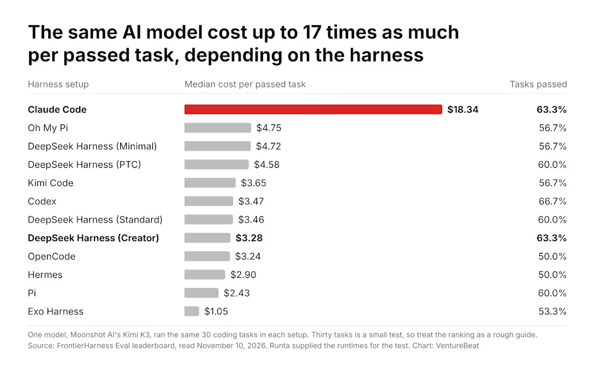
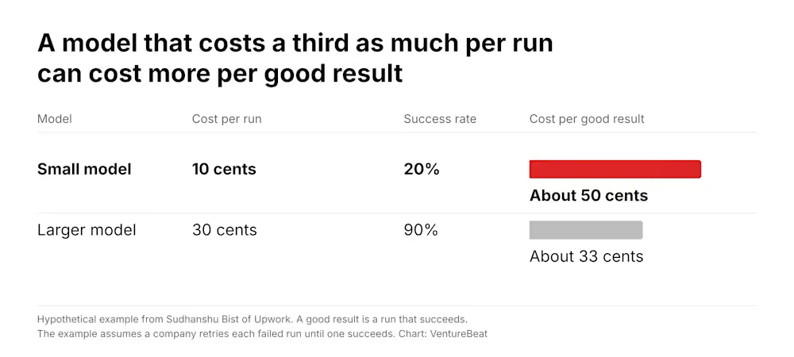

Barchasi oson bo‘lishi kerak edi. Sun’iy intellekt modellari aql bovar qilmas tezlikda bir-biridan o‘zib ketmoqda, shu bois kompaniyalar dasturchilarga kodning bor-yo‘g‘i bitta qatorini o‘zgartirish orqali modellarni almashtirish imkonini beruvchi shlyuzlar va marshrutizatorlarni o‘rnatishdi. Bu ularga har kuni paydo bo‘ladigan eng yaxshi modelga osongina o‘tish imkonini berishi kerak edi.

Biroq ma’lum bo‘lishicha, kompaniyalar buni mijozlar yoki xodimlar allaqachon foydalanib kelayotgan ilova ichida sinab ko‘rganida, modelni almashtirish haftalab yoki oylab muhandislik ishlarini talab qilishi mumkin. Ular ko‘pincha ilovani qayta yozishga yoki avvalgi modelga qaytishga majbur bo‘lishadi. Har bir necha oyda yangi eng yaxshi model paydo bo‘ladi, shuning uchun zamon bilan hamnafas bo‘lishni istagan kompaniyalar har safar ana shunday haftalab qilinadigan mashaqqatli ishlarga duch kelishadi.

VentureBeat kamida 100 nafar xodimga ega kompaniyalarda sun’iy intellekt yo‘nalishida ishlaydigan mutaxassislar o‘rtasida o‘tkazilgan oktyabr oyidagi so‘rovnomada modelni almashtirish masalasini o‘rganib chiqdi. Biz respondentlardan ularning kompaniyasi so‘nggi 12 oy ichida atrofidagi ilovani o‘zgartirmasdan, ishchi (production) sun’iy intellekt tizimidagi modelni almashtirganmi yoki yo‘qmi, deb so‘radik. Barcha respondentlarning 47 foizi “ha” deb javob berdi.

Modelni almashtirgan kompaniya vakillarining 70 foizi bu jarayon modelning o‘zini o‘zgartirishdan tashqari yana bir necha hafta yoki undan ko‘proq muhandislik mehnatini talab qilganini aytdi. O‘sha respondentlarning 36 foizi almashtirish bir oydan ko‘proq vaqt olganini bildirdi.

Modelni almashtirgan kompaniya vakillarining atigi 13 foizigina bu jarayon deyarli qiyinchilik tug‘dirmagani va oddiy sozlamani o‘zgartirishdek oson kechganini ta’kidladi.

Almashtirish natijalari turlicha bo‘ldi. Modelni almashtirgan respondentlarning 55 foizi yangi model eskisidek yoki undan ham yaxshiroq ishlaganini aytdi. Qolgan 45 foizi esa quyidagi ikki javobdan birini berdi: unumdorlik pasaygan va ularning kompaniyalari atrofidagi ilovani qayta ishlashga majbur bo‘lgan yoki asl modelga qaytgan. Ushbu 45 foizlik ulush sentyabridan beri statistik jihatdan sezilarli darajada o‘zgarmagani ma'lum bo'ldi.

Modelni almashtirish nima uchun qiyin kechishi va kompaniyalar bunga qanday tayyorgarlik ko‘rishini bilish uchun men Uber, PayPal, Home Depot, T-Mobile, Box va boshqa kompaniya rahbarlari bilan VentureBeat’ning yaqinda o‘tkazilgan intervyulari va tadbirlaridagi sessiyalariga tayanib tahlil qildim.

## Anthropic dushanba kuni narxlarni tushirdi, kompaniyalar esa ishni arzonroq modellarga yo‘naltirmoqda

Narxlarning arzonlashuvi kompaniyalar modellarini almashtirishining sabablaridan biridir, garchi bizning so‘rovnomamiz respondentlardan kompaniyalari nima sababdan almashtirgani yoki yangi model arzonroq bo‘lgani haqida so‘ramagan bo‘lsa ham. Dushanba kuni VentureBeat ijrochi muharriri Karl Fransenning xabar qilishicha, Anthropic kompaniyasi Claude Fable 5.2 modelini taqdim etdi: uning kirish tokenlari millioni uchun 8 dollar va chiqish tokenlari millioni uchun 40 dollar etib belgilandi, bu uning o‘rnini bosadigan oldingi versiya narxidan 20 foizga past. Bizning oktyabr oyidagi so‘rovnomamiz ushbu taqdimotdan oldin yakunlangan edi.

Kompaniyalar marshrutizatorlar (routers) yordamida o‘rta narxdagi modellardagi vazifalarni arzonroq modellarga ko‘chirishlari mumkin. Marshrutizator — bu har bir so‘rovni tanlangan modelga jo‘natuvchi dasturiy ta’minot. Marshrutizatsiya kompaniya ilovalari va model provayderlari o‘rtasida joylashgan sun’iy intellekt shlyuzining (AI gateway) vazifalaridan biridir.

Adobe’ning marketing agenti kerakli kontekstni tanlash uchun arzonroq modeldan foydalanadi va shundan so‘ng Adobe so‘rovni kattaroq modelga yuboradi, dedi Adobe’ning muhandislik bo‘yicha vitse-prezidenti Anjul Bambri 28-oktyabr kuni San-Fransiskoda bo‘lib o‘tgan VentureBeat Agentic Infrastructure Stack sammitida.

Ayrim startaplar modelni marshrutizatsiya qilish yechimlarini taklif qilmoqda. Shunday kompaniyalardan biri bo‘lgan Tetrate har bir so‘rov uchun modelni tanlaydigan “Avtomatik rejim”ga ega. Tetrate’ning hammuassisi va texnologiya bo‘yicha direktori Varun Talvarning sammitda ta’kidlashicha, Tetrate’ning ayrim mijozlari qaysi modelni olayotganiga endi e’tibor bermay qo‘yishgan. Ular Tetrate’ga model sozlamasiga “o‘zingiz xohlagan har qanday matnni yozib qo‘yavering” deyishadi, dedi u.

Biroq Talvarning so‘zlariga ko‘ra, mijoz bunday avtomatik tanlovga to‘liq ishonch hosil qilishidan oldin hali ko‘p ish qilishi kerak. Tetrate qaysi vazifa uchun qaysi model mos kelishini aniqlash borasida hali to‘liq mukammal darajaga yetgani yo‘q, dedi u. Mijozlar avval bitta jamoa bilan ish boshlaydi va faqatgina javoblar avvalgidek yaxshi bo‘lib, xarajatlar kamaygan taqdirdagina Avtomatik rejimni standart qilib belgilaydi, dedi Talvar.

Demak, shlyuz modelni o‘zgartirishni osonlashtiradi, biroq kompaniya baribir o‘z ilovasi yangi model bilan ham avvalgidek yaxshi ishlashini tekshirib ko‘rishi shart.

Mijozlar yoki xodimlar allaqachon bog‘lanib qolgan (foydalanayotgan) ilova ichidagi modelni almashtirish — bu mutlaqo boshqa vazifa bo‘lib, bizning so‘rovnomamiz aynan shu haqda so‘ragan edi. Frilanserlar uchun onlayn bozor hisoblangan Upwork kompaniyasining platforma infratuzilmasi muhandisligi bo‘yicha vitse-prezidenti Sudhanshu Bist sammitda huddi shunday chegarani ko‘rsatib o‘tdi. Ochiq kodli dasturlash bo‘yicha topshiriq uchun Bist shaxsan o‘zi kichik modelga kattaroq model boshlagan ishni oxiriga yetkazishiga ruxsat berishini aytdi. Ishchi (production) tizimda esa u “katta ehtimol bilan mavjud modelda qolgan bo‘lar edi”, dedi u. Modelni tanlash vazifaga bog‘liq, deb qo‘shimchib o‘tdi Bist chorshanba kungi elektron xatida. Upwork frilanserlarni ishlarga moslashtirish kabi takrorlanuvchi, aniq belgilangan vazifalarni kichikroq, moslashtirilgan modellarga yo‘naltiradi, ochiq yakunli (open-ended) ishlarni esa yirik modellarga beradi, dedi u.

Ishchi ilova muhandislar ma’lum bir model uchun moslashtirgan so‘rovlar (prompts), vositalar va testlarga tayanashi mumkin va model o‘zgarganda ana shu qismlarni qayta ishlash talab etilishi mumkin. So‘rovnoma respondentlardan qaysi qismlarni qayta ishlaganliklari yoki kompaniyalari shlyuzdan foydalanish-foydalanmasligini so‘ramagan.

## Yangi model eskilari uchun qurilgan dasturiy ta’minot ichida boshqacha harakat qilishi mumkin

Ba’zi kompaniyalar o‘z sohalarida yaxshiroq ishlashi uchun modellarni moslashtirish maqsadida ularni nozik sozlashga (fine-tuning) murojaat qilishgan. Kompaniya o‘sha modelni o‘zining namunalari asosida yana o‘qitadi, ammo bu nozik sozlash boshqa almashtirilgan modelga avtomatik ravishda o‘tmaydi. PayPal kompaniyasining sun’iy intellekt mahsulotlari bo‘yicha vitse-prezidenti va global rahbari Ren Chjan 8-oktyabr kuni VentureBeat tadbirida PayPal ilovadagi modelni “ko‘p marta” o‘zgartirishga majbur bo‘lganini aytdi. Xaridorlarga mahsulotlarni qidirish va sotib olishda yordam beradigan PayPal tijorat agenti uchun kompaniya kichikroq, tezroq modelga o‘tdi va uni nozik sozladi, bu aniqlikni oshirdi, biroq yetarli darajada emas edi, dedi Chjan. PayPal bu ishni agent mijozlargacha yetib borishidan oldin ichki tadqiqot va sinov bosqichida amalga oshirgan, dedi kompaniya.

Keyinchalik PayPal kamroq nozik sozlashga qaror qildi, chunki nozik sozlash mutaxassislar jamoasini talab qiladi va “yangi model paydo bo‘lganda, endi yangi model bilan yana qaytadan nozik sozlashni amalga oshirishingiz kerak bo‘ladi”, dedi Chjan. PayPal hozirda aniqlik, tezlik, narx va nazoratning eng yaxshi uyg‘unligiga erishish uchun nozik sozlashni tayyor (out-of-the-box) modellar hamda hisoblash quvvatini taqsimlash usullari bilan muvozanatga keltiradi, dedi Chjan seshanba kuni PayPal vakili orqali.

Box kompaniyasining texnologiya bo‘yicha direktori Ben Kasning aytishicha, yangi model ilovani yomonlashtirib qo‘yishi mumkin, chunki muhandislar o‘z dasturiy ta’minotini ular dastlab boshlagan modelga moslab qurishadi. Keyin muhandislar modelni o‘zgartiradilar va “yangi model shunchaki boshqacha harakat qilishi mumkin”, dedi Kas 30-oktyabr kuni VentureBeat’ning Beyond the Pilot podkasti uchun bergan intervyusida. Rahbarlar ko‘pincha yangiroq modeldan foydalanish yaxshiroq natijalarni beradi deb o‘ylashadi, biroq ko‘p hollarda bu unday emas, dedi Kas.

Kompaniya katta ehtimol bilan “dasturiy ramka (harness) asosida eng tubdan farq qiluvchi natijalarni” ko‘radi, dedi u. Harness — bu modelni o‘rab turuvchi, unga ko‘rsatmalarni uzatuvchi va model qanday vositalarni chaqirishi mumkinligini nazorat qiluvchi koddir. Hozirgi ilg‘or (frontier) modellar orasidan tanlash unchalik katta farq qilmaydi, chunki ularning barchasi juda yaxshi, dedi u. Box hozirda qaysi juftlik ishlashini aniqlash uchun harness’lar va modellarni birgalikda sinovdan o‘tkazmoqda, dedi u.

Harness vazifa narxini o‘zgartirib yuborishi mumkin. Runta’ning FrontierHarness Eval benchmarkida Moonshot AI’ning Kimi K3 modeli Claude Code va DeepSeek Harness konfiguratsiyalarining ikkalasida ham vazifalarning 63,3 foizidan muvaffaqiyatli o‘tdi. Biroq muvaffaqiyatli bajarilgan bitta vazifa uchun o‘rtacha xarajat Claude Code ichida 18,34 dollarni, DeepSeek Harness konfiguratsiyasida esa 3,28 dollarni tashkil etdi — ya’ni bir xil ball uchun besh barobardan ziyod ko‘p mablag‘ sarflangan, deb yozadi benchmark peshqadamlar jadvali.

Kimi K3 modeli uchun 12 ta harness sozlamalarida muvaffaqiyatli bajarilgan bitta vazifa uchun o‘rtacha xarajat ko‘rsatilgan ustunli diagramma: Claude Code’dagi 18,34 dollardan Exo Harness’dagi 1,05 dollargacha.

FrontierHarness Eval sinovida Kimi K3 bir xil 30 ta vazifa bo‘yicha 9 ta kodlash harness’idan va 12 ta sozlamadan o‘tdi. Test uchun ish vaqti muhitlarini taqdim etgan agent infratuzilmasi kompaniyasi Runta sentyabr oyining boshida natijalarni e’lon qildi. 30 ta vazifa — bu kichik test, shuning uchun reytinglar taxminiy qo‘llanma xolos, deb ta’kidlaydi mening podkastdagi hammuallifim Sem Vittevin benchmark bo‘yicha videosharmshida.

Yangi modelni baholayotgan kompaniyaga maslahatimiz shundan iborat: Uni haqiqatda ishlatiladigan harness ichida sinab ko‘ring va agar natijalar ko‘ngilni xira qilsa, modelni rad etishdan oldin boshqa harness’ni sinab ko‘ring. Aks holda kompaniya harness keltirib chiqargan muammo uchun modelni ayblashi mumkin.

Benchmark kompaniyasining asoschisi va bosh direktori Mika Xill-Smit 28-oktyabrdagi sammitda Artificial Analysis tadqiqotiga tayanib, eng yirik modellar uchun harness “biz kutgandan ko‘ra kamroq ahamiyatga ega bo‘lganini” aytdi. Boshqa tomondan, kichik modellar unchalik moslashuvchan emas, dedi Xill-Smit. Kichik model kodlovchi agent sinov natijalarida “20, 30, 40 ballik tebranishlarni” ko‘rsatishi mumkin, bu uning muayyan harness uslubida o‘qitilgan yoki o‘qitilmaganiga bog‘liq, dedi u.

Kichikroq modelga o‘tish — bu kompaniyalar vazifani keskin arzonlashtiradigan yo‘ldir, dedi Xill-Smit, lekin bu qadam muhandislik vaqti evaziga amalga oshadi. “Biz kichik modeldan foydalanishimizga imkon berish uchun ko‘proq mehnat sarflaymiz”, dedi u.

Agar kichik modellar harness’ga keskin munosabat bildirsa, muhandislar katta model uchun qurgan harness kichik modelga mos kelmasligi mumkin.

## Token uchun arzonroq turadigan model yaxshi natija uchun qimmatroqqa tushishi mumkin

Arzonroq model almashtirilgandan keyin tez-tez xatoga yo‘l qo‘ysa, u yakunda qimmatroqqa tushishi ham mumkin.

Bist sammit ishtirokchilariga keltirgan gipotetik misolga ko‘ra, har bir ishga tushirish uchun 10 sent turadigan va 20 foiz hollarda muvaffaqiyatli chiqadigan kichik model o‘rtacha beshta urinishni talab qiladi, shuning uchun yaxshi natija uchun u taxminan 50 sentga tushadi. Har bir ishga tushirish uchun 30 sent turadigan va 90 foiz hollarda muvaffaqiyatli chiqadigan yirikroq model esa yaxshi natija uchun taxminan 33 sent turadi, dedi Bist chorshanba kungi elektron xatida o‘z raqamlarini aniqlashtirib. Yirik model har bir ishga tushirish uchun uch barobar qimmat tursa ham, yaxshi natija uchun baribir arzonroqqa tushadi. Misol har bir muvaffaqiyatsiz urinish bittasi muvaffaqiyatli bo‘lguncha qayta urinilishini nazarda tutadi, dedi Bist.

Kichik model har bir urinish uchun 10 sent turishi, 20% muvaffaqiyat qozonishi va yaxshi natija uchun taxminan 50 sent sarflashi, yirikroq model esa har bir urinish uchun 30 sent turishi, 90% muvaffaqiyat qozonishi va yaxshi natija uchun taxminan 33 sent sarflashini ko‘rsatuvchi gipotetik misol jadvali.

Bistning aytishicha, Upwork model shlyuzi yaxshi natijaning to‘liq qiymatini qamrab olmaydi. Shlyuz model chaqiruvlari bo‘yicha xarajatlarni jamoalar kesimida kuzatib boradi. Shlyuz modellarni o‘qitish va nozik sozlash uchun ishlatiladigan GPU hisoblash quvvatini, agent natijasini tuzatishga odam sarflaydigan vaqtni yoki agentning vosita chaqiruvining protsessor xarajatlarini ko‘rmaydi, dedi u.

Tetrate’dan Talvarning ta’kidlashicha, ba’zi kompaniyalar faqat token narxiga e’tibor qaratish o‘rniga, yaxshi natija uchun ketadigan xarajatni hisoblay boshlamoqda. Sammitda WEKA bosh sun’iy intellekt direktori Val Bersovich shunday dedi: Sun’iy intellekt sanoati natija narxini o‘lchashi kerak bo‘lgan paytda, “hali ham token bo‘yicha hisob-kitob qilishga yopishib qolgan”. WEKA ushbu sammitning homiylaridan biri edi.

Ba’zi kompaniyalar arzonroq model ma’lum bir vazifa uchun noto‘g‘ri maqsad degan xulosaga kelishadi. T-Mobile axborot texnologiyalari bo‘yicha direktori Jeff Saymon sammitda ta’kidlaganidek, T-Mobile o‘zining mijozlarga xizmat ko‘rsatish agentlari uchun yetakchi modellardan foydalanadi va ular uchun qo‘shimcha haq to‘laydi. “Biz mijozlarga xizmat ko‘rsatishda xarajatlarni optimallashtirishga harakat qilmayapmiz”, dedi Saymon. T-Mobile mijozlarga tezkor va aniq javoblar berishga intilmoqda.

## Uber boshqariladigan agent modelini bir necha kun ichida almashtirishi mumkinligini aytmoqda

Agar ochiq vaznli model (open-weight) Uber’ning sun’iy intellekt kodini tekshirish jarayoni uchun eng yaxshi natija bersa, “biz uni bir necha kun ichida almashtiramiz”, dedi Uber’ning taniqli muhandisi Uday Kiran Medisetti sammitda. AI kodini tekshirish — bu Uber’ning markazlashgan tarzda bitta vazifa uchun quradigan va ishlatadigan boshqariladigan agentlaridan biridir.

Medisettining so‘zlariga ko‘ra, Uber kodni tekshirish uchun o‘z benchmarkiga ega, chunki kompaniya modelni o‘tgan yillardagi har qanday kod o‘zgarishiga qarshi sinab ko‘rishi mumkin. Keyinchalik Uber haqiqiy kodlash seanslari asosida fon kodlash agenti uchun benchmark yaratdi, uning so‘zlariga ko‘ra, bu ancha qiyin ish bo‘lgan.

Medisettining aytishicha, Uber avtomatlashtirilgan kodni tozalash vazifasi uchun modelni tanlashda benchmarklardan o‘rgangan narsalaridan foydalanadi. Bu vazifa eskirgan obyekt bayroqlarini (feature flags) olib tashlaydi. Benchmark qilish va to‘g‘ri modelni tanlash orqali Uber tozalash xarajatlarini 90 foizga qisqartirdi, dedi u. Uber har bir boshqariladigan agentda xarajatlarni qisqartirish imkoniyatlarini ko‘rmoqda, dedi u.

Medisettining aytishicha, Uber shuningdek, bir modeldan boshqasiga o‘tkazilishi mumkin bo‘lgan sun’iy intellekt so‘rovlarining ulushini kuzatib boradi. Uber o‘zining boshqariladigan agentlarini modeldan modelga ko‘chira oladi; muhandislar Claude Code kabi vositalarda qo‘lda ishga tushiradigan seanslarini ko‘chirish ancha qiyin, dedi u, chunki ularni ko‘chirish odamlarning ishlash tarzini o‘zgartirishni anglatadi.

## PayPal, Databricks mijozlari, Box, T-Mobile va JPMorgan Chase kompaniyalari almashtirishdan oldin nima qiladi?

PayPal o‘zining biznes bilimlarini modeldan tashqarida saqlaydi. Chjanning aytishicha, PayPal’ning ichki ma’lumotlar fanlari yordamchisi PayPal’ning biznes ta’riflari, uning tasdiqlangan so‘rovlari va tahlil qilish uchun bosqichma-bosqich qo‘llanmalarini o‘z ichiga olgan bilim qatlamiga tayanadi. PayPal ma’lumotlariga ko‘ra, ushbu qatlamning qo‘shilishi yordamchining ichki biznes savollari bo‘yicha aniqligini bir xil modelda 43 foizdan 95 foizgacha oshirgan. PayPal bu qatlamni modeldan alohida ravishda qurgan. “Bu modelga bog‘liq emas (model agnostic), chunki men buni ataylab shunday qilganman”, dedi Chjan. Yaxshiroq model chiqqanda, “men uni shunchaki ulab ishlataman. Men o‘z bilimlarimni o‘zgartirmasligim kerak”. O‘z bilimlarini bitta modelga bog‘lab qo‘ygan kompaniya har bir yangi model uchun o‘sha bilimlarni yana qaytadan moslashtirishga majbur bo‘ladi, dedi u.

Databricks mijozlari ilg‘or modelning javoblarini testga aylantiradilar. Databricks mahsulot boshqaruvi direktori Brayan Klarkning aytishicha, Databricks mijozlari ma’lum bir ketma-ketlikka amal qilishadi. Mijozlar birinchi versiyani oddiy matnli indeksga ega ilg‘or model asosida qurishadi, buni Klark “aqlli orqa fon (back end) emas, aqlli agent” deb atagan. Mijozlar ilg‘or modelning javoblarini baholash to‘plami sifatida saqlab qo‘yadilar. Keyin mijozlar arzonroq ochiq vaznli modelga o‘tadilar, arzonroq modelga yordam berish uchun vektorli qidiruvni qo‘shadilar va arzonroq modelning javoblarini baholash to‘plamiga nisbatan tekshiradilar, dedi Klark sammitda.

Box har bir o‘zgarishni uchta ko‘rsatkich — aniqlik, narx va tezlik bo‘yicha baholaydi, bular mijozlar Box agentlaridan bajarishni so‘ragan narsalar asosida tuzilgan baholash to‘plamida o‘lchanadi. “Buni qanday qilganingiz muhim emas, muhimi shu uchta raqam bo‘ladi”, dedi Kas. Baholash ma’lumotlarini yig‘ish odatda eng qiyin qismidir, dedi u.

T-Mobile o‘zgarishlarni haqiqiy mijozlar qo‘ng‘iroqlarida sinab ko‘radi va shundan so‘ng har bir seansni kuzatib boradi. Saymonning aytishicha, T-Mobile muhandislari mijozlarga xizmat ko‘rsatish agentlari qanday sozlanganini o‘zgartirmoqchi bo‘lsa, T-Mobile eski va yangi versiyalarni bir vaqtning o‘zida ishga tushiradi va ularni haqiqiy mijozlar qo‘ng‘iroqlarida solishtiradi. T-Mobile yangi versiyani faqat u yaxshiroq ishlasagina kengaytiradi. T-Mobile shuningdek, har bir chat va ovozli seansni kuzatib boradigan va noto‘g‘ri ko‘ringan javoblarni belgilab qo‘yadigan kichik modelni ishga tushiradi, dedi u. Ishga tushirishdan oldingi sinovlar mijoz savol berishining har qanday usulini qamrab ololmaydi, shuning uchun T-Mobile “laboratoriyada hech qachon ko‘rmaydigan” g‘ayrioddiy holatlarni qidiradi, dedi Saymon.

JPMorgan Chase xodimlar kirish huquqiga ega bo‘lishidan oldin yangi modellarni tasdiqlaydi. Modelni almashtirishni sekinlashtiradigan yana bir omil — tashkiliy boshqaruvdir. Anthropic kompaniyasining dushanba kuni ma’lum qilishicha, o‘zining ko‘proq xodimlariga Anthropic’ning Claude modelini joriy etayotgan JPMorgan Chase har bir yangi Claude modeli JPMorgan Chase’dagi har qanday shaxs undan foydalanishidan oldin bankning o‘z tasdiqlash jarayonidan o‘tishini talab qiladi.

## Kompaniyalar keyingi modelni almashtirishdan oldin nima qilishlari mumkin

Almashtirish talab qiladigan mehnat — bu almashtirishni ehtiyotkorlik bilan baholash uchun sababdir, uni butunlay rad etish uchun emas. 3-noyabr kuni VentureBeat bilan suhbatda Snowflake’ning AI kodlash agenti CoCo va bilim xodimlari uchun AI yordamchisi CoWork bo‘yicha mahsulot rahbari Uilyam Allen shunday dedi: bundan uch-to‘rt oy oldingi sun’iy intellekt haqidagi e’tiqodlar katta ehtimol bilan hozirda o‘z kuchini yo‘qotgan. “Biz hammamiz tushunishimiz va chinakamiga anglab yetishimiz kerak bo‘lgan ehtimoliy eng muhim xato — bu yo‘qotilgan xarajatlar xatosi (sunk cost fallacy) bo‘lib, unda siz: yo‘q, yo‘q, men buni qurishga shuncha vaqt sarfladim, uni qaytadan qurishni xohlamayman, deysiz”, dedi Allen.

Ushbu ma’ruzachilar bayon qilgan fikrlarga asoslanib, asosiy xulosa shundan iborat: almashtirishdan oldin tayyorgarlik ko‘ring.

Birinchidan, kompaniya yangi modelni unga qarshi sinab ko‘rishi uchun h
