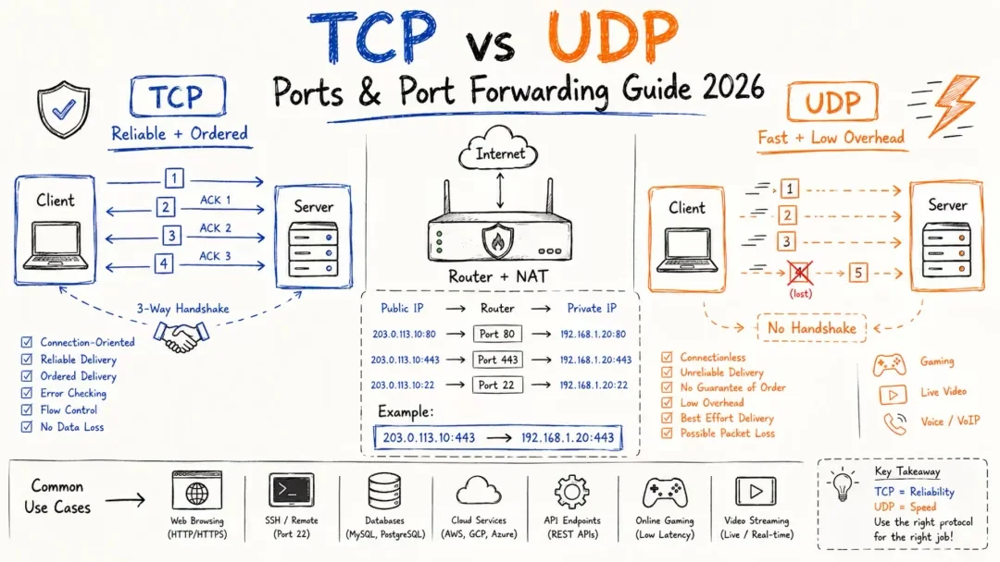

TCP (**Transmission Control Protocol** — uzatishni boshqarish protokoli) ma’lumotlaringiz belgilangan tartibda, to‘liq va xatosiz yetib borishini kafolatlaydi. Buning uchun u ma’lumot yuborishdan oldin ulanish o‘rnatadi va yo‘qolgan paketlarni qayta jo‘natadi.

UDP (**User Datagram Protocol** — foydalanuvchi datagrammalari protokoli) esa «yubor va unut» tamoyili asosida ishlaydi. U paketlarni yetib borgan-bormaganini tekshirmasdan, imkon qadar tez jo‘natadi. Ishonchlilik borasidagi kamchiligini juda yuqori tezlik bilan qoplaydi.

| Xususiyat | TCP | UDP |
|---|---|---|
| Ulanish | Uch bosqichli qo‘l siqish (3-way handshake) talab etiladi | Talab etilmaydi — ulanishsiz ishlaydi |
| Yetkazib berish kafolati | Ha — yo‘qolgan paketlarni qayta jo‘natadi | Kafolat yo‘q |
| Tartib | Ma’lumotlar belgilangan tartibda yetib keladi | Paketlar tartibsiz yetib kelishi mumkin |
| Xatolarni tuzatish | To‘liq | Faqat nazorat summasi |
| Tezlik | Sekinroq (qo‘shimcha xizmat xarajatlari ko‘proq) | Tezroq (qo‘shimcha xarajatlar minimal) |
| Sarlavha hajmi | 20–60 bayt | 8 bayt (o‘zgarmas) |
| Oqimni boshqarish | Ha — suriluvchi oyna mexanizmi | Yo‘q |
| Tirbandlikni boshqarish | Ha — yuklama oshganda uzatish tezligini pasaytiradi | Yo‘q |
| Broadcast/Multicast | Yo‘q | Ha |
| Eng mos qo‘llanish sohasi | Veb, ma’lumotlar bazalari, elektron pochta, fayl uzatish | Striming, o‘yinlar, DNS, VoIP |

## TCP qanday ishlaydi: uch bosqichli qo‘l siqish

TCP bir bayt ma’lumot yuborishdan oldin uch bosqichli qo‘l siqish (3-way handshake) yordamida ulanish o‘rnatadi:

- **SYN** — mijoz sinxronlash paketini yuboradi: «Ulanmoqchiman».
- **SYN-ACK** — server javob beradi: «Xo‘p, tayyorman».
- **ACK** — mijoz tasdiqlaydi: «Ajoyib, boshlaymiz».

Faqat shu jarayon tugagandan keyingina ma’lumotlar uzatila boshlaydi. TCP yuborgan har bir paket uchun qabul qiluvchi tomon tasdiq (ACK) jo‘natadi. Agar belgilangan vaqt ichida ACK kelmasa, TCP paketni avtomatik ravishda qayta yuboradi.

Shu sababli TCP ishonchli, ammo sekinroq: har bir paket qo‘shimcha xizmat xarajatlarini keltirib chiqaradi, yo‘qolgan paketlar esa qayta yuborilishini kutish vaqtida kechikishlarga sabab bo‘ladi.

## TCP ulanishini uzish (4 bosqich)

TCP ulanishini yopish to‘rt bosqichda amalga oshadi:

1. Mijoz FIN (uzatish tugadi) paketini yuboradi.
2. Server ACK yuboradi.
3. Server o‘z FIN paketini yuboradi.
4. Mijoz ACK yuboradi.

Bunday tartibli yakunlash ulanish yopilishidan oldin har ikki tomon barcha ma’lumotlarni yuborib bo‘lishini ta’minlaydi.

## UDP qanday ishlaydi: yubor va unut

UDP qo‘l siqish jarayonini butunlay chetlab o‘tadi. U shunchaki ma’lumotlaringizni 8 baytli kichik sarlavhaga joylab, jo‘natadi. Ulanish holati kuzatilmaydi, tasdiqlar yuborilmaydi va paketlar qayta jo‘natilmaydi.

```text
UDP Header (8 bytes):
┌────────────────┬────────────────┐
│  Source Port   │ Dest Port      │  4 bytes
├────────────────┴────────────────┤
│  Length        │ Checksum       │  4 bytes
└─────────────────────────────────┘
│  Data (payload)...              │
```

UDP sarlavhasining 8 bayt bo‘lishi, TCP sarlavhasi esa 20–60 baytni tashkil etishi — soniyasiga minglab kichik paket yuboradigan ilovalar, masalan, o‘yinlar, VoIP qo‘ng‘iroqlari yoki DNS so‘rovlari uchun katta ustunlikdir.

## Nega ishonchsiz protokol kerak bo‘lishi mumkin?

Chunki «ishonchsiz» degani «buzuq» degani emas. Bu shunchaki ishonchlilikni ilovaning o‘zi ta’minlashini yoki umuman bunga ehtiyoj yo‘qligini anglatadi.

- **Video striming:** Kadrni qayta yuborishni kutib, tasvir to‘xtab qolganidan ko‘ra, bitta kadr tushib qolishi ma’qul. Ko‘zlaringiz bitta yo‘qolgan kadrni sezmasligi mumkin, ammo yarim soniyalik qotib qolishni darhol payqaydi.
- **Onlayn o‘yinlar:** 200 ms oldingi eskirgan pozitsiya yangilanishi foydasiz. Uni tashlab yuborib, keyingi yangi ma’lumotdan foydalangan ma’qul.
- **DNS so‘rovlari:** So‘rov bitta kichik paketdan iborat. Agar paket yo‘qolsa, uni yana yuborish mumkin — bu bitta paket almashinuvi uchun to‘liq TCP ulanishini saqlab turishdan tezroq.
- **VoIP qo‘ng‘iroqlari:** Videodagi kabi, 20 ms lik audio bo‘lagi yo‘qolsa, ovozda yengil chirsillash paydo bo‘lishi mumkin. Bu qo‘ng‘iroqni paket qayta yuborilguncha to‘xtatib turishdan yaxshiroq.

## Qaysi protokoldan foydalanish kerak?

**Quyidagi holatlarda TCP dan foydalaning:**

- Ma’lumotlarning yaxlitligi juda muhim bo‘lsa — HTTP/HTTPS, ma’lumotlar bazasiga so‘rovlar, fayl uzatish, elektron pochta.
- Ma’lumot yetib borganini bilishingiz kerak bo‘lsa — API chaqiruvlari, shakl ma’lumotlarini yuborish, autentifikatsiya.
- Paketlar belgilangan tartibda yetib kelishi shart bo‘lsa — faylni o‘qish, veb-sahifani yuklash.
- Standart veb-xizmat yaratayotgan bo‘lsangiz — serverlar uchun odatiy tanlov TCP hisoblanadi.

**Quyidagi holatlarda UDP dan foydalaning:**

- Mukammal yetkazib berishdan ko‘ra tezlik muhimroq bo‘lsa — jonli video, audio qo‘ng‘iroqlar, o‘yinlar.
- Ayrim paketlarning yo‘qolishiga chidash mumkin bo‘lsa — masalan, bitta kadr yoki o‘yinchining pozitsiyasi haqidagi yangilanish tushib qolsa.
- Kichik va tez-tez yuboriladigan xabarlar bilan ishlasangiz — DNS, DHCP, IoT sensorlari, metrikalar.
- Broadcast/multicast kerak bo‘lsa — xizmatlarni aniqlash, mDNS, SSDP.
- O‘zingizning ishonchli transport mexanizmingizni yaratayotgan bo‘lsangiz — HTTP/3 ishlatadigan QUIC TCP dagi «head-of-line blocking» muammosini chetlab o‘tish uchun UDP ustida ishonchlilikni ta’minlaydi.

## ICMP: ping protokoli (port raqamlari yo‘q)

Tarmoq sohasidagi eng keng tarqalgan noto‘g‘ri tushunchalardan biri shuki, ping port raqamidan foydalanmaydi.

Ping ICMP (Internet Control Message Protocol — internetni boshqarish xabarlari protokoli) dan foydalanadi. Bu TCP va UDP bilan bir qatorda ishlaydigan, ammo ulardan farq qiladigan alohida 3-qavat protokolidir. ICMP da port tushunchasi yo‘q, chunki u transport protokoli emas, balki diagnostika va boshqaruv protokolidir.

### Ping qanday ishlaydi

```bash
ping google.com
```

1. Kompyuteringiz manzilga ICMP Echo Request (aks-sado so‘rovi) paketini yuboradi.
2. Manzil ICMP Echo Reply (aks-sado javobi) bilan javob qaytaradi.
3. Kompyuteringiz borib-kelish vaqtini o‘lchaydi.

Natija taxminan quyidagicha ko‘rinadi:

```text
PING google.com: 56 data bytes
64 bytes from 142.250.80.46: icmp_seq=0 ttl=117 time=11.234 ms
64 bytes from 142.250.80.46: icmp_seq=1 ttl=117 time=10.891 ms
```

- `icmp_seq`: paketning tartib raqami.
- `ttl`: Time To Live — har bir routerdan o‘tishda kamayib boradigan yashash muddati.
- `time`: millisekundlarda o‘lchanadigan borib-kelish kechikishi.

### Nega «80-portga ping yuborish» texnik jihatdan noto‘g‘ri?

Dasturchilar «80-portga ping yuborish» deganda, aslida 80-portga TCP ulanishini tekshirishni nazarda tutishadi. ICMP da portlar yo‘q. Muayyan portni tekshiradigan vositalar quyidagilar:

```bash
# TCP 443-portga ulanish mumkinligini tekshirish
nc -zv google.com 443

# Xuddi shu ishni telnet orqali bajarish
telnet google.com 80

# Yoki curl yordamida
curl -I https://google.com
```

### traceroute / tracert

`traceroute` (Linux/Mac) va `tracert` (Windows) ham ICMP dan foydalanadi. Ular TTL qiymatini bosqichma-bosqich oshirib boradigan paketlarni yuboradi. Yo‘ldagi har bir router TTL qiymatini bittaga kamaytiradi. TTL 0 ga yetganda, router ICMP Time Exceeded (vaqt tugadi) xabarini qaytaradi. Shu orqali uning IP manzili va ushbu tugungacha bo‘lgan kechikish aniqlanadi.

```bash
traceroute google.com        # Linux / macOS
tracert google.com           # Windows
```

### Server ishlab turgan bo‘lsa-da, ping ishlamasa

Xavfsizlik devorlari (firewall) ko‘pincha ICMP trafigini bloklaydi. Ping ishlamasa, server o‘chiq deb xulosa qilmang — uning o‘rniga TCP asosidagi tekshiruvdan foydalaning:

```bash
# Bu buyruq ICMP bloklangan bo‘lsa ham ishlaydi
curl -I --max-time 5 https://yourserver.com
```

## Keng tarqalgan portlar ma’lumotnomasi

Portlar uchta diapazonga bo‘linadi:

- **Ma’lum portlar (0–1023):** IANA tomonidan ajratiladi va tizim xizmatlari uchun ishlatiladi. Ularga ulanishni tinglash (bind) uchun root/administrator huquqlari talab qilinadi.
- **Ro‘yxatdan o‘tkazilgan portlar (1024–49151):** Muayyan ilovalarga ajratiladi. Root huquqi talab etilmaydi.
- **Dinamik/vqtinchalik portlar (49152–65535):** Mijoz ulanishlari uchun vaqtincha ishlatiladi.

### Tizim / veb-portlari

| Port | Protokol | Xizmat | Tavsif |
|---|---|---|---|
| 20 | TCP | FTP Data | FTP faol rejimida ma’lumot uzatish |
| 21 | TCP | FTP Control | FTP buyruqlari va boshqaruvi |
| 22 | TCP | SSH | Shifrlangan masofaviy kirish va tunnellash |
| 23 | TCP | Telnet | Shifrlanmagan terminal (eskirgan — SSH dan foydalaning) |
| 25 | TCP | SMTP | Serverlar o‘rtasida elektron pochta yetkazish |
| 53 | TCP/UDP | DNS | Domen nomlarini aniqlash |
| 67/68 | UDP | DHCP | IP-manzillarni dinamik tayinlash |
| 69 | UDP | TFTP | Oddiy fayl uzatish; PXE orqali yuklashda ishlatiladi |
| 80 | TCP | HTTP | Shifrlanmagan veb-trafik |
| 110 | TCP | POP3 | Elektron pochtani qabul qilish (eski protokol) |
| 123 | UDP | NTP | Tarmoq vaqtini sinxronlash |
| 143 | TCP | IMAP | Elektron pochta qutisiga kirish va uni sinxronlash |
| 161/162 | UDP | SNMP | Tarmoq qurilmalarini monitoring qilish |
| 179 | TCP | BGP | Internet marshrutlash protokoli |
| 389 | TCP/UDP | LDAP | Katalog xizmatlari va autentifikatsiya |
| 443 | TCP | HTTPS | Shifrlangan veb-trafik (TLS) |
| 445 | TCP | SMB | Windows fayllarini ulashish |
| 465/587 | TCP | SMTPS/Submission | Elektron pochtani xavfsiz yuborish |
| 636 | TCP | LDAPS | TLS orqali xavfsiz LDAP |
| 993 | TCP | IMAPS | Xavfsiz IMAP |
| 995 | TCP | POP3S | Xavfsiz POP3 |

### Ma’lumotlar bazasi va kesh portlari

| Port | Protokol | Xizmat | Tavsif |
|---|---|---|---|
| 1433 | TCP | MSSQL | Microsoft SQL Server |
| 1521 | TCP | Oracle DB | Oracle Database tinglovchisi |
| 3306 | TCP | MySQL / MariaDB | Ochiq kodli eng mashhur relyatsion ma’lumotlar bazasi |
| 5432 | TCP | PostgreSQL | Ilg‘or ochiq kodli ma’lumotlar bazasi |
| 5984 | TCP | CouchDB | REST API ga ega hujjatli ma’lumotlar bazasi |
| 6379 | TCP | Redis | Tezkor xotiradagi kesh va xabarlar brokeri |
| 9200 | TCP | Elasticsearch | Qidiruv va tahlil mexanizmining HTTP API si |
| 11211 | TCP/UDP | Memcached | Taqsimlangan xotira keshlash tizimi |
| 27017 | TCP | MongoDB | NoSQL hujjatli ma’lumotlar bazasi |

### DevOps va xabar almashish portlari

| Port | Protokol | Xizmat | Tavsif |
|---|---|---|---|
| 2375 | TCP | Docker (TLS siz) | Docker daemon REST API (shifrlanmagan) |
| 2376 | TCP | Docker (TLS bilan) | Docker daemon REST API (shifrlangan) |
| 3389 | TCP/UDP | RDP | Windows masofaviy ish stoli |
| 4369 | TCP | Erlang EPM | RabbitMQ tugunlarini aniqlashda ishlatiladi |
| 5672 | TCP | AMQP (RabbitMQ) | Xabarlar navbati protokoli |
| 5671 | TCP | AMQPS | TLS orqali xavfsiz AMQP |
| 6443 | TCP | Kubernetes API | kube-apiserver |
| 8080 | TCP | HTTP Alt | Dasturlash serverlari, proksilar, Tomcat |
| 9090 | TCP | Prometheus | Metrikalar va ogohlantirishlar |
| 9092 | TCP | Apache Kafka | Xabarlar brokeri |
| 15672 | TCP | RabbitMQ UI | Veb-boshqaruv konsoli |

### Dasturlash serverlari portlari

| Port | Protokol | Xizmat | Tavsif |
|---|---|---|---|
| 3000 | TCP | React / Next.js / Node.js | Eng ko‘p ishlatiladigan dasturlash serveri porti |
| 3001 | TCP | React fallback / Remix | 3000-port band bo‘lganda ishlatiladi |
| 4200 | TCP | Angular CLI | Angular dasturlash serveri |
| 4321 | TCP | Astro | Astro dasturlash serveri |
| 5173 | TCP | Vite | Vite asosidagi dasturlash serverlari |
| 8000 | TCP | Django / FastAPI | Python veb-freymvorklari |
| 8888 | TCP | Jupyter Notebook | Ma’lumotlar tahlili uchun bloknotlar |
| 11434 | TCP | Ollama | Mahalliy AI/LLM serveri |

## Port forwarding

Port forwarding (portni yo‘naltirish) uy yoki ofis tarmog‘ingiz ichida ishlayotgan serverni ommaviy internetga ochish imkonini beradi. Bu sozlama bo‘lmasa, routeringizdagi NAT xavfsizlik devori barcha kiruvchi ulanishlarni bloklaydi.

### NAT (Network Address Translation — tarmoq manzillarini o‘zgartirish) qanday ishlaydi?

Routeringizda bitta ommaviy IP-manzil (masalan, `203.0.113.45`) bo‘ladi, ammo u barcha qurilmalaringizga xususiy IP-manzillar (masalan, `192.168.1.x`) tayinlaydi. Tashqi tarmoqqa ulanganingizda router ulanishni kuzatib boradi va javoblarni tegishli qurilmaga yo‘naltiradi. Ammo tashqaridan yangi ulanish kelganda, port forwarding qoidasini belgilamasangiz, router uni qaysi qurilmaga yo‘naltirish kerakligini bilmaydi.

```text
Internet → Router (203.0.113.45:80) → Serveringiz (192.168.1.100:3000)
```

### 1-qadam: Serveringizning LAN IP-manzilini aniqlang

**Linux / macOS:**

```bash
ip addr show         # Linux
ifconfig             # macOS
# Faol interfeys (eth0, en0, wlan0) ostidan inet 192.168.x.x qatorini toping
```

**Windows:**

```cmd
ipconfig
# Faol adapter ostidan IPv4 Address qatorini toping
```

Qayta ishga tushirilgandan keyin o‘zgarmasligi uchun serveringiz IP-manzilini statik LAN IP qilib belgilang. Buni router sozlamalaridagi DHCP reservation (DHCP orqali manzilni band qilish) bo‘limida qurilmaning MAC-manzili yordamida bajaring.

### 2-qadam: Router boshqaruv paneliga kiring

Brauzerni oching va standart shlyuz manzilingizga o‘ting:

```bash
# Shlyuzni aniqlash
ip route | grep default      # Linux/Mac
# Natija: default via 192.168.1.1 dev eth0
```

Ko‘p uchraydigan shlyuz manzillari: `192.168.1.1`, `192.168.0.1`, `10.0.0.1`.

Routeringizning login ma’lumotlari bilan tizimga kiring (ular ko‘pincha router yorlig‘ida yozilgan bo‘ladi).

### 3-qadam: Port forwarding qoidasini yarating

Router sozlamalaridan **Port Forwarding**, **NAT** yoki **Virtual Server** bo‘limini toping. Quyidagi qiymatlar bilan qoida yarating:

| Maydon | Misol | Izoh |
|---|---|---|
| Tashqi port | 80 | Internet ulanadigan port |
| Ichki IP | 192.168.1.100 | Serveringizning LAN IP-manzili |
| Ichki port | 3000 | Ilovangiz tinglaydigan port |
| Protokol | TCP | Yoki UDP yoxud ikkalasi |
| Tavsif | My App | Ixtiyoriy yorliq |

Tashqi va ichki portlar bir-biridan farq qilishi mumkin. Shu tariqa ilovani ichki tarmoqda 3000-portda ishga tushirib, tashqariga 80-port orqali ochishingiz mumkin.

### 4-qadam: Tarmog‘ingizdan tashqarida turib tekshiring

Ommaviy IP-manzilingizni aniqlang:

```bash
curl ifconfig.me # yoki whatismyip.com saytiga kiring
```

Tarmog‘ingizdan tashqarida turib tekshiring (o‘sha Wi-Fi ga ulangan qurilmadan emas, mobil internetdan foydalaning):

```bash
curl -I http://YOUR_PUBLIC_IP:80
```

Yoki port internetdan ochiqligini tekshirish uchun Port Checker vositamizdan foydalaning.

### Port forwarding bilan bog‘liq keng tarqalgan muammolar

**Port hanuz yopiq ko‘rinmoqda:**

- Serveringiz faqat `127.0.0.1` da emas, barcha interfeyslarni qamrab oluvchi `0.0.0.0` manzilida tinglayotganiga ishonch hosil qiling.
- Server tomonidagi xavfsizlik devorini (`ufw`, `iptables`, Windows Defender) tekshiring — routerda port yo‘naltirilgan bo‘lsa ham, u portni bloklashi mumkin.
- Ayrim internet-provayderlar uy interneti ulanishlarida 80 va 443-portlarni bloklaydi. Buning o‘rniga 8080-portni sinab ko‘ring.

**Internet-provayder kiruvchi ulanishlarni bloklaydi:**

- Ayrim provayderlar CGNAT (Carrier-Grade NAT) dan foydalanadi. Bunda sizga umumiy ommaviy IP-manzil beriladi va port forwarding ishlamaydi.
- Yechim: Cloudflare Tunnel, ngrok yoki Playit.gg kabi tunnel xizmatidan foydalaning.

**Bir tarmoq ichidan tekshirganda ishlamayapti:**

- NAT loopback (hairpin NAT) funksiyasini hamma routerlar ham qo‘llab-quvvatlamaydi.
- Boshqa tarmoqqa ulangan qurilmadan (mobil internet orqali) tekshiring.

**Server xavfsizlik devori trafikni bloklamoqda:**

```bash
# Ubuntu da ufw orqali 3000-portga ruxsat berish
sudo ufw allow 3000/tcp

# iptables orqali ruxsat berish
sudo iptables -A INPUT -p tcp --dport 3000 -j ACCEPT
```

## Haqiqiy ilovalarda TCP va UDP

### HTTP/1.1 va HTTP/2 — TCP

Barcha veb-trafik TCP dan foydalanadi. TCP ning ishonchliligi sahifalar birorta bayt ham yo‘qolmasdan to‘liq yuklanishini ta’minlaydi. HTTP/2 bir nechta qo‘l siqish jarayonlari bilan bog‘liq qo‘shimcha xarajatlarni kamaytirish uchun bitta TCP ulanishi orqali multiplekslashni qo‘llaydi.

### HTTP/3 va QUIC — UDP

HTTP/3 UDP ustida ishlaydigan QUIC protokoliga asoslanadi. QUIC TCP ning ishonchlilik imkoniyatlarini ilova qatlamida qayta joriy qiladi, biroq TCP dagi «head-of-line blocking» muammosini chetlab o‘tadi. Agar oqimlardan birida paket yo‘qolsa, butun ulanishdagi barcha oqimlar emas, faqat o‘sha oqim to‘xtab turadi. Shu sababli HTTP/3 zamonaviy veb-ilovalarda ancha tez ishlaydi.

### DNS — asosan UDP, shuningdek TCP

DNS odatda so‘rovlar uchun UDP ning 53-portidan foydalanadi (paketlar kichik, qo‘shimcha xarajat kam). Ammo quyidagi holatlarda TCP ga o‘tadi:

- 512 baytdan katta javoblar;
- DNS serverlari o‘rtasidagi zona uzatishlari;
- DNSSEC bilan imzolangan javoblar.

### Onlayn o‘yinlar — UDP

Fortnite, Valorant va Counter-Strike kabi o‘yinlar o‘yin holatiga oid yangilanishlarni (o‘yinchilar pozitsiyasi, o‘qlar va hokazo) uzatish uchun UDP dan foydalanadi. Paket yo‘qolishi kadrning biroz eskirishiga olib keladi — bu maqbul holat. Qayta yuborilishini kutayotgan kechikkan paket esa o‘yinni o‘ynab bo‘lmaydigan holga keltiradi.

Odatda o‘yinlar o‘yin natijalari, chat xabarlari va autentifikatsiya kabi ishonchli yetkazilishi kerak bo‘lgan ma’lumotlar uchun alohida TCP ulanishidan foydalanadi.

### VoIP (WhatsApp, Zoom, Teams) — UDP

Haqiqiy vaqt rejimidagi audio UDP dan foydalanadi. Audio kodek paketlarning oz miqdorda yo‘qolishini muammosiz qoplay oladi — ovozda biroz chirsillash eshitilishi mumkin, ammo qo‘ng‘iroq davom etaveradi. TCP ishlatilganda esa paketlarni qayta yuborish zarur bo‘lgan har safar sezilarli pauzalar yuzaga kelardi.

### WebSockets — TCP

WebSockets TCP ustida ishlaydi (ular HTTP ulanishini yangilash orqali boshlanadi). Chat, jonli boshqaruv panellari yoki hamkorlikda tahrirlash kabi real vaqt funksiyalarini yaratayotgan bo‘lsangiz, WebSockets sizga kam qo‘shimcha xarajatli doimiy TCP ulanishini taqdim etadi.

## Xavfsizlik masalalari

### TCP SYN Flood hujumi

Hujumchilar TCP qo‘l siqish jarayonidan foydalanib, yakuniy ACK paketini yubormasdan (ya’ni qo‘l siqishni tugatmay) minglab SYN paketlarini jo‘natishi mumkin. Bu serverning ulanishlar jadvalini to‘ldirib, DoS hujumiga olib keladi. Bunga qarshi SYN cookies va xavfsizlik devorida so‘rovlar tezligini cheklash kabi choralar qo‘llanadi.

### UDP orqali kuchaytirish hujumlari

UDP ning ulanishsiz ishlashi uni aks ettirish/kuchaytirish hujumlariga zaif qiladi. Hujumchi DNS yoki NTP serveriga soxta manba IP-manzili (nishon manzili) ko‘rsatilgan kichik UDP so‘rovini yuboradi. Server esa jabrlanuvchiga ancha katta javob jo‘natadi. Himoya choralari: so‘rovlar tezligini cheklash, manba IP-manzilini tekshirish (BCP38) va ishlatilmaydigan UDP xizmatlarini bloklash.

### Portlarni skanerlash

Hujumchilar va xavfsizlik mutaxassislari ochiq portlarni aniqlash uchun TCP (SYN scan) hamda UDP skanerlash usullaridan foydalanadi. `nmap` kabi vositalar xavfsizlik auditida keng qo‘llanadi. Faqat zarur portlarni ochiq qoldiring, qolganlarini esa xavfsizlik devori yordamida bloklang.

```bash
# TCP portlarini skanerlash (nmap talab qilinadi)
nmap -sT -p 1-1000 192.168.1.1

# UDP portlarini skanerlash
nmap -sU -p 53,67,123,161 192.168.1.1
```

## Xulosa

- **TCP:** Ma’lumotlar to‘liq, belgilangan tartibda va xatosiz yetib borishi shart bo‘lsa, TCP ni tanlang. Veb-serverlar, ma’lumotlar bazalari, fayl uzatish va elektron pochta — bularning barchasi TCP dan foydalanadi.
- **UDP:** Mukammal yetkazib berishdan ko‘ra tezlik muhim bo‘lsa, UDP ni tanlang. Video striming, o‘yinlar, DNS va VoIP UDP dan foydalanadi.
- **ICMP:** TCP ham, UDP ham emas — portlari bo‘lmagan diagnostika protokoli. Ping va traceroute ICMP dan foydalanadi.
- **Port forwarding:** Routerdagi tashqi portni ichki IP:port manziliga bog‘laydi va shu orqali serveringizga internetdan kirish imkonini beradi.

Ushbu bilimlarni amalda qo‘llash uchun bepul vositalarimizdan foydalaning:

- **[Port Checker](https://devtoollab.com/tools/port-checker)** — port internetdan ochiqligini tekshirish.
- **[DNS Lookup](https://devtoollab.com/tools/dns-lookup)** — DNS yozuvlarini tekshirish.
- **[Localhost Port Tester](https://devtoollab.com/tools/localhost-tester)** — localhost dagi istalgan portda nima ishlayotganini aniqlash.
- **[Browser Error Codes](https://devtoollab.com/tools/browser-error-codes)** — ulanish va SSL xatolarini aniqlash.
