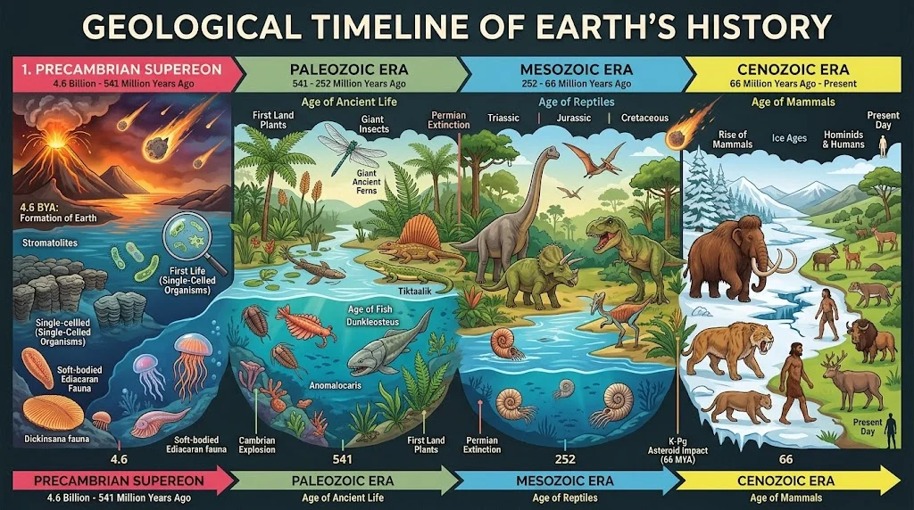

Tasavvur qiling, sizda vaqt mashinasi bor. Biz hozir 4.6 milliard yil orqaga, koinotdagi oddiy bir chang va gaz bulutlari aylanib, bizning jonajon uyimiz – Yerni hosil qilayotgan davrga sayohat qilamiz. Bu sayyorada hayot qanday paydo bo'ldi? Qanday qilib mittigina hujayralardan ulkan dinozavrlar-u, oxir-oqibat biz – insonlar keldik? Va nega ba'zi qudratli mavjudotlar izsiz yo'qolib ketdi?
Keling, olimlar va paleontologlarning ko'p yillik izlanishlari orqali tasdiqlangan (ilmiy konsensusga erishilgan) faktlar asosida Yer tarixini sahifalab chiqamiz.

Umumiy Xronologiya (Timeline)
Quyidagi chizmada Yer tarixining asosiy eralari va u yerda yashagan mavjudotlar ketma-ketligi (ingliz tilida) keltirilgan:

## 1. Hayotsiz Boshlanish va Ilk Uchqunlar: Katarxey va Arxey Eonlari (4.6 – 2.5 milliard yil oldin)
Boshlanishida Yer olovli do'zaxga o'xshardi. Magma ummonlari va tinimsiz meteorit yomg'irlari ostida hayot bo'lishi mumkin emasdi. Biroq sayyora sovib, okeanlar paydo bo'lgach, mo'jiza yuz berdi.

#### Qanday mavjudotlar yashagan?
Arxey eonida faqat bir hujayrali, yadrosiz organizmlar (prokariotlar) yashagan. Ularning eng mashhurlari — Sianobakteriyalar edi. Ular "stromatolitlar" deb ataluvchi toshsimon tuzilmalarni hosil qilgan.

#### Nima uchun o'zgargan/qirilib ketgan?
Bu mitti bakteriyalar quyosh nuridan energiya olib (fotosintez), o'zidan kislorod ajrata boshladi. O'sha paytdagi hayot uchun kislorod zahar edi! Natijada, kislorodsiz muhitda yashovchi (anaerob) organizmlarning katta qismi qirilib ketdi. Bu voqea ilm-fanda Buyuk Kislorod Falokati (Great Oxidation Event) deb ataladi. Ammo aynan shu voqea kelajakda biz kabi nafas oluvchi murakkab mavjudotlar paydo bo'lishiga yo'l ochdi.

## 2. Murakkab Hayotning Boshlanishi: Proterozoy Eoni (2.5 milliard – 541 million yil oldin)
Kislorod ko'paygach, hayot asta-sekin murakkablasha boshladi. Hujayralar birlashib, ilk ko'p hujayrali organizmlarni yaratdi.
#### Qanday mavjudotlar yashagan?
Davr oxiriga kelib (Ediakara davri) dengiz tubida g'alati, barg yoki naychaga o'xshash yumshoq tanali mavjudotlar — Ediakara biotasi (masalan, Dickinsonia, Charnia) paydo bo'ldi. Ularning na og'zi, na ko'zi va na harakatlanish a'zolari bor edi.

#### Nima uchun o'zgargan/qirilib ketgan?
Ediakara mavjudotlari Kembriy davrining boshlanishi bilan birdaniga g'oyib bo'ldi. Sababi aniq emas, ammo olimlarning fikricha, atrof-muhitning o'zgarishi va birinchi yirtqichlarning (faol harakatlanuvchi hayvonlarning) paydo bo'lishi bu himoyasiz mavjudotlarni qirib yuborgan.

## 3. Hayotning Portlashi: Paleozoy Erasi (541 – 252 million yil oldin)
Bu davrda evolyutsiya xuddi aqldan ozgandek tezlashdi. Buni Kembriy portlashi deb ataymiz. Hayot okeandan quruqlikka chiqdi.

#### Qanday mavjudotlar yashagan?
Okeanlarda: Trilobitlar (zirhli hasharotsimonlar), Anomalokaris (dastlabki bahaybat yirtqich) va ilk baliqlar yashagan.

#### Quruqlikda:
 Ulkan o'rmonlar (qirqquloqlar) paydo bo'ldi. Kislorod darajasi hozirgidan ham yuqori bo'lgani uchun hasharotlar ulkan o'lchamlarga yetgan. Masalan, qanotlari 70 sm bo'lgan ninachi — Meganeura va ilk sudralib yuruvchilar (Dimetrodon) yashagan.

#### Nima uchun o'zgargan/qirilib ketgan?
Paleozoy erasi sayyora tarixidagi eng daxshatli falokat — Perm-Trias qirilishi (The Great Dying) bilan yakunlandi. Sibir hududidagi davomiy va ulkan vulqon otilishlari oqibatida atmosferaga milliardlab tonna karbonat angidrid va zaharli gazlar tarqaldi. Global isish va okeanlarning nordonlashuvi tufayli Yerdagi barcha turlarning 90% dan ortig'i qirilib ketdi. Trilobitlar aynan shu yerda o'z tarixini yakunladi.

## 4. Dinozavrlar Saltanati: Mezozoy Erasi (252 – 66 million yil oldin)
Buyuk qirilishdan omon qolgan ozgina mavjudotlar bo'sh qolgan sayyorani qayta egalladi va evolyutsiya sahnasiga yirik sudralib yuruvchilar — Dinozavrlar chiqdi.
#### Qanday mavjudotlar yashagan?
Mezozoy Uch davrga bo'linadi: **Trias**, **Yura** va **Bor**.
Bu davrda yerdagi hukmronlik to'liq dinozavrlarga o'tdi: o'txo'r Zauropodlar (Diplodok, Braxiozavr), yirtqich Tiranozavr (T-Rex) va Velotsiraptorlar.
Osmonni uchuvchi kaltakesaklar — Pterozavrlar egalladi.
Okeanlarda esa bahaybat Pleziozavr va Ixtiozavrlar suzib yurardi.
Shuningdek, aynan shu erada ilk mitti sutemizuvchilar va qushlar (Arxeopteriks) paydo bo'ldi.
#### Nima uchun o'zgargan/qirilib ketgan?
66 million yil oldin hozirgi Meksika ko'rfaziga (Chikshulub krateri) diametri taxminan 10 km bo'lgan ulkan asteroid kelib urilgan. Zarba oqibatida kelib chiqqan tsunamilar, yong'inlar va eng yomoni — quyosh nurini to'sib qo'ygan qalin chang buluti (Yadro qishi effekti) sayyorani qoplagan. O'simliklar nobud bo'ldi, oziq-ovqat zanjiri uzildi. Natijada qushlardan tashqari barcha dinozavrlar va dengiz sudralib yuruvchilari butunlay qirilib ketdi.

## 5. Sutemizuvchilar Va Insoniyat Davri: Kaynozoy Erasi (66 million yil oldin – Hozirgacha)
Dinozavrlar g'oyib bo'lgach, er ostida jon saqlab qolgan mitti, sichqonsimon sutemizuvchilar uchun "oltin davr" boshlandi.
#### Qanday mavjudotlar yashagan/yashamoqda?

**Erta davrlarda**: Evolyutsiya ularni tez fursatda bahaybat qilib yubordi. Quruqlikda karkidonsimon Paraserateriy (tarixdagi eng katta quruqlik sutemizuvchisi), okeanlarda esa 15-18 metrlik ulkan akula — Megalodon yashagan.

**Muzlik davrida (Pleystotsen)**: Mamontlar, qilich tishli yo'lbarslar (Smilodon) va ulkan yerqovaklar (Megateriy) yashagan.

**Insonning paydo bo'lishi**: Taxminan 2-3 million yil oldin Afrikada dastlabki Gominidlar (inson ajdodlari), keyinchalik esa taxminan 300 000 yil oldin bizning turimiz — Homo sapiens paydo bo'ldi.

#### Nima uchun o'zgargan/qirilib ketgan?
Muzlik davrining oxiriga kelib (taxminan 10-12 ming yil oldin) iqlimning tez isishi (muzliklarning erishi) va ibtidoiy insonlar tomonidan ommaviy ov qilinishi natijasida mamontlar va qilich tishli yo'lbarslar kabi yirik hayvonlar (Megafauna) qirilib ketdi.
Bugungi kunga kelib, insoniyatning atrof-muhitga ta'siri sababli (o'rmonlarni kesish, iqlim o'zgarishi, ifloslanish) yana bir ommaviy qirilish — "Oltinchi ommaviy qirilish" (Golotsen qirilishi) xavfi ostida turibmiz.

## Xulosa
Yulduz changidan boshlangan hikoyamiz juda ko'p marotaba qirilishlar va falokatlarga yuz tutgan bo'lsa-da, hayot o'zining yashashga bo'lgan cheksiz irodasini ko'rsatdi. Trilobitlarning kuli ustida dinozavrlar unib chiqdi, dinozavrlar yo'qolishi sababli esa insoniyat sahnaga keldi. Bugun bu chiroyli sayyoraning himoyasi faqat bitta turning — aql-idrok berilgan Homo Sapiensning qo'lida.

